# NeuraLink

<p align="center">
    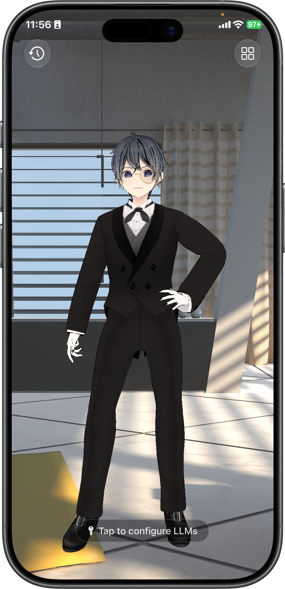
    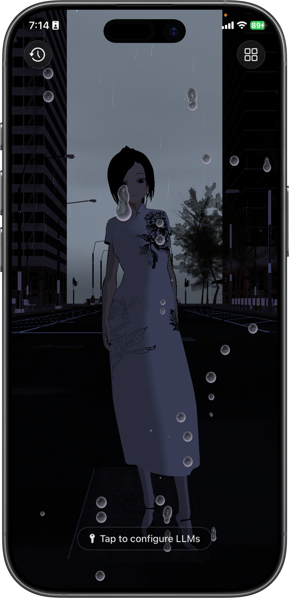
    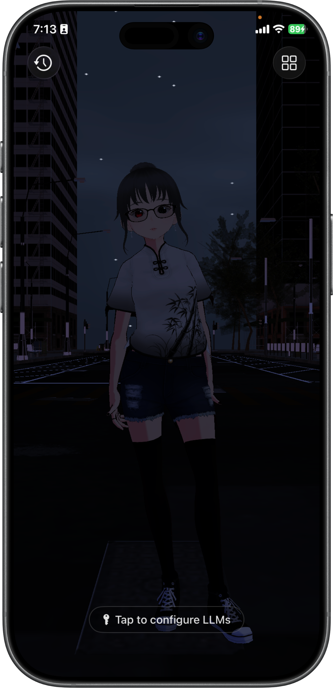
</p>

<p align="center">
  
  
  
  
  
  
  
  
  
  
  
</p>

A high-performance, native iOS VRM character viewer and AI companion built from the ground up using **Metal** and **SwiftUI**. NeuraLink connects to the OpenAI Realtime API via **WebRTC** for ultra-low latency mic capture and AI audio playback, and can run fully offline with on-device speech recognition, language models and voices.

---

## ✨ Features

<table>
  <tr>
    <td><strong>Native Metal Engine</strong><br/>Custom MToon shaders, GPU morph targets and skinning, MSAA and outline passes.</td>
    <td><strong>Spring-Bone Physics</strong><br/>The VRMC_springBone solver for hair, skirts and accessories, with sphere and capsule colliders (VRM 0.x and 1.0).</td>
  </tr>
  <tr>
    <td><strong>Realtime Sky System</strong><br/>The real sun, moon phase and stars for the user's time and place, lighting the character. See <a href="./docs/Engine/Sky_System.md">Sky System</a></td>
    <td><strong>Procedural Rain System</strong><br/>World-space rain streaks and liquid-glass drops on the lens, on a natural weather cycle.</td>
  </tr>
  <tr>
    <td><strong>Agentic Memory</strong><br/>Fact types, an entity graph and hybrid recall, all on device, so the companion remembers what matters. See <a href="./docs/Memory/AGENTIC_MEMORY.md">Agentic Memory</a></td>
    <td><strong>Lip-Sync</strong><br/>Mouth shapes read from the audio as it plays, on both the Realtime and the local voice path. See <a href="./docs/Engine/LipSync.md">Lip-Sync</a></td>
  </tr>
  <tr>
    <td><strong>Living Companion</strong><br/>Diary reflections after each session, proactive greetings, keepsakes, mini-games, desk presence and an inner life that opens up as you grow close. See <a href="./docs/Companion/LIVING_COMPANION.md">Living Companion</a></td>
    <td><strong>Presence Beyond the App</strong><br/>Voice chat with the screen off, home-screen widgets and a Live Activity. See <a href="./docs/Companion/PRESENCE_BEYOND_APP.md">Presence Beyond the App</a></td>
  </tr>
  <tr>
    <td><strong>Generative Motion</strong><br/>Gestures generated on device from what the character says (ARDY via ONNX Runtime). See <a href="./docs/Engine/GENERATIVE_MOTION.md">Generative Motion</a></td>
    <td><strong>Character Customization</strong><br/>Recolour hair, eyes and clothes, or swap whole parts between characters, live on the scene. See <a href="./docs/Engine/CHARACTER_CUSTOMIZATION.md">Character Customization</a></td>
  </tr>
  <tr>
    <td><strong>Proactive Vision</strong><br/>Periodically captures frames to "see" the user's world and comment on it autonomously.</td>
    <td><strong>Interactive Photoshoot</strong><br/>The AI can strike poses, look at the camera, and hide the UI for clean screenshots.</td>
  </tr>
  <tr>
    <td><strong>"Eyes on You" System</strong><br/>Arknights: Endfield-inspired camera tracking — characters maintain eye contact by turning their heads toward the camera after 5 seconds.</td>
    <td><strong>Physical Interaction</strong><br/>Direct 3D raycasting lets the user "touch" or "pat" the character with haptic feedback.</td>
  </tr>
  <tr>
    <td><strong>Song Recognition</strong><br/>"What song is this?" — ShazamKit finds the track and the persona reacts in character. See <a href="./docs/Companion/SONG_RECOGNITION.md">Song Recognition</a></td>
    <td><strong>Dual-Layer VAD</strong><br/>Client-side Silero VAD (v5) alongside OpenAI's server VAD for instant local voice detection and immediate UI feedback.</td>
  </tr>
  <tr>
    <td><strong>Per-Character Personas</strong><br/>Each character carries their own system prompt, voice and relationship bond, hot-swapped on model selection.</td>
    <td><strong>Fully Offline AI</strong><br/>whisper.cpp (STT), Llama-3.2 / LLM-jp-3 (LLM) via llama.cpp on the Metal GPU or CPU, and OpenVoice / VOICEVOX voices. See <a href="./docs/AI/Local_SLM_Model.md">On-Device LLM</a></td>
  </tr>
</table>

---

## 📚 Documentation

Feature documentation lives in [`docs/`](./docs), one folder per area.

| Area | Document | What it covers |
| :--- | :--- | :--- |
| **AI** | [Chat & LLM](./docs/AI/CHAT_LLM.md) | The conversation layer on both backends: tool calls, barge-in, reconnect, chat history |
| | [On-Device LLM](./docs/AI/Local_SLM_Model.md) | llama.cpp engines, shipped models, memory residency on 4 GB phones, turn latency |
| | [Voice Architecture](./docs/AI/LLM_VOICE.md) | The local TTS pipeline next to the OpenAI Realtime audio path |
| | [Function Calling](./docs/AI/Function_Call.md) | The tools the companion can call and how each one runs |
| | [OpenAI Realtime](./docs/AI/OPENAI_REALTIME.md) | The cloud voice path: handshake, session config, events, mic gating, phantom transcripts |
| | [API Usage Dashboard](./docs/AI/API_USAGE.md) | Estimated spend, tokens and requests per model |
| **Memory** | [Agentic Memory](./docs/Memory/AGENTIC_MEMORY.md) | Retain, recall, reflect: the on-device Hindsight port |
| | [Memory Ownership](./docs/Memory/MEMORY_OWNERSHIP.md) | Export, the weekly recap, the timeline and photoshoot sharing |
| **Companion** | [Living Companion](./docs/Companion/LIVING_COMPANION.md) | Reflection, personality evolution, proactive engagement, games, desk presence, keepsakes |
| | [Companion Depth](./docs/Companion/COMPANION_DEPTH.md) | Follow-ups on plans the user mentioned, photo memories |
| | [Presence Beyond the App](./docs/Companion/PRESENCE_BEYOND_APP.md) | Background voice sessions, widgets, the Live Activity, App Intents |
| | [Song Recognition](./docs/Companion/SONG_RECOGNITION.md) | ShazamKit matching, persona reactions, co-listening |
| **Engine** | [Sky System](./docs/Engine/Sky_System.md) | The procedural sky, sun, moon and stars, and the lighting they drive |
| | [Lip-Sync](./docs/Engine/LipSync.md) | Visemes, the audio analysis and the timing on both voice paths |
| | [Generative Motion](./docs/Engine/GENERATIVE_MOTION.md) | Text-to-motion with ARDY on device, streamed into the animation player |
| | [Character Customization](./docs/Engine/CHARACTER_CUSTOMIZATION.md) | Recolouring, texture borrowing and part grafting between VRMs |
| **Security** | [App Security](./docs/Security/APP_SECURITY.md) | Threat model, storage inventory, Keychain layout, download pinning, privacy manifest |

Images used by the docs and this README are in [`docs/Assets/`](./docs/Assets). The code layout is described in [CONTRIBUTING.md](./CONTRIBUTING.md#project-structure).

---

## 🌤️ Realtime Sky System

NeuraLink renders a fully procedural, physically-inspired sky backdrop that **follows the user's real clock and place** — the sun rises and sets at the real times, the moon shows tonight's phase, and the real constellations turn through the night.

| Before dawn | Sunrise | Morning | Noon |  
|:---:|:---:|:---:|:---:|
| 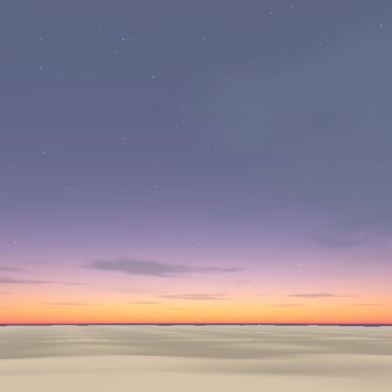 | 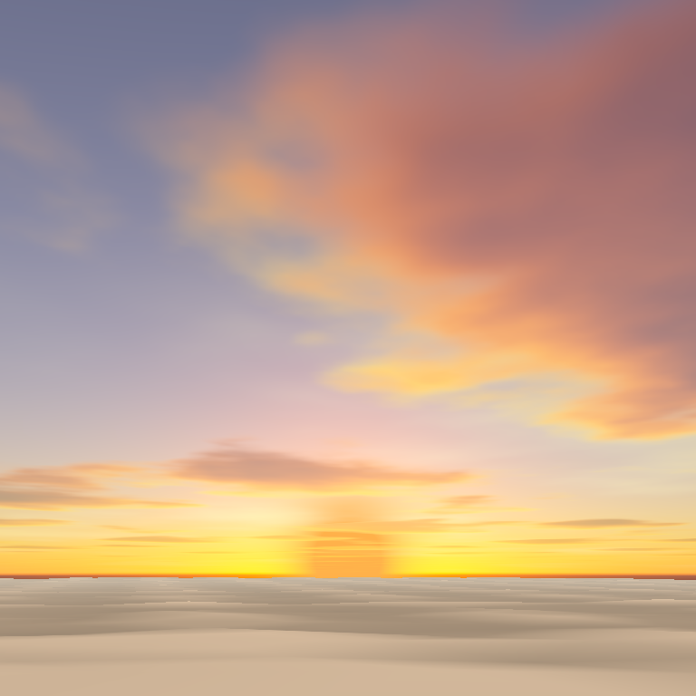 | 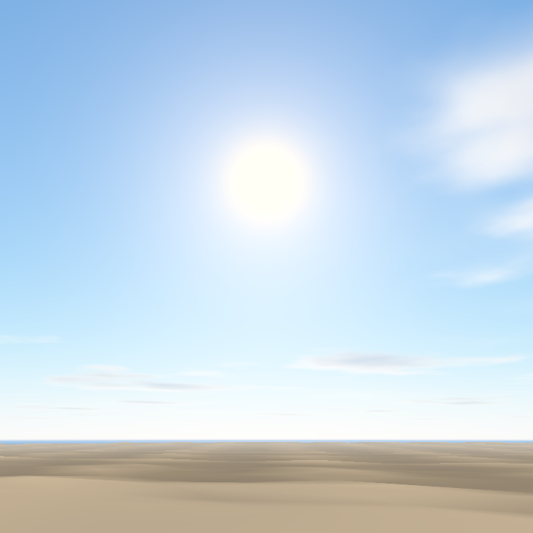 | 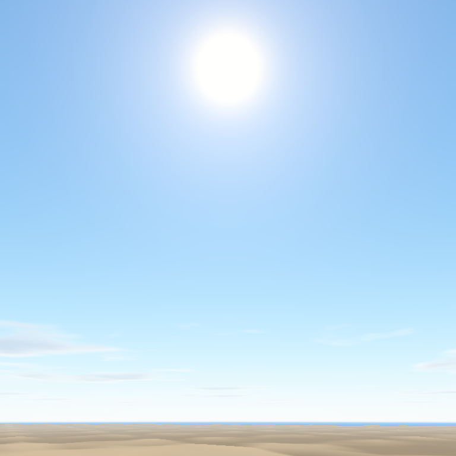 |
| **Afternoon** | **Sunset** | **Dusk** | **Night, toward the moon** |
| 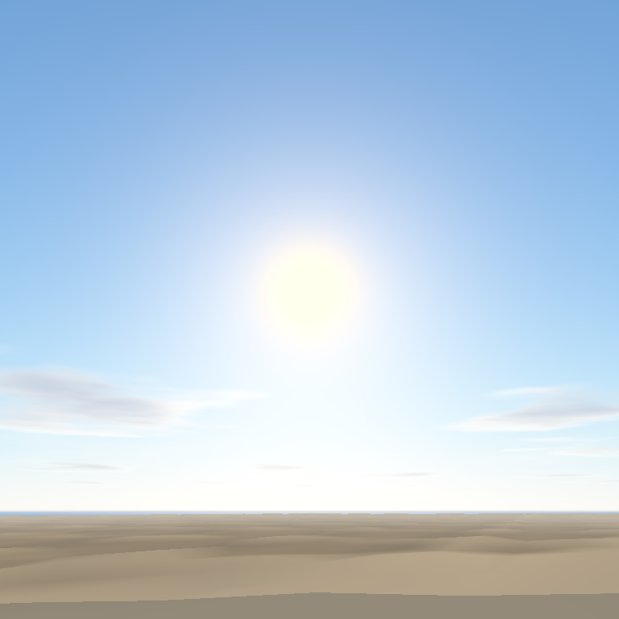 | 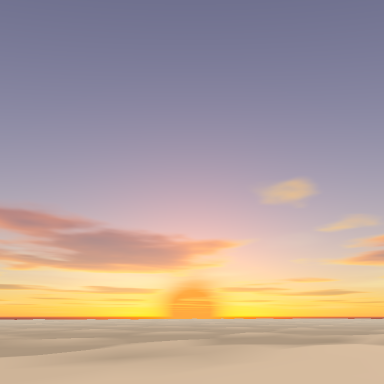 | 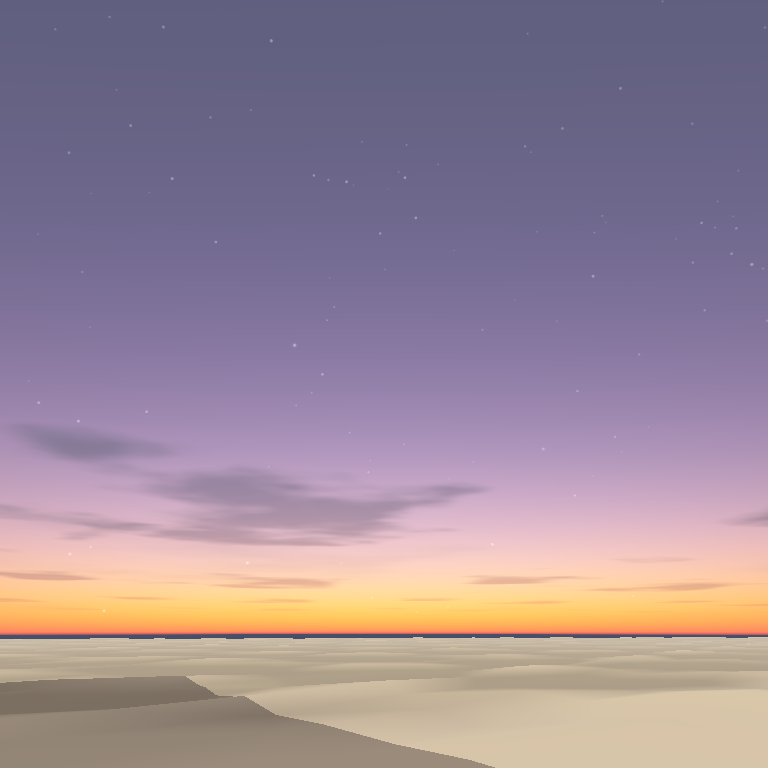 | 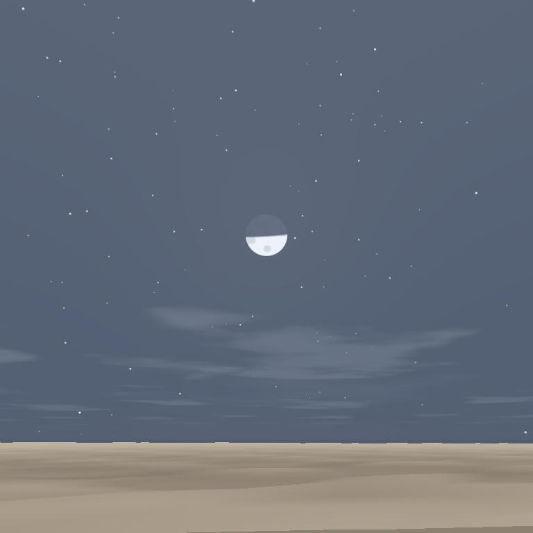 |


Key highlights:

- **Clock-driven** — `SkyTimeProvider` reads the device's local calendar every frame; no manual configuration required.
- **Physically based atmosphere** — Rayleigh, Mie and ozone scattering through GPU look-up tables, with two procedural cloud layers, the sun disc with bloom and the moon in one fullscreen draw, and a bright-star catalogue drawn on top.
- **Unified lighting** — the resolved sky drives a key / fill / rim light rig that keeps the VRM character consistently lit against the sky at every hour.
- **No image assets** — the atmosphere tables and the cloud noise are computed on the GPU at runtime.

**[Full Sky System documentation](./docs/Engine/Sky_System.md)**

---

## 🌧️ Procedural Rain System

NeuraLink's rain falls in the world, runs down the lens and darkens the sky, all from one shared intensity.

- **Weather Cycles**: Rain doesn't just "turn on"—a `RainController` state machine fades it in, holds it for a few minutes, fades it out and waits before the next shower.
- **In the world**: 1,500 streaks animated entirely in the vertex shader from spawn points uploaded once, skipped indoors.
- **On the lens**: drops simulated on the CPU are written into a water map and drawn as a liquid-glass overlay over the finished frame.
- **In the sky**: cloud coverage closes into a full low deck while it rains.
- **Thermal-aware**: the intensity is scaled down on the reduced pressure tier and to zero on the minimal one.

---

## 🤖 Tool Calling

The AI companion isn't just for chat—it can help you manage your day by interacting with native iOS applications. Anything that opens another app waits for a tap on the in-app phone widget.

- **Live Weather**: Get real-time weather reports powered by Open-Meteo.
- **App Integration**: Open Maps, Camera, Photos, or Settings via voice command.
- **Productivity**: Create reminders, take notes, and search the web without leaving the app.
- **Entertainment**: Search and play music directly in Apple Music, or identify the song that's playing.
- **Memory**: Remember a fact on request, or search what it already remembers.

**[Full Tool Calling documentation](./docs/AI/Function_Call.md)**

---

## 🫆 VRM Specifications

NeuraLink follows the official **VRM ecosystem standards** to ensure compatibility, realism, and expressive avatars.

| Category | Specification |
|----------|---------------|
| **Core** | [VRM 1.0](https://github.com/vrm-c/vrm-specification/tree/master/specification/VRMC_vrm-1.0) • [VRM 0.x](https://github.com/vrm-c/vrm-specification/tree/master/specification/0.0) |
| **Materials**| [MToon 1.0](https://github.com/vrm-c/vrm-specification/tree/master/specification/VRMC_materials_mtoon-1.0) |
| **Physics**  | [Spring-Bone 1.0](https://github.com/vrm-c/vrm-specification/tree/master/specification/VRMC_springBone-1.0) |
| **Animation**| [VRM Animation 1.0](https://github.com/vrm-c/vrm-specification/tree/master/specification/VRMC_vrm_animation-1.0) |

## 🛠️ Architecture

### Real-time Audio & LipSync Pipeline

NeuraLink uses a high-efficiency dual-VAD pipeline to minimise latency between the user's voice and the AI's response.

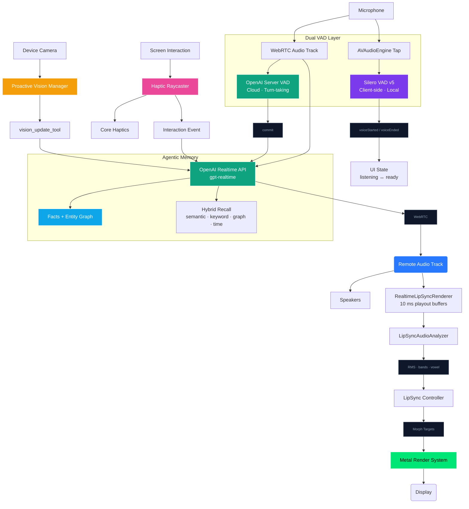

### AI Voice & Persona System

Each character model carries their own system prompt and OpenAI voice model, applied automatically on selection.

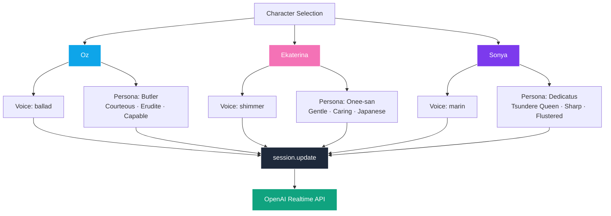

### Model Loading & Rendering

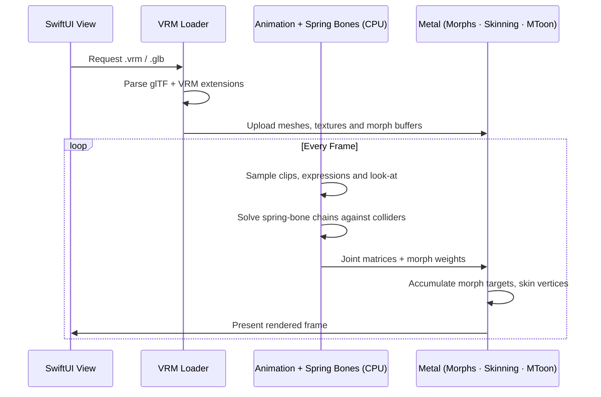

---

## ⚙️ Requirements

| Component | Minimum Version |
| :--- | :--- |
| **Operating System** | iOS 26.2+ |
| **Development** | Xcode 26.2+ |
| **Language** | Swift 6.2 toolchain |
| **Hardware** | iPhone 11 (A13 Bionic) or newer |

---

## ⬇️ Installation

```bash
# Clone the repository
git clone https://github.com/kevinliddel/NeuraLink.git
cd NeuraLink

# Initialize submodules (llama.cpp and DropDown)
git submodule update --init --recursive

# Open in Xcode
open NeuraLink.xcodeproj

# Setup Local AI Backend (Optional)
# If you intend to use the llama.cpp backend, ensure stale SPM references are purged:
ruby purge_spm.rb
```

Large assets (3D environments, voices, model weights) are not in the repository: the app downloads them on first use from Hugging Face and checks each one against a pinned SHA-256 hash.

---

## 🧩 Proof of Concept

[Proof-of-Concept](https://github.com/user-attachments/assets/2dc35314-fa8e-4b78-8507-b88d96d8c420)


## ֎ Offline AI
NeuraLink features a high-performance local AI pipeline that runs **entirely on your device** via llama.cpp — on the Metal GPU on every device, with a CPU fallback. No cloud, no Apple Neural Engine.

- **whisper.cpp**: Multi-lingual speech-to-text via `whisper.xcframework` running the `ggml-base` model on the CPU.
- **llama.cpp**: Metal/CPU inference for Llama-3.2-1B (English) and LLM-jp-3 1.8B (Japanese), shipped as single-file GGUF.
- **Memory-resident by design**: models are quantized to fit in RAM on 4 GB devices, so weights aren't streamed from flash.

For the full architecture — engine selection, the shared C++ bridge, memory residency, and turn latency — see:
- [On-Device LLM Architecture](./docs/AI/Local_SLM_Model.md)
- [Chat & LLM](./docs/AI/CHAT_LLM.md) — grammar-constrained tool calls and barge-in on the local path

---

## ֎ Offline AI Voices

When running in **Offline Mode** (Local LLM), the system selects a TTS engine per persona — **VOICEVOX** for the Japanese model (LLM-jp-3), **OpenVoice** (MeloTTS + tone-color converter, ONNX, 22.05 kHz) for every other persona, and Apple's **AVSpeechSynthesizer** as the last-resort fallback.

### 🗣️ Local SLMs voice
The selector logic, per-persona voice picker, and end-to-end audio pipelines (LLM → text chunks → engine → PCM buffers → AVAudioPlayerNode) are documented separately:

- [LLM_VOICE](./docs/AI/LLM_VOICE.md) — full architecture with mermaid diagrams comparing the local-LLM TTS path against the OpenAI Realtime audio path.

#### Improving the AVSpeechSynthesizer fallback
When the system falls through to the iOS speech synthesizer (no VOICEVOX model, no OpenVoice assets), iOS uses compact voices (`q=1`) which can sound robotic. To improve fidelity:

1.  Open **Settings** on your iPhone.
2.  Navigate to **Accessibility** → **Read & Speak** → **Voices**.
3.  Select your language (e.g., **English**).
4.  Find the voice you wish to use (e.g., **Shelley**, **Ava**, or **Matilda**) and tap the download icon for the **Enhanced** or **Premium** version.
5.  Once downloaded, the system will automatically jump from `q=1` to `q=2`, providing a dramatically more lifelike experience.

### 🛠️ Implementation Details
- [TTSEngineSelector.swift](./NeuraLink/Data/DataSources/TTS/TTSEngineSelector.swift) — engine resolution per persona + model (Japanese / LLM-jp-3 → VOICEVOX, else OpenVoice, System TTS fallback).
- [LocalLLMManager+TTS.swift](./NeuraLink/Data/DataSources/LocalLLM/Manager/LocalLLMManager+TTS.swift) — chunked synthesis pipeline that pumps engine PCM buffers into the playback graph.

---

## 🔒 Security & Privacy

NeuraLink is designed for the realistic threat model of a **lost, stolen, or filesystem-dumped iPhone** — not a runtime debugger on a jailbroken device. Every piece of on-disk state has a defense layer matched to its sensitivity, and conversation content stays out of release-build system logs.

| Layer | What it protects | How |
|---|---|---|
| **Keychain** | OpenAI API key, SQLCipher page key, KV-cache encryption key | `kSecAttrAccessibleAfterFirstUnlockThisDeviceOnly` — unreadable from a cold-boot extraction. Never iCloud-synced, never restored to a different device. |
| **iOS Data Protection** | Conversation DB, personas, local-LLM prompts, user profile, transient audio | `.completeUntilFirstUserAuthentication` on `Application Support/private/` (excluded from backups) — unreadable until the user unlocks the device once after boot. |
| **SQLCipher (opt-in)** | Per-message page-level crypto on the conversation DB | AES-CBC + HMAC pages keyed from a 32-byte Keychain secret. Off by default; flag-gated as the foundation for a future passphrase mode. |
| **KV-cache encryption** | Persistent KV cache blobs | AES-256-GCM sealed box (12-byte nonce + ciphertext + 16-byte tag), keyed from a 32-byte Keychain secret; the GCM tag also provides integrity. An undecryptable/tampered blob falls back to a cold prefill. |
| **Download pinning** | Model weights, voices, 3D assets | Hugging Face downloads use commit-pinned URLs and must match a pinned size + SHA-256 before they are used. |
| **Sensitive logging** | Chat transcripts, persona prompts, memory bodies | `nlLogSensitive` marks payloads as `.private` so they're redacted in observer-readable Console.app captures (TestFlight testers, MDM log capture). Release builds compile out all `nlLog` calls entirely. |
| **Transient files** | None for STT | whisper.cpp consumes in-memory 16 kHz float samples directly — no audio is written to disk. |

The app and the widget extension each ship a privacy manifest (`PrivacyInfo.xcprivacy`) that declares no tracking; the app's also gives the reason for each required-reason API it uses.

**Explicitly out of scope** (closing these would require a different threat model): runtime debugger on a jailbroken device, server-side compromise at OpenAI, screen-recording leaks, side-channel attacks on the Apple Neural Engine.

**[Full security architecture](./docs/Security/APP_SECURITY.md)** — covers the storage inventory, Keychain layout, KV-cache encryption rationale, download pinning, and the full threat model.

---

## ⚖️ License

NeuraLink is released under the **MIT License** — you are free to use, modify, and distribute this software for any purpose. See [LICENSE](./LICENSE) for the full text.
