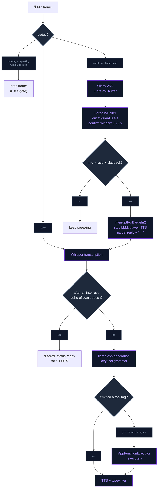
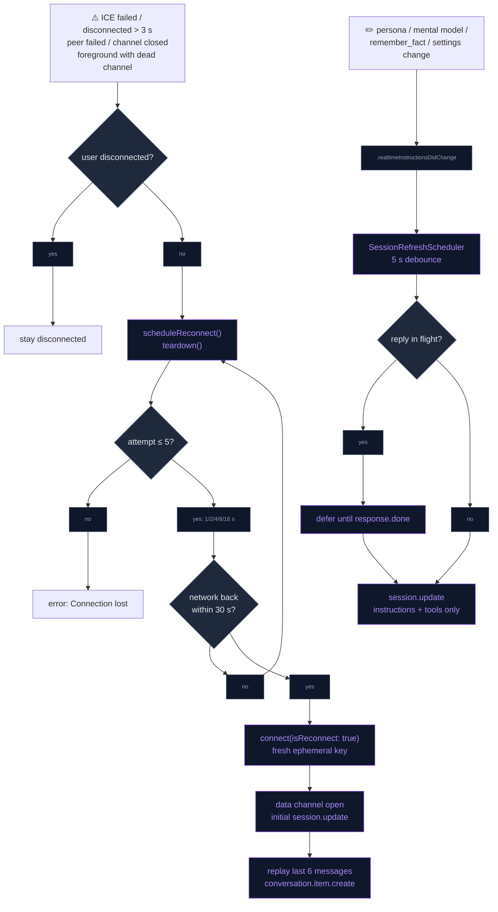

# Chat & LLM

The conversation layer on both backends: the **local path** (Llama 3.2 1B /
LLM-jp 1.8B via llama.cpp) gets grammar-constrained tool calls and barge-in; the
**OpenAI Realtime path** reconnects by itself, refreshes its instructions
mid-session and uses a curated per-role model choice with token metering; and
chat history is searchable. Voice chat is voice-only (there is no typed input).
Long-term memory, which both backends share, is described in
[AGENTIC_MEMORY.md](../Memory/AGENTIC_MEMORY.md), the Realtime transport in
[OPENAI_REALTIME.md](OPENAI_REALTIME.md).

## Grammar-constrained local tool calls

Local replies stay free-form speech. A **lazy GBNF grammar** engages only once
the model emits `<tool` (trigger pattern `[\s\S]*?(<tool)`); from then on
sampling is constrained to a valid `<tool name="…">{…}</tool>` call, so a 1–2B
model cannot produce malformed JSON.

- **One source of truth.** `ToolGrammarBuilder` turns the curated local tool set
  (`ToolGrammarBuilder.localToolNames`: `remember_fact`, `search_memory`,
  `get_weather`, `create_reminder`, `play_music`) from the `AppFunctionTool`
  schemas into both the grammar and the one-line-per-tool prompt block, so
  prompt and grammar never disagree. Supported property types: `string`,
  `string` + `enum`, `number`, `integer`, `boolean`; required keys come first in
  the schema's `required` order, optional keys (alphabetical) may follow. A tool
  with any other property type is skipped.
- **Bridge.** `llama_bridge_set_tool_grammar` / `llama_bridge_clear_tool_grammar`
  rebuild the sampler chain as lazy-grammar → penalties → top_k → top_p → temp →
  dist. Prompt-lookup decoding (PLD) is bypassed while a grammar is active, so the
  grammar's accept bookkeeping only runs in the standard loop. Because the grammar
  stays installed for the whole load, the Llama 1B engine always generates in the
  standard loop; PLD only runs on the LLM-jp engine (or if the grammar was
  rejected).
- **Install once per load.** `GGUFLlamaEngine+ToolGrammar` installs the grammar
  when the model loads (no per-turn sampler swap). `LLMEngineProtocol.setToolGrammar`
  defaults to a no-op returning `false`, so the LLM-jp engine (`GGUFLLMjp3Engine`)
  has no grammar.
- **Early stop.** The token callback stops generation as soon as the text ends
  with `</tool>`.
- **Dispatch.** At end of generation `LocalLLMManager+Engine` parses the first
  tool block (`LocalToolCallParser`); if its name is in the curated set it runs
  through `AppFunctionExecutor.shared.execute`, and the result is logged to the
  timeline, typed and spoken. The silent bookkeeping tools
  (`ChatTimelineStore.isSilentTool`: `search_memory`, `remember_fact`) do
  neither. There is no second generation on the local path, so a `search_memory`
  result is not fed back to the model. Tool blocks are stripped from the
  transcript.
- **Prompt.** The `.llama1b` default prompts in `LocalLLMPromptStore` embed the
  generated tool block.

## Barge-in on the local path

The user can interrupt the assistant mid-reply. While `.speaking`, mic frames
reach Silero VAD instead of being dropped; `.thinking` keeps the plain mic gate
(nothing is playing, so there is no loop risk and first-token latency is
unaffected).

- **Two-signal arbiter** (`BargeInArbiter`, pure value type). A Silero voice
  start opens a candidate only if playback has run ≥ 0.4 s (TTS onset guard).
  Over the next 0.25 s the arbiter averages mic RMS and playback RMS; it commits
  only when mic ≥ 0.01 (silence floor) and mic > 1.5 × playback, otherwise it
  rejects.
- **Interrupt** (`interruptForBargeIn`): stops the LLM, the player node and the
  active TTS engine, clears the TTS/tag buffers and pending UI action, ends the
  phone episode and the typewriter, appends " —" to the partial transcript, and
  moves to `.listening` with the 0.5 s pre-roll kept so the first syllable
  survives.
- **Echo guard** (`BargeInEchoGuard`). After an interruption, a transcript that
  is empty or whose words overlap ≥ 80 % with the assistant's last 12 words is
  treated as our own speech leaking back: it is discarded, status returns to
  `.ready`, and the energy ratio rises by 0.5. The arbiter lives on the
  `LocalLLMManager` singleton, so the raised ratio holds until the app relaunches.
- **Setting.** Autonomy → Talking → "Interrupt while speaking"
  (`OpenAISettings.isLocalBargeInEnabled`, key `com.neuralink.localllm.bargeIn`),
  one of the switches the Autonomy presets set; greyed out while the local model
  is off. Defaults on for devices with ≥ 5 GB RAM, off on the 4 GB tier.

## Realtime auto-reconnect with context resume

A dropped WebRTC session recovers on its own instead of sitting in a dead
`.ready` state.

- **Failure detection.** ICE `.failed`; ICE `.disconnected` that persists past a
  3 s grace; peer connection `.failed`; data channel closed while connected; and
  a foreground return whose data channel is no longer open.
- **Backoff** (`ReconnectPolicy`): 1, 2, 4, 8, 16 s, at most 5 attempts. Each
  attempt tears down the transport, sleeps its delay, then waits up to 30 s for
  the network (`NetworkWaiter`). Still offline counts as a failed attempt;
  online calls `connect(isReconnect: true)`, which mints a fresh ephemeral key.
  Status shows `.reconnecting(attempt:)` — "Reconnecting… (n)" in the overlay.
  After the last attempt the session ends with "Connection lost".
- **User intent wins.** `disconnect()` (user action / OpenAI toggled off) sets
  `userRequestedDisconnect` and cancels any pending reconnect; `teardown()`
  releases the transport without touching reconnect bookkeeping.
- **Context resume.** When the data channel reopens after a reconnect, the last
  6 spoken messages (user and assistant, `kind == "message"`) of the active
  conversation are replayed as `conversation.item.create` items (user →
  `input_text`, assistant → `text`). No `response.create` is sent; the user
  speaks next.
- **Single send path.** `send(_:)` serialises every data-channel event and drops
  (with a log) anything sent while the channel is not open.

## Mid-session instruction refresh

Instructions aren't frozen at connect. Anything that feeds them posts
`.realtimeInstructionsDidChange` (`OpenAIRealtimeManager.postInstructionsChanged`),
and the manager re-sends `session.update` with **instructions + tools only**
(never `voice`, which the API rejects once audio is in flight). Both the initial
update and the refresh use `buildSessionInstructions()`.

- **Scheduler** (`SessionRefreshScheduler`): 5 s debounce, so a burst of edits
  produces one update; if a reply is in flight (`.thinking` / `.speaking`) the
  refresh is deferred and flushed on `response.done`.
- **Triggers:** persona prompt save, mental-model refresh (when content
  changed), `remember_fact`, the User Settings Done button, disposition edits,
  photo memories, follow-up planning and the Siri "remember" intent.

## Model selection and cost logging

AI Settings → OpenAI → **Models** (`ModelsSettingsView`) has one section per
role, each a fixed, curated dropdown (`ModelPickerRow` over `DropDownSelector`);
there is no free-text model entry. The row and the screen are disabled while
OpenAI is off.

| Role | Setting | Used by |
|---|---|---|
| Voice model | `OpenAISettings.realtimeModel` | Ephemeral-key mint in the handshake |
| Transcription model | `OpenAISettings.transcriptionModel` | Input transcription in the initial `session.update` |
| Background text model | `OpenAISettings.textModel` | `OpenAIChatClient` (memory extraction, summaries, chat titles, reflections) and `VisionAnalyzer` (camera frames, photo memories) |

- **Catalog.** The lists live in `OpenAIModelCatalog.swift`: realtime models,
  transcription models, and a text list of GPT-4.x, GPT-5.x and GPT-6 Chat
  Completions models that support function calling and image input. The first
  entry of each list is the role's default. See that file for the current ids.
- **Stored values.** Choices persist in UserDefaults
  (`com.neuralink.openai.model.realtime` / `.transcription` / `.text`). An
  unset, blank or no longer catalogued id falls back to the role's default, so a
  stale id never reaches OpenAI.
- **Reasoning effort.** A catalog entry can carry a `reasoning_effort` (`none`,
  or `minimal` on the original GPT-5 models), which `OpenAIChatClient` and
  `VisionAnalyzer` send with the request. This keeps short background calls
  (chat titles at 16 tokens, reflections at 240) from spending their whole
  completion budget on reasoning and returning nothing. GPT-5/6 ids also get no
  `temperature` (`OpenAIChatClient.supportsTemperature`), which they reject.
- **Applying a change.** A realtime model change reconnects the session when AI
  Settings is closed with Done; a transcription model change applies from the
  next connect; the text model applies on its next call.
- **Speech previews.** The persona voice preview and transcript read-aloud call
  `/v1/audio/speech` with a fixed `tts-1`; it is not a selectable role.
- **Cost logging.** `RealtimeUsageMeter` accumulates `usage` from every
  `response.done` (input/output, audio, cached tokens) and logs one
  `[Cost] realtime …` line at teardown; `OpenAIChatClient` logs
  `[Cost] text model=… in=… out=…` per call. Every metered call is also
  stored and charted on the Usage dashboard — see [API_USAGE.md](API_USAGE.md).
  Catalog entries carry list prices for its spend estimate.

## Chat history search

A search field at the top of `ChatHistorySidebar` filters conversations by title
or message text (150 ms debounce) through `ConversationStore.conversations(matching:)`
(SQL `LIKE`). While a query is active each row previews the first matching
message (`MemoryStore.firstMessage(conversationID:matching:)`) as a 90-character
snippet centred on the match (`MemoryStore.snippet`). No results shows
"No chats mention "…"".

## Memory

Both backends read and write the same long-term memory. Its opt-in
multilingual embedding model, the evaluation harness, per-character memory
banks and the Memory Personality sliders are described in
[AGENTIC_MEMORY.md](../Memory/AGENTIC_MEMORY.md). Whether characters share
memories controls what a character knows, not how close you are: the
relationship meter is always per character
([LIVING_COMPANION.md → One bond per character](../Companion/LIVING_COMPANION.md#one-bond-per-character)).

## Flow

### Local turn: tool call and barge-in

### Realtime session: reconnect and instruction refresh

## Files

| File | Role |
|---|---|
| `Core/Bridge/llama_bridge.h` / `.cpp` | `set/clear_tool_grammar`; lazy-grammar sampler chain; PLD bypass while a grammar is active |
| `Data/DataSources/LocalLLM/Tools/ToolGrammarBuilder.swift` | Curated local tool set → GBNF grammar + prompt block |
| `Data/DataSources/GGUF/Llama/GGUFLlamaEngine+ToolGrammar.swift` | Installs the tool grammar once per model load |
| `Data/DataSources/GGUF/Llama/GGUFLlamaEngine+Generate.swift` | Stops generation at `</tool>` |
| `Data/DataSources/LocalLLM/Manager/LocalLLMManager+Engine.swift` | Parses and dispatches local tool calls through `AppFunctionExecutor` |
| `Data/DataSources/LocalLLM/Tools/LocalToolCallParser.swift` | First `<tool …>` block in the reply; strips tool blocks from the transcript |
| `Data/DataSources/Memory/ChatTimelineStore.swift` | `isSilentTool`, tool-result timeline rows |
| `Data/Repositories/LocalLLMPromptStore.swift` | 1B default prompts embed the generated tool block; save posts an instruction refresh |
| `Data/DataSources/LocalLLM/Manager/LocalLLMManager+BargeIn.swift` | `BargeInArbiter`, `BargeInEchoGuard`, interrupt sequence |
| `Data/DataSources/LocalLLM/Manager/LocalLLMManager+Audio.swift` / `+VAD.swift` | Frames reach the VAD while speaking; voice-start and echo hooks |
| `Presentation/Views/Settings/AutonomySettingsView.swift` | "Interrupt while speaking (local)" toggle |
| `Data/DataSources/OpenAI/Realtime/OpenAIRealtimeManager+Reconnect.swift` | `ReconnectPolicy`, failure detection, `send(_:)`, context replay |
| `Core/Utils/NetworkWaiter.swift` | Waits (bounded) for connectivity before a reconnect attempt |
| `Data/DataSources/OpenAI/Realtime/OpenAIRealtimeManager+SessionRefresh.swift` | `SessionRefreshScheduler`, `.realtimeInstructionsDidChange`, refresh `session.update` |
| `Data/DataSources/OpenAI/OpenAIModelCatalog.swift` | Curated per-role model lists, defaults, `reasoning_effort`, list prices; `RealtimeUsageMeter` |
| `Data/DataSources/OpenAI/OpenAISettings.swift` | Model selection per role; `isLocalBargeInEnabled` |
| `Data/DataSources/OpenAI/OpenAIChatClient.swift` | Background text calls on `textModel`, reasoning effort, temperature gate, `[Cost]` lines |
| `Presentation/Views/Settings/Models/ModelsSettingsView.swift` / `ModelPickerRow.swift` | Models screen: per-role dropdowns |
| `Presentation/Views/Settings/AISettingsView.swift` | Reconnects on Done after a voice-model change |
| `Presentation/Views/Chat/ChatHistorySidebar.swift` | Search field, debounce, snippet rows, empty state |
| `Data/DataSources/Memory/Store/MemoryStore+Conversations.swift` | `firstMessage(conversationID:matching:)`, `snippet` |

Tests: `NeuraLinkTests/LocalLLM/` (`ToolGrammarBuilderTests`, `BargeInTests`),
`NeuraLinkTests/Chat/` (`RealtimeReconnectTests`, `SessionRefreshTests`,
`OpenAIModelSettingsTests`, `ChatSearchTests`).

## Integration notes

- **Pure state machines.** `BargeInArbiter`, `ReconnectPolicy`,
  `SessionRefreshScheduler`, `ToolGrammarBuilder` and `RealtimeUsageMeter` are
  `nonisolated` value types, testable without audio, WebRTC or the main actor.
- **Prebuilt llama.xcframework only.** Both bridge features (tool grammar,
  embeddings) use symbols the prebuilt framework exports; `common/json-schema-to-grammar`
  is not linked, which is why GBNF is generated in Swift.
- **Adding a local tool.** Add its name to `ToolGrammarBuilder.localToolNames`;
  prompt and grammar both follow. Every property must be one of the supported
  types or the tool is skipped. Each tool costs 1B prompt tokens.
- **Instruction inputs.** Any new input to the Realtime instructions must call
  `OpenAIRealtimeManager.postInstructionsChanged(reason:)`, or it only applies on
  the next connect.
- **Model ids.** Edit `OpenAIModelCatalog.swift` to add or retire a model; there
  is no in-app custom entry. A retired id silently falls back to the role default.
- **Embedding asset.** Re-uploading the EmbeddingGemma file requires updating
  its SHA-256 pin in `RemoteAssetRegistry`. Changing the model also means a new
  backend id, so stored vectors are re-embedded by the migrator.
- **Logs:** `֎ [FunctionCall]`, `[GGUFEngine] Tool grammar …`, `[BargeIn]`,
  `[AI Reconnect]`, `[AI Refresh]`, `[Cost]`, `[EmbeddingService]`,
  `[EmbeddingMigrator]`, `[MemoryEval]`.

## Troubleshooting

| Symptom | Likely cause |
|---|---|
| `[GGUFEngine] Tool grammar REJECTED` | GBNF failed to parse in llama.cpp; check `ToolGrammarBuilderTests` against the new schema |
| Local model never calls a tool | LLM-jp model (no grammar and no tool block in its prompt), or the tool is not in `localToolNames` / has an unsupported property type |
| Assistant interrupts itself on speaker | Speaker echo beats the 1.5× ratio; each echo rejection raises the ratio by 0.5 until relaunch. Turn barge-in off on that device |
| "Reconnecting…" loops then "Connection lost" | No network within 30 s per attempt, or key minting fails; see `[AI Reconnect]` lines |
| Background titles/reflections come back empty | A reasoning model without a `reasoning_effort` in its catalog entry spent the budget on reasoning |

## Known device-test items

- Grammar-constrained tool calls: `[Bench]` prefill delta of the tool block and the tool-call hit-rate sweep
  on iPhone 11 (4 GB) and a 6 GB device.
- Barge-in: tuning of the energy ratio and onset guard (false barge-ins at 50 % / 100 %
  speaker volume, interruption latency) from the `[BargeIn]` mic vs playback RMS.
- Realtime auto-reconnect: airplane-mode toggle, 10-minute background, ephemeral-key expiry.
