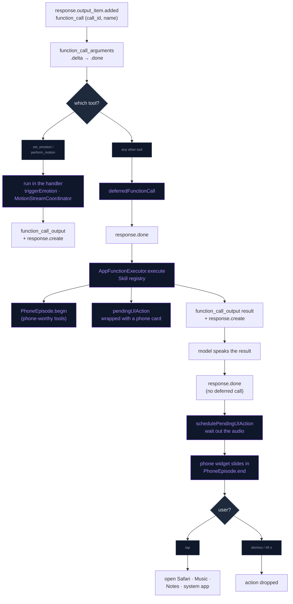

# AI Function Calling

The character can act on the device from inside a conversation: check the
weather, search the web, queue a song, set a reminder, look through the camera,
remember a fact, strike a pose, identify a song, host a game. Each action is a
typed tool. On the OpenAI Realtime path the model calls any of them through the
API's native function calling; on the local Llama path a small curated subset is
called through a grammar-constrained tag. Both paths run the tool through the
same `AppFunctionExecutor`.

Nothing opens another app on its own. A tool that would open Safari, Apple
Music, Notes or a system app prepares the action, the character says what is
ready, and then the in-app **phone widget** slides in; the app opens only when
the user taps the phone.

## Tools

The schemas live in `AppFunctionTool`; `AppFunctionTool.all` is the `tools`
array sent with `tool_choice: "auto"` in every `session.update` (see
[OPENAI_REALTIME.md](OPENAI_REALTIME.md#session-configuration)). Every tool
except the two pre-speech tools is a `Skill` registered in
`AppFunctionExecutor`.

| Tool | Arguments | Runs in | What it does |
|---|---|---|---|
| `set_emotion` | `emotion` (enum, required), `duration` seconds (required) | Realtime handler | Sets the avatar's expression before the reply is spoken |
| `perform_motion` | `caption` (required), `seconds` 2–12 (default 6), `continuous` | Realtime handler | Generated body gesture for the reply; offered only while `MotionSettings.offersTool` |
| `get_weather` | `location` (required) | `WeatherSkill` | Current conditions from Open-Meteo |
| `search_web` | `query` (required) | `WebSearchSkill` | Safari search or URL, on the phone widget |
| `play_music` | `query` (required) | `MusicSkill` | Apple Music search, on the phone widget |
| `create_reminder` | `title` (required), `notes` | `ReminderSkill` | EventKit reminder in the default list |
| `create_note` | `title`, `body` (both required) | `NotesSkill` | Bear or Notes, on the phone widget |
| `open_app` | `app` (enum, required) | `OpenAppSkill` | System app by URL scheme, on the phone widget |
| `analyze_camera` | `prompt` (optional) | `CameraSkill` | Describes the current camera frame |
| `remember_fact` | `subject`, `predicate`, `object` (all required) | `RememberFactSkill` | Files a fact about the user |
| `search_memory` | `query` (required) | `SearchMemorySkill` | Searches long-term memory |
| `pose_for_photo` | `pose` (enum, required) | `PhotoshootSkill` | Pose, hidden UI, photo capture |
| `identify_song` | `mode`: `once` (default) or `session` | `IdentifySongSkill` | ShazamKit match or co-listening session |
| `play_game` | `game` (enum), `action`: `start` (default) or `stop` | `PlayGameSkill` | Starts or stops a spoken mini-game |
| `show_photo` | none | `ShowPhotoSkill` | Opens the photo picker |

The result string a skill returns goes back to the model as the
`function_call_output`, and the model words its spoken reply from it. That is
why results are written as plain sentences ("Done! I've added "Call mom" to
your Reminders."), not JSON.

### set_emotion

`emotion` is one of `happy`, `angry`, `sad`, `relaxed`, `surprised`, `shocked`,
`shy`, `embarrassed`, `bored`, `confused`, `wink`, `neutral`. The schema tells
the model to call it at the very start of every response and never to name the
emotion aloud. It is not a Skill: the Realtime handler applies it the moment the
arguments are complete (`state.triggerEmotion`), so the face changes before any
audio plays, and answers `"ok"` at once. If `emotion` or `duration` is missing
the face is left alone and the result is still `"ok"`. The local path expresses
emotion with `[emotion:seconds]` tags in the reply instead.

### perform_motion

A one-sentence physical caption ("A person waves with the right hand") that the
motion model turns into a gesture stream while the character speaks. Like
`set_emotion` it runs in the handler on arguments-done, through
`MotionStreamCoordinator.request`, and answers `"ok"`, or `"unavailable"` when
the caption is empty or the stream cannot start. The tool and its prompt
instructions are sent only when the user's switch is on and the model files are
ready. See [GENERATIVE_MOTION.md](../Engine/GENERATIVE_MOTION.md).

### get_weather

Geocodes `location` with the Open-Meteo geocoding API (first match), then reads
current temperature, apparent temperature, humidity, wind, rain and the WMO
weather code from the Open-Meteo forecast API (no key). The result reads like
"Current weather in Tokyo: partly cloudy. Temperature 22°C, feels like 20°C.
Humidity 68%, wind 14 km/h." It also gets a display-only phone card: the screen
shows the result and a tap only puts the phone away.

### search_web

A `query` that starts with `http://` or `https://` is opened as is; anything
else becomes `https://www.google.com/search?q=…`. The URL opens in Safari when
the user taps the phone.

### play_music

Queues `music://music.apple.com/search?term=…`, or the `https` form of the
same link when the `music` scheme cannot be opened. The URL opens on the phone
tap.

### create_reminder

Requests full Reminders access (`requestFullAccessToReminders`) on each call,
then saves an `EKReminder` with `title` and optional `notes` to
`defaultCalendarForNewReminders()`. There is nothing to open, so there is no
phone card; the phone episode still plays while the reminder is filed.

### create_note

- **Bear installed**: the tap opens
  `bear://x-callback-url/create?title=…&text=…`.
- **Otherwise**: the tap copies "title + body" to the clipboard and opens
  `mobilenotes://`; the user pastes. The clipboard is touched only on the tap.
- **Neither scheme available**: the text is copied right away.

Clipboard writes are local-only (no Universal Clipboard) and expire after
10 minutes (`NotesSkill.clipboardLifetime`).

### open_app

| `app` | Opened with |
|---|---|
| Maps | `maps://` |
| Photos | `photos-redirect://` |
| Calendar | `calshow://` |
| Settings | `UIApplication.openSettingsURLString` |
| Camera | `camera://` |
| Clock | `clock-alarm://` |
| Health | `x-apple-health://` |
| FaceTime | `facetime://` |

A scheme that `canOpenURL` rejects returns "I wasn't able to open … directly"
and queues nothing.

### analyze_camera

Needs the camera to be on already (`CameraManager.isActive`); otherwise the
result asks the user to enable it. The current frame goes to `VisionAnalyzer`,
which sends it to the configured background text model (vision-capable, Chat
Completions) with `prompt` as the focus, or a general "describe what you see".

### remember_fact and search_memory

`remember_fact` goes to `KnowledgeGraphManager.remember`: an S/P/O row in the
knowledge graph for the current character, mirrored into agentic memory as an
entity-linked fact (`MemoryRetain.retainFact`), and a mid-session instruction
refresh so the new fact reaches the prompt. `search_memory` returns
`MemoryReflect.evidence(for:character:)` (mental models, then observations, then
raw facts), "Nothing relevant in memory." when it finds nothing, or "Long-term
memory is turned off." The session instructions tell the model to call
`remember_fact` silently whenever the user shares a personal detail, and
`search_memory` before answering anything that depends on the past. Both are
bookkeeping: their results are never logged to the chat timeline. See
[AGENTIC_MEMORY.md](../Memory/AGENTIC_MEMORY.md).

### pose_for_photo

`pose` is `cool`, `peace_sign`, `relax` or `stretch`; an unknown value picks one
at random. The skill posts `VRMPlayPoseAnimation` (a feminine pose on a male
character plays its stand-in clip from `AnimationCatalogue`), hides the UI for
5 s, schedules
the photo capture 2 s in (`PhotoshootShareController`), and stops the pose at
6 s. The captured frame is offered in the save/share capsule
([MEMORY_OWNERSHIP.md](../Memory/MEMORY_OWNERSHIP.md#export-and-share)).

### identify_song, play_game, show_photo

- `identify_song` awaits the ShazamKit result and returns it; `"session"` starts
  co-listening instead. See [SONG_RECOGNITION.md](../Companion/SONG_RECOGNITION.md).
- `play_game` starts `twenty_questions`, `trivia` or `word_chain`, or stops the
  running game; the result carries the rules for the model. See
  [LIVING_COMPANION.md](../Companion/LIVING_COMPANION.md#mini-games).
- `show_photo` presents the system photo picker. When a picture is picked, the
  character takes the phone out with the picture on its screen (display-only
  `.photo` card), the picture is described once by the vision-capable text model
  (or the user's own words when OpenAI is off), the character reacts, and the
  moment is remembered as a dated experience with a small thumbnail. See
  [COMPANION_DEPTH.md](../Companion/COMPANION_DEPTH.md#photo-memories).

## How a call runs on the Realtime path

`OpenAIRealtimeManager+Handlers.swift` (`handleIncomingJSON`) tracks one
function call at a time:

| Event | Action |
|---|---|
| `response.output_item.added` with `item.type == "function_call"` | Start a call: keep `call_id` and `name`, reset the argument buffer |
| `response.function_call_arguments.delta` | Append the JSON fragment |
| `response.function_call_arguments.done` | `set_emotion` / `perform_motion`: run now and reply. Anything else: store it as `deferredFunctionCall` |
| `response.done` with a deferred call | Run it through `AppFunctionExecutor.execute`, log it to the timeline, send the result |
| `response.done` without one | If an app action is pending or a phone episode awaits its result, wait for the spoken audio, then present the phone widget and end the episode |

Sending a result is two client events: a `conversation.item.create` holding the
`function_call_output` for the `call_id`, then `response.create` so the model
speaks about it. A tool runs once the response that requested it has finished,
so its result never lands in the middle of an active response; only one
deferred call is held per response.

The wait before the phone appears (`schedulePendingUIAction`) takes the later of
two estimates: the moment the spoken reply started plus `max(characters / 15,
1)` s + 1.5 s, and the `response.output_audio_transcript.done` time + 1.5 s. A
barge-in (`response.done` with status `cancelled`) puts the phone away at once.

## The phone widget

`AppFunctionExecutor.execute` resets the skill's `pendingUIAction`, runs the
skill, then asks `PhoneWidgetManager.card(for:arguments:result:)` for a
`ToolActionCard`:

- **Action and card** (`search_web`, `play_music`, `open_app`, `create_note`):
  the open is wrapped, so after the spoken result the widget presents the card,
  and `openAndDismiss()` performs the open only when the user taps it.
- **Card only** (`get_weather`): a display-only card; the tap just puts the
  phone away.
- **Neither**: nothing is queued.

A newer card replaces the current one. Dismissing the phone or leaving it for
45 s (`PhoneWidgetManager.autoDismissAfter`) drops the action. The skills'
results already say so ("… is ready on my phone — tap it to open."), so the
spoken reply matches what the user sees. On the local path the pending action is
drained by `schedulePendingUIActionAfterSpeech` once the TTS queue is empty.

## Phone episode

While a phone-worthy tool runs (`PhoneEpisodePolicy.tools`: `get_weather`,
`search_web`, `play_music`, `open_app`, `create_note`, `create_reminder`), the
character checks their phone: the body crossfades into `checking_phone.vrma`
and gaze tracking switches off so the clip's head-down tilt toward the hand
shows. Idles, talking gestures, the listening loop and the away loop wait; a
photo pose outranks it. `AppFunctionExecutor` begins the episode before the
skill runs (a chained call joins the running episode), and it ends when the
spoken result finishes, the moment the 2D phone widget slides in. It also ends
on barge-in, a cancelled response, session teardown, engine stop, character
switch, when the clip has played through once, or at the 45 s safety cap.
Emotion, motion, camera, photoshoot, song recognition, games and the memory
tools never trigger it; `show_photo` starts it itself when the picture is
picked. `PhoneEpisodePolicy` is unit-tested in `PhoneEpisodeTests`;
`PhoneEpisode` is the app-wide switch the scene state observes.

The phone is a 3D prop: `mobile_phone.glb` (Sketchfab, CC-BY-4.0 by Rescue3D
Assets), loaded once by `VRMPropLoader` with textures capped at 1024 px and hung
off the right-hand bone of the displayed character (`VRMModel+Props`). Its grip,
`VRMMetalState.phoneGrip`, was tuned on Sonya at the clip's hold; each character
gets the same seat on its own palm, scaled to its hand and refined against the
hand its outfit draws (`VRMModel.seatProp`) when the phone is shown. The phone
appears once the hand has reached the pose and goes away as the arm lowers.
`PhoneGripDiagnostic` and `CheckingPhoneClipDiagnostic` render the grip and the
clip on every rig.

## Local model tool calls

The local Llama path offers five tools (`ToolGrammarBuilder.localToolNames`):
`remember_fact`, `search_memory`, `get_weather`, `create_reminder`,
`play_music`. A lazy GBNF grammar, installed on the llama.cpp sampler once per
model load, leaves sampling free until the model emits `<tool`, after which only
`<tool name="…">{valid JSON for that tool}</tool>` can follow. The grammar and
the prompt's one-line examples (in the Llama 1B default prompts) are generated
from the same `AppFunctionTool` schemas, and generation stops as soon as the
text ends with `</tool>`. `LocalToolCallParser.firstToolCall` reads the tag;
a call outside the curated set is ignored, and tags are always stripped from the
transcript. The call goes through `AppFunctionExecutor`, and the result is shown
and spoken directly, with no second generation; `remember_fact` and
`search_memory` stay silent. Details in
[CHAT_LLM.md](CHAT_LLM.md#grammar-constrained-local-tool-calls).

## Adding a tool

1. In `AppFunctionTool`, add the name constant and a schema (`type`, `name`,
   `description`, JSON-schema `parameters`), and add it to `all`.
2. Add a `Skill` in `Domain/Entities/Skills/`: `static let toolName`, `execute`
   returning a spoken-style sentence, and `pendingUIAction` for anything that
   must wait for the user (an app open).
3. Register it in the list in `AppFunctionExecutor.init`.
4. Where it applies: a card in `PhoneWidgetManager.card(for:)` (an action
   without a card fires right after speech, with no tap); `PhoneEpisodePolicy.tools`
   for a phone moment; `ToolGrammarBuilder.localToolNames` for the local model
   (string, string enum, number, integer and boolean properties only);
   `ChatTimelineStore.silentTools` for bookkeeping tools.

## Flow

The Realtime path, from the model's call to the user's tap:

## Files

| File | Role |
|---|---|
| `Data/DataSources/FunctionCalling/AppFunctionTool.swift` | Tool names and schemas; `all` (adds `perform_motion` when offered) |
| `Data/DataSources/FunctionCalling/AppFunctionExecutor.swift` | Skill registry and dispatch; phone episode start; wraps `pendingUIAction` with the phone card |
| `Domain/Entities/Skills/Skill.swift` | The protocol every tool skill conforms to |
| `Domain/Entities/Skills/*Skill.swift` | One skill per tool |
| `Data/DataSources/OpenAI/Realtime/OpenAIRealtimeManager+Handlers.swift` | Argument streaming, pre-speech tools, deferral to `response.done`, `sendFunctionResult`, `schedulePendingUIAction` |
| `Data/DataSources/OpenAI/Realtime/OpenAIRealtimeManager+SessionConfig.swift` | Sends `tools` + `tool_choice: "auto"`; `remember_fact` / `search_memory` usage rules |
| `Presentation/ViewModels/PhoneWidgetManager.swift` | Card per tool, present / tap-to-open / 45 s dismiss |
| `Presentation/Components/PhoneWidgetView.swift` | The phone widget |
| `Domain/Entities/Chat/ToolActionCard.swift` | Card model (web search, music, app, note, weather, photo) |
| `Domain/Entities/Motion/PhoneEpisode.swift` | `PhoneEpisodePolicy` (tools, 45 s cap) and the app-wide `PhoneEpisode` switch |
| `Core/Engine/VRM/UI/VRMMetalState+PhoneEpisode.swift` | Scene side: clip, gaze, phone prop and grip |
| `Core/Engine/VRM/Props/` | `VRMPropLoader`, `VRMModel+Props`, `VRMPropSeat`, `VRMPalm` |
| `Data/DataSources/LocalLLM/Tools/ToolGrammarBuilder.swift` | Local tool set, GBNF grammar, prompt block |
| `Data/DataSources/LocalLLM/Tools/LocalToolCallParser.swift` | Parses and strips `<tool …>` tags |
| `Data/DataSources/LocalLLM/Manager/LocalLLMManager+Engine.swift` | Local dispatch and spoken result |
| `Data/DataSources/Memory/ChatTimelineStore.swift` | `logToolCall`; silent tools |

## Permissions

| Tool | Needs |
|---|---|
| `create_reminder` | Reminders full access (`requestFullAccessToReminders`); Info.plist declares `NSRemindersUsageDescription` |
| `analyze_camera` | The camera already running (`NSCameraUsageDescription`) |
| `identify_song` | Microphone (`NSMicrophoneUsageDescription`) |
| `play_music`, `create_note`, `open_app` | `LSApplicationQueriesSchemes`: `music`, `bear`, `mobilenotes`, `maps`, `photos-redirect`, `calshow`, `x-apple-health`, `facetime` |
| `show_photo` | None (the system photo picker) |

What leaves the device: `get_weather` sends the location string to Open-Meteo;
`analyze_camera` and `show_photo` send the image to OpenAI Chat Completions;
the app-opening tools hand their query to the opened app only on the user's
tap. Everything else stays on the device or rides the existing Realtime
session.

## Troubleshooting

Debug builds log every call under `֎ [FunctionCall]`: `dispatch name=… args=…`,
`done name=… result=…` (with "deferred UI action queued" when the phone will
appear), and `UNKNOWN tool '…'` with the registered names when a schema has no
skill.

| Symptom | Cause |
|---|---|
| `open_app` Camera or Clock always answers "I wasn't able to open … directly" | `camera` and `clock-alarm` are not in `LSApplicationQueriesSchemes`, so `canOpenURL` returns false |
| The phone appears a moment after the reply ends | It waits for the estimated end of the spoken result (see the wait rule above), not for the audio itself |
| A tool result is spoken but nothing opens | The action waits for the tap on the phone; it is dropped after 45 s |
