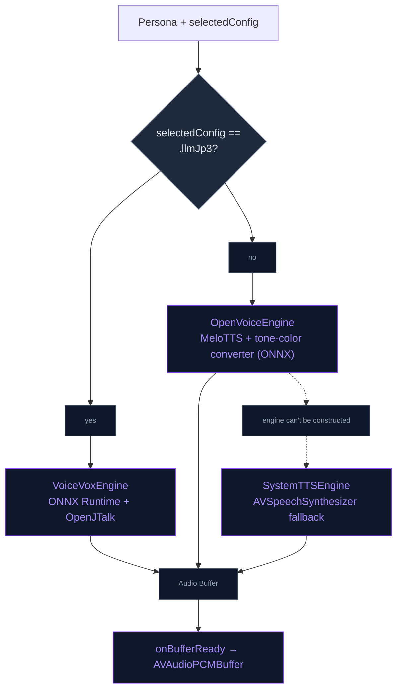
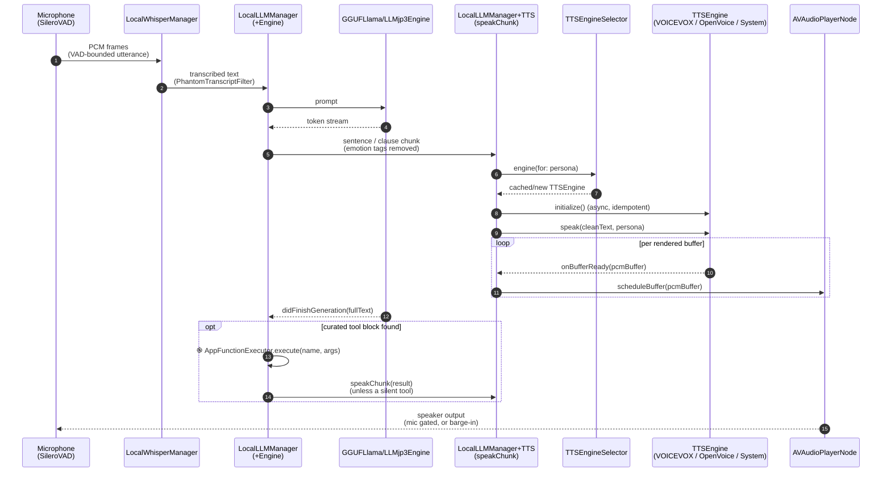
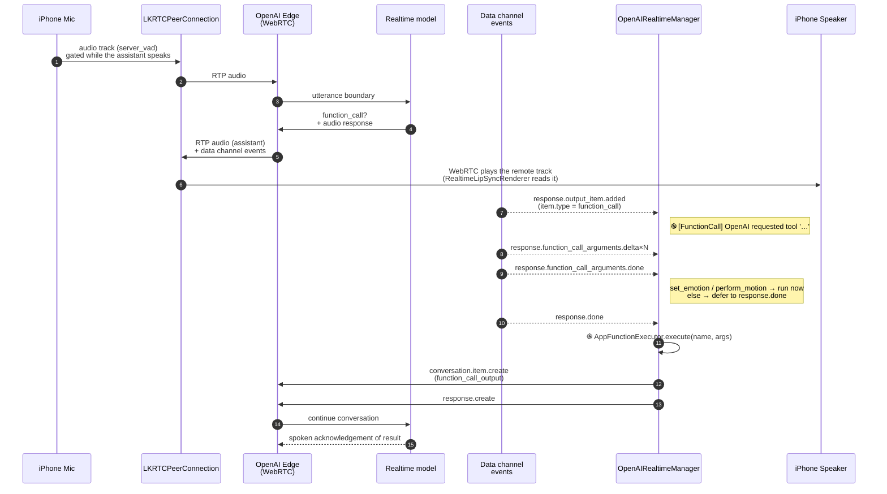

# Voice Architecture — Local SLMs vs. OpenAI Realtime

NeuraLink runs **two completely different audio stacks** depending on whether you've enabled the cloud realtime path or the on-device path in AI Settings. They share nothing at the network/codec level: the local path owns its whole PCM pipeline on the app's `AVAudioEngine`, while on the OpenAI path WebRTC plays the reply itself. What they share is downstream — the Silero VAD, the lip-sync analyser, the acoustic-affect read, tool dispatch and the chat history (see "Where the two pipelines converge").

This doc explains how each pipeline turns a model's output into spoken audio, and is intended to be read alongside the source files it cites. The models themselves are covered in [Local_SLM_Model.md](./Local_SLM_Model.md) and [OPENAI_REALTIME.md](./OPENAI_REALTIME.md).

## Quick comparison

| | **Local SLM path** | **OpenAI Realtime path** |
|---|---|---|
| **What runs on-device** | VAD, speech-to-text (whisper.cpp), LLM inference, TTS synthesis, lip-sync analysis | Microphone capture, Silero VAD, audio playback, lip-sync analysis, function-call dispatch |
| **What runs in the cloud** | nothing | LLM inference, audio synthesis, transcription (for the chat history) |
| **Model** | Llama-3.2-1B or LLM-jp-3 1.8B via llama.cpp | `OpenAISettings.realtimeModel` (default `gpt-realtime-2.1-mini`) |
| **Audio transport** | engine PCM → `AVAudioPCMBuffer` → `AVAudioPlayerNode` → speaker | WebRTC RTP audio track (`LKRTCAudioTrack`), played by WebRTC |
| **Tool calls** | `<tool name="…">{…}</tool>` blocks in the reply text (grammar-constrained on Llama-1B), parsed at the end of generation | structured `function_call` events on the WebRTC data channel |
| **Persona voice** | per-persona override in `PersonaVoiceStore` (VOICEVOX speaker or OpenVoice preset), persisted in the `character_ai` SQL table; else the engine's built-in default | one of OpenAI's named voices (alloy / shimmer / marin / etc.) set at session-mint time |
| **Latency profile** | bounded by on-device transcription, decode and first-chunk synthesis | bounded by network RTT and server generation |

## Local SLM path

When `OpenAISettings.isLocalLLMEnabled = true`, the LLM runs on-device via [`LocalLLMManager`](../../NeuraLink/Data/DataSources/LocalLLM/Manager/LocalLLMManager.swift). Generated text is split into sentence chunks and handed to a TTS engine resolved by [`TTSEngineSelector`](../../NeuraLink/Data/DataSources/TTS/TTSEngineSelector.swift) from the selected local model, cached per persona.

### Engine selection rules



Each engine conforms to [`TTSEngineProtocol`](../../NeuraLink/Domain/Interfaces/TTSEngineProtocol.swift), which is a push-streaming contract: the engine calls back into `onBufferReady` with each PCM buffer it renders, and the player schedules it at once. VOICEVOX renders a whole chunk and returns one buffer; OpenVoice returns one per sentence group; the system voice streams `AVSpeechSynthesizer` buffers. First-audio latency therefore comes from the chunking: the first chunk of a turn is short, so synthesis starts while the LLM is still producing text.

`SystemTTSEngine` is the `??` tail of `resolveEngine`, reached only when no model-specific engine can be built. `OpenVoiceEngine.shared` always is, so an OpenVoice download or initialisation failure surfaces as a thrown `initialize()` / `speak()` — logged as `[TTS] speak failed` — and that chunk stays silent.

### End-to-end flow



Notes on the flow:

- **Chunking**: `LocalLLMManager+Engine.swift` accumulates tokens into chunks for `speakChunk` (in [`LocalLLMManager+TTS.swift`](../../NeuraLink/Data/DataSources/LocalLLM/Manager/LocalLLMManager+TTS.swift)). Hard sentence ends are `。！？`, a newline, and a Latin `.`/`!`/`?` followed by a space (never the `.` in "3.14"); clause breaks are `、，…` and `, `. The **first** chunk of a turn flushes at the earliest sentence end or clause, or at 12 characters, so audio starts as soon as possible; later chunks wait for a sentence end, a clause once 40 characters have built up, or a hard cap of 64. Whatever is left flushes when generation ends.
- **Tool calls and stripping**: `[emotion:seconds]` tags are taken out of the stream first and drive the avatar's expression. `speakChunk` then removes any `<tool …>…</tool>` block, `*stage directions*` and other `[bracketed]` text, so the model's markup never gets spoken aloud. Tool calls are handled once the generation finishes: [`LocalToolCallParser`](../../NeuraLink/Data/DataSources/LocalLLM/Tools/LocalToolCallParser.swift) finds the first `<tool name="…">{…}</tool>` block, and if the name is in the curated local set (`ToolGrammarBuilder.localToolNames`) `AppFunctionExecutor.execute` runs it and its result is typed and spoken — except for the silent bookkeeping tools (`remember_fact`, `search_memory`). `LocalToolCallParser.strippedText` keeps the block out of the transcript. See [CHAT_LLM.md](./CHAT_LLM.md) for the tool grammar.
- **Persona voice resolution**: Each engine consults [`PersonaVoiceStore`](../../NeuraLink/Data/Repositories/PersonaVoiceStore.swift) at synthesis time — a facade over the `character_ai` SQL table, where each engine's voice lives alongside that engine's prompt (VOICEVOX under engine `gemma_jp`, OpenVoice under `local`) — so changing the picker in `PersonaSettingsView` and saving immediately changes the voice for the next chunk without requiring an app restart.
- **Buffer scheduling**: Each engine emits `AVAudioPCMBuffer`s in its native sample rate (OpenVoice at 22.05 kHz, VOICEVOX at 24 kHz, the system voice at whatever its voice renders). [`scheduleBuffer`](../../NeuraLink/Data/DataSources/LocalLLM/Manager/LocalLLMManager+TTS.swift) re-connects the player node with the right format on the fly when consecutive chunks have differing rates; only the player → `ttsMixerNode` edge is rewired, and the `ttsMixerNode` → main mixer edge stays pinned at 48 kHz, so a rate change never restarts the engine or interrupts mic capture. The main mixer's tap feeds `LipSyncAudioAnalyzer` (the mouth) and the barge-in arbiter (playback RMS) — see [LipSync.md](../Engine/LipSync.md).

### English voices (OpenVoice)

OpenVoice clones MeloTTS speech into a target voice from a 256-float speaker embedding bundled in `App/Resources` (`se_<name>.f32`, converted from the bundled `se_source_en.f32` base speaker). MeloTTS (~163 MB) and the tone-color converter (~122 MB) download from the app's Hugging Face dataset; the optional prosody BERT (~91 MB) is loaded only on ≥ 5 GB devices, so the 4 GB tier speaks with flatter intonation. The engine groups whole sentences into 60–220-character pieces, trims MeloTTS's padding silence and adds a short punctuation pause between them. [`OpenVoiceVoicePreset`](../../NeuraLink/Data/DataSources/TTS/OpenVoice/OpenVoiceVoicePreset.swift) lists four voices:

| Voice | Gender | Embedding |
|---|---|---|
| Riko · soft | female | `se_riko` |
| Akira · calm | female | `se_akira` |
| Kamijou · lively | male | `se_touma` |
| Ayanokouji · composed | male | `se_ayanokoji` |

A character with no saved voice gets one that matches its gender: Ayanokouji for male characters, Oz included, and Riko otherwise. A voice picked in the persona settings always wins.

### Japanese voices (VOICEVOX)

[`VoiceVoxEngine`](../../NeuraLink/Data/DataSources/TTS/VoiceVoxEngine.swift) wraps the VOICEVOX CORE 0.16.4 C API (ONNX Runtime + Open JTalk). It is CPU-only on iOS — VOICEVOX exposes no way to reach a GPU or the CoreML provider — so it runs with `acceleration_mode` CPU and 4 threads (`nl.voicevox.threads` overrides it in DEBUG). The Open JTalk dictionary and each speaker's `.vvm` pack download through `RemoteAssetCache` on first use. Without a saved speaker, `VoiceVoxSpeaker.speakerID(for:)` picks Tsumugi for Ekaterina and as the default, and Ritsu for Sonya and for Oz (no male VOICEVOX pack is pinned yet). Every audio query is rendered at `speedScale` 1.1 and `intonationScale` 1.5, bent by the acoustic affect below.

### Voice preview and transcript playback

On the local path, the persona settings preview and the chat-history play button speak a text that
is already complete, so the only wait is rendering. [`LocalVoicePreview`](../../NeuraLink/Presentation/Views/Settings/Persona/LocalVoicePreview.swift)
keeps that wait short:

- **Chunked.** [`SpeechChunker`](../../NeuraLink/Domain/Entities/Chat/SpeechChunker.swift) splits the text like the live chat does: a short first clause, then whole sentences. VOICEVOX renders a whole call before returning any audio, so playback starts after the first clause and the rest renders while it plays.
- **Direct voice.** The picked voice goes straight to the engine (`VoiceVoxEngine.synthesize(text:speakerID:)`, `OpenVoiceEngine.speak(_:voiceName:deliver:)`). Trying an unsaved voice never rewrites the saved one or borrows the chat's `onBufferReady`.
- **No CPU contention.** While it speaks, `LocalLLMManager.beginStandaloneSpeech` stops a running background memory generation and holds new ones, because they share the CPU cores VOICEVOX renders on.
- **Warm voice.** The settings screen warms the picked voice shortly after it opens or changes (`VoiceVoxEngine.warmUp` loads the speaker and renders one mora). It never downloads a voice that isn't on disk.
- **Stoppable.** The button is a stop button from the first tap, and a stopped run drops the chunk it was rendering.

### Phantom transcripts from local Whisper

Whisper was trained on subtitles. When the voice activity detector opens a turn on a breath, a desk thump or room noise, `ggml-base` writes what subtitles say there: "(笑)", "(音楽)", "(エンディング)", "[BLANK_AUDIO]", or a sign-off like "ご視聴ありがとうございました". [`PhantomTranscriptFilter`](../../NeuraLink/Domain/Entities/Chat/PhantomTranscriptFilter.swift) drops a transcript that is only an annotation or a known filler, and `spokenText` cuts annotations out of real speech ("(笑) 本当に？" becomes "本当に？").

The decoder's non-speech token suppression stays **off** on purpose. `WhisperPhantomDiagnostic` runs the bundled model on noise, a breath, a thump and real speech both ways. With suppression on, the same noise comes out as believable words ("アイス", "I'm going to start the engine.") that no filter can catch, and real speech is unchanged. whisper.cpp's per-segment no-speech probability reads about zero with `no_timestamps`, so it is not used.

### Barge-in

While the local assistant is speaking, mic frames reach the Silero VAD
instead of being dropped (`LocalLLMManager+Audio.swift` → `observeBargeInFrame`).
A voice start opens a candidate only when playback has run ≥ 0.4 s (TTS onset
guard); over the next 0.25 s the mic RMS must reach 0.01 and exceed 1.5 × the
playback RMS measured on the main-mixer tap (our own speaker echo) before the
interruption commits. On commit `interruptForBargeIn` cancels the LLM (`cancel_flag`),
stops the player node and the active TTS engine, keeps what was already spoken in the
transcript (suffixed " —"), and switches to `.listening` with the 0.5 s pre-roll
intact so the user's first syllable is transcribed. If Whisper's transcript is
mostly the assistant's own last words, `BargeInEchoGuard` discards it and raises
the energy ratio by 0.5 for the rest of the session. Nothing plays during `.thinking`,
so that state keeps the original mic gate. Toggle: AI Settings → Autonomy → Talking →
"Interrupt while speaking" (`OpenAISettings.isLocalBargeInEnabled`, default on for
≥ 5 GB devices). Details in [CHAT_LLM.md](./CHAT_LLM.md).

### Voice cache & invalidation

`TTSEngineSelector` caches one engine per persona. VOICEVOX and OpenVoice are singletons that resolve the voice on every call, so a saved voice applies to the next chunk anyway; `invalidateCache(for:)` drops the persona's entry (and pre-warms its replacement) when:

1. The user saves a new voice in `PersonaSettingsView`.
2. The user clears the override via Reset.
3. The VOICEVOX voice pack finishes downloading from the persona settings.
4. An imported character is deleted.

The cache is keyed by persona only: switching the active LLM model (to/from the Japanese LLM-jp-3 model) does not clear it, so the persona's engine stays the one resolved first until one of the above or a relaunch.

## OpenAI Realtime path

When `OpenAISettings.isEnabled = true` and a valid API key is set, audio is shipped to OpenAI's realtime model (`OpenAISettings.realtimeModel`, picked in AI Settings) over a WebRTC peer connection. The on-device synthesizers above don't run at all — OpenAI both *speaks* the AI's reply and *transcribes* the user's microphone. Reconnects and mid-session instruction refreshes are covered in [OPENAI_REALTIME.md](./OPENAI_REALTIME.md).

### Handshake

The connection takes two steps. The master API key mints a short-lived client
secret, which also fixes the model and the persona's voice (GA models reject a
voice change once assistant audio has played), and only that ephemeral key is
used for the SDP exchange. The tools and the full instructions follow in a
`session.update` once the data channel opens. The steps, the request bodies and
the session configuration are in
[OPENAI_REALTIME.md → Connection and handshake](./OPENAI_REALTIME.md#connection-and-handshake).

### Per-turn audio flow



A few load-bearing details:

- **The app never schedules the reply audio**: WebRTC decodes the remote `LKRTCAudioTrack` and plays it through the shared `AVAudioSession`. NeuraLink only reads it: `RealtimeLipSyncRenderer` (LiveKit WebRTC's audio-renderer hook) receives every 10 ms 16-bit playout buffer for the mouth ([LipSync.md](../Engine/LipSync.md)). This is the opposite of the local path, where the app owns the entire PCM pipeline.
- **`set_emotion` and `perform_motion` are synchronous**: the model emits them *before* speaking, so the avatar's expression (or the gesture stream) starts on `response.function_call_arguments.done` instead of waiting for `response.done`. Every other tool defers until the response is complete, otherwise we'd interrupt the model mid-speech and confuse it.
- **Deferred UI actions**: tools like `play_music`, `open_app`, `search_web`, and `create_note` store an `() -> Void` in `AppFunctionExecutor.pendingUIAction` rather than firing immediately. The `schedulePendingUIAction` task in [`OpenAIRealtimeManager+Handlers.swift`](../../NeuraLink/Data/DataSources/OpenAI/Realtime/OpenAIRealtimeManager+Handlers.swift) waits for the AI to finish speaking the *result* (the later of a characters ÷ 15 s estimate from speech start and the transcript-done time, each plus 1.5 s); then the companion's phone widget slides in (`PhoneWidgetManager`) and the app opens only when the user taps it, so iOS never backgrounds NeuraLink mid-sentence. A weather card is display-only. The local path does the same once its TTS buffers drain (`schedulePendingUIActionAfterSpeech`).
- **Tool-call observability**: every dispatch logs with the `֎` glyph (see "Logging" below).

## Acoustic affect

The companion hears *how* the user sounds, not only what they said. Both
engines measure the utterance the VAD already brackets; nothing extra is
recorded.

- **Features** (`AcousticFeatureExtractor`, Accelerate): the audio is
  decimated to ≤ 16 kHz, cut into 25 ms frames, and each frame gets an RMS.
  Frames above 30 % of the loud frames' RMS are speech; on those a
  normalised autocorrelation over 70–400 Hz gives a pitch when its peak
  passes 0.5 (the shortest lag within 90 % of the best peak, so period
  multiples don't halve the pitch). Per utterance: duration, pitch mean and spread, energy mean
  and spread, inner pauses (≥ 150 ms of silence between the first and last
  speech frame) and, once the transcript lands, words per second.
- **Where the audio comes from**: local, the 16 kHz samples handed to
  whisper.cpp at voice end; OpenAI, the WAV the Silero wrapper returns from
  `voiceEnded(withWavData:)` (`WAVDecoder`, 16-bit PCM or float).
- **Judgement** (`AcousticAffect`, pure): relative to the user's own
  baseline, an exponential moving average over their utterances (two before
  any judgement is made). Quiet (≤ 0.7× usual energy), slower and flat
  (< 25 Hz spread) → **subdued**; loud (≥ 1.3×) or lively (≥ 60 Hz spread)
  and quicker → **animated**; slow with ≥ 0.4 pauses/s → **hesitant**;
  otherwise neutral. Utterances under 1 s are never judged.
- **Prompt**: a one-line tag with a tone directive ("[User acoustic affect:
  subdued — …] → Tone directive: speak softly, …"). Local (Llama-1B; LLM-jp
  prompts carry none): a per-turn system block after the history (KV-safe, like
  the game reminder), empty when neutral. OpenAI: a system `conversation.item.create`
  only when the read **changes**, plus a "back to their usual voice" line on the return
  to neutral; the reply already streaming is unaffected, the next ones are.
- **Voice**: `AcousticAffectState.modulation` bends the local voices —
  VoiceVox `speedScale` / `intonationScale` (house defaults 1.1 / 1.5 ×
  the modulation) and the system voice's rate and pitch. OpenVoice has no
  knob. Subdued 0.92 / 0.85 / 0.97, animated 1.06 / 1.15 / 1.03, hesitant
  0.95 / 0.9 / 1.
- **Setting**: AI Settings → Autonomy → Talking → "Sense my tone"
  (`AffectSettings`, on by default). Off, nothing is kept or judged and the
  voices use their defaults.

## Where the two pipelines converge

Both pipelines feed into the same downstream subsystems:

- **`AppFunctionExecutor`** — single registry of `Skill` implementations. Whether a tool call arrives as `<tool name="…">{json}</tool>` from a local LLM or as a `function_call` event from OpenAI, dispatch goes through the same code path, including the phone episode and the deferred UI action.
- **`ChatTimelineStore` → `ConversationStore`** — every user message, AI reply, and tool call is appended to the **active conversation** (the SQLite `conversations` + `messages` session tables), browsable in the chat-history **sidebar** and openable as a read-only transcript.
- **Long-term memory** — `RAGManager.store` hands each turn to the agentic memory layer (`MemoryRetain`, recalled through `MemoryRecall`; the local path skips this for LLM-jp), and `KnowledgeGraphManager` files `remember_fact` triples and mirrors them into it. See [AGENTIC_MEMORY.md](../Memory/AGENTIC_MEMORY.md).
- **Lip sync and affect** — both paths publish mouth cues from `LipSyncAudioAnalyzer` to `LipSyncFeed`, and both feed `AcousticAffectState`.

## Logging

Every function-call event across both paths logs with `֎` as the prefix glyph (Armenian hyphen, U+058E). This makes it trivial to filter the Xcode console for just the function-call traffic when debugging "the AI isn't using my tool":

```
֎ [FunctionCall] OpenAI requested tool 'remember_fact' (call_id=abc123) — streaming args…
֎ [FunctionCall] args complete for 'remember_fact' (call_id=abc123) — deferring to response.done
֎ [FunctionCall] dispatch name=remember_fact args={"subject":"User","predicate":"has_sister","object":"Manohy"}
֎ [FunctionCall] remember_fact storing → subject="User" predicate="has_sister" object="Manohy"
֎ [KnowledgeGraph] Inserted into knowledge_graph: User — has_sister — Manohy
֎ [FunctionCall] done name=remember_fact result="Got it! I'll always remember that User has_sister Manohy."
```

For the local LLM path the equivalent log starts at `֎ [FunctionCall] LocalLLM emitted <tool name="…">` instead of `OpenAI requested tool …`. If the AI never produces a function-call event, none of these lines fire — that's the signal that the model didn't choose to call the tool, and the fix is in the prompt (see `buildSessionInstructions` for the explicit trigger instructions on the OpenAI path).

## Files

| File | Role |
|---|---|
| [`STT/LocalWhisperManager.swift`](../../NeuraLink/Data/DataSources/STT/LocalWhisperManager.swift) | Local STT — whisper.cpp (`ggml-base`, multilingual, CPU), one-shot at voice end |
| [`TTSEngineProtocol.swift`](../../NeuraLink/Domain/Interfaces/TTSEngineProtocol.swift) | Push-streaming engine contract |
| [`TTS/VoiceVoxEngine.swift`](../../NeuraLink/Data/DataSources/TTS/VoiceVoxEngine.swift), `TTS/VoiceVox/VoiceVoxSpeaker.swift` | VOICEVOX engine and the persona → speaker map |
| [`TTS/OpenVoice/OpenVoiceEngine.swift`](../../NeuraLink/Data/DataSources/TTS/OpenVoice/OpenVoiceEngine.swift), [`OpenVoiceVoicePreset.swift`](../../NeuraLink/Data/DataSources/TTS/OpenVoice/OpenVoiceVoicePreset.swift) | OpenVoice engine and its four voices |
| [`TTS/SystemTTSEngine.swift`](../../NeuraLink/Data/DataSources/TTS/SystemTTSEngine.swift) | `AVSpeechSynthesizer` fallback |
| [`TTS/TTSEngineSelector.swift`](../../NeuraLink/Data/DataSources/TTS/TTSEngineSelector.swift) | Engine selection and per-persona cache |
| [`LocalLLMManager+Engine.swift`](../../NeuraLink/Data/DataSources/LocalLLM/Manager/LocalLLMManager+Engine.swift), [`+TTS.swift`](../../NeuraLink/Data/DataSources/LocalLLM/Manager/LocalLLMManager+TTS.swift), [`+Audio.swift`](../../NeuraLink/Data/DataSources/LocalLLM/Manager/LocalLLMManager+Audio.swift), [`+BargeIn.swift`](../../NeuraLink/Data/DataSources/LocalLLM/Manager/LocalLLMManager+BargeIn.swift) | Chunking and tool dispatch, playback, audio graph and taps, barge-in |
| [`PersonaSettingsView.swift`](../../NeuraLink/Presentation/Views/Settings/Persona/PersonaSettingsView.swift), [`LocalVoicePreview.swift`](../../NeuraLink/Presentation/Views/Settings/Persona/LocalVoicePreview.swift), [`SpeechChunker.swift`](../../NeuraLink/Domain/Entities/Chat/SpeechChunker.swift) | Voice picker and preview |
| [`OpenAIRealtimeManager+Handshake.swift`](../../NeuraLink/Data/DataSources/OpenAI/Realtime/OpenAIRealtimeManager+Handshake.swift) | Mint + SDP exchange |
| [`OpenAIRealtimeManager+SessionConfig.swift`](../../NeuraLink/Data/DataSources/OpenAI/Realtime/OpenAIRealtimeManager+SessionConfig.swift) | `buildSessionInstructions`, `sendInitialSessionUpdate` |
| [`OpenAIRealtimeManager+Handlers.swift`](../../NeuraLink/Data/DataSources/OpenAI/Realtime/OpenAIRealtimeManager+Handlers.swift) | Data-channel event dispatch, deferred tool calls, `schedulePendingUIAction` |
| [`RealtimeLipSyncRenderer.swift`](../../NeuraLink/Data/DataSources/OpenAI/Realtime/RealtimeLipSyncRenderer.swift) | Reads the remote track's playout buffers for the lip sync |
| [`AppFunctionExecutor.swift`](../../NeuraLink/Data/DataSources/FunctionCalling/AppFunctionExecutor.swift) | Shared tool dispatch |
| [`AcousticFeatureExtractor.swift`](../../NeuraLink/Data/DataSources/Audio/AcousticFeatureExtractor.swift), [`AcousticAffect.swift`](../../NeuraLink/Domain/Entities/Companion/AcousticAffect.swift), [`AcousticAffectState.swift`](../../NeuraLink/Data/DataSources/Audio/AcousticAffectState.swift) | Acoustic affect: features, judgement, prompt tag and voice modulation |
