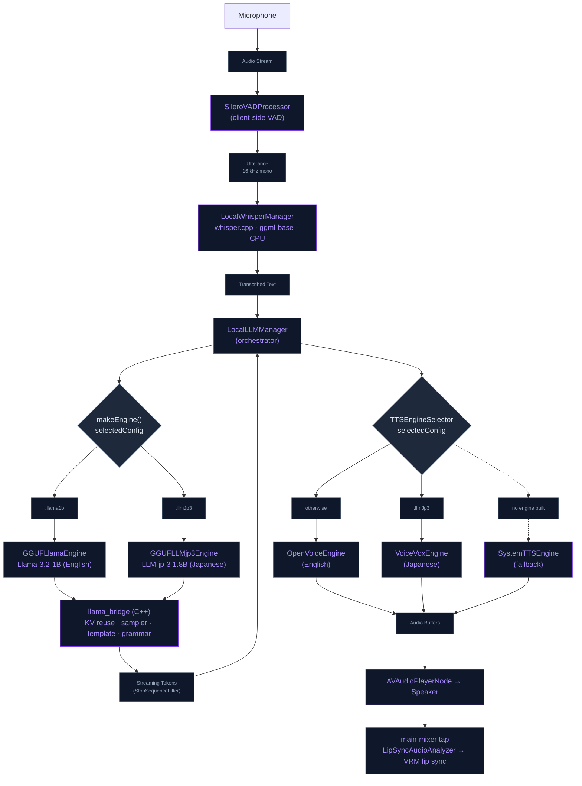

# On-Device LLM (Local SLM) Architecture

NeuraLink runs a fully **offline** AI loop on the device as an alternative to the
OpenAI Realtime (cloud) path. This document covers the local Small Language Model
(SLM) stack: which models ship, where they actually run, and the inference
pipeline from microphone to spoken reply.

> **Where it runs — no ANE.** The on-device LLM does **not** use the Apple Neural
> Engine. It runs through **llama.cpp** on the **Metal GPU** on every real device,
> the 4 GB tier (iPhone 11/12/13) included. It runs on the **CPU** on the
> Simulator, on a build whose GPU load was killed by the system twice in a row
> (`LLMGPUSentinel`), and when Metal fails to initialise (`LlamaBridge` retries
> with `gpuLayers = 0`). Speech-to-text (whisper.cpp) always runs on the **CPU**.

## Why llama.cpp (and not CoreML / ANE)

A CoreML build of Llama-3.2-1B hits an **unfixable hardware constraint on the H12
ANE** (iPhone 11/12/13): the model's GQA head-dim layout (8 heads × fp16 = 16 B)
violates the ANE's mandatory 64-byte channel alignment. The consequences are fatal:

- ANE blocked → CPU-only → ~11,500 ms/token (unusable).
- `cpuAndGPU` doubles DRAM → instant jetsam on 4 GB devices.
- The CoreML state allocator crashes when the ANE falls back to a null engine.

**llama.cpp** bypasses CoreML entirely, drives Metal directly (or runs on CPU),
ships single-file GGUF weights, and has no ANE dependency — so one backend serves
every tier.

## Shipped models

Two models ship today — one English, one Japanese. Both are sized to stay
**memory-resident** on a 4 GB device (see "Memory residency" below).

| Model | Params | Quant | Size | Language | TTS engine |
| :--- | :--- | :--- | :--- | :--- | :--- |
| **Llama-3.2-1B Instruct** | 1.2 B | Q4_K_M | ~0.81 GB | English (default) | OpenVoice |
| **LLM-jp-3 1.8B instruct3** | 1.8 B | Q3_K_M | ~0.96 GB | Japanese | VOICEVOX |

`LocalModelDownloadManager.defaultConfigForCurrentDevice()` defaults **every**
device to Llama-3.2-1B (`.llama1b`); the Japanese model (`.llmJp3`) is opt-in in
the Model Library.

**Downloads.** Each GGUF comes straight from its upstream Hugging Face repo
(`bartowski/Llama-3.2-1B-Instruct-GGUF`, `mmnga/llm-jp-3-1.8b-instruct3-gguf`):
`LocalModelDownloadManager` → `GGUFLlamaDownloader` / `GGUFLLMjp3Downloader` →
`GGUFDirectDownloader`, which streams the file with `RemoteAssetCache.fetch`, so
the progress bar moves as bytes arrive and a pause, a dropped connection or an app
kill resumes from the `.part` file. The URL names a commit
(`GGUFModelAccess.revision`, `GGUFLLMjp3ModelAccess.revision`), not `main`, and the
finished file must match the pinned size and SHA-256 (`…ModelAccess.integrity`)
before it is moved into place; a mismatch deletes the partial file and fails the
download. llama.cpp's C loader parses these files, so a re-upload upstream must
never reach the device — changing a quant means re-capturing both pins (see
[APP_SECURITY.md](../Security/APP_SECURITY.md)).

The model fills 0–80 % of the bar; the **matching voice pack is bundled into the
same download** and fills the rest, from the app's own Hugging Face dataset
(VOICEVOX Open JTalk dictionary + default speaker for Japanese; OpenVoice MeloTTS
+ tone-color converter, plus the optional prosody BERT, for English), so the user
never fetches voices separately. The voice pack is best-effort: if it fails, the
model is still ready and the voice downloads on first use. A finished download also
gives the GPU a clean slate (`LLMGPUSentinel.reset()`).

## Flow

1. **Voice detection** — `SileroVADProcessor` bounds the utterance client-side;
   the last 1.5 s of trailing silence is cut before transcription.
2. **Speech-to-text** — `LocalWhisperManager` runs the multilingual `ggml-base`
   model (~141 MB, fetched from the dataset on first launch) via whisper.cpp on the
   **CPU** (`use_gpu = false`; the A13 Metal whisper encoder is broken and CPU keeps
   STT off the GPU shared with the avatar/LLM). It is one-shot at voice end, with
   the language pinned to `ja` for LLM-jp and `en` otherwise; `WhisperDecode`
   drops clips below the speech level and normalises quiet speech first.
3. **Inference** — `LocalLLMManager.makeEngine()` picks the engine for the selected
   model; `LocalLLMMemoryHierarchy` builds the prompt. A reply is capped at 60 new
   tokens (120 during a mini-game). All engines share the `llama_bridge` C++ layer.
4. **Text-to-speech & lip-sync** — tokens are chunked into sentences and routed by
   `TTSEngineSelector` on the selected model (LLM-jp → VOICEVOX, otherwise
   OpenVoice; System TTS only if no engine can be constructed). PCM buffers feed
   `AVAudioEngine`, and the main-mixer tap drives the VRM lip sync through
   `LipSyncAudioAnalyzer` (see [LipSync.md](../Engine/LipSync.md)).

## llama_bridge (shared C++ layer)

Both engines call into `NeuraLink/Core/Bridge/llama_bridge.{h,cpp}` (KV persistence
and in-memory snapshots in `llama_bridge_state.cpp`):

- **KV-cache prefix reuse** — the bridge keeps the tokens it has decoded and only
  prefills from the first token where the new prompt differs, so the system prompt
  + persona prefix aren't re-prefilled every turn.
- **Tuned sampler chain** (repetition penalty 1.1 over the last 64 tokens → top-k
  40 → top-p 0.9 → temp 0.7) instead of greedy argmax, which avoids the
  loop/repetition pathologies of small models.
- **`llama_chat_apply_template`** — Llama-3.2 prompts are formatted with the chat
  template baked into the GGUF metadata, so the app never drifts from the format the
  model was trained on (a hand-rolled Llama-3 template is the fallback when a model
  has none). **LLM-jp-3 is the exception:** its "### 指示 / ### 応答" format isn't
  in llama.cpp's template detector, so the template call fails for it, and Llama-3
  markup it has never seen makes it improvise a script ("ユーザー：… Oz:…").
  `LLMjpPromptFormat` renders the native format in Swift for turns and warm-ups
  alike, with the persona folded into the instruction block (the stock template
  discards system messages).
- **Stop sequences** — `StopSequenceFilter` sits on the token stream of both
  engines and stops a reply where the model starts writing the next turn itself
  ("ユーザー：", "### 指示", "User:", template tokens), holding back anything that
  could still become a marker so none of it reaches the screen or TTS.
  `LeadingLabelFilter` drops a "Oz:" style speaker label off the front of a reply.
- **Tool grammar** — the Llama engine installs a lazy GBNF grammar once per load
  that engages only at `<tool`, so a tool call is always well-formed JSON (see
  [CHAT_LLM.md](./CHAT_LLM.md)). The JP engine has none.
- **Prompt-lookup decoding (PLD)** — a lightweight speculative pass (C defaults
  n = 3, n_draft = 5). The bridge bypasses it while a tool grammar is active, which
  is the case on Llama-1B whenever its grammar installed (`[GGUFEngine] Tool grammar
  installed`), and LLM-jp turns it off (`promptLookup: false`:
  device `[Bench]` showed 0 % hits on short Japanese replies), so turns decode one
  token at a time; the profile's JP window (n = 2, n_draft = 3) is unused.

## Memory residency (the 4 GB constraint)

Decode is **memory-bandwidth bound** on the GPU and the CPU alike, so on the 4 GB
tier the single biggest factor is whether the model's weights stay **resident in
RAM** (Metal maps the same mmap'd pages, so this holds on the GPU too):

- llama.cpp `mmap`s the GGUF. If the model is too large to stay resident alongside
  the avatar, environment, and TTS engines, iOS evicts its clean pages and re-reads
  them from flash on **every forward pass** — which collapses decode to ~0.15 tok/s.
- A model that **fits** stays resident and decodes at RAM bandwidth (multiple tok/s
  on the A13 CPU). That's why both shipped models are quantized to ≲ 1 GB.
- `mmap` stays on. A `use_mmap = false` "force-resident" load makes peak RSS the
  full model with no eviction valve and jetsam-crashes on 4 GB (see the note in
  `llama_bridge.cpp`). With a model that fits, plain mmap keeps it resident **and**
  degrades gracefully (briefly streams) under pressure instead of crashing.
- Below 5 GB, Whisper's model (~150 MB) is freed for the decode window
  (`handleUserInput`) and reloaded when the generation finishes, before the VAD can
  open the next turn. OpenVoice's prosody BERT (~91 MB) is only loaded on ≥ 5 GB
  devices.

Per-model runtime parameters (context length, threads, `gpuLayers`, KV quant, flash
attention, PLD window) live in one place: `LLMRuntimeProfile.resolve(for:)`, with the
per-device rules in `LLMRuntimeProfile.tuned`:

| Device | Where | Threads | KV cache | Context |
|---|---|---|---|---|
| < 5 GB (iPhone 11/12/13) | Metal | 2 | q4_0 | 2048 (Llama-1B), 1024 (LLM-jp) |
| 5–7 GB | Metal | 4 | q8_0 | 2048 |
| ≥ 7 GB | Metal | 4 | q8_0 | 4096 |
| Simulator | CPU | 2 | q4_0 | the model's baseline |

Flash attention is on everywhere. Any real device runs on the CPU instead when the
GPU sentinel has disabled the GPU for the build. Threads are capped at the core
count, and at 2 when the phone is at a serious/critical thermal state or in Low
Power Mode (`RuntimePressurePolicy.threadCap`, read at load).
`LocalLLMMemoryHierarchy.nCtx(for:)` reads the same resolved context length, so the
prompt budget and the KV capacity always agree.

**GPU sentinel.** A load the system kills for memory (jetsam) can't be caught, so
`LlamaBridge` marks a GPU load pending before creating the context and
`LLMGPUSentinel` confirms it after the first forward pass completes. A launch that
finds a load still pending counts a strike. Xcode stopping the app mid-load looks
the same as a kill, so it takes two strikes in a row before that build stays on
the CPU, and a confirmed load clears them. A new build, a fresh model download, or
the DEBUG launch argument `-nl.llm.resetGPU YES` tries the GPU again. `[Bench]`
lines end the model label with `·gpu` or `·cpu`, and `[LLMGPU]` lines say why.

## Turn latency

A turn only pays for the tokens the bridge has not already got in its KV cache: it
reuses everything up to the first token where the new prompt differs. Four things
keep that difference at the end of the prompt.

- **Anchored history window.** The verbatim history starts at a fixed message and
  grows; only once it passes 16 messages, or the context budget, does it jump forward
  to keep the last 8 (`LocalLLMMemoryHierarchy.stableWindow`). A window that slid by a
  pair every turn would change the prompt right after the system block and re-prefill
  the whole history every turn (measured: ~365 of ~850 tokens from turn 6 on); the
  anchored one makes a turn prefill only its facts, the user's words and the
  template, and a jump costs one re-prefill every few turns. The voice-start warm-up
  and the turn compute the same window from the same anchor. Per-turn blocks (facts,
  game reminder, acoustic affect) go after the history for the same reason. LLM-jp
  prompts carry no history; a fixed lead-in (`jpAnswerLeadIn`) gives the warm-up a
  reusable prefix instead.
- **Background generations keep the prefix.** Fact extraction, consolidation, mental
  models, reflections and chat titles run on the same model. `SilentGenerationGate`
  snapshots the conversation's KV state in RAM before each one and restores it after
  (`llama_bridge_snapshot_*`, milliseconds), so the next turn starts warm.
- **User turns come first.** A silent run starts only after the companion has been
  idle for 1.5 s (`silentIdleSettle`), and a user turn preempts it at its next token
  instead of being dropped. A preempted run returns no answer: memory retain advances
  its watermark only past chunks it finished, consolidation and mental models keep
  their state, and all of them retry on their next trigger. A voice preview or
  transcript playback (`beginStandaloneSpeech`) also stops and holds them.
- **Cold start.** `LocalLLMManager.startListening()` loads the LLM first, then
  restores and warms the prefix before Whisper loads:

  - **`tryRestoreKVCache()`** — a previous session's prefilled persona prefix is
    restored from disk, so the first turn reuses it (~instant first token from the
    2nd launch onward).
  - **`warmupPrefill()`** — the prefix is prefilled in the background (it overlaps
    Whisper setup), so it's warm before the user finishes speaking their first
    turn. It runs again at every VAD voice start, and the first successful warm-up
    of a session persists the cache.

KV-cache blobs are AES-256-GCM encrypted on disk and named per model, llama.cpp
state-format version and a hash of the system prompt, so a model swap, a llama.cpp
upgrade or a persona edit never restores an incompatible blob. See `LocalLLMKVCache`.

## Lines the companion starts (cues)

Silence breaks, return greetings, song reactions, head pats and the other
proactive moments reach the local model as a `LocalCue`
(`LocalLLMManager.handleCue`), not as the user's words: sent as a user message, a
1–2B model reads the English instruction out or answers it, and the instruction
shows on screen as if the user had said it. A cue only runs when the companion is
ready or listening — it never interrupts a turn.

- **An instruction, in the model's language.** Llama-3.2 gets it as a final system
  message after the history. LLM-jp gets Japanese — native versions of the silence
  break and the return greeting (`ProactivePresenceManager.smallTalkEventJapanese`,
  `greetingEventJapanese`), and a short Japanese frame around any other English cue.
- **Checked before it is said.** The reply is buffered, not streamed, and
  `CueReplyValidator` drops it when it repeats or narrates the instruction (a long
  run copied from it, "the user…", "ユーザーが…", stage-direction asterisks). A
  dropped line is simply not spoken; the user's transcript is never touched.

## Files

| File | Role |
|---|---|
| `Data/DataSources/LocalLLM/Manager/LocalLLMManager.swift` (+ extensions) | Orchestrator: audio engine, VAD → Whisper → engine → TTS; `+Engine` chunking and tool dispatch, `+Cue`, `+KVCache`, `+Compaction` (silent generations), `+BargeIn` |
| `Data/DataSources/GGUF/Llama/GGUFLlamaEngine.swift` (+ `+Generate`, `+ToolGrammar`) | Llama-3.2-1B engine |
| `Data/DataSources/GGUF/LLMjp3/GGUFLLMjp3Engine.swift` (+ `+Generate`) | LLM-jp-3 engine; native prompt format, PLD off |
| `Data/DataSources/GGUF/LlamaBridge.swift` | Swift wrapper over the C handle: GPU-load marks, Metal-init CPU retry, `[Bench]` lines, KV snapshot/save/load |
| `Core/Bridge/llama_bridge.{h,cpp}`, `llama_bridge_state.cpp` | C++ layer over the prebuilt `llama.xcframework`: prefix reuse, sampler, chat template, PLD, tool grammar, KV persistence and snapshots |
| `Data/DataSources/LocalLLM/LLMRuntimeProfile.swift` | Per-model, per-device runtime parameters |
| `Data/DataSources/LocalLLM/LLMGPUSentinel.swift` | Two-strike guard against GPU loads the system kills |
| `Data/DataSources/LocalLLM/LocalLLMMemoryHierarchy.swift` | Prompt assembly, anchored history window, cue messages |
| `Data/DataSources/GGUF/SilentGenerationGate.swift` | KV snapshot/restore and preemption for background generations |
| `Data/DataSources/LocalLLM/LocalLLMKVCache.swift` | Encrypted, per-model/per-prompt KV blobs |
| `Domain/Entities/Chat/LocalReplyFormat.swift` | `LLMjpPromptFormat`, `StopSequenceFilter`, `LeadingLabelFilter`, `LocalCue`, `CueReplyValidator` |
| `Data/DataSources/STT/LocalWhisperManager.swift`, `WhisperDecode.swift`, `SileroVADProcessor.swift` | Speech-to-text (whisper.cpp) and voice activity detection |
| `Data/DataSources/GGUF/LocalModelDownloadManager.swift` | Download state machine + voice bundling |
| `Data/DataSources/GGUF/GGUFDirectDownloader.swift`, `Llama/GGUFModelAccess.swift`, `LLMjp3/GGUFLLMjp3ModelAccess.swift` | Commit- and SHA-256-pinned GGUF fetch; repo, revision and integrity pins |

TTS routing and the voices are covered in [LLM_VOICE.md](./LLM_VOICE.md).
