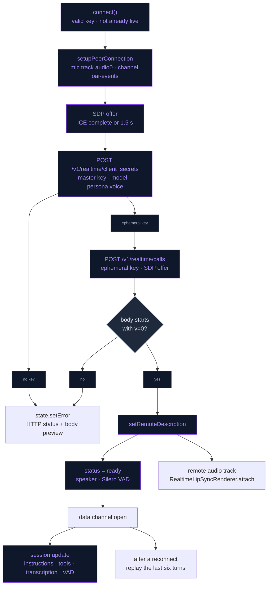
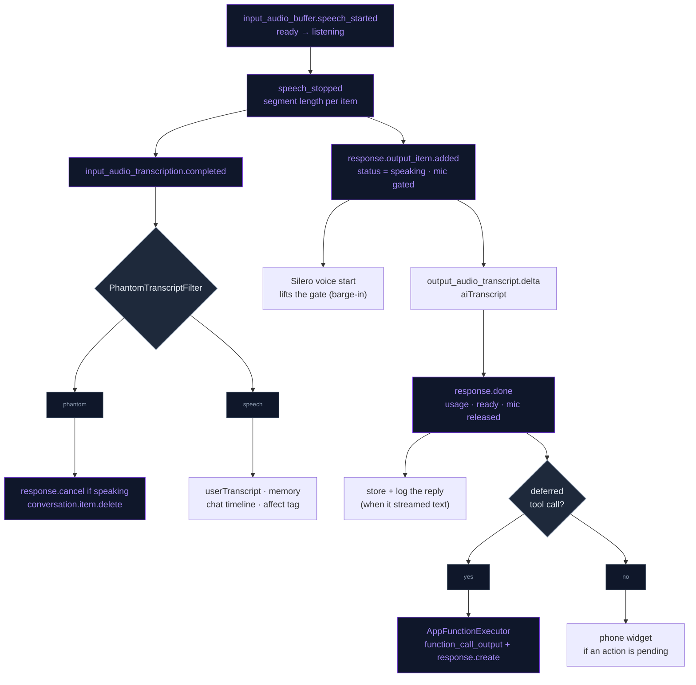

# OpenAI Realtime

The cloud voice path. `OpenAIRealtimeManager` (a singleton) holds one WebRTC
session with OpenAI's Realtime API (GA): the user's microphone goes up and the
character's voice comes back as RTP audio tracks, and everything else (session
configuration, transcripts, tool calls, turn events) travels as JSON events on
a data channel. WebRTC is LiveKit's build of libwebrtc
(`livekit/webrtc-xcframework`, module `LiveKitWebRTC`, every class prefixed
`LKRTC`), used for the renderer hook it adds to audio tracks. The local path is
separate (see [Local_SLM_Model.md](Local_SLM_Model.md)).

## Connection and handshake

`connect()` needs a valid API key and does nothing while a session is already
connecting or live. It runs at launch when OpenAI voice mode is on, when the
mode is switched on, when AI Settings closes with Done (after a disconnect if
the voice model changed), on New Chat (disconnect, then connect), from the
reconnect loop, and on foreground after the background keeper ended an idle
session ([PRESENCE_BEYOND_APP.md](../Companion/PRESENCE_BEYOND_APP.md)).

1. **Audio session.** `LKRTCAudioSession` is set to `.playAndRecord`
   (`.allowBluetoothHFP`, `.defaultToSpeaker`) in `.videoChat` mode with
   `useManualAudio`, so `isAudioEnabled` really starts and stops the audio
   units.
2. **Peer connection.** Unified plan, max-bundle, five Google STUN servers, one
   outgoing mic track (`audio0` on stream `stream0`) and the data channel
   `oai-events`.
3. **Offer.** An SDP offer that asks to receive audio. It is sent once ICE
   gathering completes, or after 1.5 s with the candidates gathered so far.
4. **Ephemeral key.** `POST https://api.openai.com/v1/realtime/client_secrets`
   with the master API key (kept in the Keychain, see
   [APP_SECURITY.md](../Security/APP_SECURITY.md)). The body fixes the model
   and seeds the character's persona instructions and voice:

   ```json
   {
     "session": {
       "type": "realtime",
       "model": "<OpenAISettings.realtimeModel>",
       "instructions": "<persona instructions>",
       "audio": { "output": { "voice": "<persona voice>" } }
     }
   }
   ```

   The token is read from the top-level `value` (the GA shape) or from
   `client_secret.value`.
5. **SDP exchange.** `POST https://api.openai.com/v1/realtime/calls` with
   `Authorization: Bearer <ephemeral key>`, `Content-Type: application/sdp` and
   the offer as the body. The model is not in the URL; the mint fixed it. The
   master key never reaches this endpoint.
6. **Answer.** A body that does not start with `v=0` is an error: the status
   and a body preview go to the UI instead of into WebRTC. A real answer is
   applied with `setRemoteDescription`; the status becomes `.ready`, output is
   forced to the speaker and the Silero VAD starts when enabled.
7. **Data channel open.** The initial `session.update` goes out, a reconnect
   replays recent turns, and proactive vision starts.

The persona comes from `CharacterPersona.forCharacter(named:)`: the character's
saved persona (prompt and voice in SQL via `PersonaStore`) or the built-in one.
Built-in voices are `shimmer` (Ekaterina), `marin` (Sonya), `ballad` (Oz) and
`alloy` for any other character.

## Session configuration

The voice is set once, at the mint: the API rejects a voice change
(`cannot_update_voice`) once assistant audio has played, and that rejection
drops the whole update. Everything else arrives in the first `session.update`:

```json
{
  "type": "session.update",
  "session": {
    "type": "realtime",
    "output_modalities": ["audio"],
    "instructions": "<buildSessionInstructions()>",
    "tools": ["<AppFunctionTool.all>"],
    "tool_choice": "auto",
    "audio": {
      "input": {
        "transcription": {
          "model": "<OpenAISettings.transcriptionModel>",
          "prompt": "Casual voice chat with an AI companion. May include proper nouns: media/game/anime/song titles, app names, Japanese words."
        },
        "turn_detection": {
          "type": "server_vad",
          "threshold": 0.75,
          "prefix_padding_ms": 300,
          "silence_duration_ms": 700
        },
        "noise_reduction": { "type": "near_field" }
      }
    }
  }
}
```

- **Instructions** (`buildSessionInstructions`): persona instructions, the
  user's profile context, mental models, recalled memories for a fixed "about
  the user" grounding query (5 hits, 500 tokens), knowledge-graph facts,
  companion state, follow-up mentions, explicit usage rules for `remember_fact`
  and `search_memory`, and the motion instructions while `perform_motion` is
  offered.
- **Tools**: every tool in [Function_Call.md](Function_Call.md);
  `perform_motion` only when `MotionSettings.offersTool`.
- **Transcription** is a side channel for the chat history: the model itself
  understands the raw audio. The prompt biases vocabulary toward proper nouns
  and is omitted for `gpt-realtime-whisper`, which rejects it
  (`OpenAIModelCatalog.transcriptionSupportsPrompt`). No `language` is pinned,
  so Japanese personas keep auto-detection.
- **Turn detection**: `server_vad` with a higher threshold and a longer silence
  window than the defaults (0.5 / 500 ms), which opened phantom turns on room
  noise and echo with the speaker on. The server creates and interrupts
  responses itself (defaults).
- **Noise reduction**: `near_field`, the close-talk setting for a phone in
  conversational use. It cleans only the audio OpenAI receives, independent of
  the local path's voice processing.
- **Audio formats**: none are sent. Over WebRTC the media is the RTP track,
  whose codec the SDP offer and answer negotiate.

A mid-session refresh re-sends `session.update` with only `type`,
`instructions`, `tools` and `tool_choice` (see
[Reconnect and instruction refresh](#reconnect-and-instruction-refresh)).

## Server events

`dataChannel(_:didReceiveMessageWith:)` decodes each message and hands it to
`handleIncomingJSON` (`OpenAIRealtimeManager+Handlers.swift`), which runs on
the main actor. Unhandled types are ignored.

| Event | What the app does |
|---|---|
| `input_audio_buffer.speech_started` | `.ready` → `.listening`; while `.speaking` it is a barge-in, and the phone episode ends. Records `audio_start_ms` for the item |
| `input_audio_buffer.speech_stopped` | `.listening` → `.ready`; stores the segment length for the item |
| `conversation.item.input_audio_transcription.completed` | Records transcription usage, then runs the [phantom filter](#phantom-transcripts). A real transcript sets `userTranscript`, feeds acoustic affect (a changed tone tag goes in as a system message), notes the turn for proactive vision, the interaction clock and games, stores it in memory and logs it to the chat timeline |
| `response.output_item.added` | `function_call` item: starts a tool call. Any other item: clears `aiTranscript`, status `.speaking`, and gates the outgoing mic |
| `response.output_audio_transcript.delta` | Appends to `aiTranscript` |
| `response.output_audio_transcript.done` | Timestamp used to time the phone hand-off |
| `response.function_call_arguments.delta` / `.done` | Accumulates the arguments; on `.done` runs `set_emotion` / `perform_motion` at once or defers the call |
| `response.done` | Adds `usage` to the session meter and the Usage dashboard; status `.ready`; releases the mic gate; flushes a deferred instruction refresh; stores and logs the reply when it streamed text; runs a deferred tool call, or schedules the pending phone hand-off |
| `error` | Logs the event (pretty-printed, 800 chars) as `[AI ERROR EVENT]` |
| `session.created` / `session.updated` | Logs the voice and an instructions preview as the server's acknowledgement |

## Client events

All outgoing events go through `send(_:)`, which drops (and logs) anything sent
while the data channel is not open.

| Event | Sent when |
|---|---|
| `session.update` | Data channel opens; mid-session instruction refresh |
| `conversation.item.create` + `function_call_output` | A tool call finished (followed by `response.create`) |
| `conversation.item.create` + system `input_text` message | Interaction events: head pats, song matches, proactive engagement and photo reactions (followed by `response.create`); `[Vision Update: …]` from proactive vision (followed by `response.create`); acoustic tone tags (no `response.create`) |
| `conversation.item.create` + user / assistant messages | After a reconnect: the last six turns, no `response.create` |
| `response.cancel` | A phantom turn's reply; song recognition starting to listen |
| `conversation.item.delete` | A phantom turn's item |

## Turn-taking and the microphone

Server VAD decides the turns. The local Silero VAD (Autonomy → "Auto-turn
detection", `OpenAISettings.isVADEnabled`) adds an instant listening / ready
state and makes barge-in possible; `server_vad` stays on either way.

The outgoing track is disabled while any `MicGateReason` is held:

- **`assistantSpeaking`**: set when the assistant's message item starts and
  released at `response.done`. Residual echo that voice processing misses (phone
  on a desk, speaker up) otherwise reaches `server_vad` as phantom user turns.
  Silero listens to the processed input, so a voice start there is the user:
  it lifts this gate mid-reply and the server hears the interruption. Without
  Silero the user can only speak after the reply ends.
- **`songRecognition`**: held while a song is being listened to or announced.
  Recognition also cancels the active response, suspends WebRTC's audio units
  (`suspendAudioUnit`, mode `.default`) so ShazamKit gets an unprocessed mic,
  and `resumeAudioUnit` restores the full WebRTC session configuration, since a
  changed hardware sample rate otherwise pitch-shifts all later speech. See
  [SONG_RECOGNITION.md](../Companion/SONG_RECOGNITION.md).

A new peer connection starts with no gate reasons.

## Phantom transcripts

Server VAD opens turns on desk noise and breaths, and the transcription model
then hallucinates: it returns its own vocabulary prompt as if spoken, a lone
"ね。" or "you", or a trailing "That's…". `PhantomTranscriptFilter.reason`
decides whether a transcript is something the user said; checks run in this
order:

| Reason | Dropped when |
|---|---|
| `empty` | No letter or digit at all |
| `annotation` | Only subtitle annotations: `(笑)`, `（拍手）`, `[音楽]`, `【字幕】`, `♪…♪`, `*laughs*` |
| `promptEcho` | 3+ words contained in the transcription prompt (or containing it), or 6+ words of which at least 60 % come from the prompt's vocabulary |
| `tooShort` | The speech segment is under 350 ms |
| `tooFastForDuration` | More than 8 words per second (scripts without spaces count one unit per four characters) |
| `fragment` | One or two words trailing off with `…` or `...` |
| `filler` | A known silence hallucination: "you", "thank you", "thanks for watching", "bye", "ね", "はい", "ご視聴ありがとうございました", "チャンネル登録よろしくお願いします", … |

**Realtime path.** The filter runs on every
`conversation.item.input_audio_transcription.completed`, with the segment length
measured from `speech_started.audio_start_ms` to `speech_stopped.audio_end_ms`
for that `item_id` and the session's transcription prompt. A dropped turn is
never shown, stored in memory, logged to the chat timeline or counted as a
turn. If the reply it triggered is already playing, it is cancelled
(`response.cancel`) and that response's `response.done` is neither shown nor
stored; the item is deleted from the conversation (`conversation.item.delete`)
so the model's context never holds it. Its transcription usage is still
recorded, since it was billed.

**Local path.** whisper.cpp output goes through the same rules without timing
or prompt, and `spokenText` cuts annotations out of real speech ("(笑) 本当に？"
→ "本当に？") before `handleUserInput`.

## Function calls

`set_emotion` and `perform_motion` run the moment their arguments are complete,
so the face and the gesture lead the audio. Every other call is held until the
response that requested it ends, then runs through `AppFunctionExecutor`; the
result goes back as a `function_call_output` with `response.create`, and an
app-opening action waits for the spoken result and the user's tap on the phone
widget. Full description in [Function_Call.md](Function_Call.md).

## Audio playback and lip sync

The character's voice plays through WebRTC's own audio unit, routed to the
speaker. When the remote audio track arrives (`peerConnection(_:didAdd:streams:)`,
the unified-plan receiver callback; the legacy `didAdd stream` is the fallback),
the track is enabled and `RealtimeLipSyncRenderer`, an `LKRTCAudioRenderer`, is
attached to it. WebRTC hands it each 10 ms 16-bit playout buffer as it goes to
the speaker; the first channel is analysed by `LipSyncAudioAnalyzer` and
published to `LipSyncFeed`, which the render tick reads once a frame. Teardown
detaches it. See [LipSync.md](../Engine/LipSync.md).

## Reconnect and instruction refresh

- **Reconnect** (`+Reconnect.swift`): ICE `.failed`, ICE `.disconnected` for
  more than 3 s, peer connection `.failed`, a data channel that closes while
  connected, or a foreground return with the channel not open schedule a
  reconnect at 1, 2, 4, 8, 16 s (five attempts, each waiting up to 30 s for the
  network). Each attempt mints a fresh key. The overlay shows
  "Reconnecting… (n)", and after the last attempt "Connection lost". When the
  new channel opens, the last six turns are replayed. `disconnect()` (the user's
  action) cancels the loop; `teardown()` only releases the transport.
- **Instruction refresh** (`+SessionRefresh.swift`): anything that feeds the
  instructions posts `.realtimeInstructionsDidChange`; after a 5 s debounce the
  manager re-sends instructions and tools, deferred to `response.done` while a
  reply is in flight.

Details in CHAT_LLM.md:
[auto-reconnect](CHAT_LLM.md#realtime-auto-reconnect-with-context-resume) and
[instruction refresh](CHAT_LLM.md#mid-session-instruction-refresh).

## Models and usage

The voice model (`OpenAISettings.realtimeModel`, default
`gpt-realtime-2.1-mini`) and the transcription model
(`OpenAISettings.transcriptionModel`, default `gpt-4o-transcribe`) are picked
from the curated lists in `OpenAIModelCatalog`; an id that is not listed falls
back to the default. A voice-model change applies on the next connect.
`RealtimeUsageMeter` accumulates `response.done` usage and logs
`[Cost] realtime …` at teardown; every response and transcription is also
recorded for the Usage dashboard. See
[CHAT_LLM.md](CHAT_LLM.md#model-selection-and-cost-logging) and
[API_USAGE.md](API_USAGE.md).

## Flow

### Connect



### A voice turn



## Files

| File | Role |
|---|---|
| `Data/DataSources/OpenAI/Realtime/OpenAIRealtimeManager.swift` | Singleton: audio session, peer connection, data channel, offer and ICE timeout, teardown, mic gate reasons, audio suspend / resume for song recognition |
| `Data/DataSources/OpenAI/Realtime/OpenAIRealtimeManager+Handshake.swift` | `client_secrets` mint and the `/v1/realtime/calls` SDP exchange |
| `Data/DataSources/OpenAI/Realtime/OpenAIRealtimeManager+SessionConfig.swift` | `buildSessionInstructions`, the initial `session.update`, transcription prompt |
| `Data/DataSources/OpenAI/Realtime/OpenAIRealtimeManager+Handlers.swift` | Server events, function calls, phantom discard, peer-connection and data-channel delegates |
| `Data/DataSources/OpenAI/Realtime/OpenAIRealtimeManager+Events.swift` | Interaction events and `response.cancel` for song recognition |
| `Data/DataSources/OpenAI/Realtime/OpenAIRealtimeManager+VAD.swift` | Silero VAD delegate: listening / ready, barge-in gate lift, acoustic affect capture |
| `Data/DataSources/OpenAI/Realtime/OpenAIRealtimeManager+Reconnect.swift` | `send(_:)`, `ReconnectPolicy`, failure detection, context replay |
| `Data/DataSources/OpenAI/Realtime/OpenAIRealtimeManager+SessionRefresh.swift` | `SessionRefreshScheduler` and the mid-session refresh |
| `Data/DataSources/OpenAI/Realtime/RealtimeLipSyncRenderer.swift` | Renderer on the remote track → `LipSyncFeed` |
| `Data/DataSources/OpenAI/OpenAISettings.swift` | API key (Keychain), voice-mode and Silero switches, model choices |
| `Data/DataSources/OpenAI/OpenAIModelCatalog.swift` | Curated model ids and prices per role, `transcriptionSupportsPrompt`, `RealtimeUsageMeter` |
| `Data/DataSources/OpenAI/OpenAIChatClient.swift` | Chat Completions for background text work (outside the live session) |
| `Domain/Entities/Chat/PhantomTranscriptFilter.swift` | Phantom transcript rules |
| `Domain/Entities/Chat/RealtimeChatState.swift` | Status, transcripts, session usage, emotions |
| `Domain/Entities/Character/CharacterPersona.swift` | Built-in persona instructions and voices |
| `Data/DataSources/FunctionCalling/AppFunctionTool.swift` | The `tools` array |

## Integration notes

The session uses the GA Realtime shapes. The beta shapes are rejected, so these
are the details not to regress:

- **Endpoints**: `/v1/realtime/client_secrets`, then `/v1/realtime/calls`. The
  old direct SDP POST to `/v1/realtime?model=…` with the master key returns
  HTTP 400 `beta_api_shape_disabled`. No `OpenAI-Beta` header is sent.
- **`session.type: "realtime"`** is required in the mint and in every
  `session.update`.
- **`output_modalities`** accepts `["audio"]` or `["text"]`, never both;
  `["audio", "text"]` fails with `invalid_value` and the whole update is
  dropped. The transcript still streams with `["audio"]`.
- **Nesting**: transcription, turn detection and noise reduction live under
  `session.audio.input`; the voice under `session.audio.output.voice`, sent
  only at the mint.
- **Transcript events** are `response.output_audio_transcript.delta` / `.done`
  (the beta `response.audio_transcript.*` never fire).

## Troubleshooting

Logs are Debug-only (`nlLog` compiles to nothing in Release); handshake failures
also reach the UI through `state.setError`. Every incoming event is logged as
`[AI Event Received]: <type>`, so a renamed or unhandled event shows there.

| Symptom | Meaning |
|---|---|
| `OpenAI client_secrets HTTP 401: …` | The API key is wrong |
| `client_secrets HTTP 404 … Model not found` | The account cannot use the selected voice model |
| "OpenAI returned HTTP … instead of SDP" | The calls endpoint answered with an error body; the preview names it |
| `[AI]: WARNING - Answer does NOT contain audio track` | The SDP answer has no `m=audio` section |
| `[AI ERROR EVENT]` right after connecting; no tools, no user transcripts, no memory context | The `session.update` was rejected (the error names the `param`); the session runs on what the mint set: persona instructions and voice |
| Audio plays but no transcript appears | The transcript event names changed; compare `[AI Event Received]` with the handled names |
| The user cannot interrupt the character | Silero VAD is off (Auto-turn detection), so the mic stays gated until the reply ends |
| "Connection lost" | All five reconnect attempts failed |
