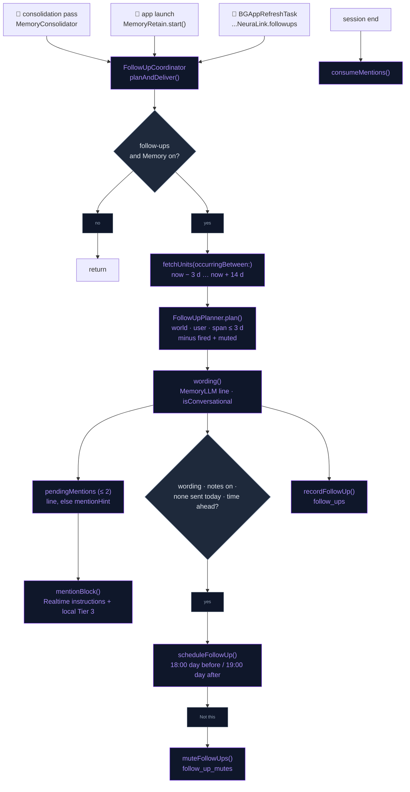
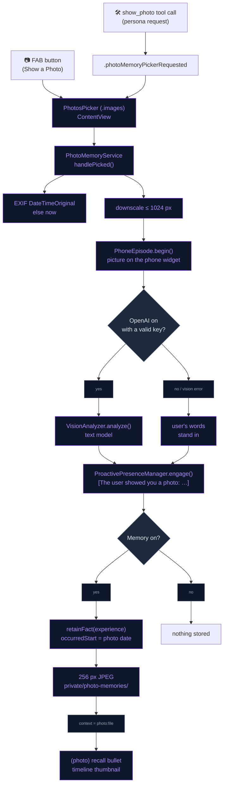

# Companion Depth

The companion acts on what memory already holds. Plans the user mentions with
a date get followed up: before and after, by notification or in conversation.
Photos the user shows are described once, reacted to in character, and kept as
dated memories with a small on-device thumbnail.

## Follow-ups on dated plans

Retain already extracts dated facts about the future ("User's mother turns 60
on 2026-04-14", "User has a dentist appointment on Friday").
`FollowUpCoordinator.planAndDeliver()` turns those into follow-ups. It runs
after every consolidation pass (`MemoryConsolidator.consolidatePending`), at
launch (`MemoryRetain.start`), and from a background refresh. It does nothing
unless **Autonomy → Between sessions → "Follow up on plans"**
(`PresenceSettings.followUpsEnabled`, default on) and Memory are both on.

- **Candidates**: `MemoryStore.fetchUnits(occurringBetween:and:includeUndated: false)`
  over `[now − 3 d, now + 14 d]`.
- **Planner** (`FollowUpPlanner.plan`, pure): keeps `world` facts that carry an
  `occurredStart`, span **≤ 3 days**, and list the `user` entity. Coarse spans
  ("in September") never fire. Each fact gets one of three kinds, using ISO
  calendar days:

  | Kind | When | Notification |
  |---|---|---|
  | `.today` | event spans today | none (conversation only) |
  | `.upcoming` | starts in 1–3 days | 18:00 the day before |
  | `.afterwards` | ended 1–2 days ago | 19:00 the day after |

  (unit, kind) pairs that already fired (`follow_ups`) and muted units
  (`follow_up_mutes`) are skipped. The results are sorted most imminent
  first.
- **Wording**: one `MemoryLLM` call (cloud or local, 60 tokens) per
  follow-up. `FollowUpWording.prompt` asks for one or two short, warm
  sentences (25 words max) in the character's voice, addressed to the user by
  name, that neither restate the fact nor say "the user"; the fact is fed with
  the user's name in place of "User". The first line of the reply is kept
  only if `CompanionNotificationCopy.isConversational` accepts it (8–220
  characters, no "the user", not a restatement of the fact). With the tier at
  `.none` or a rejected line there is **no wording**: the conversation gets a
  plain hint instead ("Happening today: …", "Coming up soon: …", "Just
  happened, ask how it went: …"), and no notification is sent — a raw fact
  never reaches the lock screen.
- **Notification**: at most **one per day**, tracked by a day key in
  `UserDefaults`, and only with real wording, the **"Thinking of you" notes**
  toggle on (`PresenceSettings.isNotificationsEnabled`) and a fire time still
  ahead. `CompanionNotificationScheduler.scheduleFollowUp` sends it as a
  communication notification with the character as sender, on the single
  identifier `com.neuralink.presence.followup`, replacing any pending
  follow-up. The `NL_FOLLOWUP` category carries a **"Not this"** action,
  which calls `MemoryStore.muteFollowUps(unitID:)`, so that fact is never
  brought up again.
- **In conversation**: up to **2** pending mentions (an `.afterwards` one only
  when nothing else is queued). `mentionBlock()` renders them as
  `[Things to bring up naturally, once]`. This block is appended to the
  Realtime session instructions (`buildSessionInstructions`) and to the local
  Tier 3 facts block. `postInstructionsChanged(reason: "follow-ups")` pushes it
  into a running session. Mentions are cleared on `SessionLifecycle.sessionDidEnd`.
- **Background refresh**: `NeuraLinkApp.init` registers the `BGAppRefreshTask`
  `com.dedicatus.NeuraLink.followups` and re-submits it with an earliest begin
  12 h out. This schedules a day-before notification even on days the app is
  not opened.
- **Memory page**: the hero card shows a **COMING UP** row with up to three
  upcoming or today items (fact text + date), muted units excluded.

## Photo memories

The user can show the companion a picture from their library. To open the
system `PhotosPicker` (images only, no library permission needed), they can:

- tap the **"Show a Photo"** FAB button, or
- say "let me show you a picture". The model calls the `show_photo` tool,
  which posts `.photoMemoryPickerRequested`.

`PhotoMemoryService.handlePicked(data:userWords:)` then takes over. Whatever
the user said just before (`userTranscript`) goes along as their words.

1. **Date**: reads the EXIF `DateTimeOriginal` as the photo's date, or uses
   now.
2. **Look**: scales the photo down to ≤ 1024 px and starts the phone episode
   (`PhoneEpisode.begin(tool: show_photo)`): the character takes out its
   phone, and the phone widget shows the picture right away.
3. **Describe**: when OpenAI is on with a valid key,
   `VisionAnalyzer.analyze` asks the image-capable **text model**
   (`OpenAISettings.textModel`, `max_completion_tokens` 300, plus the
   catalog's `reasoning_effort` when the model has one) for two short
   sentences that name any people, places or events the user mentioned.
   Otherwise, or on a vision error, the user's own words stand in ("a photo
   the user showed" when they said nothing). `PhoneEpisode.toolFinished()`
   then lets the spoken reaction put the phone away.
4. **React**: `ProactivePresenceManager.engage(with: "[The user showed you a photo: …]")`
   on whichever engine is live (a Realtime interaction event or a local
   cue).
5. **Remember** (only when Memory is on): stores an `experience` fact
   (source `photo`), "User showed <Character> a photo: … User said: …", cut
   to 300 characters. Its `occurredStart/End` is the photo's date, and its
   entities are the user plus those found in the description and words. A
   256 px JPEG thumbnail goes into
   `Application Support/private/photo-memories/`, and the unit's `context`
   is set to `photo:<file>`. The original photo is never copied.

Every photo also notes the `.firstPhoto` keepsake milestone. Recall bullets
prefix photo units with `(photo)`, so the model knows a picture exists. The
Memory timeline rows show the thumbnail in place of the fact-type glyph.

## Flow

### Follow-ups

### Photo memories

## Files

| File | Role |
|---|---|
| `Data/DataSources/Memory/Agentic/FollowUpPlanner.swift` | `FollowUp`, the pure `FollowUpPlanner` (kinds, notification times), `FollowUpWording` (prompt + mention hint), and `FollowUpCoordinator` (plan → word → deliver, pending mentions) |
| `Data/DataSources/Memory/Agentic/Store/MemoryStore+FollowUps.swift` | `follow_ups` (fired unit+kind) and `follow_up_mutes` tables |
| `Data/DataSources/Memory/Agentic/Store/MemoryStore+Timeline.swift` | `fetchUnits(occurringBetween:and:includeUndated:)`, the candidate query (shared with the Memory timeline) |
| `Core/Notifications/CompanionNotificationScheduler.swift` | `scheduleFollowUp`, the `NL_FOLLOWUP` category; `CompanionNotificationPresenter` handles "Not this" |
| `Core/Notifications/CompanionNotificationCopy.swift` | `personalize`, `firstLine`, `isConversational` (the wording gate) |
| `App/NeuraLinkApp.swift` | Registers and re-submits the `com.dedicatus.NeuraLink.followups` background refresh |
| `Data/DataSources/Companion/PresenceSettings.swift` | `followUpsEnabled`, `isNotificationsEnabled` |
| `Presentation/Views/Settings/AutonomySettingsView.swift` | "Follow up on plans" toggle |
| `Presentation/Views/Memory/MemoryInsightsSection.swift` | "COMING UP" row on the hero card |
| `Data/DataSources/OpenAI/Realtime/OpenAIRealtimeManager+SessionConfig.swift` | Appends `mentionBlock()` to the session instructions |
| `Data/DataSources/LocalLLM/LocalLLMMemoryHierarchy.swift` | Appends `mentionBlock()` to the local Tier 3 block |
| `Data/DataSources/Photos/PhotoMemoryService.swift` | Picker hand-off, phone episode, describe, react, remember, thumbnails |
| `Domain/Entities/Skills/ShowPhotoSkill.swift` | `show_photo` tool (opens the picker) |
| `Data/DataSources/FunctionCalling/AppFunctionTool.swift` | `showPhotoTool` schema |
| `App/ContentView.swift` | Hosts `.photosPicker` and listens for `.photoMemoryPickerRequested` |
| `Presentation/Components/ExpandableFABMenu.swift` | "Show a Photo" FAB button |
| `Data/DataSources/Vision/VisionAnalyzer.swift` | Image → description via the configured text model |
| `Data/DataSources/Memory/Agentic/MemoryRecall.swift` | `(photo)` marker on recall bullets |
| `Presentation/Views/Memory/MemoryTimelineSection.swift` | Thumbnail in timeline rows |
| `NeuraLinkTests/Companion/CompanionDepthTests.swift` | Planner kinds / spans / mutes, prompt and mention hint, notification copy gate, photo fact, vision request body |

## Integration notes

- **Info.plist**: `BGTaskSchedulerPermittedIdentifiers` lists
  `com.dedicatus.NeuraLink.followups`, and `UIBackgroundModes` includes
  `fetch`. `PhotosPicker` needs no library-read usage string.
- **Banks**: follow-ups come from shared `world` facts about the user. Photo
  memories are `experience` units, which land in the active character's bank
  through the normal `MemoryBanks` policy.
- **No double delivery**: a follow-up is recorded as fired when it is
  planned, whether or not it was notified, so later runs never repeat it.
- **Fixed delivery times**: follow-up notifications fire at fixed times
  (18:00 / 19:00), not through the reflection quiet-hours clamp. They need
  notification authorization (`.authorized` or `.provisional`).
- **Mid-session**: a photo memory also posts `postInstructionsChanged`, so the
  new experience reaches the Realtime prompt without a reconnect.
- **Privacy**: the photo goes to OpenAI once, to be described, and only when
  cloud mode is on. On the device, only the description and the 256 px
  thumbnail are kept, in the protected `private/` folder (complete until
  first unlock, excluded from backup). Forgetting a photo unit deletes the
  row but not its thumbnail file, which stays in `photo-memories/`.

## Known device-test items

- Mention "I have a dentist appointment the day after tomorrow" in a chat
  (Siri *Remember* stores facts without a date, so they never produce a
  follow-up), with "Thinking of you" notes on. Confirm the 18:00
  notification the day before, the "how did it go" mention afterwards, and
  that "Not this" silences it.
- Show a photo of a named person, then ask about them next session. Confirm
  the phone episode shows the picture, recall and the timeline thumbnail, and
  that nothing is stored with Memory off.
