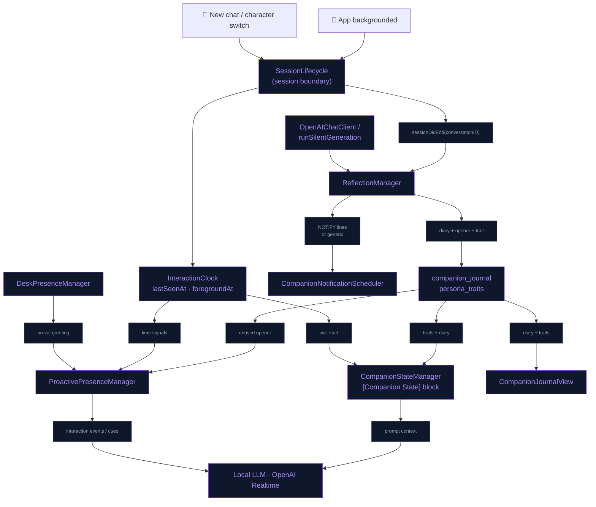
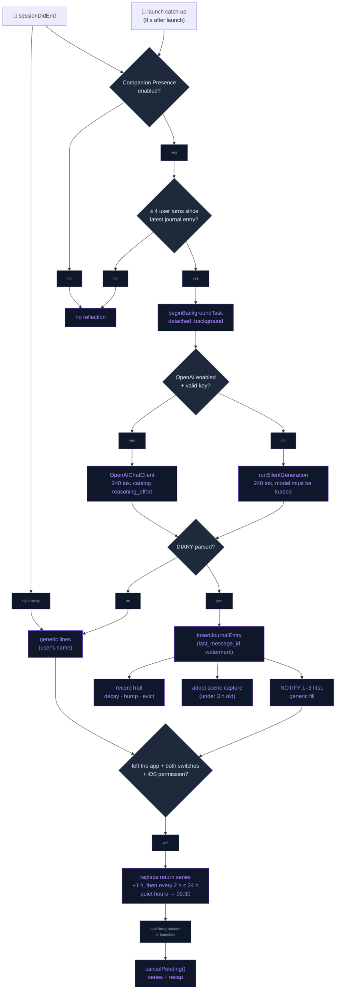
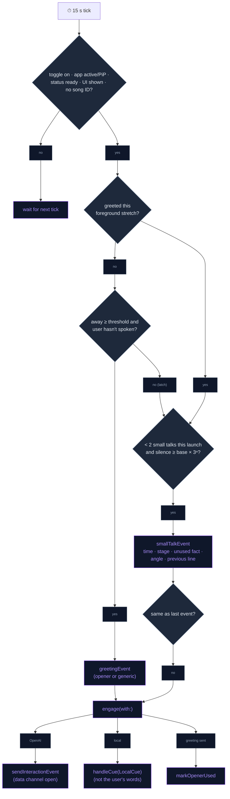

# Living Companion

The companion carries on between conversations. When a session ends it
reflects in private: it writes a diary line and saves an opener for next time,
may note a personality trait, and leaves a series of gentle "thinking of you"
notifications. When the user returns, it greets them with that opener, and it
breaks long silences on its own. It notices the user sitting down at the desk,
knows how long they have been apart and what their day holds, and hosts shared
activities: co-listening and mini-games. Everything it remembers or becomes can
be seen and deleted in the Journal sheet.

## Session boundaries

`SessionLifecycle` marks **session boundaries**. It posts
`SessionLifecycle.sessionDidEnd` (userInfo `conversationID`, `reason`) with the
active conversation id. Three things fire a boundary:

- **backgrounding** (`reason: "background"`), via
  `UIApplication.didEnterBackgroundNotification`,
- **new chat** (`ContentView.startNewChatSession`, `reason: "newChat"`),
- **character switch** (`VRMSceneView`, `reason: "characterSwitch"`).

Explicit callers post the boundary *before* they reset or stop the
conversation. A boundary does **not** reset the active conversation, so a
quick app switch never splits the chat history (a fresh conversation comes
only from New Chat or a cold launch). If no conversation row exists yet,
nothing is posted, so empty sessions are never reflected on. Two observers
act on it: `ReflectionManager` (below) and `MemoryRetain`, which flushes
un-retained turns
into agentic memory ([AGENTIC_MEMORY.md](../Memory/AGENTIC_MEMORY.md)) and
clears the follow-up mentions the session had its chance to use
([COMPANION_DEPTH.md](COMPANION_DEPTH.md#follow-ups-on-dated-plans)).

When "Keep talking in background" is on and a voice session is live,
`BackgroundSessionKeeper` holds the session open on backgrounding. The
boundary then fires later, when the keeper ends the session
(`reason: "backgroundIdle"` or `"backgroundGuard"`; see
[PRESENCE_BEYOND_APP.md](PRESENCE_BEYOND_APP.md#keep-talking-in-the-background)).

## Interaction clock

`Core/Utils/InteractionClock.swift` is the one clock for "when did the user
last interact":

- `lastUserSpeechAt` is kept in memory for the current launch. Both user-turn
  sites feed it through `noteUserSpoke()`: `LocalLLMManager` and
  `OpenAIRealtimeManager+Handlers`. It drives silence detection.
- `lastSeenAt` is saved to UserDefaults (`com.neuralink.presence.lastSeenAt`)
  on every backgrounding, even when the background keeper holds the session.
  It drives the "hours since last seen" absence check.
- `foregroundAt` is stamped at launch and on every return from the
  background. It marks the start of the current visit, which the time-apart
  and daily-grounding lines are frozen against.

The clock's arithmetic uses the device's local `Date` only. SQLite
`messages.timestamp` values are UTC strings, and they are never mixed into it.

## Storage

`MemoryStore`'s single `createTableQuery` creates three tables
(`snapshot_file` is added by a migration). Journal and trait CRUD lives in
`MemoryStore+Journal.swift`, keepsakes in `MemoryStore+Milestones.swift`.

```sql
companion_journal (id, character, conversation_id, diary, opener,
                   notification_line, notified, opener_used,
                   last_message_id, created_at, snapshot_file)
persona_traits    (id, character, trait, weight, created_at, updated_at)
companion_milestones (character, kind, achieved_at, celebrated_at)   -- PK (character, kind)
```

`companion_journal.conversation_id` deliberately has no foreign key.
`last_message_id` is the newest message a reflection covered, and it acts as
the **reflection watermark** (see End-of-session reflection). When the column
is added during an upgrade, it is backfilled to each conversation's current
last message. This stops the upgrade from re-reflecting conversations that
already have entries. Swift entities: `JournalEntry`, `PersonaTrait`
(`Domain/Entities/Companion/CompanionJournal.swift`); `MilestoneKind`,
`CompanionMilestone`, `MilestoneRules`
(`Domain/Entities/Companion/CompanionMilestone.swift`).

## One bond per character

The relationship is between the user and **one** character. Every row in
`messages` and `knowledge_graph` has a `character` column, the identity key
of the character on screen when it was written (`ConversationStore`,
`KnowledgeGraphManager`). One conversation can span a character switch, so
the tag is per message, not per conversation. The relationship meter, the
count-based keepsakes, the journal calendar, time apart, the carry-over line
and the home-screen widget all count only that character's rows
(`MemoryStore+Affinity`, `MemoryStore+CharacterBond`). A character met
today is "New", however long the user has known another one.

What a character **knows** is a separate setting. Facts about the user live
in the shared memory bank, and "Characters share memories" decides whether
recall also reads other characters' banks (`MemoryBanks`; see
[AGENTIC_MEMORY.md](../Memory/AGENTIC_MEMORY.md#memory-banks)). So a new
character can know the user's sister's name and still be at "New". The
meter's depth only counts facts the user told **this** character.

**Upgrading.** The first launch with the column attributes older rows once
(`attributeLegacyRows`):

1. A message a diary entry covered goes to that entry's character.
2. The rest of a reflected conversation goes to its latest diary character.
3. Anything else goes to the character with the most diary entries, or else
   the last character the user picked.
4. A fact goes to the character of the last message before it.

## Background text client

`Data/DataSources/OpenAI/OpenAIChatClient.swift` is the one-shot Chat
Completions client used by every background text call: titling, reflection,
memory retain, consolidation and mental models. It handles the bearer auth,
`max_completion_tokens`, the JSON parse and the usage record
([API_USAGE.md](../AI/API_USAGE.md)). It returns `nil` on any failure, and
callers skip silently. The model is the user-selected
`OpenAISettings.textModel` (AI Settings → Models). Two rules apply to
reasoning models:

- `temperature` is omitted for `gpt-5*` and `gpt-6*` ids, because they reject
  non-default values.
- `reasoning_effort` comes from the model's `OpenAIModelCatalog` entry:
  `"none"` for GPT-5.1 and later, `"minimal"` for the original `gpt-5` /
  `gpt-5-mini`, and nothing for non-reasoning models. At the default "medium"
  effort, a small budget like reflection's was used up entirely by reasoning,
  and the reply came back empty.

The Realtime/WebRTC voice path is separate.

## End-of-session reflection

On a session boundary, `ReflectionManager` runs **one silent LLM pass** over
the conversation's last 16 spoken turns (tool calls are excluded). The model
answers with labelled lines:

```
DIARY:   one or two first-person sentences about the talk and how it felt
OPENER:  one short, warm line to greet the user with next time
NOTIFY:  one or two short sentences (25 words max) inviting the user back
NOTIFY2: a different one for two hours later, never repeating NOTIFY
NOTIFY3: another one, different again
TRAIT:   optional — a new habit/dynamic note, only if clearly revealed
```

Replies are parsed as labelled lines, not JSON, because 1–2B local models
can't be trusted to produce valid JSON. Content can wrap onto the next lines.
Unlabelled leading text counts as the diary, because the local prompt ends
with `DIARY:`. Each field is trimmed and capped (diary 300, opener 200, each
notify line 220, trait 100 chars). If no diary comes back, nothing is stored.
The prompt forbids inventing facts.

- **Routing**: if OpenAI is enabled and has a valid key, the call goes to
  `OpenAIChatClient` (240 tokens, temperature 0.6 where the model allows
  it). Otherwise it goes to `LocalLLMManager.runSilentGeneration` (240
  tokens), and is skipped if the local model isn't loaded. That path writes
  nothing to the transcript or TTS and leaves the conversation's KV cache as
  it was. It starts only once the companion has been idle for 1.5 s (giving
  up after 120 s), and a user turn preempts it.
- **Guards**: the Companion Presence master switch must be on. The
  conversation must have **≥ 4 new spoken user turns since its latest
  journal entry** (`MemoryStore.unreflectedUserTurns`, which counts message
  ids above the `last_message_id` watermark). An `NSLock` in-flight set
  dedupes repeat calls. The active conversation survives backgrounding, so a
  long-running chat gets a fresh reflection, and a fresh notification
  series, every time it grows by another 4 or more turns.
- **Background budget**: the pass runs in `Task.detached(priority: .background)`
  inside `beginBackgroundTask`, which gives it about 30 s after
  backgrounding.
- **Launch catch-up**: 8 s after launch, the five most recently updated
  conversations (excluding the active one) are checked, and the first one
  updated within 7 days that meets the ≥ 4-new-turns guard is reflected on.
  This covers cold kills, missed background windows and a freshly enabled
  feature. Only one conversation is caught up per launch, and its entry is
  credited to the currently selected character.
- **Output**: a `companion_journal` row, the "First diary entry" keepsake, a
  widget snapshot refresh, the trait pool update (see Personality evolution),
  the latest candid capture of the scene as the entry's picture when one is
  fresh (see Diary pictures), and the return series re-scheduled with the
  reflection's lines. When a series is scheduled, the row is marked
  `notified`. A failed generation, or one with no diary, stores nothing, logs
  `[Reflection] Generation failed` and re-schedules the series with the
  generic lines.

### Notifications

When the user leaves mid-chat, `CompanionNotificationScheduler` schedules a
**return series**. It goes out in two steps, so it is never hostage to the
LLM: at the boundary, `ReflectionManager.scheduleSeriesNow` schedules it
straight away with the generic lines (under its own background-task grace),
and a finished reflection then replaces it with its own lines and picture. A
chat with fewer than 4 new user turns isn't reflected on and keeps the
generic series.

- **Timing**: anchored on the conversation's last spoken message. The first
  notification comes **1 h after it** (never sooner than a minute from now),
  then **one every 2 h**, for up to 24 h after the first (at most 12). iOS
  cannot run the app to compose a notification later, so the whole series is
  scheduled up front, one request per slot
  (`com.neuralink.presence.reflection.<seriesID>.<slot>`). Every series gets a
  fresh id and the removal of the previous one is awaited: removals run
  asynchronously, and with reused ids a late removal deleted the requests
  just added. A conversation with no user message schedules nothing.
- **Quiet hours**: 22:00–09:00 local. A slot inside that window moves to the
  next **09:30**, and the 2 h rhythm resumes from there.
- **Picture**: the first notification of the series carries the entry's
  diary picture as an image attachment (thumbnail clipped to the upper
  middle of the frame, where the character stands). The attachment is built
  from a copy, because the system moves the file it is given into its own
  store.
- **Cancelled on return**: every pending series request (matched by prefix)
  and the weekly recap are removed on every foreground return and on cold
  launch. Nothing is scheduled while the app is in the foreground, so launch
  catch-up and in-app boundaries (new chat, character switch) reflect
  silently.
- **Content**: the title is "‹Name› has been thinking of you". Bodies cycle
  through the reflection's `NOTIFY`, `NOTIFY2` and `NOTIFY3` lines, then a
  pool of warm generic lines that use the user's name
  (`CompanionNotificationCopy.genericLines`). A generated line is dropped
  unless it is 8–220 characters and reads like a message rather than a
  memory record ("the user …").
- **Weekly recap**: a one-off on its own identifier
  (`com.neuralink.presence.recap`), so it never replaces the series; it is
  cleared on return with the series. Follow-ups on dated plans use a third
  identifier ([COMPANION_DEPTH.md](COMPANION_DEPTH.md#follow-ups-on-dated-plans)).

The notification is rewritten as a **communication notification**
(`INSendMessageIntent` with the character as sender). iOS then shows the
character's thumbnail as a circular avatar in place of the app icon. The
thumbnail is looked up by the identity key and the sender is named with the
display name. This needs the `usernotifications.communication` entitlement.
The thumbnail is drawn onto an opaque gradient with a ring, because
transparent VRM thumbnails read badly inside the circle.
`CompanionNotificationPresenter` shows banners in the foreground
(`.banner, .list, .sound`) and handles the follow-ups' "Not this" action.

Authorization is alert + sound only, with no badge. It is requested whenever
the "Thinking of you" toggle is switched on (iOS asks once), including by a
preset.

## Personality evolution

- **One relationship curve**: `CompanionAffinity` drives both the UI meter
  (`CompanionStateStore`) and the prompt, for one character at a time (see
  One bond per character). The meter refreshes after every turn and on a
  character switch. The score weights shared days (45%, saturating at 30),
  depth (35%: facts learned, saturating at 20, and reflection count, at 12)
  and volume (20%: turns, which saturate at 150). Time apart cools it
  gently: full strength for 3 days, then a linear fade to a floor of 0.65×
  at 45 days. It is capped at 0.95. There are five stages: New (under 3 user
  turns), then by score Acquaintances (< 0.25), Friends (< 0.5), Good
  Friends (< 0.75) and Close. Each stage carries behaviour guidance, so the
  persona acts its stage.
- **Trait pool**: the optional `TRAIT:` line comes from the same reflection
  call, with no extra LLM call. On each reflection:
  1. Every trait for the character decays (×0.95).
  2. A case-insensitive match gets +1.0 weight.
  3. Otherwise, if the pool is full (5 per character), the weakest trait is
     evicted, and the new trait is inserted at weight 1.0.

  Traits must be 8–100 characters. They live only in `persona_traits` and
  are never copied into the fact stores.
- **Prompt block**: `CompanionStateManager.promptContext(characterName:compact:)`
  is the one hook shared by both engines: local `buildSystemContent` and the
  OpenAI session instructions. Its `[Companion State]` block holds:
  - relationship stage + guidance (once the user has spoken to this
    character),
  - the time-apart line (see Time apart),
  - the daily grounding lines (see Daily grounding),
  - recent tone,
  - known preferences (up to 6),
  - up to 3 traits,
  - the carry-over line (see Cross-session carry-over),
  - the keepsake celebration line (see Keepsake milestones).

  On `.llama1b` it is compact: 3 preferences, 2 traits and the short forms
  of the time-apart and grounding lines. The LLM-jp (`llmJp3`) path leaves it
  out. When nothing is known, it returns `""`. It sits in the system prompt
  rather than in `LocalLLMPromptStore.effectivePrompt`, so it never
  overwrites a prompt the user has saved.
- **Journal UI**: tapping the relationship meter (`RelationshipMeterBarOverlay`)
  opens `CompanionJournalView`, an inset-grouped list:
  - **Relationship**: the character's portrait (`CompanionPortrait`: the
    live render the widget pipeline keeps, else the model's thumbnail),
    stage label, meter and "N days together".
  - **Together**: a month calendar (`JournalCalendarView`). Each day carries
    up to three dots: grey when you talked, pink for a diary entry, purple
    for a keepsake. Today is outlined; future days are dimmed. Tap a day to
    filter the section below to it, tap again (or "All days") to clear;
    chevrons or a horizontal swipe change month and a "Today" button jumps
    back. The header line summarises the month ("Talked on 9 days · 3 diary
    entries · 1 keepsake").
  - **Day / This month** (`JournalDaySection`): with a day selected, the
    conversations you had that day with your message count (tap one and the
    journal closes, then the read-only transcript opens in ContentView's
    full-screen cover), its diary entries (swipe to delete; an entry shows
    the picture of the character's world adopted by that reflection, when
    there is one) and the keepsakes reached; "Nothing on this day." or "Not
    yet." otherwise. With no day selected, the month's diary entries and
    keepsakes newest first. Day grouping uses the device calendar and time
    zone (`JournalCalendarModel`), so a late-night chat lands on the day you
    lived it, not the UTC day SQLite stored.
  - **Keepsakes**: the badge grid (see Keepsake milestones).
  - **Personality**: traits, swipe to delete.
  - **Reset Personality**: after a confirmation, deletes the diary (with its
    pictures) and all traits. Chat history, keepsakes and facts are kept.

  Turns are read per visible month
  (`MemoryStore.userTurnStamps(between:and:character:)`); the diary and
  keepsakes are loaded once per open.

## Proactive engagement

`ProactivePresenceManager` lets the companion speak first. It checks every
**15 s** and works with either engine. With OpenAI selected it injects
through `OpenAIRealtimeManager.sendInteractionEvent`, only while the data
channel is open. On the local model it runs a `LocalCue` through
`LocalLLMManager.handleCue` — an instruction rather than the user's words, in
Japanese for the LLM-jp model, and checked before it is spoken so the
instruction itself is never read out
([Local_SLM_Model.md](../AI/Local_SLM_Model.md#lines-the-companion-starts-cues)).
A cue never interrupts a turn in flight.

- **Guards on every tick**: Speaks first (`isProactiveEngagementEnabled`) is
  on, and the app is active (or PiP is active). `status == .ready`, and the
  UI isn't hidden. No song recognition is running.
- **Absence greeting.** This fires at most once per foreground stretch. It
  needs `hoursSinceLastSeen ≥ absenceGreetingHours` (default 6 h), and the
  user must not have spoken first. The greeting uses the latest **unused
  opener** from `companion_journal`, which is marked `opener_used` once the
  greeting has gone in. Without an opener, a generic warm greeting is used.
  Both versions include how long the user was away and the time of day.
- **Silence small talk.** This fires after `silenceSmallTalkSec` of silence
  (default 90 s), measured from the later of the last user speech (before
  the first one, the moment the session became ready) and the last
  engagement. It fires at most **2 per launch**: the count isn't reset by
  backgrounding or a new chat. The wait triples each time (×3 backoff, so
  90 s → 270 s), and an event identical to the previous one is skipped. It
  is seeded with the time of day, the relationship stage and one random
  remembered fact not used before this launch. Each small talk takes a
  different **angle** (`SmallTalkAngle`): the first checks in, the second
  offers something of the character's own — a passing thought, the time of
  day, a tiny moment — with no question. It also quotes the character's
  previous line with an instruction to say something genuinely different, so
  two silences never get the same sentence.
- **Time-of-day** is not a separate trigger. It is a descriptor inside the
  greeting and small-talk events: early morning, morning, afternoon, evening
  or late night.

`engage(with:)` is also the shared injection seam for photo memories, the
desk-presence arrival greeting and the weekly recap's "Ask about it". When no
session is live, "Ask about it" stores its question as the next opener
instead: a journal row whose diary reads "Weekly recap follow-up".

## Shared activities

### Co-listening

A long-press on the Identify Song FAB, or `identify_song` with
`"mode": "session"`, turns recognition into a loop. It gets one persona
comment per track change and stops on its own. See
[SONG_RECOGNITION.md](SONG_RECOGNITION.md#co-listening-sessions).

### Mini-games

The `play_game` tool (`PlayGameSkill`) has two forms:

- `game`: `twenty_questions`, `trivia` or `word_chain`
- `action: "stop"`

It is a thin gate onto `GameSessionManager`, where the **rules live in code**.
The manager tracks the active game and the turn count (both engines count
real user turns). For 20 Questions it also picks and holds the secret answer,
since the LLM has no hidden state. The tool result is a rules brief the model
acts on. On the local path (not LLM-jp), a per-turn `[Active Game]` reminder
rides after the history, so the KV-cache prefix is untouched. The reminder
carries the turn number, the secret (20Q) and a wrap-up nudge at the soft cap
(20 / 10 / 15 turns). Local game turns get `maxTokens = 120` instead of the
usual 60. Five turns past the soft cap, the session ends itself.

## Desk presence

A welcome-back for a phone standing on a desk. Opt-in (AI Settings →
Companion → Autonomy → **Notice me at the desk**) and only while the camera
button is on: the app never starts the camera on its own.
`DeskPresenceManager` runs the policy once a second.

- **Face detection** (`FacePresenceDetector`): every 400 ms, the newest frame
  `CameraManager` already captures goes through Vision's face-rectangle
  request on this device, stood up with `.leftMirrored` for the front camera
  and `.right` for the back one (the back camera's hint on the front camera
  hands Vision an upside-down face: flickering detection and a flipped
  centre). The largest face's centre (normalised, upright, origin top-left)
  and width are published; "nobody" needs two empty passes in a row. Nothing
  is stored and no frame leaves the phone.
- **Gaze** (`VRMMetalState+AwayEpisode.followFace`): while a face is in
  the frame the look-at's `userPosition` follows it and the target switches
  from the camera or the forward rest to the user; when the face is gone the
  previous target is restored. A point target set by something else is left
  alone. `FaceGaze` anchors the point on the **scene camera** (the renderer
  keeps `lookAtController.cameraPosition` current, so an orbited view still
  means "at the viewer") and offsets it by the face's position in the frame
  along the camera's own right (flattened to the ground) and world up: up to
  1.2 m sideways and 0.9 m vertically. A fixed world point would be
  "straight ahead of the character", which with the camera orbited to one
  side is away from the user. The mirrored frame means right is right;
  `mirrorX` flips it if the device disagrees. Two things keep the head
  still: `FaceGazeSmoother` averages the detector's face position (newest
  sample weight 0.35) and emits a new target only when the average has moved
  ≥ 2 % of the frame, so detection noise of a few pixels never reaches the
  eyes; and while following, the controller's smoothing is raised from 0.1
  (a two-frame snap, right for a target that never moves) to 0.85 (about a
  third of a second), restored on hand-back.
- **Arrival greeting** (`DeskPresencePolicy`, `DeskPresenceManager`): a face
  that stays 3 s after an absence of 10 min or more fires one greeting
  through the shared `ProactivePresenceManager.engage(with:)` seam ("The
  user just sat down at the desk after 15 minutes away…"), only when
  `status == .ready`, at most once per 30 min. It does not need Speaks
  first. A passer-by, or a one-second detector flicker, never greets.
  Absence is measured from the moment the manager started when nobody has
  been seen yet.
- **Away** (`AwayEpisode`): nobody for `deskAwayMinutes` (default 10;
  5 / 10 / 20 / 30) starts the resting loop (see Clip pools by gender), the
  lowest-priority episode: idles stop and the look-at is switched off, but a
  pose, the phone and the listening loop outrank it and it resumes after
  them. A face that stays 2 s ends it (and, if the absence was long,
  greets). Safety cap four hours.

## Clip pools by gender

Every character carries a gender label (`CharacterGender`): fixed in the
registry for the bundled ones (`VRMModelRegistry.bundledGenders`: Oz is male,
every other bundled character female), chosen in the import sheet for a
user's VRM and editable afterwards in the character's settings. VRM metadata
has no such field, so the label is the app's. It decides which bundled clips
the body draws on (`AnimationCatalogue`):

| Clips | Female | Male |
|---|---|---|
| Base loop | `neutral` | `male_breathing` |
| Random idles | `default_state`, `neutral_2`…`neutral_4`, `relax`, `waiting` | `male_look_around`, `male_powerful`, `male_stretching_arms`, `neutral_4` |
| Resting loop (desk presence, away) | `relax` | `male_breathing` |
| Photo poses | `cool`, `peace_sign`, `relax`, `stretch` | `cool`, `stretch`; `peace_sign` → `cool`, `relax` → `stretch` |
| Entrance, talking gestures, phone, listening | shared | shared |

An idle plays once — never looped, since a short clip wrapping back to its
first frame pops — and the blend back to the base loop starts a second
before it ends. On the OpenAI path a generated gesture stream
([GENERATIVE_MOTION.md](../Engine/GENERATIVE_MOTION.md)) takes the talking
gesture's place for one reply: idles stand down while it plays, a pose or an
episode outranks it, and it crossfades home when the reply's motion has
played out. The pose tool keeps offering the same four names to every
character, and the body resolves a feminine pose when it plays. The male
clips came from the Sonya project's male set, plus Mixamo FBX clips
converted with `scripts/assets/fbx_to_vrma.py` (`male_breathing`,
`male_stretching_arms`); rows and models that predate the label are female.

## Diary pictures

The companion shares pictures of its own world back. Metal only draws while
the scene is on screen, and the reflection runs after the app has gone to
the background, so nothing is rendered at reflection time. Instead
`CompanionSceneCapture` keeps **one fresh candid capture** of the live
scene — the Metal drawable composited over the custom background, no HUD —
written as `latest.jpg` (≤ 1280 px JPEG) in the private `scene-captures`
directory:

- every 30 s while the scene is settled (model shown, entrance finished,
  app active), starting 8 s after a character loads;
- on `willResignActive`, best effort, so the frame on the way out is the
  freshest.

A reflection adopts the latest capture if it is under three hours old:
the file is copied to `journal-<id>.jpg` and its name stored in
`companion_journal.snapshot_file`. The journal shows it under the entry
and deletes it with the entry (and on Reset Personality); the first return
notification attaches it. No capture is ever posed: it is whatever the
character was doing, which is the point.

## Keepsake milestones

Shared "firsts" the user and the character collect, shown as badges in the
journal's **Keepsakes** section (dimmed until reached) and mentioned once by
the persona. Eight kinds (`MilestoneKind`; raw values are the stored keys):

| Keepsake | Unlocks when |
|---|---|
| First hello | the user has spoken to this character at least once |
| One week / 30 days / 100 days together | `distinctUserMessageDays(character:)` reaches 7 / 30 / 100 (the same per-character totals the affinity curve reads) |
| First shared song | the first `SongRecognitionManager.presentMatch` |
| First game together | the first `GameSessionManager.start` (the model decides who won, so a "win" badge is not knowable) |
| First photo shared | the first `PhotoMemoryService.handlePicked` |
| First diary entry | the first reflection row written for that character |

`CompanionMilestoneTracker` is stateless. Event keepsakes are noted where they
happen; count-based ones are re-derived in `CompanionStateStore.refresh()`
(every user turn) and again when the Keepsakes section appears. Rows are keyed
by `RealtimeChatState.selectedCharacterName`, the identity key the journal
uses, so each character has its own set. `INSERT OR IGNORE` on the
`(character, kind)` primary key makes every call idempotent, and rows with a
kind an older build doesn't know are skipped, never deleted.

**Celebration.** `CompanionStateManager.promptContext` asks the tracker for a
`celebrationLine`: keepsakes reached in the last 7 days and never mentioned
yield one `[Companion State]` line ("Keepsake to celebrate together, once and
naturally: 30 days together…"). The first call stamps `celebrated_at`; the line
then stays for two hours (`MilestoneRules.celebrationHold`) so the block is
identical on every turn of that session (the local path rebuilds the system
content per turn and reuses the KV prefix; Realtime re-sends instructions
mid-session), and it is gone from the next session on. Older keepsakes are
history, not news, and are never announced.

**The moment.** A newly recorded keepsake is handed to
`KeepsakeUnlockController`, and `KeepsakeUnlockCapsule` (in the HUD layer,
same placement and glass as the photoshoot capsule) rises from the bottom of
the scene with the badge, the title and its one-line meaning, plays a
success haptic, and leaves after 5 s or on tap. Unlocks queue and show one
at a time; a repeat record never shows anything, because only the first
`INSERT` succeeds.

**Reset.** "Reset Personality" keeps keepsakes: they are shared history like
the chat log, not a learned trait. Nothing in the app deletes them;
`deleteMilestones(character:)` is used by tests only.

## Cross-session carry-over

`CompanionStateManager.carryOverLine` adds one line to the Companion State
block, so no session starts cold, even with Companion Presence off:

1. **the latest reflection diary** (< 7 days, up to 200 chars): "Last
   session, you privately noted: …", else
2. **the last exchange with this character** outside the active conversation
   (< 48 h, up to 140 chars; `MemoryStore.lastExchange`), credited to whoever
   said it. Another character's closing line is never quoted back as "you
   saying".

The guidance line tells the persona to "pick up threads… never act like a
stranger". A new diary entry only lands at a session boundary, so the line
holds still within a session. The saved cross-launch KV cache misses
whenever the diary has changed, and warm-up then re-prefills.

## Time apart

The persona should know when the user has been gone a day or two, not only
at the moment of the absence greeting (which needs Speaks first on).
`CompanionStateManager` adds a **time-apart line** to the `[Companion State]`
block: "Time apart: you last talked 3 days ago (Friday evening); it's Tuesday
morning now. If the gap feels notable, acknowledge it naturally — glad to see
them, curious what they've been up to — without guilt-tripping or counting
days at them." The wording is `CompanionAbsence` (pure, unit-tested);
`.llama1b` gets the compact form.

Two rules keep it honest and stable:

- **Measured from before this visit.** The gap runs from the last user turn
  to this character strictly before `InteractionClock.foregroundAt` (launch,
  or the last return from the background;
  `MemoryStore.lastUserMessageAt(before:character:)`), so the turns of the
  current visit never shrink it to "a minute ago", and switching to a
  character last seen a week ago reads a week.
- **Frozen per visit and character.** The first block built in a visit
  snapshots that turn and the current time; every later build in the visit
  formats the same values, so the local KV prefix and the Realtime
  instruction refreshes see an identical block.

Wording: under an hour, nothing; same day, "earlier today, about N hours
ago"; then "yesterday (Monday evening)", "N days ago (…)", "about a week ago
(…)", "N weeks ago", "about a month ago", "about N months ago". Day names
are English whatever the device locale; the time zone and week are the
user's.

## Daily grounding

Two opt-in lines of real-world context in the `[Companion State]` block
(AI Settings → Companion → Autonomy → **Knowing your day**), so the persona
knows what the user's day holds without being told. Both are read-only and,
like the time-apart line, fetched once per foreground visit by
`DailyGroundingProvider` and held for the visit, so the block is stable
within a session. When a fetch changes the lines, it posts
`realtimeInstructionsDidChange`, which refreshes the Realtime instructions.

- **Know my day** (`CalendarGrounding`, EventKit full access): events under
  way or starting within 12 hours, soonest first, at most three: "Today's
  schedule: Ana's birthday (all day); Standup (now); Presentation at
  2:00 PM. Wish them luck or ask how it went when it fits naturally; never
  recite the list." Untitled events are skipped. Its store is separate from
  `ReminderSkill`'s, which only holds reminders access.
- **Know how I slept** (`SleepGrounding`, HealthKit sleep analysis, last 24
  h; the row only shows where HealthKit is available): "asleep" samples
  (stages, from a Watch or a sleep app) are summed as a union of intervals,
  so two sources recording the same night count once; "in bed" samples
  (what the iPhone alone records) likewise. The line only appears when the
  night was short — under 5.5 h asleep, or under 6 h in bed when there are
  no stages — and tells the persona to go gentle and not lecture. A normal
  night says nothing.

Turning a toggle on asks for the permission (`AutonomySettingsView.daySection`).
A denied calendar request turns the toggle back off. HealthKit never reveals
a denied read — it simply returns no samples — so the sleep toggle only turns
itself off when the request itself fails. The `.llama1b` tier gets compact
forms ("Today: …", "Sleep: about 4.5 h last night (short)."). The wording
and arithmetic are `DailyGrounding` (pure, unit-tested).

## Flow

### Architecture



### Reflection and notification



### Proactive tick



## Files

| File | Role |
|---|---|
| `Data/DataSources/Companion/SessionLifecycle.swift` | Session boundaries; posts `sessionDidEnd` |
| `Core/Utils/InteractionClock.swift` | `lastUserSpeechAt` (per launch), persisted `lastSeenAt`, `foregroundAt` (visit start) |
| `Domain/Entities/Companion/CompanionJournal.swift` | `JournalEntry` / `PersonaTrait` entities |
| `Data/DataSources/Memory/Store/MemoryStore+Journal.swift` | Journal + trait CRUD, `unreflectedUserTurns` watermark count |
| `Data/DataSources/Memory/Store/MemoryStore.swift` | Table DDL + `last_message_id` / `snapshot_file` migrations |
| `Data/DataSources/OpenAI/OpenAIChatClient.swift` | Shared one-shot Chat Completions client |
| `Data/DataSources/Companion/ReflectionManager.swift` | Reflection pass, labelled-line parser, trait pool, launch catch-up, return-series lines |
| `Core/Notifications/CompanionNotificationScheduler.swift` | Return series, quiet hours, recap, communication-style avatar, foreground presenter |
| `Core/Notifications/CompanionNotificationCopy.swift` | Generic lines, the 8–220-character / "the user" filter |
| `Data/DataSources/Companion/PresenceSettings.swift` | All presence toggles/thresholds (explicit-backing `@Observable`) |
| `Data/DataSources/Memory/CompanionState/CompanionAffinity.swift` | The single relationship curve + stage guidance, per character |
| `Data/DataSources/Memory/CompanionState/CompanionStateStore.swift` | Observable meter state for the character on screen; re-derives count-based keepsakes |
| `Data/DataSources/Memory/Store/MemoryStore+Affinity.swift` | Per-character meter inputs: turns, shared days, last seen, diary count, facts told |
| `Data/DataSources/Memory/Store/MemoryStore+CharacterBond.swift` | `character` columns, one-time attribution of older rows, per-character `lastExchange` |
| `Data/DataSources/Memory/CompanionState/CompanionStateManager.swift` | `[Companion State]` prompt block; time-apart (frozen per visit), carry-over and keepsake lines |
| `Presentation/Views/Journal/CompanionJournalView.swift` | Journal sheet: relationship, calendar, day / month list, keepsakes, traits, reset |
| `Domain/Entities/Companion/JournalCalendar.swift` | `JournalCalendarModel` month grid + local-day `JournalDayActivity` grouping |
| `Domain/Entities/Companion/CompanionAbsence.swift` | Time-apart wording (pure) |
| `Data/DataSources/Memory/Store/MemoryStore+JournalCalendar.swift` | `userTurnStamps(between:and:character:)`, `lastUserMessageAt(before:character:)` |
| `Domain/Entities/Companion/DailyGrounding.swift` | `GroundingEvent`, `SleepSummary`, schedule / sleep line wording, interval union |
| `Data/DataSources/Grounding/GroundingSettings.swift` | The two opt-in toggles (explicit-backing `@Observable`) |
| `Data/DataSources/Grounding/CalendarGrounding.swift` | EventKit full-access request + 12 h event read |
| `Data/DataSources/Grounding/SleepGrounding.swift` | HealthKit sleep-analysis request + last-night read |
| `Data/DataSources/Grounding/DailyGroundingProvider.swift` | Once-per-visit fetch held for the Companion State block |
| `Data/DataSources/Companion/CompanionSceneCapture.swift` | Candid scene captures: the 30 s loop, `latest.jpg`, the journal copy, the notification attachment |
| `Domain/Entities/Companion/DeskPresence.swift` | `DeskPresencePolicy` (arrival / away over face observations), greeting wording, `FaceGaze`, `FaceGazeSmoother` |
| `Domain/Entities/Motion/AwayEpisode.swift` | `AwayEpisodePolicy` + the app-wide `AwayEpisode` switch |
| `Data/DataSources/Vision/FacePresenceDetector.swift` | On-device Vision face presence on the camera's frames |
| `Data/DataSources/Companion/DeskPresenceManager.swift` | Runs the policy once a second; greeting + away episode |
| `Core/Engine/VRM/UI/VRMMetalState+AwayEpisode.swift` | Body side of the away loop + the face-following gaze |
| `Domain/Entities/Character/AnimationCatalogue.swift` | Per-gender base loop, idles, resting loop and pose mapping |
| `Presentation/Views/Journal/JournalCalendarView.swift` | Month grid, activity dots, swipe / chevrons, Today |
| `Presentation/Views/Journal/JournalDaySection.swift` | Selected-day or month list under the calendar; hands transcripts to ContentView's full-screen cover |
| `Data/DataSources/Companion/CompanionPortrait.swift` | Character face for the journal and Memory hero card (live portrait, else bundled thumbnail) |
| `Data/DataSources/Companion/KeepsakeUnlockController.swift` | Queue + lifetime for the "Keepsake collected" capsule |
| `Presentation/Views/Overlays/KeepsakeUnlockCapsule.swift` | The capsule itself: badge, title, haptic, tap or 5 s to dismiss |
| `Domain/Entities/Companion/CompanionMilestone.swift` | `MilestoneKind` (titles, symbols, day thresholds), `CompanionMilestone`, pure `MilestoneRules` |
| `Data/DataSources/Memory/Store/MemoryStore+Milestones.swift` | `companion_milestones` CRUD (`INSERT OR IGNORE` record, oldest-first read, celebrated flag) |
| `Data/DataSources/Memory/CompanionState/CompanionMilestoneTracker.swift` | `note` / `refreshDerived` / once-only `celebrationLine` |
| `Presentation/Views/Journal/CompanionKeepsakesSection.swift` | Badge grid in the journal; dims keepsakes not yet reached |
| `Presentation/Views/Overlays/RelationshipMeterBarOverlay.swift` | Meter overlay; tap opens the Journal |
| `Data/DataSources/Companion/ProactivePresenceManager.swift` | Absence greeting + silence small talk loop; shared `engage(with:)` |
| `Presentation/Views/Settings/AutonomySettingsView.swift` | Autonomy screen: preset header + the Talking / Seeing / Between sessions / Knowing your day cards |
| `Domain/Entities/Companion/AutonomyPreset.swift` | `AutonomyPreset` + `AutonomyFlags` (pure) |
| `Data/DataSources/Companion/AutonomyPresets.swift` | Reads and writes the switches a preset governs |
| `Data/DataSources/SongRecognition/SongRecognitionManager+Session.swift` | Co-listening loop |
| `Data/DataSources/Companion/GameSessionManager.swift` | Mini-game state machine, secret, per-turn reminder |
| `Domain/Entities/Skills/PlayGameSkill.swift` | `play_game` tool |
| `App/NeuraLinkApp.swift` | Starts `SessionLifecycle`, `ReflectionManager`, `ProactivePresenceManager`, `DeskPresenceManager` |

## Integration notes

- **Settings** (AI Settings → Companion → Autonomy). The screen opens with
  a **preset** header — Quiet / Balanced / Lively (`AutonomyPreset`, pure;
  `AutonomyPresets.swift` reads and writes the switches) — that sets the
  switches needing no permission; any other mix is a custom one. Below it,
  four cards of `FeatureToggleRow`s (tile, title, one-line meaning, ⓘ,
  switch; sub-settings slot in under a row while it is on):
  - **Talking**: Auto-turn detection, Interrupt while speaking, Sense my
    tone ([LLM_VOICE.md](../AI/LLM_VOICE.md)), Gesture while speaking
    (+ motion model card), Keep talking in background (+ End after silence).
  - **Seeing**: Proactive vision (+ interval, quiet after you speak), Notice
    me at the desk (+ Rest when nobody's there for, 5 / 10 / 20 / 30 min).
  - **Between sessions**: Companion Presence (master switch, off by default;
    "Thinking of you" notes sit under it and request iOS permission when
    turned on; turning either off cancels the pending notifications), Follow
    up on plans, Companion widgets, Speaks first (+ Greet after time away
    1 / 6 / 12 / 24 h, Break silence after 45 / 90 / 180 / 300 s). Without
    reflections, the greeting falls back to a generic welcome.
  - **Knowing your day**: Know my day, Know how I slept.

  The Autonomy row's subtitle in AI Settings names the preset (or "Custom")
  plus any permission-gated extras that are on (Vision, Desk, Grounding).
- **Settings storage**: every `PresenceSettings` property uses the
  explicit `_x` backing with `access`/`withMutation`, never `didSet`. Under
  MainActor default isolation, `didSet` fires during init and overwrites the
  value read from UserDefaults.
- **Attribution**: conversations aren't scoped to a character in SQL
  (messages are). Reflections and catch-ups are credited to the character
  selected when the reflection starts, and the return series is titled with
  it.
- **Absence math** uses `InteractionClock` only. SQLite UTC timestamps are
  never mixed in.
- **KV cache**: the local path rebuilds the Companion State block every turn
  and reuses the warm prefix, so the block must not drift within a session.
  The time-apart and grounding lines are frozen per visit, the keepsake line
  is held for 2 h, and the diary and traits only change at a session
  boundary. The game reminder rides after the history, so it never touches
  the prefix.
- **4 GB devices**: reflection is one ≤ 240-token call made after the session
  has ended. It never loads a cold model in the background. If the engine
  isn't loaded, launch catch-up handles the conversation instead.
- **Trust**: reflection prompts forbid invented facts. Everything the
  companion remembers or becomes is visible and deletable in the Journal.

## Troubleshooting

### Why no "thinking of you" notification arrived

| Cause | Detail |
|---|---|
| Too early | The first one is **1 h after the last message**, then every 2 h |
| Quiet hours | A slot in 22:00–09:00 local is moved to the next **09:30** |
| User came back | The whole series is **cancelled every time the app returns to the foreground** (and on cold launch) |
| Series over | It stops 24 h after the first notification; the next chat starts a new one |
| Switches off | Needs **both** the Companion Presence master switch **and** "Thinking of you" notes |
| iOS permission | Missing or revoked permission logs `[Presence] NOT scheduling — notification permission missing`; check Settings → Notifications → NeuraLink |
| Session kept alive | With "Keep talking in background" on, backgrounding logs `[Presence] Return series deferred until the background session ends`; the series goes out when the keeper ends the session |
| No user message | A conversation with nothing from the user logs `[Presence] Return series skipped: no user messages in conversation N` |
| Generic text only | Fewer than **4 new user turns** since the latest journal entry means no reflection, so the series keeps the generic lines. A long chat is reflected on again each time it gains 4 or more new turns. A failed reflection also leaves the generic lines. |
| Empty OpenAI reply | Reasoning models can spend the whole budget on reasoning. `OpenAIChatClient` sends the catalog's `reasoning_effort` (`none` / `minimal`). A reply with no diary logs `[Reflection] Generation failed` and nothing is stored. |
| Local model not loaded | Local-only setups skip the reflection (the generic series still goes out). Launch catch-up retries on the next launch. |
| Background window missed | The ~30 s `beginBackgroundTask` window ran out. Launch catch-up retries on the next launch. |

**Testing without waiting hours**: add the Xcode scheme launch argument
`-nl.debug.presenceNotifDelaySec 60`. The first notification then arrives N
seconds after the last message and the rest every 2N, with quiet hours skipped.
Chat, then background the app. `[Presence] Return series: …` logs how many were
scheduled, and `[Presence] Notification state (launch|foreground|scheduled)`
shows the permission status, the pending count and the next fire date.

## Known device-test items

- Check that reflection finishes inside the background window on 4 GB
  devices when running on the local model.
- Check that a long-running conversation produces a second diary entry and a
  second notification series after 4 or more new turns.
- Check that two silence breaks in one launch take different angles and
  different words.
- Check the journal calendar on device: horizontal month swipe inside the
  list, day selection and clearing, and the dismiss → transcript cover
  hand-off from a day row.
- Check the keepsake capsule on device: it should rise once with a haptic
  when a first song / game / photo lands, and never again for the same one.
- Check that the time-apart line reads the same on every turn of a session
  and names the right day after a real overnight gap.
- Daily grounding: the HealthKit entitlement needs **HealthKit enabled on
  the App ID** (Signing & Capabilities, or the developer portal) before a
  device build signs. Check the calendar prompt appears once, that a denied
  calendar permission turns the toggle back off, and that a short night from
  a Watch produces the sleep line while a normal night produces nothing.
- Diary pictures: confirm a capture is written while idle (log
  `[SceneCapture]`), that a diary entry made after a session shows it in
  the journal, and that the first return notification carries the image.
  Check the capture on the way to the background actually lands.
- Desk presence: with the camera on, confirm the gaze follows your head
  the right way (if it mirrors, flip `FaceGaze.mirrorX`), that sitting down
  after 10+ min away greets once, that leaving for the away threshold starts
  the resting loop and coming back ends it, and that a pose or the phone
  still win over the loop.
