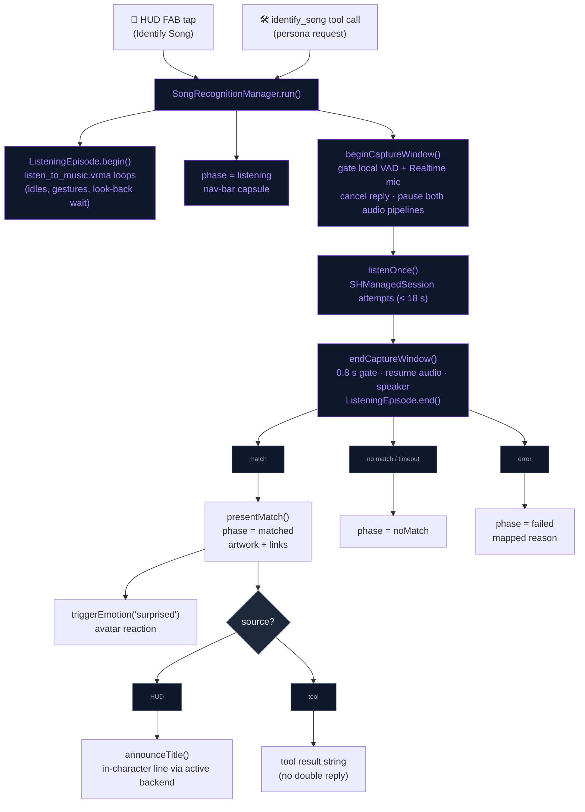

# Song Recognition

"What song is this?" — like Google's song search, but with a lively persona reaction.
The song itself is identified by **ShazamKit** (the LLM is text-only and cannot hear);
the LLM's job is the *interaction*: reacting to the match in character.

## Co-listening sessions

Long-press the Identify Song FAB — or ask the persona to "listen together"
(`identify_song` with `"mode": "session"`) — and recognition becomes a loop
(`SongRecognitionManager+Session.swift`): re-arm every ~75 s after a hit / ~20 s
after a miss or failure, keep the current track on the capsule (cyan waveform
badge; closing it ends the session), and inject ONE persona comment per track
change (≥ 60 s apart, dedupe by the case- and punctuation-stripped `trackKey`).
Each cycle reuses the one-shot `beginCaptureWindow → listenOnce → endCaptureWindow`
audio suspension and first waits (up to 45 s) for the persona to finish thinking
or speaking. While a session runs, a FAB tap is ignored and a one-shot
`identify_song` call answers that the session is already following the music.
Auto-stops: 30-minute cap, backgrounding, headphone (un)plug
(`.oldDeviceUnavailable`/`.newDeviceAvailable` only — our own capture churn is
ignored), battery < 20% unplugged, or 3 consecutive hard failures.

## Flow

## Files

| File | Role |
|---|---|
| `Domain/Entities/Companion/RecognizedSong.swift` | Framework-free entity; builds Apple Music / YouTube links |
| `Data/DataSources/SongRecognition/SongRecognitionManager.swift` | `@Observable` singleton; ShazamKit session, capture window, phase machine, persona-reaction injection |
| `Data/DataSources/SongRecognition/SongRecognitionManager+Session.swift` | Co-listening loop, auto-stop observers, pure `trackKey` / duration / battery helpers |
| `Presentation/Views/Overlays/SongRecognitionOverlay.swift` | Nav-bar principal capsule: pulsing listening state → artwork + link pills; retry on no-match / failure |
| `Presentation/Components/ExpandableFABMenu.swift` | Identify Song FAB (tap = one-shot, long-press = session) |
| `Domain/Entities/Motion/ListeningEpisode.swift` | App-wide switch: the body loops `listen_to_music.vrma` (Mixamo → VRMA via `scripts/fbx_to_vrma.py`) during a recognition and for a whole co-listening session; `VRMMetalState+ListeningEpisode.swift` is the scene side |
| `Domain/Entities/Skills/IdentifySongSkill.swift` | `identify_song` tool (awaits the result and returns it to the AI; `"session"` starts a co-listening session) |
| `Data/DataSources/FunctionCalling/AppFunctionTool.swift` | `identifySongTool` schema (optional `mode`: `once` / `session`) |
| `NeuraLinkTests/Companion/SongRecognitionTests.swift`, `CoListeningTests.swift`, `NeuraLinkTests/Animation/ListeningEpisodeTests.swift` | Links, session rules and schema, listening loop |

## Integration notes

- **Capture window**: voice processing (AEC / noise suppression) erases exactly
  the non-speech content Shazam fingerprints, so `beginCaptureWindow()` clears
  the mic for the listen: it gates the local VAD for 20 s
  (`LocalLLMManager.gateMicCapture(forSeconds:)`), holds the Realtime outgoing
  mic gate (`setMicGated(true, reason: .songRecognition)`), cancels any
  in-flight Realtime reply, pauses the local `AVAudioEngine`
  (`pauseCaptureForMusicRecognition()`) and disables WebRTC audio with the
  session dropped to `.default` mode (`suspendAudioUnit()`).
  `endCaptureWindow()` hands the local gate back to the normal 0.8 s
  cool-down, restores the full WebRTC session configuration (a bare mode
  switch would leave speech pitch-shifted at Shazam's sample rate), resumes
  the local engine only if it was running, releases the gate and puts output
  back on the speaker.
- **Reaction gating (local path)**: the title announcement and session
  comments are only injected when `RealtimeChatState.status` is
  `.ready`/`.listening` — never barging in on an in-flight generation. On
  OpenAI they go through `sendInteractionEvent`.
- **Links**: Apple Music uses the exact catalog URL from the match when
  present (`SHMatchedMediaItem.appleMusicURL`), else a
  `music.apple.com/search` universal link. YouTube uses an `https` results
  URL — neither needs an `LSApplicationQueriesSchemes` entry.
- **Permissions**: reuses the existing `NSMicrophoneUsageDescription`
  (`AVAudioApplication.requestRecordPermission()`). ShazamKit catalog
  matching needs network access and the ShazamKit app service enabled for
  the App ID in the developer portal.
- **Keepsake**: every match goes through `presentMatch`, which notes the
  `.firstSharedSong` milestone ([LIVING_COMPANION.md](LIVING_COMPANION.md#keepsake-milestones)).

## Troubleshooting

A failure shows on the capsule (orange triangle, retry and dismiss buttons)
as the mapped reason **with the raw `[domain code]`** appended; a tool call
gets the same text back as "I couldn't listen for the song: …". The capsule
is the only surface in Release — `nlLog` compiles to a no-op there; attach
Xcode with a Debug build for the full `[SongID]` log line including the
underlying error.

| Code (`com.apple.ShazamKit`) | Meaning | Usual cause |
|---|---|---|
| 202 `matchAttemptFailed`, 500 `internalError` | catalog query failed | **ShazamKit app service not enabled for the App ID** (developer portal → Identifiers → App Services), or no network; voice processing left on over the mic gives the same 202 |
| 100/101/200/201 (audio format / discontinuity / signature) | recorder produced unusable audio | a voice pipeline still holding the mic with voice processing on |

## Known device-test items

- The listening loop: `listen_to_music.vrma` plays for a one-shot listen and
  across a whole co-listening session, a pose or the phone episode can
  borrow the body, and the loop resumes after them.
