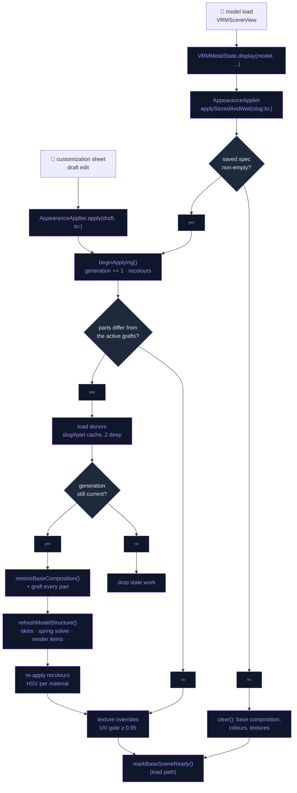
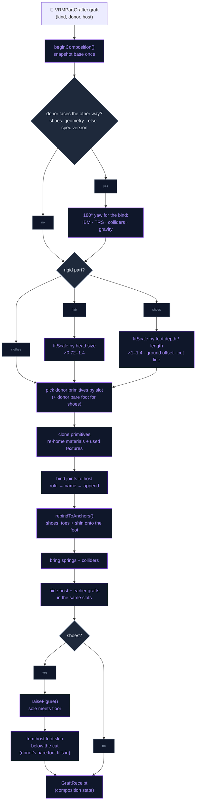
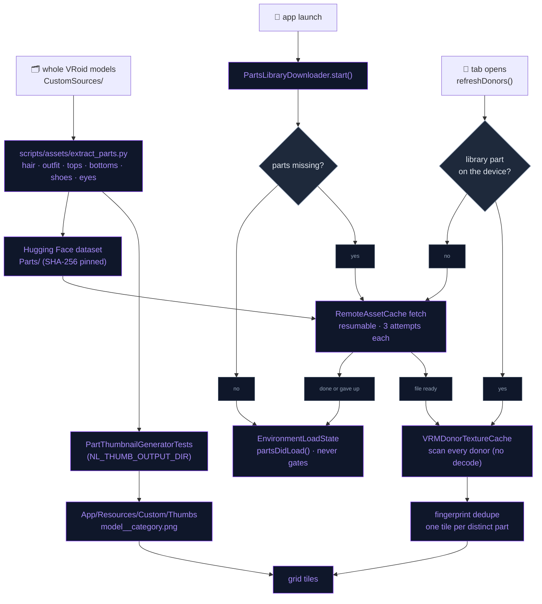

# Character Customization

Characters can be restyled live on the scene. The user can recolour hair,
eyes and clothes, borrow eye textures from other characters, and swap whole
parts: hairstyles, full outfits, or single garments (top, bottom, shoes).
Parts are grafted from the other characters in the app and from a downloaded
parts library. It works because every VRoid export shares two things:

- a stable material-name vocabulary (`*_Hair_00_HAIR`, `*_Tops_*`,
  `*_EyeIris_00_EYE`, …), classified into slots by `VRoidMaterialSlot`,
- the `J_Bip_*` humanoid skeleton.

Everything is a non-destructive overlay, saved per character and re-applied
on load. Nothing is written back to a model file, and there is no export
path.

## Opening the customizer

There are two entry points:

- long-press a card in the model picker → **Customize**
  (`ModelSelectionOverlay.onCustomize`). If that character is not on
  screen, `ContentView` switches to it first.
- **Customize Appearance** in the character's settings
  (`AppearanceSettingsSection`), shown only for the character on screen. It
  dismisses the settings sheet first.

`CharacterCustomizationCoordinator.isPresented` drives an overlay hosted by
`ContentView`. The overlay sits over the live Metal scene, so the renderer
*is* the preview.

## The sheet

`CharacterCustomizationView` is an edge-to-edge bottom sheet:

- a grab handle to resize it; it can be pulled shorter, never taller than
  the default,
- an icon-over-label **category rail**. Part tabs are always there, since a
  graft can add a part the host lacks; Eyes appears only when the model has
  an eye material to put a texture on (`CustomizationCategory.isAvailable`),
- a scrolling **grid** of picture tiles. The first tile is "Original", and
  the selected tile gets an accent ring and a check badge,
- a collapsible **colour** section,
- a **Reset / Save** footer.

Edits change a draft `AppearanceSpec` that `AppearanceApplier` applies
immediately:

- **Save** persists the draft (identity recolours dropped).
- **Close** (✕) restores the saved look, or clears it when nothing was
  saved.
- **Reset** clears everything.

Save and Close also free the donor-model cache.

| Category | Donor pick does | Colour sliders act on |
|---|---|---|
| Hair | Grafts hair + back hair | `hair`, `hairBack` |
| Outfit | Grafts the donor's **body skin and every garment** | tops, bottoms, shoes, one-piece, accessory |
| Top | Grafts tops + one-piece | `tops`, `onepiece` |
| Bottom | Grafts bottoms | `bottoms` |
| Shoes | Grafts shoes and the bare foot they were modelled around (library parts only) | `shoes` |
| Eyes | Borrows iris / white / highlight / extra **textures** | `eyeIris`, `eyeHighlight` |

The sliders only act on slots the model actually has.

**Exclusive picks**: Outfit and the single garments describe the same region
of the body (`AppearancePartKind.supersedes`). Picking one clears the other.

**Outfit vs single garments**: Outfit brings the donor's body skin along,
which is the faithful option, because VRoid deletes the skin its own outfit
hides. A single garment leaves the host's skin alone. If the new garment
covers less than the old one, it can expose a carved-away gap.

**Donor list** (`refreshDonors`): the tiles come from the parts library plus
every other registered character (bundled and imported).

- Characters are not offered as **shoe** donors. VRoid paints socks and
  stockings into the outfit material, so a shoe lifted off a whole character
  arrives without its legwear. Library shoe parts carry it.
- Every donor is scanned concurrently, and the tab's grid fills once the
  scans are done. Scanning a library part that is not on the device yet
  fetches it (joining the background download if that file is in flight),
  so on a fresh install a tab can wait on its missing parts.
- Donors whose part has the same **fingerprint** collapse into one tile. The
  fingerprint is a SHA-256 over slot + SHA-256 of the texture bytes + index
  count for each slot of the part (body skin left out of an outfit's), so
  one school uniform worn by several models is one tile.

## Recolouring

A recolour is an **HSV shift** in the fragment shader, not a tint. A tint can
only darken, and VRoid irises and hair need real hue changes.

- `SlotRecolor` holds hue −180…180°, saturation ×0…2 and brightness
  ×0.5…1.5.
- `AppearanceMaterialLayer` keys the shift by material index, and
  `buildMaterialUniforms` feeds it into block 13 of `MToonMaterialUniforms`.
- `nl_applyRecolor` applies it to both base **and** shade colour, so the
  shadow side follows, and to the outline.
- The colour section offers eight one-tap hue presets above the exact
  sliders. A preset is a hue rotation, not an absolute colour, so each
  swatch previews its rotation on a warm reference tone.

## Borrowing eye textures

The Eyes tab copies base-colour textures from a donor's matching slots.

- **Scan**: `VRMDonorTextureCache` inventories a donor's GLB without loading
  the model. It maps materials to slots, hashes the texture bytes, reads UV
  footprints and records each image's byte range. A 20 MB VRM scans in well
  under a second, and its cached entry is a few KB.
- **Compatibility gate**: a donor slot is offered only when the target
  slot's rasterized UVs are covered at ≥ **0.95**
  (`AppearanceApplier.compatibilityThreshold`, 64×64 `UVCoverageMask`) by
  the donor's UV footprint plus its painted texels. The footprint alone is
  tried first; the donor image is decoded for its painted-area masks only
  when that falls short, once per image. Face, eye-white and mouth UVs match
  across VRoid models, but the small eye parts sit in different places per
  model, which is what the gate catches.
- **Swap**: images are decoded straight, not premultiplied
  (`PNGStraightDecoder`), because ImageIO premultiplies on iOS. The new
  `MTLTexture` is swapped *inside* the shared `VRMTexture`. VRoid samples the
  same image as MToon's shade texture, so the shadow side follows. Originals
  are remembered for an exact reset.

## Grafting parts

`VRMPartGrafter.graft(kind, from: donor, donorSlug:, onto: host)` appends a
donor part to the host's plain arrays.

1. **Measure** first, in the host's and donor's bind spaces: which way the
   part faces, its fit scale, how far it must drop or rise to meet the
   floor, and (shoes) where the host's skin will be cut.
2. **Pick** donor primitives by slot (`AppearancePartKind.slots`), plus the
   donor's bare foot for shoes.
3. **Clone** them shallowly (GPU buffers shared), and re-home their
   materials plus only the textures they use.
4. **Bind** a new skin to **host** nodes:
   - humanoid bones by **role** first (`humanoidRole(ofNode:)`), so a rig
     with other bone names still binds,
   - then by name, for role-less helpers such as `J_Adj_*` and for donors
     without a humanoid map,
   - everything else (hair chains, skirt bones) is appended under its mapped
     ancestor with the donor's local TRS. Secondary bones (`J_Sec_*`,
     `HairJoint-*`) never bind by name, because those names collide between
     VRoid models while meaning different bones.
5. **Physics**: bring the donor's springs and collider groups for appended
   bones. Colliders on body bones resolve by role or name, so hair still
   collides with the head.
6. **Hide** the host's primitives in those slots, and any previously grafted
   ones, via `VRMModel.hiddenPrimitives`.
7. **Shoes** then raise the figure and trim the host's foot (below).

**Joint usage**: VRoid merges a body into one vertex array sliced per
primitive by indices. Joint usage (`VRMPrimitive.referencedJoints`) and
extents (`forEachRestPosition`) therefore always walk the index buffer.

**Orientation**: the renderer yaws VRM 0.x models 180°. When the donor faces
the opposite way from the host, every bone-local quantity is conjugated by
that yaw: inverse bind matrices, appended TRS, collider offsets, gravity.
For shoes the facing is read from the part's **geometry**
(`VRMPartGrafter+Orientation`), because one library part declares 1.0 while
laid out as 0.x; other parts compare the spec versions.

**Composition and undo** (`VRMModel+Composition`): the first graft takes a
snapshot of the base arrays. Any change restores the snapshot (including
trimmed index buffers, the figure's lift and attached props), then
re-grafts every active part. This gives an exact, order-independent undo.
After that, `VRMRenderer.refreshModelStructure()`:

- invalidates the render-item cache,
- re-runs skin palette setup,
- invalidates the CPU `SpringBoneSolver`, so the next frame rebuilds the
  chains from the rest pose and settles them before stepping.

### Fitting rigid parts

Clothes are skinned across the whole humanoid and follow the host's
proportions on their own. Their scale is always 1. Hair and shoes are rigid
on one bone, so they are fitted with `fitScale`, clamped to ×0.72–1.4 for
hair and ×1–1.4 for shoes. The scale applies to joints in `fitAnchorBones`
and to the bones appended with the part.

- **Hair** rides `head`. It is scaled by the host/donor head size: the
  height-and-depth diagonal of the face-skin bounds (face width is
  unreliable), or `NL_headSize` in a hair part's document `extras`, since a
  hair part carries no face.
- **Shoes** ride the feet and toes. They are scaled by whichever of foot
  **depth** (ankle to sole, read from the shoe the host already wears, else
  its bare foot) or foot **length** demands more, and are never shrunk.
  - **One piece on the foot**: a shoe is partly weighted to the toes (toe
    box) and the lower leg (collar, ankle strap, shaft). Kept as the donor
    bound them, those parts hang off the host's toe and knee joints at the
    donor's distances from them, and the shoe tears wherever the rigs
    differ — a heel's toe joint sits far lower than a flat foot's.
    `VRMPartGrafter+Anchors` re-binds each follower in
    `AppearancePartKind.anchorFollowers` so that, at rest, it places its
    vertices exactly where the foot does
    (followerIBM = followerBind⁻¹ · footBind · footIBM). The toes and shin
    still bend the part when they move.
  - **Grounding**: `raiseFigure` moves the host's root nodes up or down so
    the shoe's sole meets the floor, so the character stands taller in
    heels. Sliding the shoe instead would pull its cavity off the foot. An
    offset of 12 cm or more is taken as a mismeasurement and skipped.
    `lowerFigure` undoes the move on restore.
  - **Skin trim**: VRoid leaves a whole foot in the merged body primitive,
    shaped for its own shoe. `VRMPartGrafter+SkinTrim` gives that primitive
    a narrower index buffer that drops triangles whose three corners are
    below a cut line. The line sits at 90% of the shoe's collar height above
    the host's floor (the collar is the top of the highest of 12 bands still
    at least 60% as deep as the deepest, from up to 40k samples), capped at
    80% of the host's own foot depth. The full buffer stays on the primitive
    (`untrimmedIndices`) and is restored with the composition.
  - **Bare foot**: an open shoe (sandal, strappy heel) shows where the trim
    took the host's foot, so a shoe part also carries the donor's own foot,
    arched and toed for that shoe. `VRMPartGrafter+BareFoot` keeps the donor
    skin under the host's cut line mapped into donor space, so the two skins
    meet, and draws it with a double-sided copy of the **host's** skin
    material. VRoid has shipped more than one body unwrap, so each corner
    takes the UV of the nearest host foot vertex in the bind pose, and a
    triangle that would straddle two UV islands takes a single UV. The part
    file ships the foot without the body textures.
- Every measurement is taken in **bind space** (`bindPosition(of:)`, from the
  inverse bind matrix), never from animated `node.worldPosition`. The idle
  animation is already playing when a saved look is applied.

## Parts library

`scripts/assets/extract_parts.py` cuts whole VRoid models into minimal part VRMs:
`<model>__hair`, `__outfit`, `__tops`, `__bottoms`, `__shoes` and `__eyes`.
Each file keeps:

- only that part's primitives (re-indexed),
- their materials and textures (bytes verbatim, so fingerprints are stable),
- the full skeleton and springs,
- a trimmed VRM extension,
- the source model's head size (`NL_headSize` in `extras`).

A `__shoes` part also carries the below-knee slice of any legwear that
reaches the ankle, and the model's bare foot from the sole to just past the
shoe's top or the ankle. The foot keeps its body-skin material but none of
its textures, since the app draws it with the host's skin. An `__eyes` part
brings eyeline and lashes along so its picture reads as a pair of eyes.

Unnamed materials get a slot from the following sources, in order:

1. the glTF name,
2. the VRM 0.x property name,
3. the sampled image names,
4. an exclusively-hair mesh name,
5. the body band they occupy, for nameless materials on a body mesh with a
   known skin (ankles → shoes, hips/legs → bottoms, above the waist → tops).

Recovered slots are written under canonical names (`NL_Tops_01_CLOTH`, …).

- **Delivery**: the 119 files (about 365 MB) live in the Hugging Face
  dataset under `Parts/`. They are reached through
  `RemoteAssetRegistry.libraryPart(stem)` and pinned by size + SHA-256.
- **Manifest**: `PartsLibrary` lists `RemoteAssetRegistry.libraryPartStems`.
  Donor slugs are `lib:<stem>`, and library parts never appear in the
  character picker.
- **Background download**: `ContentView` starts `PartsLibraryDownloader`
  once per launch. It fetches missing parts (3 attempts each) and reports
  progress to the loading screen but never holds it. Every fetch resumes
  from its partial file with an HTTP Range request (`RemoteAssetCache.fetch`),
  so a slow link makes progress across attempts and launches instead of
  starting an outfit over. A file the server does not have (4xx) rests for
  six hours before it is asked for again.
- **Tile pictures** ship pre-rendered: 136 PNGs in
  `App/Resources/Custom/Thumbs/`, named `<model>__<category>.png`, covering
  the library and the bundled characters. Imported characters' tiles are
  rendered once at runtime by `VRMPartThumbnailRenderer`, then cached as
  PNGs by `PartThumbnailStore`:
  - private renderer with catalogue lighting,
  - transparent background,
  - framed on the part's own bounds,
  - one donor at a time, never while a graft is in flight.

## Saved looks

- **Storage**: `AppearanceSpec` (schema 2: `recolors`, `textures`, `parts`)
  is stored as JSON in the `character_appearance` table, keyed by the
  lowercased slug (`MemoryStore+Appearance`, `AppearanceStore` facade).
  Saving an empty spec deletes the row. Unknown slots and kinds from newer
  builds are skipped on decode. Deleting an imported character cascades to
  its row.
- **Apply on load**: `VRMSceneView` calls `state.display(model, …)`, then
  `await AppearanceApplier.shared.applyStoredAndWait(slug:to:)`, then
  `EnvironmentLoadState.shared.markBaseSceneReady()`. The character is never
  revealed in its original clothes first.
- **Apply order**: recolours (so sliders feel instant) → parts, when they
  differ from the active grafts (donor models load asynchronously, cached
  two deep by slug+part, and only the part's textures are decoded) →
  recolours again (grafts append materials) → texture overrides.
- **Stale work**: a generation counter drops async work left over from a
  previous pick or character.
- **Widget**: each apply re-renders the companion widget's portrait
  (`CompanionSnapshotWriter.refreshPortrait`, debounced).

## Flow

### Applying a look

### One graft

### Parts library

## Files

| File | Role |
|---|---|
| `Domain/Entities/Appearance/VRoidMaterialSlot.swift` | Prefix-agnostic slot classifier over VRoid material names |
| `Domain/Entities/Appearance/AppearanceSpec.swift` | `SlotRecolor`, `DonorTextureRef`, `AppearancePartKind` (slots, anchors, supersedes, floor/trim flags), tolerant Codable spec |
| `Core/Engine/VRM/Appearance/AppearanceMaterialLayer.swift` | Per-material HSV recolours + texture overrides with exact reset |
| `Core/Engine/VRM/Appearance/AppearanceTextureFactory.swift` | Straight-alpha texture upload for borrowed images, painted-area masks |
| `Core/Engine/VRM/Appearance/PNGStraightDecoder.swift` | Non-premultiplied PNG decode |
| `Core/Engine/VRM/Appearance/UVCoverageMask.swift` | 64×64 UV coverage masks for the texture gate |
| `Core/Engine/VRM/Appearance/Grafting/VRMPartGrafter.swift` | Graft: pick, clone, bind, springs, hide |
| `Core/Engine/VRM/Appearance/Grafting/VRMPartGrafter+Orientation.swift` | Geometry-based shoe facing, collider rotation |
| `Core/Engine/VRM/Appearance/Grafting/VRMPartGrafter+SkinTrim.swift` | Fit scale, grounding (`raiseFigure`/`lowerFigure`), cut line, host foot trim, `clippedClone` |
| `Core/Engine/VRM/Appearance/Grafting/VRMPartGrafter+Anchors.swift` | Re-binds a shoe's toe- and shin-weighted parts onto the foot |
| `Core/Engine/VRM/Appearance/Grafting/VRMPartGrafter+BareFoot.swift` | The donor's foot under a shoe, drawn in the host's skin |
| `Core/Engine/VRM/Appearance/VRMModel+Composition.swift` | Base snapshot, restore + re-graft, `humanoidRole(ofNode:)`, bind targets |
| `Core/Engine/VRM/Appearance/VRMModel+SlotBounds.swift` | Index-following rest bounds, `bindPosition(of:)`, head/foot reference sizes |
| `Core/Engine/VRM/Appearance/VRMModel+SlotNames.swift` | Material → slot lookup on a loaded model |
| `Core/Engine/VRM/Appearance/VRMRenderer+Refresh.swift` | `refreshModelStructure()` after a graft or restore |
| `Core/Engine/VRM/Appearance/VRMPartThumbnailRenderer.swift` | Offscreen tile renderer (catalogue lighting, transparent, part-framed) |
| `Core/Engine/VRM/Shaders/MToonCommon.metal`, `Core/Engine/VRM/Shaders/MToonShader.swift` | `nl_applyRecolor`; block 13 of `MToonMaterialUniforms` |
| `Data/DataSources/Characters/Appearance/AppearanceApplier.swift` | Spec → renderer state (colours → parts → colours → textures), donor cache, generation counter, compatibility gate |
| `Data/DataSources/Characters/Appearance/VRMDonorTextureCache.swift` | Decode-free donor inventory, fingerprints, lazy masks |
| `Data/DataSources/Characters/Appearance/PartsLibrary.swift` | Manifest of library parts (`lib:<stem>`) |
| `Data/DataSources/Characters/Appearance/PartsLibraryDownloader.swift` | Background download, 4xx cooldown |
| `Data/DataSources/Characters/Appearance/PartThumbnailStore.swift` | Bundled tile lookup + runtime render cache |
| `Data/DataSources/Assets/RemoteAssetRegistry+Parts.swift` | Part stems + size/SHA-256 pins |
| `Data/DataSources/Memory/Store/MemoryStore+Appearance.swift` | `character_appearance` table |
| `Data/Repositories/AppearanceStore.swift` | `@Observable` facade over the table |
| `Presentation/Views/Characters/Customization/CharacterCustomizationView.swift` | The sheet: rail, grid, colour, Reset/Save, donor list |
| `Presentation/Views/Characters/Customization/CustomizationCategory.swift` | Tabs → part kind / texture slots / recolour slots |
| `Presentation/Views/Characters/Customization/CustomizationItemGrid.swift` | Tile grid |
| `Presentation/Views/Characters/Customization/CustomizationColorSection.swift` | Hue presets + sliders |
| `Presentation/Views/Characters/Customization/CustomizationTheme.swift` | Sheet look and metrics |
| `Presentation/Views/Characters/Customization/CharacterCustomizationCoordinator.swift` | Presentation flag |
| `Presentation/Views/Settings/Persona/PersonaSettingsView+Appearance.swift` | "Customize Appearance" in character settings |
| `Presentation/Views/Overlays/ModelSelectionOverlay.swift`, `App/ContentView.swift` | Long-press "Customize"; the overlay host and the downloader start |
| `scripts/assets/extract_parts.py` | Cuts whole models into part VRMs |

## Integration notes

- **Asset pins**: re-uploading any `Parts/` file requires updating its pin in
  `RemoteAssetRegistry+Parts.swift`. Regenerating parts also changes
  fingerprints, so re-run the thumbnail generator:
  `TEST_RUNNER_NL_THUMB_OUTPUT_DIR=… xcodebuild test -only-testing:NeuraLinkTests/PartThumbnailGeneratorTests`.
- **No reloads**: customization never reloads the model. Everything is
  applied on top of `display()`, so switching tabs is instant.
- **VRoid guideline**: the app imports VRM and never exports a combined
  model. No save-as-VRM or share path exists for customized characters.
- **Tests** (`NeuraLinkTests/Characters/`):
  - `VRMPartGraftTests` and `VRMGraftCompatibilityTests` cover role binding,
    both spec versions, exact restore, colliders, the spring solver
    rebuilding for grafted chains, repeated swaps, hair and shoe fit, shoe
    grounding and trim. `ShoeGraftTests` covers the toe/shin re-binding and
    the borrowed bare foot.
  - `UVCoverageTests`, `VRoidMaterialSlotTests`, `AppearanceSpecTests`,
    `AppearanceStoreTests` and `PartsLibraryTests` cover the texture gate,
    the slot classifier, the spec, storage and the library.
  - `ShoeGraftDiagnostic` (`NL_SHOE_DIAG_DIR`; `NL_SHOE_DIAG_HOSTS`,
    default Sonya, Ekaterina and Oz; `NL_SHOE_DIAG_DONORS`) reports the
    exposed foot per host×donor pair and renders each pair close up from
    the front, three quarters, the side and the back.
    `NL_SHOE_DIAG_PARTS_DIR` reads freshly extracted parts from a local
    folder before they are uploaded. `HairGraftDiagnostic`
    (`NL_HAIR_DIAG_DIR`) renders grafted hair with the scalp, so a bald
    patch shows.

## Troubleshooting

| Symptom | Usual cause |
|---|---|
| Garment tile or bounds show the whole figure | Something read a primitive's raw vertex array instead of following its index buffer (VRoid merges the body into one array) |
| Grafted part lands wrong only after a pose | A measurement used animated `node.worldPosition`. Graft measurements must be in bind space |
| Hair floats off the origin on an imported model | The donor's or host's humanoid map is wrong for those bones, so they bound neither by role nor by name and were appended |
| A diagnostic render "passes" unchanged | Setting `node.rotation` needs `updateLocalMatrix()`; compare render hashes, not pictures |
| Shoe gap or buried foot | Set `NL_NO_SKIN_TRIM` to compare without the trim; run `ShoeGraftDiagnostic` for per-pair exposure |
| Toe box or strap pulled off a shoe | Set `NL_NO_ANCHOR_REBIND` to compare without the toe/shin re-binding |
| Open shoe shows no toes | The part file predates the bare foot (re-extract it), or the host has no visible VRoid body skin to lend |
| A tab's grid stays on its spinner | The scan is fetching library parts that have not arrived; the `[PartsDownload]` and `[Appearance]` lines say which |

## Known device-test items

- Recolour hair, eyes and clothes on Ekaterina (VRM 0.x) and Sonya
  (VRM 1.0). Switch characters with a saved look and back. Confirm Close
  restores and Reset clears.
- Shoe fit is tuned on the bundled characters (worst 1.7% of the foot
  exposed). An imported model with other proportions can still show the
  foot through a borrowed shoe.
- Opening customization while the parts library is still coming down on a
  slow link: how long a tab waits on its missing parts.
