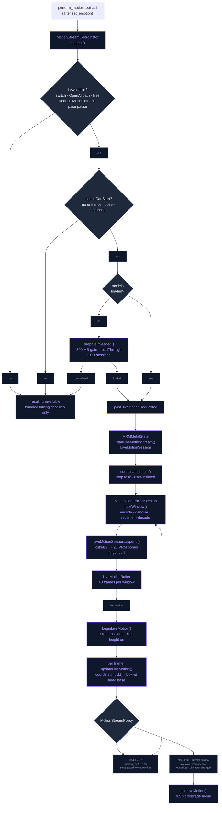

# Generative Motion

On the OpenAI voice path ([OpenAI Realtime](../AI/OPENAI_REALTIME.md)) the
character can move its body to match what it says. The Realtime model
describes one movement in a line of English ("A person waves with the right
hand"). A motion diffusion model on the phone turns that line into a stream
of poses, two seconds at a time, and the scene plays the stream through the
same player, crossfades and look-at as a `.vrma` clip. The bundled clips
remain the body's default: a generated gesture borrows the body for one
reply and hands it back. Off this path, or with the switch off, nothing
changes.

## What moves the body

The motion comes from NVIDIA's **ARDY** (`ARDY-Core-RP-20FPS-Horizon40`), an
autoregressive diffusion model over a 27-joint skeleton. Each window is
40 frames (2 s) at 20 fps and continues from up to 40 frames of its own
history, so a stream of any length is a chain of windows (the bridge's fixed
contract is a 20-token window of 148-float tokens, 4 frames each). The text
goes in through **ARDY-mini**'s distilled encoder, a 28 M-parameter MiniLM
student of ARDY's Llama 3 conditioning, which is what makes the whole thing
fit on a phone.

Three ONNX graphs do the work: text encoder, denoiser and decoder. Their
float32 weights sit in sidecar files that ONNX Runtime memory-maps (the
whole download is about 775 MB), so the phone holds them as file-backed
pages outside the app's footprint. `motion_bridge.cpp` runs them on the ONNX
Runtime the app already ships (VOICEVOX's build), on its CPU provider, the
one that reads the mapped weights in place (see Providers below).
`MotionGenerationSession` wraps them in the window bookkeeping: noise in,
history recentred on the last frame, latents snapped back to the quantizer's
grid, the decoded root kept as the next history. A seed gives the same
motion as the browser build and the Python driver the fixtures came from.

## From a reply to a gesture

The Realtime model is offered a `perform_motion` tool beside `set_emotion`
and asked to call it right after the emotion, before speaking. The call
carries a caption, an optional length (2–12 s) and whether the movement
should last the whole reply. It is answered at once, so decoding starts
while the audio is still being produced.

`MotionStreamCoordinator` owns the stream. It posts `.liveMotionRequested`,
the scene answers with a `LiveMotionSession` for the character on screen,
and a task keeps 2.5 s of decoded motion ahead of the playhead while the
character speaks and for 1.5 s after it stops, never more than 12 s a reply
(`MotionStreamPolicy`). A continuous movement, or one with no length, gets
the full 12 s budget and is cut by the speech tail. The first window
crossfades the body onto the stream. When the buffered motion has played
out, the body crossfades home and the idle timer re-arms.

A second `perform_motion` during the reply replans: the next window starts
as a fresh inference from the current position and heading, and its first
eight frames ease in from the last pose, because carrying the old action's
history smothers the new one. Its budget counts on from what was already
generated, still capped at 12 s.

While the entrance, a pose or an episode holds the body, the call is
answered "unavailable" instead (`MotionStreamCoordinator.sceneCanStart`,
the scene's `isBodyFreeForLiveMotion`), so the model is not told a gesture
started that never plays. A first window that lands after the body was
taken, or after the character changed, cancels its stream. The stream ends
when the playhead is on the buffer's last frame, one frame interval (50 ms)
short of the seconds generated, since the playhead waits there and never
passes it.

## The live clip

`LiveMotionClip` is an `AnimationClip` whose tracks read a `LiveMotionBuffer`
instead of keyframes, so `AnimationPlayer`, its crossfades and the tick
drive it unchanged. Each decoded frame is retargeted when it arrives
(`LiveMotionRetargeter`). ARDY's identity pose is a VRM 1.0 T-pose, so the
joint's local rotation goes through the loader's own math for an
identity-rest clip: flipped for VRM 0.x, conjugated into the model bone's
parent-rest basis and composed with the bone's rest.

- Twenty humanoid bones are driven; Spine2 folds into upperChest, and a
  parent the model lacks is absorbed by its child.
- The root is pinned in x/z so the character gestures in place; hips height
  is kept for bows and crouches, scaled by the model's hips height against
  the 0.9 m reference.
- The upper arms open 6° so mocap arms stay out of anime torsos.
- The index to little fingers hold a relaxed curl, since the skeleton has no
  fingers.

Between frames the pose is interpolated. The player samples through its own
clock (`LiveMotionBuffer.samplePlayer`). While frames lie ahead the two
clocks run together. When the player reaches the last frame the buffer's
clock waits there, so a late window resumes from the pose the body stopped
in instead of skipping ahead to wherever the player's clock has got to. The
coordinator reads that clock as the playhead.

In the body's pecking order a stream sits where a talking gesture does. A
pose or an episode (phone, listening, away) takes the body back at once,
idles and talking gestures stand down while it plays
(`VRMMetalState+TalkingGesture.swift` skips while `liveMotion` is set), and
the look-at composes on the stream's neck and head so a generated nod
survives the gaze.

## Captions that work

The model follows physical descriptions, not moods. "A person nods the head
up and down several times" nods; "A person nods in agreement" barely does.
"Shakes the head from side to side", "shrugs with both shoulders and open
palms", "waves with the right hand", "bows from the waist", "talks,
gesturing with both hands" and "scratches the back of the head" all read on
every bundled character. "Looks around curiously" turns the whole body, so
in-place wording ("glances left and right") is preferred. The tool's
description and the persona text appended while the tool is offered
(`CharacterPersona.motionInstructions`) ask for exactly this: a caption
starting "A person", body parts and movement rather than mood, one movement,
in place.

## Flow

## Files

| File | Role |
|---|---|
| `Core/Bridge/motion_bridge.{h,cpp}` | C API over the three ONNX graphs: sessions (CoreML → XNNPACK → CPU fallback, two user-initiated threads, prepacking off), text encoder, one DDIM window, decoder, timings, last error |
| `Data/DataSources/Motion/ARDY/ARDYMotionRuntime.swift` | Swift face of the bridge; `ARDYModelFiles` (graphs, sidecars, tokenizer); schedule and window constants from model.json; `readThrough` of the sidecars |
| `Data/DataSources/Motion/ARDY/ARDYModelLocator.swift` | Where the files are: the verified download, else a hand-copied `Caches/ardy-mini-fp32/` folder for development |
| `Data/DataSources/Motion/ARDY/ARDYWindowMath.swift`, `ARDYPortableRandom.swift`, `ARDYPromptTokenizer.swift` | Window bookkeeping, the browser-identical noise source, WordPiece through swift-transformers |
| `Data/DataSources/Motion/MotionGenerationSession.swift` | Actor: a caption's windows, replan as a fresh inference, `[Bench] motion encode` / `motion window` log lines, `NLSignposts.motion` |
| `Domain/Entities/Motion/MotionStreamPolicy.swift` | Lead, tail, budget, steps-by-tier and pacing rules (pure, tested) |
| `Data/DataSources/Motion/MotionStreamCoordinator.swift` | One stream per reply: request → scene → loop at user-initiated priority, steps paced to the measured window time; load behind a memory gate; unload on idle, memory warning, file removal or a path change |
| `Data/DataSources/Motion/MotionStreamHold.swift` | Why no gesture runs now (memory or pace), for the Settings card |
| `Core/Utils/MemoryFootprint.swift` | The app's physical footprint, its peak since launch and the kernel's remaining allowance, for the gate and the log lines |
| `Core/Engine/VRM/Animation/LiveMotion/*.swift` | `LiveMotionBuffer`, `LiveMotionRetargeter`, `LiveMotionClip` + `LiveMotionSession` |
| `Core/Engine/VRM/UI/VRMMetalState+LiveMotion.swift` | Scene side: observer, begin/end with crossfades, per-frame tick, look-at base, debug caption |
| `Core/Engine/VRM/UI/VRMMetalState+TalkingGesture.swift` | Bundled talking gestures, which stand down while a stream plays |
| `Data/DataSources/FunctionCalling/AppFunctionTool.swift`, `Data/DataSources/OpenAI/Realtime/OpenAIRealtimeManager+SessionConfig.swift`, `Data/DataSources/OpenAI/Realtime/OpenAIRealtimeManager+Handlers.swift`, `Domain/Entities/Character/CharacterPersona.swift` | `perform_motion` schema (offered only when `MotionSettings.offersTool`), load at session start, synchronous handler, caption guidance |
| `Data/DataSources/Motion/MotionSettings.swift`, `Domain/Entities/Companion/AutonomyPreset.swift`, `Presentation/Views/Settings/AutonomySettingsView.swift` | The "Gesture while speaking" switch (`AutonomyFlags.gestures`; balanced and lively on), with the model card under it |
| `Domain/Entities/Tutorial/TutorialScript.swift`, `Presentation/Components/Tutorial/TutorialOverlayHost.swift`, `App/ContentView+Tutorial.swift` | The onboarding tour's "gestures" beat: opens Settings › Autonomy from inside the tour and spotlights the switch |
| `Data/DataSources/Motion/MotionModelAccess.swift`, `Data/DataSources/Assets/RemoteAssetRegistry.swift`, `Presentation/Views/Settings/Models/MotionModelCard.swift` | Nine pinned assets under `motion/ardy-mini-external/`, download with progress after a notices sheet, removal, deletion of superseded downloads |
| `scripts/ardy_mini_batch.py`, `scripts/cskel_to_vrma.py`, `scripts/ardy_captions_rephrased.json` | The Python driver the fixtures and review clips came from, its VRMA writer and a caption set |
| `scripts/ardy_patch_graphs.py`, `scripts/ardy_external_graphs.py`, `scripts/ardy_fp16_graphs.py`, `scripts/ardy_onnx_to_coreml.py` | Explicit Clip bounds; the external-data split the downloaded files use (outputs checked bit for bit); the float16 conversion kept for the bench; a Core ML conversion attempt the app does not use |
| `NeuraLinkTests/Motion/MotionGenerationSessionTests.swift`, `LiveMotionClipTests.swift`, `MotionStreamPolicyTests.swift`, `MotionStreamCoordinatorTests.swift`, `MotionModelAssetsTests.swift` | Parity with the Python driver (two windows), parity with the VRMA path on Oz, Ekaterina and Sonya, the rules, the loop with a stub producer, the pins |
| `NeuraLinkTests/Motion/GeneratedMotionBench.swift`, `MotionBenchModelFiles.swift`, `GeneratedClipSnapshots.swift` | The device bench and where it finds its model files; the contact-sheet harness for review clips |

## Integration notes

- **Finding the switch**: the onboarding tour has a beat for it (`gestures`
  in `TutorialScript`, right after the Settings beat). It is the one beat
  whose target lives on another screen: `TutorialStep.Screen` lets a step
  require the Settings sheet the way other steps require a menu row, the
  scene presents the sheet and `AISettingsView` pushes Autonomy, a second
  `TutorialOverlayHost` inside the sheet cuts the spotlight around the
  "Gesture while speaking" row, and the sheet comes down when the tour
  moves on. `TutorialScript.version` is 3, so people who finished an
  earlier tour see it once.
- **Gates** (`MotionStreamCoordinator.isAvailable`): the switch on, the
  OpenAI path in use with the local model off, Reduce Motion off, the model
  files present and no pace pause. The tool is only offered when the switch
  is on and the files are present (`MotionSettings.offersTool`, read from
  UserDefaults so the tool list can be built on any thread), and the persona
  guidance is only appended then. A request is also declined while the body
  is held elsewhere. Without a stream the body behaves exactly as before.
- **Thermal**: the `normal` pressure tier allows up to 10 diffusion steps,
  `reduced` (serious thermal state or Low Power Mode) 4, which keeps motion
  at 80–115 % of its activity, and `minimal` ends the stream.
- **Pace**: within the tier's ceiling the steps follow the phone. Each
  window's wall time is measured and the next window gets as many steps as
  keep generation 1.25× ahead of playback
  (`MotionStreamPolicy.stepsAfterWindow`), at most one more than before and
  never under 4. The first window's time counts at 60 %
  (`firstWindowSteadyShare`) for the text encode and warm-up it carries, and
  it never ends a stream. The count is remembered
  (`motion.generated.paceSteps`) so the next stream starts there.
  The margin only decides how many steps to spend. At 4 steps the stream
  runs on as long as a window takes less than the 2 s it plays, and the
  2.5 s lead absorbs a window that lands late (an iPhone 11 takes about
  1.6 s a window, 0.41 s a step). When 4 steps would take 2 s or more the
  lead would shrink every window, so the stream ends ("too slow") rather
  than hold a frozen body. After two such streams in a row, with no window
  keeping up in between, no stream runs at that pressure tier or a worse
  one while the sessions stay loaded (`isPaceExhausted`), and the Settings
  card says so. A better tier (the phone cooled, Low Power Mode went off)
  or the next load tries again, in case the pace was the moment's; the
  card's line clears when that stream is allowed to try.
- **Threads**: `motion_bridge_create` gives the runtime two intra-op
  threads and one inter-op thread, no spinning between ops and no CPU
  arena, and creates its workers at user-initiated QoS
  (`createWorkerThread`). The generation loop and a replan run at the same
  priority, since the calling thread is the other intra-op thread. That is
  under the main thread's user-interactive, so a denoiser step never
  outranks the render loop or the audio, and above utility, which Apple
  silicon keeps on the efficiency cores while the main thread and the audio
  hold the performance cores (at utility an iPhone 11 took 1.1 s a step and
  every stream ended "too slow"). The local LLM's generation threads run at
  the same class. The `window` lines name the pressure tier beside the
  steps, since Low Power Mode and a serious thermal state cap the steps at
  4 and the CPU's clock with them.
- **Memory**: the weights stay out of the footprint. Each graph's float32
  weights sit in a sidecar (`ardy_mini_<graph>.onnx.data`, ONNX external
  data) that the runtime memory-maps and reads in place;
  `session.disable_prepacking` keeps it from copying every MatMul weight
  into memory of its own. The pages are clean and file-backed, so the
  kernel drops and fetches them again as it needs. What the app pays for is
  the session state and a window's activations: in the simulator bench the
  sessions add 11 MB and a window peaks 25 MB above that; on an iPhone 11
  the sessions load at a footprint of about 1.0 GB (the scene's own) and it
  peaks near 1064 MB through two windows. The first step after a load would
  fault the mapped weights in a page at a time (13 s in the simulator), so
  `ARDYMotionRuntime.readThrough` reads the sidecars once, front to back,
  before the sessions are made (1.8 s in the simulator, under a second on
  an iPhone 11; the `models ready` line says how long).
  - **Loading**: when the Realtime session starts with gestures available
    (`sendInitialSessionUpdate` → `prepareIfNeeded`), otherwise on the first
    request, off the main actor, and only when the kernel says the app may
    still take 300 MB (`os_proc_available_memory`,
    `MotionStreamCoordinator.loadHeadroomBytes`). Otherwise the gesture is
    skipped, the card shows why and the log line carries the numbers.
  - **Unloading**: a memory warning ends a running stream and drops the
    models, as does less than 160 MB of allowance left before a window
    (`streamMemoryFloorBytes`). They are also dropped after 10 minutes
    without a stream (`idleUnloadSeconds`, counted from the load or the last
    stream), when the files are removed from the card, and when
    `refreshAvailability` finds the OpenAI path is no longer in use. That
    check runs at Realtime session start, when the switch flips, after a
    download or removal and when the scene sets up, not when the backend is
    switched, so after a switch to the local model the idle timer or a
    memory warning frees them. A stream still playing then is finished, so
    the body crossfades home. An unload during a load wins: the load's
    result is discarded, and a request waiting on a load that failed is
    dropped rather than replayed into the same failure.
  - **Why sidecars**: an iPhone 11 allows the app about 2.1 GB and the
    scene takes about 1.0 GB. The fp32 graphs in one file (1.2 GB loaded)
    never passed the gate there, and float16 graphs were worse: the shipped
    runtime's CPU provider has no float16 MatMul kernel, so it casts every
    weight to float32 at the start of each step and holds the whole set for
    the step (1197 MB loaded, 1697 MB in the first window, then a memory
    warning). A phone with either earlier family's download still on it
    deletes it (`MotionModelAccess.removeSupersededDownloads`, folders
    `motion/ardy-mini` and `motion/ardy-mini-fp16`).
- **Providers**: the coordinator asks for the CPU provider, the one that
  reads the memory-mapped weights in place. The bridge can also register
  CoreML and XNNPACK, which the bench uses. For CoreML it tries the generic
  provider registration with a compiled-model cache
  (`Caches/ardy-coreml-cache`), then without the cache, then the legacy
  flags call; the shipped ONNX Runtime (1.20) accepts only the legacy call,
  so CoreML gets no compiled-model cache there. It also compiles a copy of
  the graph of its own and computes float16 graphs wrong (in the simulator
  bench the denoised window was 2.6 off the fixture, against 0.014 on the
  CPU). XNNPACK brings spinning threads of its own. The published graphs
  leave Clip's upper bound empty, which the CoreML provider refuses; the
  downloaded files carry explicit bounds (`scripts/ardy_patch_graphs.py`)
  and their weights in sidecars (`scripts/ardy_external_graphs.py`), the
  publisher's numbers bit for bit. The float16 family
  (`scripts/ardy_fp16_graphs.py`, 371 MB, 0.17 cm of joint position from
  fp32 on 24 four-second clips) and the single-file fp32 graphs stay in the
  dataset under `motion/ardy-mini-fp16/` and `motion/ardy-mini/` for the
  bench.
- **Model files and licences**: the denoiser and decoder are NVIDIA's under
  the NVIDIA Open Model License; the distilled encoder carries the Meta
  Llama 3 Community License ("Built with Meta Llama 3"), MiniLM's Apache
  2.0 and ARDY-mini's composite terms; the training captions are CC BY 4.0.
  The card shows these before the first download; nothing is bundled.
  Re-uploading an asset requires re-capturing its pin in
  `RemoteAssetRegistry.swift`.

## Troubleshooting

| Symptom | Where to look |
|---|---|
| The model never calls `perform_motion` | It is only offered when `MotionSettings.offersTool` is true at session start: switch on **and** files present (`motion.generated.modelsReady`). Reconnect after downloading. |
| `perform_motion` returns "unavailable" | A gate failed: an empty caption, local backend on, Reduce Motion on, files missing, a pace pause, the memory gate refusing the load, or the body held by the entrance, a pose or an episode (`[MotionStream] declined: the body is owned elsewhere`). |
| The gesture starts late | The first window costs a text encode, the runtime's warm-up and the remembered step count (up to 10), and when the models were not loaded yet it waits for the load and the sidecar read-through. `[Bench] motion encode` and `[Bench] motion window` lines give the costs; `[ARDYMotion] Sessions ready` says which provider was used. |
| The body freezes mid-gesture | The buffer ran dry: the next window was late. The body waits on its last pose and resumes when the window lands. The `[MotionStream] window N` lines give each window's wall time and the steps chosen next; a "too slow" end means even 4 steps could not keep up on this phone. |
| The card says "Paused" | `MotionStreamHold`: the phone had less than 300 MB of allowance when the model was to load (or a memory warning dropped it), or two streams in a row were too slow. The `[MotionStream]` log lines carry the numbers. A pace pause lifts when the pressure tier improves or the models reload (ten idle minutes, a memory warning, or a new Realtime session after a path change); the card's line clears when the next stream is allowed to try. |
| Every stream ends "too slow" | Each `[Bench] motion window` line gives the denoise time and its step count; at 0.5 s a step or more, 4 steps take as long as the window plays. The `window` line names the pressure tier (Low Power Mode and a serious thermal state cap the steps and the clock). Both runtime threads must be at user-initiated QoS (`motion_bridge.cpp`, `MotionStreamCoordinator.begin`): at utility the iPhone 11 took 1.1 s a step. |
| The whole scene stutters while a gesture is generated | The runtime's threads: `motion_bridge_create` caps them at two, at user-initiated QoS under the render loop's user-interactive, without spinning. A stutter beyond that points at memory pressure (watch the footprint in the window lines). |
| The gestures look different from the review clips | The phone runs the publisher's fp32 numbers, so a visible difference points at the provider: the `[ARDYMotion] Sessions ready` line must say `using cpu`. |
| The app is ended for memory during a reply | Look for `not loading the motion model` and `unloaded on memory warning` lines; each carries the footprint and its peak since launch. The weights are mapped, not held, so a climb between `models ready` and the warning is activations or the scene itself; calibrate `loadHeadroomBytes` and `streamMemoryFloorBytes` from those lines. |
| Feet slide or sink | The root is pinned in x/z and only hips height is applied; a hips height far from the reference skeleton's 0.9 m scales the bob (the ratio is clamped to 0.5–2). |
| Download fails with 404 | The card says "Not published yet": a file is missing from the dataset under `motion/ardy-mini-external/`. |

## Known device-test items

The iPhone 11 has run loading, memory, thread priority and two gestures
that looked right; these are still owed, on the iPhone 11 and the newest
phone available:

- `GeneratedMotionBench`: session creation time per provider, the
  continuation-window time at 10 and 4 steps, footprint, thermal state,
  twice in a row. The app's own files are the sidecar family: bundle the
  output of `scripts/ardy_external_graphs.py` in the git-ignored
  `NeuraLinkTests/MotionModels/` (or point `NL_MOTION_MODEL_DIR` at it in
  the simulator). `NL_MOTION_MODEL_DOWNLOAD=1` fetches the publisher's
  single-file fp32 graphs instead, whose Clip has no upper bound, so the
  CoreML provider refuses them; CoreML numbers need the patched graphs
  served from the Mac (`python3 -m http.server` in the output folder) with
  `NL_MOTION_MODEL_URL` set to that address.
- The pace rule: at 4 steps (about 1.6 s a window in `normal` on the
  iPhone 11) a stream runs to its budget or the speech tail instead of
  ending "too slow"; the body waits rather than skips when a window is
  late; a pause taken in `reduced` lifts when the tier returns to `normal`.
- Time to first motion: the iPhone 11's first window took about 4.2 s
  against 1.6 s for the next; the `[Bench] motion encode` line says how
  much of that is the encode. Also whether a step slows when the kernel has
  dropped the sidecars' pages. Without an API key the launch argument
  `-nl.debug.motionCaption "A person waves with the right hand."` plays an
  8 s caption about six seconds after the scene starts (files required; the
  switch, the path and Reduce Motion are ignored).
- Frame rate stays at the tier cap during a 12 s stream; no hitch at window
  boundaries; hair and skirts do not ring when the stream starts or stops.
- Feet planted, no sinking through the terrain, hips height right on all
  three bundled characters and an imported VRM.
- Look-at and the face-following gaze still work while a stream plays; a
  generated nod is visible.
- A pose, the phone episode and co-listening each interrupt a stream and
  hand back cleanly.
- Thermal: `reduced` drops to 4 steps, `minimal` ends the stream, both
  recover; a 30-minute session in a quiet room for heat.
- The tour's gestures beat: the Settings sheet comes up already on
  Autonomy, the spotlight sits on the "Gesture while speaking" row
  (scrolled into view on the iPhone 11's smaller sheet), and the sheet goes
  away on Next, Back and Skip.
