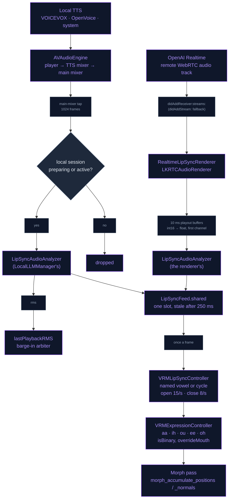

# Lip Sync

The character's mouth follows its voice on both voice paths. Neither path has
phoneme timings (OpenAI Realtime sends none, and the local TTS engines expose
none), so the mouth is read from the audio as it plays: its level opens the
mouth, and a rough three-band spectrum names one of the five VRM vowel shapes.
Both paths publish into one feed that the render tick reads once a frame, so
the mouth is within one audio buffer of what is heard.

## The mouth shapes

Lip sync drives the five vowel presets both VRM versions define, and nothing
else: neither spec has consonant presets, and the analysis does not name any.
`LipSyncVowel` and `VRMExpressionPreset` both name them as VRM 1.0 does.

| Shape | VRM 1.0 preset | VRM 0.x `presetName` | Mouth |
|---|---|---|---|
| `aa` | `aa` | `A` | Jaw dropped, wide open |
| `ih` | `ih` | `I` | Narrow, lips apart |
| `ou` | `ou` | `U` | Tight rounded pucker |
| `ee` | `ee` | `E` | Mid-open, spread |
| `oh` | `oh` | `O` | Rounded, mid-open |

The loader turns both versions into the same `VRMExpression`, so everything
after loading runs the same code whichever version the model is:

- **VRM 1.0** (`VRMC_vrm.expressions`, `parseExpressions`): presets are read by
  name. Morph binds name glTF *node* indices; `VRMRenderer.loadModel` remaps
  them to mesh indices (`remapExpressionNodes`) before registering them.
  Weights are 0–1. `isBinary` and `overrideMouth` / `overrideBlink` /
  `overrideLookAt` are read.
- **VRM 0.x** (`VRM.blendShapeMaster.blendShapeGroups`, `parseBlendShapeMaster`):
  `presetName` `a i u e o` maps to `aa ih ou ee oh` (`mapVRM0PresetToVRM1`).
  Binds already name mesh indices, with weights 0–100, divided by 100.
  `materialValues` become colour and UV binds. 0.x has no override fields, so
  every group overrides nothing.

A model with no vowel presets has nothing to drive, and its mouth stays still.

## The two sources

### OpenAI Realtime: WebRTC's playout buffers

Realtime audio plays through WebRTC's own audio unit. The app's WebRTC is
LiveKit's build of libwebrtc (`livekit/webrtc-xcframework`, module
`LiveKitWebRTC`, classes prefixed `LKRTC`), which has a renderer hook on audio
tracks: every buffer reaches the renderer as it goes to the speaker.

- **Attach.** When the remote audio track arrives,
  `peerConnection(_:didAdd:streams:)` (the unified-plan `didAddReceiver:streams:`
  callback) attaches `RealtimeLipSyncRenderer` to it. The legacy
  `peerConnection(_:didAdd:)` stream callback is the fallback. Attaching to a
  track that is already being heard (same `trackId`) does nothing. The renderer
  holds the `LKRTCAudioTrack` wrapper strongly. WebRTC's Objective-C layer
  hands out a fresh wrapper on every access, the renderer list lives in that
  wrapper, and a wrapper that is released takes its sinks off the track.
- **Render.** WebRTC's playout thread calls `render(pcmBuffer:)` with 10 ms
  buffers (480 frames at 48 kHz) of 16-bit PCM, interleaved, one or two
  channels. The first channel is converted to floats in a 4,096-frame buffer
  the renderer owns (`vDSP_vflt16`, scaled by 1/32 768; float buffers are
  copied as they are), so nothing allocates on that thread. The renderer's
  own `LipSyncAudioAnalyzer` reads it, and the cue goes to `LipSyncFeed`.
- **Detach.** At session teardown `stopLipSyncFeed()` removes the renderer
  from the track and resets the feed.

### Local TTS: the main-mixer tap

Every local engine (VOICEVOX, OpenVoice, the system voice) hands its buffers
to `scheduleBuffer`. They play through the app's `AVAudioEngine`: player →
TTS mixer (pinned at 48 kHz stereo) → main mixer. A tap on the main mixer
(`installTap(onBus: 0, bufferSize: 1024)`, about 21 ms at 48 kHz) calls
`reportAmplitude`, which:

1. returns at once unless the local session is preparing or active
   (`isPreparingOrActive`, lock-guarded). A switch to OpenAI stops the player
   but not the engine, and without this check the tap would publish silence
   over the Realtime cues in the one-slot feed;
2. analyses the first channel with `LocalLLMManager`'s own analyzer;
3. keeps the buffer's RMS as `lastPlaybackRMS`, which the barge-in arbiter
   compares with the microphone (see [Chat & LLM](../AI/CHAT_LLM.md));
4. publishes the cue.

## The audio analysis — `LipSyncAudioAnalyzer`

There is one analyzer per audio thread, because the level's peak carries over
from one call to the next. For each buffer:

1. **RMS.** `vDSP_rmsqv` over the whole buffer.
2. **Level.** `LipSyncLevelNormalizer` measures the RMS against a remembered
   peak that halves every 1.5 s without a louder sound. Below 0.002 RMS
   (about −54 dBFS) the level is 0. A quiet voice therefore opens the mouth as
   far as a loud one, and a pause closes it.
3. **Bands**, only when the level is at least 0.15. A Hann-windowed 512-point
   FFT runs over every full 512-sample hop of the buffer. A shorter buffer is
   one zero-padded frame: WebRTC's 480 frames are one frame and the tap's 1,024
   are two hops. The power, with the DC bin dropped, is summed into three bands:

   | Band | Hz | Carries |
   |---|---|---|
   | low | 100–600 | Voicing and the rounded vowels (`oh`, `ou`) |
   | mid | 600–1 500 | The open vowel's first formant, near 800 Hz (`aa`) |
   | high | 1 500–4 000 | The front vowels' second formant (`ee`, `ih`) |

4. **Vowel.** The bands' shares of their total pick the shape:

   | Rule (checked in order) | Shape |
   |---|---|
   | high ≥ 45 % and mid ≥ 20 % | `ee` |
   | high ≥ 45 % | `ih` |
   | mid ≥ 35 % | `aa` |
   | mid ≥ 15 % | `oh` |
   | otherwise | `ou` |

   These are not phonemes, but they are enough for the mouth to follow the words.

The result is a `LipSyncSample` (level 0–1, the vowel or nil, and
`ProcessInfo.systemUptime` when it was measured), plus the raw RMS.

## The feed — `LipSyncFeed`

`LipSyncFeed.shared` holds one cue behind a lock. Audio threads `publish`,
and the render tick reads `current()` once a frame. A cue older than 250 ms
reads as nil, which means silence, so a voice that stops mid-word (for
example when the connection drops) closes the mouth instead of holding it
open. Whichever path published last wins, which is why the local tap stays
quiet while the Realtime path is in use.

## The mouth — `VRMLipSyncController`

`VRMMetalState.animationTickInternal` reads the feed every frame, then calls
`update(audioLevel:vowel:deltaTime:)` and `apply(to: renderer.expressionController)`.

- **Silence** (level ≤ 0.04): every vowel moves toward 0 at a rate of 8 per
  second (`t = min(8·dt, 1)`) and snaps to 0 below 0.005.
- **Sound** (level > 0.04): the active vowel moves toward `min(level × 1.6, 1)`
  and the other four toward 0, at a rate of 15 per second. The mouth opens fast
  and closes more softly.
- **Which shape.** When the cue names a vowel, the controller switches to it
  once the current shape has shown for 70 ms, and holds it while the analysis
  agrees. When the cue names none (the level is between 0.04 and 0.15, under
  the analysis's voiced level), the controller cycles through
  `aa oh aa ee aa ih oh ou aa ee`, which is weighted toward the open vowels.
  Each shape is held for a random 70–140 ms.
- `apply` writes all five vowel weights every frame.

## Applying the weights

The tick sets expressions in this order: VRMA expression tracks, blink,
look-at, lip sync, then the emotion presets. Lip sync writes the five mouth
presets every frame, so a clip's own mouth tracks never survive it.

`VRMExpressionController.setExpressionWeight` clamps the weight to 0–1 and
re-evaluates every active expression:

- `isBinary` snaps a weight to 0 or 1 at 0.5.
- If another active expression has `overrideMouth: block`, the five mouth
  presets are zeroed while it is on. With `blend`, they are scaled by
  1 − (the sum of the blending weights). A mouth preset never overrides its
  own kind.
- Each morph bind adds weight × bind weight to its mesh's morph weights
  (`weightsForMesh`). Colour and UV binds add their difference from the
  material's own value.

The renderer's morph pass (`applyMorphTargetsCompute`, before the draws) takes
each primitive's strongest weights, at most 8 and each above 1e-4
(`VRMMorphTargetSystem.buildActiveSet`). It runs `morph_accumulate_positions`
and `morph_accumulate_normals` on the GPU (base + Σ weight × delta).

## Flow

## Timing and thresholds

| Parameter | Value | Where |
|---|---|---|
| Playout buffer (OpenAI) | 10 ms, 16-bit | WebRTC → `RealtimeLipSyncRenderer` |
| Tap buffer (local) | 1,024 frames, about 21 ms at 48 kHz | `LocalLLMManager+Audio` |
| Spectrum | 512-point Hann FFT (vDSP) | `LipSyncAudioAnalyzer.frameSamples` |
| Bands | 100–600 / 600–1 500 / 1 500–4 000 Hz | `lowBand` / `midBand` / `highBand` |
| Voiced level | 0.15 | `voicedLevel`: under it no shape is named |
| Level floor | 0.002 RMS | `LipSyncLevelNormalizer.floor` |
| Peak half-life | 1.5 s | `LipSyncLevelNormalizer.halfLife` |
| Stale cue | 250 ms | `LipSyncFeed.maxAge` |
| Silence threshold | 0.04 level | `VRMLipSyncController.silenceThreshold` |
| Open / close rate | 15 /s, 8 /s | `openLerpSpeed` / `closeLerpSpeed` |
| Shape hold | 70 ms named; 70–140 ms cycled | `minVowelDuration` / `maxVowelDuration` |
| Mouth gain | level × 1.6, capped at 1 | `VRMLipSyncController.advanceVowel` |

## Files

| File | Role |
|---|---|
| `NeuraLink/Data/DataSources/OpenAI/Realtime/RealtimeLipSyncRenderer.swift` | `LKRTCAudioRenderer` on the remote track: 16-bit playout buffers to floats, analysed, published |
| `NeuraLink/Data/DataSources/OpenAI/Realtime/OpenAIRealtimeManager+Handlers.swift` | The delegate callbacks that attach it (`didAddReceiver:streams:`, `didAddStream:`) |
| `NeuraLink/Data/DataSources/LocalLLM/Manager/LocalLLMManager+Audio.swift` | The audio graph, the main-mixer tap and `reportAmplitude` |
| `NeuraLink/Data/DataSources/Audio/LipSyncAudioAnalyzer.swift` | RMS, level, three bands, vowel |
| `NeuraLink/Domain/Entities/Motion/LipSyncFeed.swift` | `LipSyncVowel`, `LipSyncSample`, `LipSyncLevelNormalizer`, the one-slot feed |
| `NeuraLink/Core/Engine/VRM/Animation/Expression/VRMLipSyncController.swift` | Shape choice, cycle and smoothing |
| `NeuraLink/Core/Engine/VRM/Animation/Expression/VRMExpressionController.swift` | Expression weights → morph, colour and UV weights, with `isBinary` and the overrides |
| `NeuraLink/Core/Engine/VRM/Animation/Expression/VRMMorphTargets.swift` | `VRMMorphTargetSystem`: active set and the GPU morph dispatch |
| `NeuraLink/Core/Engine/VRM/Loader/VRMExtensions/VRMExtensionParser+Expressions.swift` | VRM 1.0 expressions and VRM 0.x blend shape groups → `VRMExpression` |
| `NeuraLink/Core/Engine/VRM/UI/VRMMetalState+Actions.swift` | `animationTickInternal`: reads the feed and applies the mouth each frame |
| `NeuraLinkTests/Animation/LipSyncTests.swift` | Vowels from band energies, the level, staleness, the renderer's 16-bit path, the attach selector, the controller's hold and cycle |

## Troubleshooting

- **No mouth on the OpenAI path.** Look for `[LipSync] renderer attached to
  remote track …` followed by `[LipSync] first playout buffer: … frames, … Hz,
  … ch, int16 interleaved, rms …`. If the renderer is attached but no buffer
  ever arrives, the track wrapper was released (the renderer must keep it). If
  neither line appears, the delegate callback is not firing:
  `LipSyncTests` checks that the manager answers
  `peerConnection:didAddReceiver:streams:`, because a Swift method that only
  looks like a delegate requirement compiles fine and never runs. At teardown
  the log shows `[LipSync] renderer detached after N playout buffers`.
- **The mouth stops while an emotion shows.** The model's emotion expression
  sets `overrideMouth: block` (or `blend`), and the spec says the mouth gives
  way to it.
- **The mouth never moves on one model.** The model has no `aa`…`oh` (VRM 1.0)
  or `A`…`O` (VRM 0.x) presets.

See [OpenAI Realtime](../AI/OPENAI_REALTIME.md) and
[Voice Architecture](../AI/LLM_VOICE.md) for the two audio stacks the cues are
read from.
