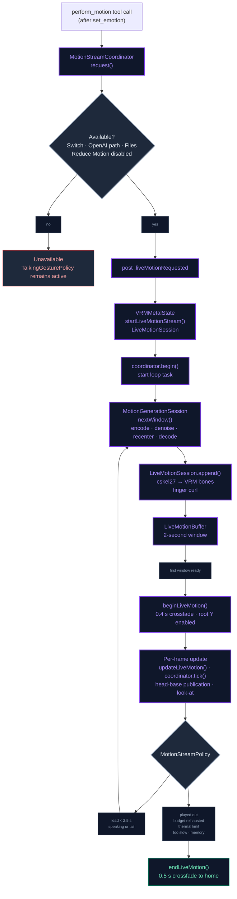

# Generative Motion

On the OpenAI voice path the character can move its body to match what it
says: the Realtime model describes one movement in a line of English
("A person waves with the right hand"), a motion diffusion model on the
phone turns that line into a stream of poses two seconds at a time, and the
scene plays the stream through the same player, crossfades and look-at as a
`.vrma` clip. The bundled clips remain the body's default; a generated
gesture borrows the body for one reply and hands it back. Off this path, or
with the switch off, nothing changes.

## What moves the body

The motion comes from NVIDIA's **ARDY** (`ARDY-Core-RP-20FPS-Horizon40`), an
autoregressive diffusion model over a 27-joint skeleton: 40 frames (2 s) a
window at 20 fps, continuing from up to 40 frames of its own history, so a
stream of any length is a chain of windows. The text goes in through
**ARDY-mini**'s distilled encoder, a 28 M-parameter MiniLM student of
ARDY's Llama 3 conditioning, which is what makes the whole thing fit on a
phone. Three ONNX graphs do the work (text encoder, denoiser, decoder;
`motion_bridge.cpp` runs them on the ONNX Runtime the app already ships
for VOICEVOX, on the CoreML provider when it is accepted, else XNNPACK,
else the CPU), and `MotionGenerationSession` wraps them in the window
bookkeeping: noise in, history recentred on the last frame, latents snapped
back to the quantizer's grid, the decoded root kept as the next history.
A seed gives the same motion as the browser build and the Python driver
the fixtures came from.

## From a reply to a gesture

The Realtime model is offered a `perform_motion` tool beside `set_emotion`
and asked to call it right after the emotion, before speaking, with a
caption, an optional length (2–12 s) and whether the movement should last
the whole reply. The call is answered at once, so decoding starts while the
audio is still being produced. `MotionStreamCoordinator` owns the stream:
it posts `.liveMotionRequested`, the scene answers with a `LiveMotionSession`
for the character on screen, and a task keeps 2.5 s of decoded motion ahead
of the playhead while the character speaks and for 1.5 s after it stops,
never more than 12 s a reply (`MotionStreamPolicy`). The first window
crossfades the body onto the stream; when the buffered motion has played
out, the body crossfades home and the idle timer re-arms. A second
`perform_motion` during the reply replans: the next window starts as a
fresh inference from the current position and heading and its first eight
frames ease in from the last pose, because carrying the old action's
history smothers the new one.

## The live clip

`LiveMotionClip` is an `AnimationClip` whose tracks read a `LiveMotionBuffer`
instead of keyframes, so `AnimationPlayer`, its crossfades and the tick
drive it unchanged. Each decoded frame is retargeted when it arrives
(`LiveMotionRetargeter`): ARDY's identity pose is a VRM 1.0 T-pose, so the
joint's local rotation goes through the loader's own math for an
identity-rest clip, flipped for VRM 0.x, conjugated into the model bone's
parent-rest basis and composed with the bone's rest. Twenty humanoid bones
are driven (Spine2 folds into upperChest), the root is pinned in x/z so the
character gestures in place, hips height is kept for bows and crouches, the
upper arms open 6° so mocap arms stay out of anime torsos, and the index to
little fingers hold a relaxed curl since the skeleton has none. Between
frames the pose is interpolated. The player samples through its own clock
(`LiveMotionBuffer.samplePlayer`): while frames lie ahead the two clocks
run together; when the player reaches the last frame the buffer's clock
waits there, so a late window resumes from the pose the body stopped in
instead of skipping ahead to wherever the player's clock has got to. The
coordinator reads that clock as the playhead. In the body's pecking
order a stream sits where a talking gesture does: a pose or an episode
(phone, listening, away) takes the body back at once, idles and talking
gestures stand down while it plays, and the look-at composes on the
stream's neck and head so a generated nod survives the gaze.

## Captions that work

The model follows physical descriptions, not moods. "A person nods the head
up and down several times" nods; "A person nods in agreement" barely does.
"Shakes the head from side to side", "shrugs with both shoulders and open
palms", "waves with the right hand", "bows from the waist", "talks,
gesturing with both hands", "scratches the back of the head" all read on
every bundled character. "Looks around curiously" turns the whole body, so
in-place wording ("glances left and right") is preferred. The persona text
appended while the tool is offered says exactly this.

## Flow

## Files

| File | Role |
|---|---|
| `Core/Bridge/motion_bridge.{h,cpp}` | C API over the three ONNX graphs: sessions with CoreML → XNNPACK → CPU fallback, text encoder, one DDIM window, decoder, timings, last error |
| `Data/DataSources/Motion/ARDYMotionRuntime.swift` | Swift face of the bridge; `ARDYModelFiles`; reads the schedule and window constants from model.json |
| `Data/DataSources/Motion/ARDYWindowMath.swift`, `ARDYPortableRandom.swift`, `ARDYPromptTokenizer.swift` | Window bookkeeping, the browser-identical noise source, WordPiece through swift-transformers |
| `Data/DataSources/Motion/MotionGenerationSession.swift` | Actor: a caption's windows, replan as a fresh inference, `[Bench] motion window` log line, `NLSignposts.motion` |
| `Domain/Entities/MotionStreamPolicy.swift` | Lead, tail, budget, steps-by-tier and pacing rules (pure, tested) |
| `Data/DataSources/Motion/MotionStreamCoordinator.swift` | One stream per reply: request → scene → loop at utility priority, steps paced to the measured window time; load at Realtime session start behind a memory gate; unload on path change, idle, memory warning; `MotionStreamHold` for the card |
| `Core/Utils/MemoryFootprint.swift` | The app's physical footprint and the kernel's remaining allowance, for the gate and the log lines |
| `Core/Engine/VRM/Animation/LiveMotion/*.swift` | `LiveMotionBuffer`, `LiveMotionRetargeter`, `LiveMotionClip` + `LiveMotionSession` |
| `Core/Engine/VRM/UI/VRMMetalState+LiveMotion.swift` | Scene side: observer, begin/end with crossfades, per-frame tick, look-at base |
| `Data/DataSources/AppFunctionTool.swift`, `OpenAI/OpenAIRealtimeManager+Handlers.swift`, `Domain/Entities/CharacterPersona.swift` | `perform_motion` schema (offered only when available), synchronous handler, caption guidance |
| `Data/DataSources/Motion/MotionSettings.swift`, `Domain/Entities/AutonomyPreset.swift` | The "Gesture while speaking" switch (`AutonomyFlags.gestures`; balanced and lively on) |
| `Domain/Entities/TutorialScript.swift`, `Presentation/Components/TutorialOverlayHost.swift`, `App/ContentView+Tutorial.swift` | The onboarding tour's "gestures" beat: opens Settings › Autonomy from inside the tour and spotlights the switch |
| `Data/DataSources/Motion/MotionModelAccess.swift`, `Assets/RemoteAssetRegistry.swift`, `Presentation/Views/AI/MotionModelCard.swift` | Six pinned assets under `motion/ardy-mini/`, download with progress and notices sheet, removal |
| `scripts/ardy_mini_batch.py`, `scripts/cskel_to_vrma.py`, `scripts/ardy_patch_graphs.py` | The Python driver the fixtures and the Phase 0 clips came from; VRMA writer; the Clip-bounds patch the CoreML provider needs |
| `NeuraLinkTests/MotionGenerationSessionTests.swift`, `LiveMotionClipTests.swift`, `MotionStreamPolicyTests.swift`, `MotionStreamCoordinatorTests.swift`, `MotionModelAssetsTests.swift`, `GeneratedMotionBench.swift`, `GeneratedClipSnapshots.swift` | Parity with the Python driver (two windows), parity with the VRMA path on all three characters, the rules, the loop with a stub producer, the pins; the device bench and the contact-sheet harness |

## Integration notes

- **Finding the switch**: the onboarding tour has a beat for it (`gestures`
  in `TutorialScript`, right after the Settings beat). It is the one beat
  whose target lives on another screen: `TutorialStep.Screen` lets a step
  require the Settings sheet the way other steps require a menu row, the
  scene presents the sheet and `AISettingsView` pushes Autonomy, a second
  `TutorialOverlayHost` inside the sheet cuts the spotlight around the
  "Gesture while speaking" row, and the sheet comes down when the tour
  moves on. The tour is v3 for it, so people who finished v2 see it once.

- **Gates** (`MotionStreamCoordinator.isAvailable`): the switch on, the OpenAI
  path in use with the local model off, Reduce Motion off, the model files
  present. The tool is only offered to the model when the first and last
  hold (`MotionSettings.offersTool`, read from UserDefaults so the tool list
  can be built on any thread), and the persona guidance is only appended
  then. Without a stream the body behaves exactly as before.
- **Thermal**: `normal` allows up to 10 diffusion steps, `reduced` 4 (motion
  keeps 80–115 % of its activity), `minimal` ends the stream.
- **Pace**: within the tier's ceiling the steps follow the phone. Each
  window's wall time is measured and the next window gets as many steps as
  keep generation 1.25× ahead of playback (`MotionStreamPolicy.stepsAfterWindow`),
  one more than before at most and never under 4; the first window's time
  is discounted for the text encode and warm-up it carries. The count that
  kept up is remembered (`motion.generated.paceSteps`) so the next stream
  starts there. When even 4 steps cannot keep up the stream ends ("too
  slow") rather than hold a frozen body; after two such streams in a row no
  more run until the next launch, and the Settings card says so.
- **Threads**: the bridge gives the runtime two intra-op threads at utility
  QoS, with spinning between ops off and no CPU arena (`motion_bridge_create`),
  and the generation task runs at utility priority, so a denoiser step
  never outranks the render loop or the audio.
- **Memory**: the fp32 graphs are about 740 MB on disk and about 1.2 GB
  resident with the CoreML provider in the simulator (the phone figure is
  in the `[MotionStream] models ready` log line). The models load when the
  Realtime session starts (`sendInitialSessionUpdate` → `prepareIfNeeded`),
  off the main actor, and only when the kernel says the app may still take
  1.5 GB (`os_proc_available_memory`, `MotionStreamCoordinator.loadHeadroomBytes`);
  otherwise the gesture is skipped, the card shows why and the log line
  carries the numbers. A memory warning ends a running stream and drops the
  models, as does less than 160 MB of allowance left before a window. They
  are also dropped when the user leaves the OpenAI path or after 10 minutes
  without a stream. On the 4 GB tier the gate may refuse: the fp32
  denoiser is the cost, and fp16 or external-data weights are the way down.
- **CoreML provider**: the shipped ONNX Runtime (1.20) registers CoreML
  through the legacy flags call, which has no compiled-model cache, so the
  first session of a process recompiles the ML Programs. The published
  graphs leave Clip's upper bound empty, which that provider refuses; the
  downloaded files are the published ones with explicit bounds
  (`scripts/ardy_patch_graphs.py`), bit-identical on the CPU provider.
- **Model files and licences**: the denoiser and decoder are NVIDIA's under
  the NVIDIA Open Model License; the distilled encoder carries the Meta
  Llama 3 Community License ("Built with Meta Llama 3"), MiniLM's Apache
  2.0 and ARDY-mini's composite terms; the training captions are CC BY 4.0.
  The card shows these before the first download; nothing is bundled.
  Re-uploading an asset requires re-capturing its pin.

## Troubleshooting

| Symptom | Where to look |
|---|---|
| The model never calls `perform_motion` | It is only offered when `MotionSettings.offersTool` is true at session start: switch on **and** files present (`motion.generated.modelsReady`). Reconnect after downloading. |
| `perform_motion` returns "unavailable" | A gate failed: local backend on, Reduce Motion on, files missing, or the stream could not start (the `[LiveMotion]` log says who owns the body). |
| The gesture starts late | The first window costs a text encode plus 10 denoiser steps; the first session of a process also compiles the CoreML programs. `[Bench] motion window` lines give the per-window cost; `[ARDYMotion] Sessions ready` says which provider was used. |
| The body freezes mid-gesture | The buffer ran dry: the next window was late. The body waits on its last pose and resumes when the window lands. The `[MotionStream] window N` lines give each window's wall time and the steps chosen next; a "too slow" end means even 4 steps could not keep up on this phone. |
| The card says "Paused" | `MotionStreamHold`: the phone had less than 1.5 GB of allowance when the model was to load (or a memory warning dropped it), or two streams in a row were too slow. The `[MotionStream]` log lines carry the numbers. |
| The whole scene stutters while a gesture is generated | The runtime's threads: `motion_bridge_create` caps them at two, at utility QoS, without spinning. A stutter now points at the CoreML provider's own work or at memory pressure (watch the footprint in the window lines). |
| The app is ended for memory during a reply | Look for `not loading the motion model` and `unloaded on memory warning` lines. The 1.5 GB gate was set from the simulator footprint; calibrate `loadHeadroomBytes` and `streamMemoryFloorBytes` from the `models ready` line of a phone run. |
| Feet slide or sink | The root is pinned in x/z and only hips height is applied; a different hips-height ratio than the reference skeleton (0.9 m) scales the bob. |
| Download fails with 404 | The six files are not (yet) in the dataset under `motion/ardy-mini/`. |

## Known device-test items

Nothing in this feature has run on a phone yet; everything above was proven
in the simulator (x86) against the Python driver. On the iPhone 11 and the
newest phone available:

- `GeneratedMotionBench` first (model files bundled with the tests in the
  git-ignored `NeuraLinkTests/MotionModels/`, or downloaded with
  `NL_MOTION_MODEL_DOWNLOAD=1`): session creation time per provider, the
  continuation-window time at 10 and 4 steps, footprint, thermal state,
  twice in a row. The gate is under 1 s a window on the iPhone 11 and under
  0.3 s on a recent phone, memory under 500 MB; the numbers decide between
  the CoreML provider and XNNPACK/CPU on device.
- A gesture without an API key: the launch argument
  `-nl.debug.motionCaption "A person waves with the right hand."` plays the
  caption six seconds after the character appears (files required; the
  switch is ignored). First visible motion within 1 s on a recent phone,
  2 s on an iPhone 11.
- Frame rate stays at the tier cap during a 12 s stream; no hitch at window
  boundaries; hair and skirts do not ring when the stream starts or stops.
- Feet planted, no sinking through the terrain, hips height right on all
  three bundled characters and an imported VRM.
- Look-at and the face-following gaze still work while a stream plays; a
  generated nod is visible.
- A pose, the phone episode and co-listening each interrupt a stream and
  hand back cleanly; switching the backend to local unloads the models.
- Thermal: `reduced` drops to 4 steps, `minimal` ends the stream, both
  recover; a 30-minute session in a quiet room for heat.
- The fp32 download on a 4 GB phone does not jetsam the app during a stream:
  the `models ready` line gives the real footprint and allowance after
  loading, and the `window` lines the footprint per window; the 1.5 GB
  gate and the 160 MB floor are to be calibrated from them.
- Pacing on the iPhone 11: the `window` lines show the steps settling, the
  body waits rather than skips when a window is late, and a "too slow" end
  hands the body back cleanly.
- First device report (2026-10-30, before the gate, the pacing and the
  thread cap): the body froze during speech and the app was ended; no log
  or crash report was captured. The next run should keep the phone wired
  to Console for the `[MotionStream]` and `[ARDYMotion]` lines.
