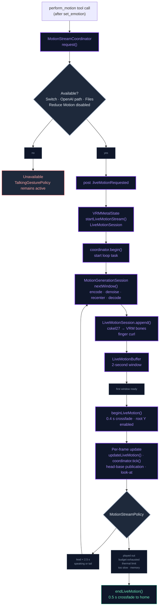

# Generative Motion

On the OpenAI voice path the character can move its body to match what it
says: the Realtime model describes one movement in a line of English
("A person waves with the right hand"), a motion diffusion model on the
phone turns that line into a stream of poses two seconds at a time, and the
scene plays the stream through the same player, crossfades and look-at as a
`.vrma` clip. The bundled clips remain the body's default; a generated
gesture borrows the body for one reply and hands it back. Off this path, or
with the switch off, nothing changes.

## What moves the body

The motion comes from NVIDIA's **ARDY** (`ARDY-Core-RP-20FPS-Horizon40`), an
autoregressive diffusion model over a 27-joint skeleton: 40 frames (2 s) a
window at 20 fps, continuing from up to 40 frames of its own history, so a
stream of any length is a chain of windows. The text goes in through
**ARDY-mini**'s distilled encoder, a 28 M-parameter MiniLM student of
ARDY's Llama 3 conditioning, which is what makes the whole thing fit on a
phone. Three ONNX graphs do the work (text encoder, denoiser, decoder),
their float32 weights in sidecar files (775 MB together) that ONNX Runtime
memory-maps, so a phone holds them as file-backed pages outside the app's
footprint rather than as memory of its own; `motion_bridge.cpp` runs them
on the ONNX Runtime the app already ships for VOICEVOX, on its CPU provider
(the one that reads the mapped weights in place; see Providers below), and
`MotionGenerationSession` wraps them in the window
bookkeeping: noise in, history recentred on the last frame, latents snapped
back to the quantizer's grid, the decoded root kept as the next history.
A seed gives the same motion as the browser build and the Python driver
the fixtures came from.

## From a reply to a gesture

The Realtime model is offered a `perform_motion` tool beside `set_emotion`
and asked to call it right after the emotion, before speaking, with a
caption, an optional length (2–12 s) and whether the movement should last
the whole reply. The call is answered at once, so decoding starts while the
audio is still being produced. `MotionStreamCoordinator` owns the stream:
it posts `.liveMotionRequested`, the scene answers with a `LiveMotionSession`
for the character on screen, and a task keeps 2.5 s of decoded motion ahead
of the playhead while the character speaks and for 1.5 s after it stops,
never more than 12 s a reply (`MotionStreamPolicy`). The first window
crossfades the body onto the stream; when the buffered motion has played
out, the body crossfades home and the idle timer re-arms. A second
`perform_motion` during the reply replans: the next window starts as a
fresh inference from the current position and heading and its first eight
frames ease in from the last pose, because carrying the old action's
history smothers the new one.

## The live clip

`LiveMotionClip` is an `AnimationClip` whose tracks read a `LiveMotionBuffer`
instead of keyframes, so `AnimationPlayer`, its crossfades and the tick
drive it unchanged. Each decoded frame is retargeted when it arrives
(`LiveMotionRetargeter`): ARDY's identity pose is a VRM 1.0 T-pose, so the
joint's local rotation goes through the loader's own math for an
identity-rest clip, flipped for VRM 0.x, conjugated into the model bone's
parent-rest basis and composed with the bone's rest. Twenty humanoid bones
are driven (Spine2 folds into upperChest), the root is pinned in x/z so the
character gestures in place, hips height is kept for bows and crouches, the
upper arms open 6° so mocap arms stay out of anime torsos, and the index to
little fingers hold a relaxed curl since the skeleton has none. Between
frames the pose is interpolated. The player samples through its own clock
(`LiveMotionBuffer.samplePlayer`): while frames lie ahead the two clocks
run together; when the player reaches the last frame the buffer's clock
waits there, so a late window resumes from the pose the body stopped in
instead of skipping ahead to wherever the player's clock has got to. The
coordinator reads that clock as the playhead. In the body's pecking
order a stream sits where a talking gesture does: a pose or an episode
(phone, listening, away) takes the body back at once, idles and talking
gestures stand down while it plays, and the look-at composes on the
stream's neck and head so a generated nod survives the gaze.

## Captions that work

The model follows physical descriptions, not moods. "A person nods the head
up and down several times" nods; "A person nods in agreement" barely does.
"Shakes the head from side to side", "shrugs with both shoulders and open
palms", "waves with the right hand", "bows from the waist", "talks,
gesturing with both hands", "scratches the back of the head" all read on
every bundled character. "Looks around curiously" turns the whole body, so
in-place wording ("glances left and right") is preferred. The persona text
appended while the tool is offered says exactly this.

## Flow

## Files

| File | Role |
|---|---|
| `Core/Bridge/motion_bridge.{h,cpp}` | C API over the three ONNX graphs: sessions with CoreML → XNNPACK → CPU fallback, text encoder, one DDIM window, decoder, timings, last error |
| `Data/DataSources/Motion/ARDYMotionRuntime.swift` | Swift face of the bridge; `ARDYModelFiles`; reads the schedule and window constants from model.json |
| `Data/DataSources/Motion/ARDYWindowMath.swift`, `ARDYPortableRandom.swift`, `ARDYPromptTokenizer.swift` | Window bookkeeping, the browser-identical noise source, WordPiece through swift-transformers |
| `Data/DataSources/Motion/MotionGenerationSession.swift` | Actor: a caption's windows, replan as a fresh inference, `[Bench] motion window` log line, `NLSignposts.motion` |
| `Domain/Entities/MotionStreamPolicy.swift` | Lead, tail, budget, steps-by-tier and pacing rules (pure, tested) |
| `Data/DataSources/Motion/MotionStreamCoordinator.swift` | One stream per reply: request → scene → loop at utility priority, steps paced to the measured window time; load at Realtime session start behind a memory gate; unload on path change, idle, memory warning; `MotionStreamHold` for the card |
| `Core/Utils/MemoryFootprint.swift` | The app's physical footprint and the kernel's remaining allowance, for the gate and the log lines |
| `Core/Engine/VRM/Animation/LiveMotion/*.swift` | `LiveMotionBuffer`, `LiveMotionRetargeter`, `LiveMotionClip` + `LiveMotionSession` |
| `Core/Engine/VRM/UI/VRMMetalState+LiveMotion.swift` | Scene side: observer, begin/end with crossfades, per-frame tick, look-at base |
| `Data/DataSources/AppFunctionTool.swift`, `OpenAI/OpenAIRealtimeManager+Handlers.swift`, `Domain/Entities/CharacterPersona.swift` | `perform_motion` schema (offered only when available), synchronous handler, caption guidance |
| `Data/DataSources/Motion/MotionSettings.swift`, `Domain/Entities/AutonomyPreset.swift` | The "Gesture while speaking" switch (`AutonomyFlags.gestures`; balanced and lively on) |
| `Domain/Entities/TutorialScript.swift`, `Presentation/Components/TutorialOverlayHost.swift`, `App/ContentView+Tutorial.swift` | The onboarding tour's "gestures" beat: opens Settings › Autonomy from inside the tour and spotlights the switch |
| `Data/DataSources/Motion/MotionModelAccess.swift`, `Assets/RemoteAssetRegistry.swift`, `Presentation/Views/AI/MotionModelCard.swift` | Six pinned assets under `motion/ardy-mini/`, download with progress and notices sheet, removal |
| `scripts/ardy_mini_batch.py`, `scripts/cskel_to_vrma.py`, `scripts/ardy_patch_graphs.py`, `scripts/ardy_external_graphs.py`, `scripts/ardy_fp16_graphs.py` | The Python driver the fixtures and the review clips came from; VRMA writer; the Clip-bounds patch; the external-data split the downloaded files use (each graph's weights moved into a sidecar it names, outputs checked bit for bit); the float16 conversion kept for the bench (inputs and outputs kept float32, the graph's own casts retargeted, output tensors that are also read internally rewired) |
| `NeuraLinkTests/MotionGenerationSessionTests.swift`, `LiveMotionClipTests.swift`, `MotionStreamPolicyTests.swift`, `MotionStreamCoordinatorTests.swift`, `MotionModelAssetsTests.swift`, `GeneratedMotionBench.swift`, `GeneratedClipSnapshots.swift` | Parity with the Python driver (two windows), parity with the VRMA path on all three characters, the rules, the loop with a stub producer, the pins; the device bench and the contact-sheet harness |

## Integration notes

- **Finding the switch**: the onboarding tour has a beat for it (`gestures`
  in `TutorialScript`, right after the Settings beat). It is the one beat
  whose target lives on another screen: `TutorialStep.Screen` lets a step
  require the Settings sheet the way other steps require a menu row, the
  scene presents the sheet and `AISettingsView` pushes Autonomy, a second
  `TutorialOverlayHost` inside the sheet cuts the spotlight around the
  "Gesture while speaking" row, and the sheet comes down when the tour
  moves on. The tour is v3 for it, so people who finished v2 see it once.

- **Gates** (`MotionStreamCoordinator.isAvailable`): the switch on, the OpenAI
  path in use with the local model off, Reduce Motion off, the model files
  present. The tool is only offered to the model when the first and last
  hold (`MotionSettings.offersTool`, read from UserDefaults so the tool list
  can be built on any thread), and the persona guidance is only appended
  then. Without a stream the body behaves exactly as before.
- **Thermal**: `normal` allows up to 10 diffusion steps, `reduced` 4 (motion
  keeps 80–115 % of its activity), `minimal` ends the stream.
- **Pace**: within the tier's ceiling the steps follow the phone. Each
  window's wall time is measured and the next window gets as many steps as
  keep generation 1.25× ahead of playback (`MotionStreamPolicy.stepsAfterWindow`),
  one more than before at most and never under 4; the first window's time
  is discounted for the text encode and warm-up it carries. The count that
  kept up is remembered (`motion.generated.paceSteps`) so the next stream
  starts there. The margin only decides how many steps to spend: at 4 steps
  the stream runs on as long as a window takes less than the 2 s it plays,
  with the 2.5 s lead absorbing a window that lands late (the iPhone 11
  takes 1.64 s a window at 0.41 s a step; the earlier rule, which wanted
  1.6 s, ended every stream there). When 4 steps take 2 s or more the lead
  would shrink every window, so the stream ends ("too slow") rather than
  hold a frozen body; after two such streams in a row no more run at that
  pressure tier, or a worse one, while the loaded sessions live, and the
  Settings card says so. A better tier (the phone cooled, Low Power Mode
  went off) or the next load (ten idle minutes, a memory warning, a return
  to the OpenAI path) tries again, in case the pace was the moment's.
- **Threads**: the bridge gives the runtime two intra-op threads, with
  spinning between ops off and no CPU arena (`motion_bridge_create`), at
  user-initiated QoS, and the generation task runs at the same priority:
  under the main thread's user-interactive, so a denoiser step never
  outranks the render loop or the audio, and above utility, which Apple
  silicon keeps on the efficiency cores while the main thread and the audio
  hold the performance cores. The first phone run with the weights mapped
  (iPhone 11, 2026-11-02) had both threads at utility and took 1.1 s a
  denoiser step, 4.4 s for a 2 s window at 4 steps, so every stream ended
  "too slow"; the local LLM's generation threads had been at user-initiated
  for the same reason (`LLMRuntimeProfile`). The `window` lines name the
  pressure tier beside the steps, since Low Power Mode and a serious
  thermal state cap the steps at 4 and the CPU's clock with them.
- **Memory**: the weights never enter the footprint. Each graph's float32
  weights sit in a sidecar (`ardy_mini_<graph>.onnx.data`, ONNX external
  data) that the runtime memory-maps and reads in place
  (`session.disable_prepacking`, or it would copy every MatMul weight into
  memory of its own), so they are clean, file-backed pages the kernel drops
  and fetches again as it needs, the way a game streams its assets; what
  the app pays for is the session state and a window's activations: in the
  simulator bench of 2026-11-02 the three sessions added 11 MB to the
  footprint and the whole first window peaked 25 MB above that, against
  441 MB loaded and a 984 MB peak for the float16 graphs on the same
  provider (the phone's figures are in the `[MotionStream] models ready`
  and `window` log lines, footprint and peak since launch). The first step
  after a load would fault the mapped weights in a page at a time (13 s in
  the simulator), so `ARDYMotionRuntime.readThrough` reads the sidecars
  once, front to back, before the sessions are made (1.8 s there; the
  `models ready` line says how long on the phone) and the first step then
  costs about twice a warm one. On the iPhone 11 (2026-11-02) the sessions
  loaded at a footprint of 1026 MB against the scene's 1.0 GB, with
  1071 MB available, and the footprint peaked at 1064 MB through two
  windows: the weights stayed out of it.
  The models load when the Realtime session starts
  (`sendInitialSessionUpdate` → `prepareIfNeeded`), off the main actor, and
  only when the kernel says the app may still take 300 MB
  (`os_proc_available_memory`, `MotionStreamCoordinator.loadHeadroomBytes`);
  otherwise the gesture is skipped, the card shows why and the log line
  carries the numbers. A memory warning ends a running stream and drops the
  models, as does less than 160 MB of allowance left before a window. They
  are also dropped when the user leaves the OpenAI path or after 10 minutes
  without a stream. Measured on an iPhone 11: the scene sits at about
  1.0 GB and the app's limit is about 2.1 GB (2026-10-30), so a model held
  in memory has about 1 GB to fit in, with the scene's own growth during a
  reply taken out of it. The fp32 graphs in one file (1.2 GB loaded) never
  passed the gate; the float16 family (2026-11-02) loaded at a footprint of
  1197 MB and climbed to 1697 MB in the first window, where a memory
  warning dropped it: the shipped runtime's CPU provider has no float16
  MatMul kernel, so it casts every weight to float32 at the start of each
  step and holds the whole set for the step. Hence the sidecars. A phone
  with an earlier family's download still on it deletes it at launch
  (`MotionModelAccess.removeSupersededDownloads`).
- **Providers**: the sessions run on the CPU provider, the one that reads
  the memory-mapped weights in place. The shipped ONNX Runtime (1.20)
  registers CoreML only through the legacy flags call, with no
  compiled-model cache, compiles a copy of the graph of its own, and
  computes float16 graphs wrong (the simulator bench of 2026-11-02 put the
  denoised window 2.6 off the fixture against 0.014 on the CPU); XNNPACK
  brings spinning threads of its own. The published graphs leave Clip's
  upper bound empty, which the CoreML provider refuses; the downloaded
  files carry explicit bounds (`scripts/ardy_patch_graphs.py`) and their
  weights in sidecars (`scripts/ardy_external_graphs.py`), the numbers the
  publisher's, bit for bit. The float16 family (`scripts/ardy_fp16_graphs.py`,
  371 MB, 0.17 cm of joint position from fp32 on 24 four-second clips) stays
  in the dataset under `motion/ardy-mini-fp16/` for the bench: on this
  runtime's CPU provider it costs more memory than fp32, not less.
- **Model files and licences**: the denoiser and decoder are NVIDIA's under
  the NVIDIA Open Model License; the distilled encoder carries the Meta
  Llama 3 Community License ("Built with Meta Llama 3"), MiniLM's Apache
  2.0 and ARDY-mini's composite terms; the training captions are CC BY 4.0.
  The card shows these before the first download; nothing is bundled.
  Re-uploading an asset requires re-capturing its pin.

## Troubleshooting

| Symptom | Where to look |
|---|---|
| The model never calls `perform_motion` | It is only offered when `MotionSettings.offersTool` is true at session start: switch on **and** files present (`motion.generated.modelsReady`). Reconnect after downloading. |
| `perform_motion` returns "unavailable" | A gate failed: local backend on, Reduce Motion on, files missing, or the stream could not start (the `[LiveMotion]` log says who owns the body). |
| The gesture starts late | The first window costs a text encode plus 10 denoiser steps, and its first step reads the weight sidecars from storage when the kernel has dropped their pages. `[Bench] motion window` lines give the per-window cost; `[ARDYMotion] Sessions ready` says which provider was used. |
| The body freezes mid-gesture | The buffer ran dry: the next window was late. The body waits on its last pose and resumes when the window lands. The `[MotionStream] window N` lines give each window's wall time and the steps chosen next; a "too slow" end means even 4 steps could not keep up on this phone. |
| The card says "Paused" | `MotionStreamHold`: the phone had less than 300 MB of allowance when the model was to load (or a memory warning dropped it), or two streams in a row were too slow. The `[MotionStream]` log lines carry the numbers. A pace pause lasts until the models reload: ten idle minutes, or leaving and returning to the OpenAI path. |
| Every stream ends "too slow" | Each `[Bench] motion window` line gives the denoise time and its step count; at 0.5 s a step or more, 4 steps take as long as the window plays. The `window` line names the pressure tier (Low Power Mode and a serious thermal state cap the steps and the clock), and `[Bench] motion encode` says what the first window's text encode cost. Both runtime threads must be at user-initiated QoS (`motion_bridge.cpp`, `MotionStreamCoordinator.begin`): at utility the iPhone 11 took 1.1 s a step. |
| The whole scene stutters while a gesture is generated | The runtime's threads: `motion_bridge_create` caps them at two, at user-initiated QoS under the render loop's user-interactive, without spinning. A stutter now points at memory pressure (watch the footprint in the window lines). |
| The gestures look different from the review clips | The phone runs the publisher's fp32 numbers, so a visible difference points at the provider (the `[ARDYMotion] Sessions ready` line must say `cpu`); a float16 download from the bench folder would show 0.17 cm of drift, not a visible one. |
| The app is ended for memory during a reply | Look for `not loading the motion model` and `unloaded on memory warning` lines; each carries the footprint and its peak since launch. The weights are mapped, not held, so a climb between `models ready` and the warning is activations or the scene itself; calibrate `loadHeadroomBytes` and `streamMemoryFloorBytes` from those lines. |
| Feet slide or sink | The root is pinned in x/z and only hips height is applied; a different hips-height ratio than the reference skeleton (0.9 m) scales the bob. |
| Download fails with 404 | The nine files are not (yet) in the dataset under `motion/ardy-mini-external/`. |

## Known device-test items

Nothing in this feature has run on a phone yet; everything above was proven
in the simulator (x86) against the Python driver. On the iPhone 11 and the
newest phone available:

- `GeneratedMotionBench` first (model files bundled with the tests in the
  git-ignored `NeuraLinkTests/MotionModels/`, or downloaded with
  `NL_MOTION_MODEL_DOWNLOAD=1`): session creation time per provider, the
  continuation-window time at 10 and 4 steps, footprint, thermal state,
  twice in a row. The gate is under 1 s a window on the iPhone 11 and under
  0.3 s on a recent phone, memory under 500 MB; the numbers decide between
  the CoreML provider and XNNPACK/CPU on device.
- A gesture without an API key: the launch argument
  `-nl.debug.motionCaption "A person waves with the right hand."` plays the
  caption six seconds after the character appears (files required; the
  switch is ignored). First visible motion within 1 s on a recent phone,
  2 s on an iPhone 11.
- Frame rate stays at the tier cap during a 12 s stream; no hitch at window
  boundaries; hair and skirts do not ring when the stream starts or stops.
- Feet planted, no sinking through the terrain, hips height right on all
  three bundled characters and an imported VRM.
- Look-at and the face-following gaze still work while a stream plays; a
  generated nod is visible.
- A pose, the phone episode and co-listening each interrupt a stream and
  hand back cleanly; switching the backend to local unloads the models.
- Thermal: `reduced` drops to 4 steps, `minimal` ends the stream, both
  recover; a 30-minute session in a quiet room for heat.
- The download on a 4 GB phone does not jetsam the app during a stream.
  Second iPhone 11 run (2026-10-30, fp32 in one file): the gate refused
  every time, with 1042–1116 MB available against a footprint of
  981–1055 MB, and the app fell back to the static clips without a crash.
  Third run (2026-11-02, float16): loaded in 1.6 s at a footprint of
  1197 MB with 900 MB available, climbed to 1697 MB in the first window and
  was dropped on a memory warning with 400 MB left (the runtime's float32
  casts of every weight, each step; the simulator bench reproduces it as a
  984 MB peak over 441 MB loaded). The sidecar family replaces it (66 MB
  loaded, 79 MB peak in the simulator); the `models ready` and `window`
  lines now carry the peak as well, to calibrate the 300 MB gate and the
  160 MB floor.
- Speed of the fp32 graphs on the iPhone 11's CPU from mapped weights.
  Fourth run (2026-11-02, sidecars, both runtime threads still at utility
  QoS): models ready in 2.2 s with the 737 MB read through in 0.93 s,
  footprint 1026 MB (peak 1035 MB) with 1071 MB available; window 1 took
  8.5 s and 11.0 s, window 2 4.4 s and 4.2 s, all at 4 steps, footprint
  1037–1064 MB through them. Memory held and the pace did not: 1.1 s a
  step on the efficiency cores, two streams ended "too slow", and the
  two-strike rule (then per launch) stopped gestures for the session. The
  threads moved to user-initiated QoS and the rule now lifts at the next
  load. Fifth run (2026-11-02, threads at user-initiated): models ready in
  1.4 s at a footprint of 952 MB with 1145 MB available; window 1 4.16 s,
  window 2 1.64 s at 4 steps in the `normal` tier (0.41 s a step, 2.7×
  faster), then the phone went to `reduced` (hot, or Low Power Mode) and a
  window took 2.36 s. Both gestures looked right to the user. Both streams
  were ended by the 1.25× margin, which wanted 1.6 s a window; the margin
  now only governs extra steps and a stream ends at 2 s a window, and a
  pause taken in `reduced` lifts when the tier improves. Still to read: the
  `[Bench] motion encode` line (the first window costs 2.5 s more than the
  second), and whether a step slows when the kernel has dropped the
  sidecars' pages.
- Pacing on the iPhone 11: the `window` lines show the steps settling, the
  body waits rather than skips when a window is late, and a "too slow" end
  hands the body back cleanly.
- First device report (2026-10-30, before the gate, the pacing and the
  thread cap): the body froze during speech and the app was ended; no log
  or crash report was captured. The next run should keep the phone wired
  to Console for the `[MotionStream]` and `[ARDYMotion]` lines.
