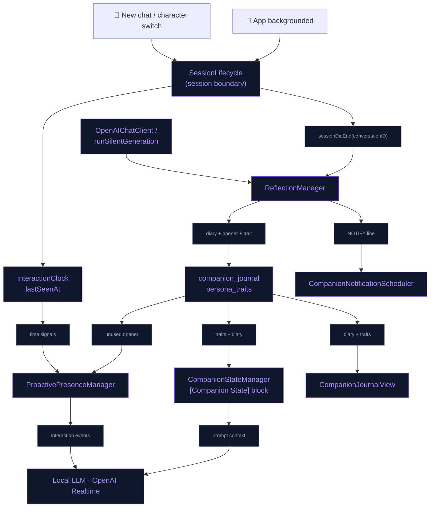
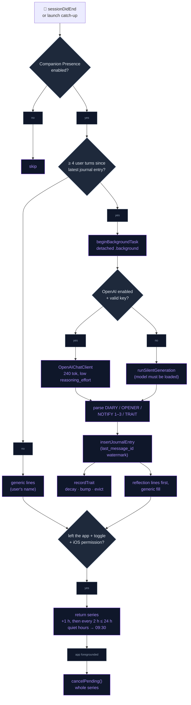
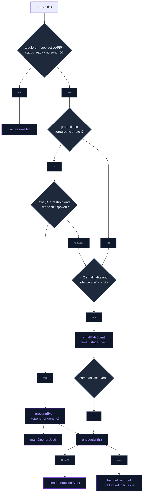

# Living Companion

The companion carries on between conversations. When a session ends it
reflects in private: it writes a diary line and saves an opener for next time.
It may also note a personality trait and schedule a gentle "thinking of you"
notification. When the user returns, it greets them with that opener, and it
breaks long silences on its own. It also hosts shared activities: co-listening
and mini-games. Everything it remembers or becomes can be seen and deleted in
the Journal sheet.

## Session boundaries

`SessionLifecycle` marks **session boundaries**. It posts
`SessionLifecycle.sessionDidEnd` (userInfo `conversationID`, `reason`) with the
active conversation id. Three things fire a boundary:

- **backgrounding** (`reason: "background"`), via
  `UIApplication.didEnterBackgroundNotification`,
- **new chat** (`ContentView.startNewChatSession`, `reason: "newChat"`),
- **character switch** (`VRMSceneView`, `reason: "characterSwitch"`).

Explicit callers post the boundary *before* they reset or stop the
conversation. A boundary does **not** reset the active conversation, so a
quick app switch never splits the chat history. It only stamps
`InteractionClock.lastSeenAt` and posts the notification. If no conversation
row exists yet, it does nothing, so empty sessions are never reflected on.
When "keep talking in background" is on and a voice session is live,
`BackgroundSessionKeeper` holds the session open. The boundary then fires
later, when the keeper ends the session (idle or battery guard).

## Interaction clock

`Core/Utils/InteractionClock.swift` is the one clock for "when did the user
last interact":

- `lastUserSpeechAt` is kept in memory for the current launch. Both user-turn
  sites feed it through `noteUserSpoke()`: `LocalLLMManager` and
  `OpenAIRealtimeManager+Handlers`. It drives silence detection.
- `lastSeenAt` is saved to UserDefaults on backgrounding. It drives the
  "hours since last seen" absence check.

All the maths uses the device's local `Date`. SQLite `messages.timestamp`
values are UTC strings, and they are never mixed into this arithmetic.

## Storage

`MemoryStore`'s single `createTableQuery` creates three tables. Journal and
trait CRUD lives in `MemoryStore+Journal.swift`, keepsakes in
`MemoryStore+Milestones.swift`.

```sql
companion_journal (id, character, conversation_id, diary, opener,
                   notification_line, notified, opener_used,
                   last_message_id, created_at, snapshot_file)
persona_traits    (id, character, trait, weight, created_at, updated_at)
companion_milestones (character, kind, achieved_at, celebrated_at)   -- PK (character, kind)
```

`companion_journal.conversation_id` deliberately has no foreign key.
`last_message_id` is the newest message a reflection covered, and it acts as
the **reflection watermark** (see End-of-session reflection). When the column is added during an
upgrade, it is backfilled to each conversation's current last message. This
stops the upgrade from re-reflecting conversations that already have entries.
Swift entities: `JournalEntry`, `PersonaTrait` (`Domain/Entities/CompanionJournal.swift`);
`MilestoneKind`, `CompanionMilestone`, `MilestoneRules` (`Domain/Entities/CompanionMilestone.swift`).

## One bond per character

The relationship is between the user and **one** character. Every row in
`messages` and `knowledge_graph` has a `character` column, the identity key
of the character on screen when it was written (`ConversationStore`,
`KnowledgeGraphManager`). One conversation can span a character switch, so
the tag is per message, not per conversation. The relationship meter, the
count-based keepsakes, the journal calendar, time apart, the carry-over line
and the home-screen widget all count only that character's rows
(`MemoryStore+Affinity`, `MemoryStore+CharacterBond`). A character met
today is "New", however long the user has known another one.

What a character **knows** is a separate setting. Facts about the user live
in the shared memory bank, and "Characters share memories" decides whether
recall also reads other characters' banks (`MemoryBanks`, docs/CHAT_LLM.md).
So a new character can know the user's sister's name and still be at "New".
The meter's depth only counts facts the user told **this** character.

**Upgrading.** The first launch with the column attributes older rows once
(`attributeLegacyRows`):

1. A message a diary entry covered goes to that entry's character.
2. The rest of a reflected conversation goes to its latest diary character.
3. Anything else goes to the character with the most diary entries, or else
   the last character the user picked.
4. A fact goes to the character of the last message before it.

## Background text client

`Data/DataSources/OpenAI/OpenAIChatClient.swift` is the one-shot Chat
Completions client used by every background text call: titling, reflection,
memory retain, consolidation and mental models. It handles the bearer auth,
`max_completion_tokens` and the JSON parse. It returns `nil` on any failure,
and callers skip silently. The model is the user-selected
`OpenAISettings.textModel`. Two rules apply to GPT-5-family models:

- `temperature` is omitted, because they reject non-default values.
- A **low `reasoning_effort`** is sent. At the default "medium" effort, a
  small budget like reflection's 160 tokens was used up entirely by
  reasoning, and the reply came back empty.

The Realtime/WebRTC voice path is separate.

## End-of-session reflection

On a session boundary, `ReflectionManager` runs **one silent LLM pass** over
the conversation's last 16 spoken turns (tool calls are excluded). The model
answers with labelled lines:

```
DIARY:   one or two first-person sentences about the talk and how it felt
OPENER:  one warm line to greet the user with next time
NOTIFY:  ≤ 12-word push-notification invitation
TRAIT:   optional — a new habit/dynamic note, only if clearly revealed
```

Replies are parsed as labelled lines, not JSON, because 1–2B local models
can't be trusted to produce valid JSON. Content can wrap onto the next lines.
Unlabelled leading text counts as the diary, because the local prompt ends
with `DIARY:`. Each field is trimmed and capped (diary 300, opener 200,
notify 120, trait 100 chars). If no diary comes back, nothing is stored. The
prompt forbids inventing facts.

- **Routing**: if OpenAI is enabled and has a valid key, the call goes to
  `OpenAIChatClient` (160 tokens, temperature 0.6 where the model allows
  it). Otherwise it goes to `LocalLLMManager.runSilentGeneration` (160
  tokens). That path has no UI or TTS side effects and waits behind the
  engine's generation lock. It is skipped if the local model isn't loaded.
- **Guards**: the Companion Presence master switch must be on. The
  conversation must have **≥ 4 new spoken user turns since its latest
  journal entry** (`MemoryStore.unreflectedUserTurns`, which counts message
  ids above the `last_message_id` watermark). An `NSLock` in-flight set
  dedupes repeat calls. The active conversation survives backgrounding, so a
  long-running chat gets a fresh reflection, and a fresh notification,
  every time it grows by another 4 or more turns.
- **Background budget**: the pass runs in `Task.detached(priority: .background)`
  inside `beginBackgroundTask`, which gives it about 30 s after
  backgrounding.
- **Launch catch-up**: 8 s after launch, the newest recent conversation
  (≤ 7 days old, excluding the active one) that meets the ≥ 4-new-turns
  guard is reflected on. This covers cold kills, missed background windows
  and a freshly enabled feature. Only one conversation is caught up per
  launch, and its entry is credited to the currently selected character.
- **Output**: a `companion_journal` row, a widget snapshot refresh, the trait
  pool update (see Personality evolution), and, if notifications are on, the
  return series below. When it is scheduled, the row is marked `notified`.
  The row also adopts the latest candid capture of the scene as its picture
  (see Diary pictures) when one is fresh.
  The reply also carries `NOTIFY2:` / `NOTIFY3:`, two more notification lines
  for the later slots.

### Notifications

When the user leaves mid-chat, `CompanionNotificationScheduler` schedules a
**return series**:

- **Picture**: the first notification of the series carries the entry's
  diary picture as an image attachment (thumbnail clipped to the upper
  middle, where she stands). The attachment is built from a copy, because
  the system moves the file it is given into its own store.
- **Timing**: the first notification **1 h after the last message** in the
  conversation, then **one every 2 h**, for up to 24 h after the first (at
  most 12). iOS cannot run the app to compose a notification later, so the
  whole series is scheduled up front, one identifier per slot
  (`com.neuralink.presence.reflection.N`).
- **Quiet hours**: 22:00–09:00 local. A slot inside that window moves to the
  next **09:30**, and the 2 h rhythm resumes from there.
- **Cancelled on return**: the whole series is removed on every foreground
  return and on cold launch. It is never scheduled while the app is in the
  foreground (launch catch-up reflects silently).
- **Content**: the title is "‹Name› has been thinking of you". Bodies cycle
  through the reflection's `NOTIFY`, `NOTIFY2` and `NOTIFY3` lines, then a
  pool of warm generic lines that use the user's name
  (`CompanionNotificationCopy.genericLines`). Lines that read like a memory
  record ("the user …") are dropped.
- **Short chats**: a conversation with fewer than 4 new user turns isn't
  reflected on, but the series still goes out with the generic lines.
- **Weekly recap**: a one-off on its own identifier
  (`com.neuralink.presence.recap`), so it never replaces the series.

The notification is rewritten as a **communication notification**
(`INSendMessageIntent` with the character as sender). iOS then shows the
character's thumbnail as a circular avatar in place of the app icon. This
needs the `usernotifications.communication` entitlement. The thumbnail is
drawn onto an opaque gradient with a ring, because transparent VRM
thumbnails read badly inside the circle. `CompanionNotificationPresenter`
shows banners in the foreground (`.banner, .list, .sound`).

Authorization is alert + sound only, with no badge. It is requested the first
time the notification toggle is switched on.

## Personality evolution

- **One relationship curve**: `CompanionAffinity` drives both the UI meter
  and the prompt, for one character at a time (see One bond per character).
  The meter refreshes after every turn and on a character switch. The score weights shared days (45%), depth (35%: facts
  learned + reflection count) and volume (20%: turns, which saturate at
  150). Time apart cools it gently, down to a floor of 0.65×, and it is
  capped at 0.95. There are five stages: New, Acquaintances, Friends, Good
  Friends and Close. Each stage carries behaviour guidance, so the persona
  acts its stage.
- **Trait pool**: the optional `TRAIT:` line comes from the same reflection
  call, with no extra LLM call. On each reflection:
  1. Every trait for the character decays (×0.95).
  2. A case-insensitive match gets +1.0 weight.
  3. Otherwise, if the pool is full (5 per character), the weakest trait is
     evicted, and the new trait is inserted at weight 1.0.

  Traits must be 8–100 characters. They live only in `persona_traits` and
  are never copied into the fact stores.
- **Prompt block**: `CompanionStateManager.promptContext(characterName:compact:)`
  is the one hook shared by both engines: local `buildSystemContent` and the
  OpenAI session instructions. Its `[Companion State]` block holds:
  - relationship stage + guidance,
  - the time-apart line (see Time apart),
  - recent tone,
  - known preferences (up to 6),
  - up to 3 traits,
  - the carry-over line (see Cross-session carry-over),
  - the keepsake celebration line (see Keepsake milestones).

  On `.llama1b` it is compact: 3 preferences and 2 traits. The JP (`llmJp3`)
  path leaves it out. When nothing is known, it returns `""`. It sits in the
  system prompt rather than in `LocalLLMPromptStore.effectivePrompt`, so it
  never overwrites a prompt the user has saved.
- **Journal UI**: tapping the relationship meter (`RelationshipMeterBarOverlay`)
  opens `CompanionJournalView`, an inset-grouped list:
  - **Relationship**: the character's portrait (`CompanionPortrait`: the
    live render the widget pipeline keeps, else the model's thumbnail),
    stage label, meter and "N days together".
  - **Together**: a month calendar (`JournalCalendarView`). Each day carries
    up to three dots: grey when you talked, pink for a diary entry, purple
    for a keepsake. Today is outlined; future days are dimmed. Tap a day to
    filter the section below to it, tap again (or "All days") to clear;
    chevrons or a horizontal swipe change month and a "Today" button jumps
    back. The header line summarises the month ("Talked on 9 days · 3 diary
    entries · 1 keepsake").
  - **Day / This month** (`JournalDaySection`): with a day selected, the
    conversations you had that day (tap to open the read-only transcript as
    a sheet, with your message count), its diary entries (swipe to delete;
    an entry shows the picture of her world adopted by that reflection,
    when there is one) and the keepsakes reached; "Nothing on this day." or "Not yet."
    otherwise. With no day selected, the month's diary entries and keepsakes
    newest first. Day grouping uses the device calendar and time zone
    (`JournalCalendarModel`), so a late-night chat lands on the day you
    lived it, not the UTC day SQLite stored.
  - **Keepsakes**: the badge grid (see Keepsake milestones).
  - **Personality**: traits, swipe to delete.
  - **Reset Personality**: after a confirmation, deletes the diary and all
    traits. Chat history, keepsakes and facts are kept.

  Turns are read per visible month (`MemoryStore.userTurnStamps(between:and:)`);
  the diary and keepsakes are loaded once per open.

## Proactive engagement

`ProactivePresenceManager` lets the companion speak first. It checks every
**15 s**. It works with either engine: it injects through
`OpenAIRealtimeManager.sendInteractionEvent` when the data channel is open,
and as a `LocalCue` through `LocalLLMManager.handleCue` otherwise — an
instruction rather than the user's words, in Japanese for the LLM-jp model, and
checked before it is spoken so the instruction itself is never read out
(`docs/Local_SLM_Model.md`, "Lines the companion starts").

- **Guards on every tick**: the Proactive Engagement toggle is on, and the app
  is active (or PiP is active). `status == .ready`, and the UI isn't hidden.
  No song recognition is running.
- **Absence greeting.** This fires at most once per foreground
  stretch. It needs `hoursSinceLastSeen ≥ absenceGreetingHours` (default
  6 h), and the user must not have spoken first. The greeting uses the latest
  **unused opener** from `companion_journal`, which is then marked
  `opener_used` exactly once. Without an opener, a generic warm greeting is
  used. Both versions include how long the user was away and the time of day.
- **Silence small talk.** This fires after `silenceSmallTalkSec`
  of silence (default 90 s), measured from the later of the last user speech
  and the last engagement. It fires at most **2 per session**. The wait
  triples each time (×3 backoff, so 90 s → 270 s), and an event identical to
  the previous one is skipped. It is seeded with the time of day, the
  relationship stage and one random remembered fact. Each small talk takes a
  different **angle** (`SmallTalkAngle`): the first checks in, the second
  offers something of her own — a passing thought, the time of day, a tiny
  moment — with no question. It uses a remembered fact not used before this
  launch, and quotes her previous line with an instruction to say something
  genuinely different, so two silences never get the same sentence.
- **Time-of-day** is not a separate trigger. It is a descriptor inside the
  greeting and small-talk events: early morning, morning, afternoon, evening or late night.

`engage(with:)` is also the shared injection seam for photo memories and the
weekly recap.

## Shared activities

### Co-listening

A long-press on the Identify Song FAB, or `identify_song` with
`"mode": "session"`, turns recognition into a loop. It gets one persona
comment per track change and stops on its own. See
[`SONG_RECOGNITION.md`](SONG_RECOGNITION.md#co-listening-sessions).

### Mini-games

The `play_game` tool (`PlayGameSkill`) has two forms:

- `game`: `twenty_questions`, `trivia` or `word_chain`
- `action: "stop"`

It is a thin gate onto `GameSessionManager`, where the **rules live in code**.
The manager tracks the active game and the turn count. For 20 Questions it
also picks and holds the secret answer, since the LLM has no hidden state.
The tool result is a rules brief the model acts on. On the local path, a
per-turn `[Active Game]` reminder rides after the history, so the KV-cache
prefix is untouched. The reminder carries the turn number, the secret (20Q)
and a wrap-up nudge at the soft cap (20 / 10 / 15 turns). Game turns get
`maxTokens = 120` instead of the usual 60. Five turns past the soft cap, the
session ends itself.

## Desk presence

Companion Evolution section 3, the Gatebox "okaeri" for a phone on a desk.
Opt-in (AI Settings → Autonomy → **Notice me at the desk**) and only while
the camera button is on: the app never starts the camera on its own.

- **Face detection** (`FacePresenceDetector`): a few times a second, the
  newest frame `CameraManager` already captures goes through Vision's
  face-rectangle request on this device, stood up with `.leftMirrored` for
  the front camera and `.right` for the back one (the back camera's hint on
  the front camera hands Vision an upside-down face: flickering detection
  and a flipped centre). The largest face's centre (normalised, upright,
  origin top-left) and width are published; "nobody" needs two empty
  passes in a row. Nothing is stored and no frame leaves the phone.
- **Gaze** (`VRMMetalState+AwayEpisode.followFace`): while a face is in
  the frame the look-at's `userPosition` follows it and the target switches
  from the camera or the forward rest to the user; when the face is gone the
  previous target is restored. A point target set by something else is left
  alone. `FaceGaze` anchors the point on the **scene camera** (the renderer
  keeps `lookAtController.cameraPosition` current, so an orbited view still
  means "at the viewer") and offsets it by the face's position in the frame
  along the camera's own right and up: up to 1.2 m sideways and 0.9 m
  vertically. A fixed world point would be "straight ahead of her", which
  with the camera orbited to one side is away from the user. The mirrored
  frame means right is right; `mirrorX` flips it if the device disagrees.
  Two things keep the head still: `FaceGazeSmoother` averages the detector's
  face position (newest sample weight 0.35) and emits a new target only when
  the average has moved ≥ 2 % of the frame, so detection noise of a few
  pixels never reaches the eyes; and while following, the controller's
  smoothing is raised from 0.1 (a two-frame snap, right for a target that
  never moves) to 0.85 (about a third of a second), restored on hand-back.
- **Arrival greeting** (`DeskPresencePolicy`, `DeskPresenceManager`): a face
  that stays 3 s after an absence of 10 min or more fires one greeting
  through the shared `ProactivePresenceManager.engage(with:)` seam ("The
  user just sat down at the desk after 15 minutes away…"), only when the
  session is idle, at most once per 30 min. A passer-by, or a one-second
  detector flicker, never greets. Absence is measured from the moment the
  manager started when nobody has been seen yet.
- **Away** (`AwayEpisode`): nobody for `deskAwayMinutes` (default 10,
  5–30) starts the resting loop — `relax.vrma`, the lowest-priority
  episode: idles stop, but a pose, the phone and the listening loop outrank
  it and it resumes after them. A face that stays 2 s ends it (and, if the
  absence was long, greets). Safety cap four hours.

## Clip pools by gender

Every character carries a gender label (`CharacterGender`): fixed in the
registry for the bundled ones (Oz is male, Ekaterina and Sonya female),
chosen in the import sheet for a user's VRM and editable afterwards in the
character's settings. VRM metadata has no such field, so the label is the
app's. It decides which bundled clips the body draws on
(`AnimationCatalogue`):

| Clips | Female | Male |
|---|---|---|
| Base loop | `neutral` | `male_breathing` |
| Random idles | `default_state`, `neutral_2`…`neutral_4`, `relax`, `waiting` | `male_look_around`, `male_powerful`, `male_stretching_arms`, `neutral_4` |
| Resting loop (desk presence, away) | `relax` | `male_breathing` |
| Photo poses | `cool`, `peace_sign`, `relax`, `stretch` | `cool`, `stretch`; `peace_sign` → `cool`, `relax` → `stretch` |
| Entrance, talking gestures, phone, listening | shared | shared |

An idle plays once — never looped, since a short clip wrapping back to its
first frame pops — and the blend back to the base loop starts a second
before it ends. The pose tool keeps offering the same four names to every
character, and the body resolves a feminine pose when it plays. The male
clips came from the Sonya project's male set, plus Mixamo FBX clips
converted with `scripts/fbx_to_vrma.py` (`male_breathing`,
`male_stretching_arms`); rows and models that predate the label are female.

## Diary pictures

Companion Evolution pillar 2: the companion shares pictures of her own
world back. Metal only draws while the scene is on screen, and the
reflection runs after the app has gone to the background, so nothing is
rendered at reflection time. Instead `CompanionSceneCapture` keeps **one
fresh candid capture** of the live scene — the Metal drawable composited
over the custom background, no HUD — written as `latest.jpg` (≤ 1280 px
JPEG) in the private `scene-captures` directory:

- every 30 s while the scene is settled (model shown, entrance finished,
  app active), starting 8 s after a character loads;
- on `willResignActive`, best effort, so the frame on the way out is the
  freshest.

A reflection adopts the latest capture if it is under three hours old:
the file is copied to `journal-<id>.jpg` and its name stored in
`companion_journal.snapshot_file`. The journal shows it under the entry
and deletes it with the entry (and on Reset Personality); the first return
notification attaches it. No capture is ever posed: it is whatever she was
doing, which is the point.

## Keepsake milestones

Shared "firsts" the user and the character collect, shown as badges in the
journal's **Keepsakes** section (dimmed until reached) and mentioned once by
the persona. Eight kinds (`MilestoneKind`; raw values are the stored keys):

| Keepsake | Unlocks when |
|---|---|
| First hello | the user has spoken to this character at least once |
| One week / 30 days / 100 days together | `distinctUserMessageDays(character:)` reaches 7 / 30 / 100 (the same per-character totals the affinity curve reads) |
| First shared song | the first `SongRecognitionManager.presentMatch` |
| First game together | the first `GameSessionManager.start` (the model decides who won, so a "win" badge is not knowable) |
| First photo shared | the first `PhotoMemoryService.handlePicked` |
| First diary entry | the first reflection row written for that character |

`CompanionMilestoneTracker` is stateless. Event keepsakes are noted where they
happen; count-based ones are re-derived in `CompanionStateStore.refresh()`
(every user turn) and again when the Keepsakes section appears. Rows are keyed
by `RealtimeChatState.selectedCharacterName`, the identity key the journal
uses, so each character has its own set. `INSERT OR IGNORE` on the
`(character, kind)` primary key makes every call idempotent, and rows with a
kind an older build doesn't know are skipped, never deleted.

**Celebration.** `CompanionStateManager.promptContext` asks the tracker for a
`celebrationLine`: keepsakes reached in the last 7 days and never mentioned
yield one `[Companion State]` line ("Keepsake to celebrate together, once and
naturally: 30 days together…"). The first call stamps `celebrated_at`; the line
then stays for two hours (`MilestoneRules.celebrationHold`) so the block is
identical on every turn of that session (the local path rebuilds the system
content per turn and reuses the KV prefix; Realtime re-sends instructions
mid-session), and it is gone from the next session on. Older keepsakes are
history, not news, and are never announced.

**The moment.** A newly recorded keepsake is handed to
`KeepsakeUnlockController`, and `KeepsakeUnlockCapsule` (in the HUD layer,
same placement and glass as the photoshoot capsule) rises from the bottom of
the scene with the badge, the title and its one-line meaning, plays a
success haptic, and leaves after 5 s or on tap. Unlocks queue and show one
at a time; a repeat record never shows anything, because only the first
`INSERT` succeeds.

**Reset.** "Reset Personality" keeps keepsakes: they are shared history like
the chat log, not a learned trait. `deleteMilestones(character:)` exists for
character removal and tests.

## Cross-session carry-over

`CompanionStateManager.carryOverLine` adds one line to the Companion State
block, so no session starts cold, even with Companion Presence off:

1. **the latest reflection diary** (< 7 days, up to 200 chars): "Last
   session, you privately noted: …", else
2. **the last exchange with this character** outside the active conversation
   (< 48 h, up to 140 chars; `MemoryStore.lastExchange`), credited to whoever
   said it. Another character's closing line is never quoted back as "you
   saying".

The guidance line tells the persona to "pick up threads… never act like a
stranger". The block is built when the session starts. That keeps it stable
within a session. The saved cross-launch KV cache misses whenever the diary
has changed, and warm-up then re-prefills.

## Time apart

The persona should know when the user has been gone a day or two, not only
at the moment of the absence greeting (which needs Proactive Engagement on).
`CompanionStateManager` adds a **time-apart line** to the `[Companion State]`
block: "Time apart: you last talked 3 days ago (Friday evening); it's Tuesday
morning now. If the gap feels notable, acknowledge it naturally — glad to see
them, curious what they've been up to — without guilt-tripping or counting
days at them." The wording is `CompanionAbsence` (pure, unit-tested);
`.llama1b` gets the compact form.

Two rules keep it honest and stable:

- **Measured from before this visit.** The gap runs from the last user turn
  to this character strictly before `InteractionClock.foregroundAt` (launch,
  or the last return from the background;
  `MemoryStore.lastUserMessageAt(before:character:)`), so the turns of the
  current visit never shrink it to "a minute ago", and switching to a
  character last seen a week ago reads a week.
- **Frozen per visit and character.** The first block built in a visit snapshots that turn
  and the current time; every later build in the visit formats the same
  values, so the local KV prefix and the Realtime instruction refreshes see
  an identical block.

Wording: under an hour, nothing; same day, "earlier today, about N hours
ago"; then "yesterday (Monday evening)", "N days ago (…)", "about a week ago
(…)", "N weeks ago", "about a month ago", "about N months ago". Day names
are English whatever the device locale; the time zone and week are the
user's.

## Daily grounding

Two opt-in lines of real-world context in the `[Companion State]` block
(AI Settings → Autonomy → **Daily grounding**), so the persona knows what
the user's day holds without being told. Both are read-only and, like the
time-apart line, fetched once per foreground visit by
`DailyGroundingProvider` and held for the visit, so the block is stable
within a session. A fetch that lands after the first block was built posts
`realtimeInstructionsDidChange`, which refreshes the Realtime instructions.

- **Know my day** (`CalendarGrounding`, EventKit full access): events under
  way or starting within 12 hours, soonest first, at most three: "Today's
  schedule: Ana's birthday (all day); Standup (now); Presentation at
  2:00 PM. Wish them luck or ask how it went when it fits naturally; never
  recite the list." Untitled events are skipped. Its store is separate from
  `ReminderSkill`'s, which only holds reminders access.
- **Know how I slept** (`SleepGrounding`, HealthKit sleep analysis, last 24
  h): "asleep" samples (stages, from a Watch or a sleep app) are summed as
  a union of intervals, so two sources recording the same night count once;
  "in bed" samples (what the iPhone alone records) likewise. The line only
  appears when the night was short — under 5.5 h asleep, or under 6 h in
  bed when there are no stages — and tells the persona to go gentle and not
  lecture. A normal night says nothing. HealthKit never reveals a denied
  read; it simply returns no samples.

Turning a toggle on asks for the permission and turns itself back off on a
denial (`AutonomySettingsView.groundingSection`). The `.llama1b` tier gets
compact forms ("Today: …", "Sleep: about 4.5 h last night (short)."). The
wording and arithmetic are `DailyGrounding` (pure, unit-tested).

## Flow

### Architecture



### Reflection and notification



### Proactive tick



## Files

| File | Role |
|---|---|
| `Data/DataSources/SessionLifecycle.swift` | Session boundaries; posts `sessionDidEnd` |
| `Core/Utils/InteractionClock.swift` | `lastUserSpeechAt` (per launch), persisted `lastSeenAt`, `foregroundAt` (visit start) |
| `Domain/Entities/CompanionJournal.swift` | `JournalEntry` / `PersonaTrait` entities |
| `Data/DataSources/Memory/MemoryStore+Journal.swift` | Journal + trait CRUD, `unreflectedUserTurns` watermark count |
| `Data/DataSources/Memory/MemoryStore.swift` | Table DDL + `last_message_id` migration/backfill |
| `Data/DataSources/OpenAI/OpenAIChatClient.swift` | Shared one-shot Chat Completions client |
| `Data/DataSources/ReflectionManager.swift` | Reflection pass, labelled-line parser, trait pool, launch catch-up |
| `Core/Utils/CompanionNotificationScheduler.swift` | Scheduling, quiet hours, communication-style avatar, foreground presenter |
| `Data/DataSources/PresenceSettings.swift` | All presence toggles/thresholds (explicit-backing `@Observable`) |
| `Data/DataSources/Memory/CompanionAffinity.swift` | The single relationship curve + stage guidance, per character |
| `Data/DataSources/Memory/MemoryStore+Affinity.swift` | Per-character meter inputs: turns, shared days, last seen, diary count, facts told |
| `Data/DataSources/Memory/MemoryStore+CharacterBond.swift` | `character` columns, one-time attribution of older rows, per-character `lastExchange` |
| `Data/DataSources/Memory/CompanionStateManager.swift` | `[Companion State]` prompt block; time-apart (frozen per visit), carry-over and keepsake lines |
| `Presentation/Views/AI/CompanionJournalView.swift` | Journal sheet: relationship, calendar, day / month list, keepsakes, traits, reset |
| `Domain/Entities/JournalCalendar.swift` | `JournalCalendarModel` month grid + local-day `JournalDayActivity` grouping |
| `Domain/Entities/CompanionAbsence.swift` | Time-apart wording (pure) |
| `Data/DataSources/Memory/MemoryStore+JournalCalendar.swift` | `userTurnStamps(between:and:character:)`, `lastUserMessageAt(before:character:)` |
| `Domain/Entities/DailyGrounding.swift` | `GroundingEvent`, `SleepSummary`, schedule / sleep line wording, interval union |
| `Data/DataSources/Grounding/GroundingSettings.swift` | The two opt-in toggles (explicit-backing `@Observable`) |
| `Data/DataSources/Grounding/CalendarGrounding.swift` | EventKit full-access request + 12 h event read |
| `Data/DataSources/Grounding/SleepGrounding.swift` | HealthKit sleep-analysis request + last-night read |
| `Data/DataSources/Grounding/DailyGroundingProvider.swift` | Once-per-visit fetch held for the Companion State block |
| `Data/DataSources/CompanionSceneCapture.swift` | Candid scene captures: the 30 s loop, `latest.jpg`, the journal copy, the notification attachment |
| `Domain/Entities/DeskPresence.swift` | `DeskPresencePolicy` (arrival / away over face observations), greeting wording, `FaceGaze` |
| `Domain/Entities/AwayEpisode.swift` | `AwayEpisodePolicy` + the app-wide `AwayEpisode` switch |
| `Data/DataSources/Vision/FacePresenceDetector.swift` | On-device Vision face presence on the camera's frames |
| `Data/DataSources/DeskPresenceManager.swift` | Runs the policy once a second; greeting + away episode |
| `Core/Engine/VRM/UI/VRMMetalState+AwayEpisode.swift` | Body side of the away loop + the face-following gaze |
| `Presentation/Views/AI/JournalCalendarView.swift` | Month grid, activity dots, swipe / chevrons, Today |
| `Presentation/Views/AI/JournalDaySection.swift` | Selected-day or month list under the calendar; opens transcripts as sheets |
| `Data/DataSources/CompanionPortrait.swift` | Character face for the journal and Memory hero card (live portrait, else bundled thumbnail) |
| `Data/DataSources/KeepsakeUnlockController.swift` | Queue + lifetime for the "Keepsake collected" capsule |
| `Presentation/Views/AI/KeepsakeUnlockCapsule.swift` | The capsule itself: badge, title, haptic, tap or 5 s to dismiss |
| `Domain/Entities/CompanionMilestone.swift` | `MilestoneKind` (titles, symbols, day thresholds), `CompanionMilestone`, pure `MilestoneRules` |
| `Data/DataSources/Memory/MemoryStore+Milestones.swift` | `companion_milestones` CRUD (`INSERT OR IGNORE` record, oldest-first read, celebrated flag) |
| `Data/DataSources/Memory/CompanionMilestoneTracker.swift` | `note` / `refreshDerived` / once-only `celebrationLine` |
| `Presentation/Views/AI/CompanionKeepsakesSection.swift` | Badge grid in the journal; dims keepsakes not yet reached |
| `Presentation/Views/AI/RelationshipMeterBarOverlay.swift` | Meter overlay; tap opens the Journal |
| `Data/DataSources/ProactivePresenceManager.swift` | Absence greeting + silence small talk loop; shared `engage(with:)` |
| `Presentation/Views/AI/AutonomySettingsView.swift` | Companion Presence / Proactive Engagement settings sections |
| `Data/DataSources/SongRecognitionManager+Session.swift` | Co-listening loop |
| `Data/DataSources/GameSessionManager.swift` | Mini-game state machine, secret, per-turn reminder |
| `Domain/Entities/Skills/PlayGameSkill.swift` | `play_game` tool |
| `App/NeuraLinkApp.swift` | Starts `SessionLifecycle`, `ReflectionManager`, `ProactivePresenceManager` |

## Integration notes

- **Settings** (AI Settings → Companion → Autonomy). The screen opens with
  a **preset** header — Quiet / Balanced / Lively (`AutonomyPreset`, pure;
  `AutonomyPresets.swift` reads and writes the switches) — that sets the
  switches needing no permission; a mix of your own reads "Custom". Below
  it, four cards of `FeatureToggleRow`s (tile, title, one-line meaning, ⓘ,
  switch; sub-settings slot in under a row while it is on):
  - **Talking**: Auto-turn detection, Interrupt while speaking, Sense my
    tone, Keep talking in background (+ End after silence).
  - **Seeing**: Proactive vision (+ interval, quiet after you speak), Notice
    me at the desk (+ Rest when nobody's there for, 5 / 10 / 20 / 30 min).
  - **Between sessions**: Companion Presence (master switch, off by default;
    "Thinking of you" notes sit under it and request iOS permission when
    turned on; turning either off cancels the pending notification), Follow
    up on plans, Companion widgets, Speaks first (+ Greet after time away
    1 / 6 / 12 / 24 h, Break silence after 45 / 90 / 180 / 300 s). Without
    reflections, the greeting falls back to a generic welcome.
  - **Knowing your day**: Know my day, Know how I slept.

  AI Settings itself is three cards: **OpenAI** (switch, key, Models, Usage),
  **Companion** (persona, Autonomy — whose subtitle names the preset plus any
  permission-gated extras), **On device** (model library, offline switch).
- **Settings storage**: every `PresenceSettings` property uses the
  explicit `_x` backing with `access`/`withMutation`, never `didSet`. Under
  MainActor default isolation, `didSet` fires during init and overwrites the
  value read from UserDefaults.
- **Attribution**: conversations aren't scoped to a character in SQL.
  Reflections and catch-ups are credited to the character selected when they
  run.
- **Absence math** uses `InteractionClock` only. SQLite UTC timestamps are
  never mixed in.
- **KV cache**: the Companion State block is built when the session starts
  and stays the same through it. The game reminder rides after the history,
  so neither one breaks the warm prefix within a session.
- **4 GB devices**: reflection is one ≤ 160-token call made after the session
  has ended. It never loads a cold model in the background. If the engine
  isn't loaded, launch catch-up handles the conversation instead.
- **Trust**: reflection prompts forbid invented facts. Everything the
  companion remembers or becomes is visible and deletable in the Journal.

## Troubleshooting

### Why no "thinking of you" notification arrived

| Cause | Detail |
|---|---|
| Too early | The first one is **1 h after the last message**, then every 2 h |
| Quiet hours | A slot in 22:00–09:00 local is moved to the next **09:30** |
| User came back | The whole series is **cancelled every time the app returns to the foreground** (and on cold launch) |
| Series over | It stops 24 h after the first notification; the next chat starts a new one |
| Switches off | Needs **both** the Companion Presence master switch **and** the notification toggle |
| iOS permission | Missing or revoked permission logs `[Presence] NOT scheduling — notification permission missing`; check Settings → Notifications → NeuraLink |
| Generic text only | Fewer than **4 new user turns** since the latest journal entry means no reflection, so the series uses the generic lines. A long chat is reflected on again each time it gains 4 or more new turns. |
| Empty OpenAI reply | GPT-5-family reasoning models at the default "medium" effort used the whole 160-token budget on reasoning. `OpenAIChatClient` sends a low `reasoning_effort`. A reply with no diary logs `[Reflection] Generation failed` and nothing is stored. |
| Local model not loaded | Local-only setups skip the pass. Launch catch-up retries on the next launch. |
| Background window missed | The ~30 s `beginBackgroundTask` window ran out. Launch catch-up retries on the next launch. |

**Testing without waiting hours**: add the Xcode scheme launch argument
`-nl.debug.presenceNotifDelaySec 60`. The first notification then arrives N
seconds after the last message and the rest every 2N, with quiet hours skipped.
Chat, then background the app. `[Presence] Return series: …` logs how many were
scheduled, and `[Presence] Notification state (launch|foreground|scheduled)`
shows the permission status, the pending count and the next fire date.

## Known device-test items

- Check on device that the communication-style avatar (character thumbnail
  instead of the app icon) appears. It depends on the entitlement and the
  intent donation.
- Check that reflection finishes inside the background window on 4 GB
  devices when running on the local model.
- Check that a long-running conversation produces a second diary entry and a
  second notification after 4 or more new turns.
- Check the journal calendar on device: horizontal month swipe inside the
  list, day selection and clearing, and the transcript sheet from a day row.
- Check the keepsake capsule on device: it should rise once with a haptic
  when a first song / game / photo lands, and never again for the same one.
- Check that the time-apart line reads the same on every turn of a session
  and names the right day after a real overnight gap.
- Daily grounding: the HealthKit entitlement needs **HealthKit enabled on
  the App ID** (Signing & Capabilities, or the developer portal) before a
  device build signs. Check the calendar prompt appears once, that a denied
  permission turns the toggle back off, and that a short night from a Watch
  produces the sleep line while a normal night produces nothing.
- Diary pictures: confirm a capture is written while idle (log
  `[SceneCapture]`), that a diary entry made after a session shows it in
  the journal, and that the first return notification carries the image.
  Check the capture on the way to the background actually lands.
- Desk presence: with the camera on, confirm her gaze follows your head
  the right way (if it mirrors, flip `FaceGaze.mirrorX`), that sitting down
  after 10+ min away greets once, that leaving for the away threshold starts
  the resting loop and coming back ends it, and that a pose or the phone
  still win over the loop.
