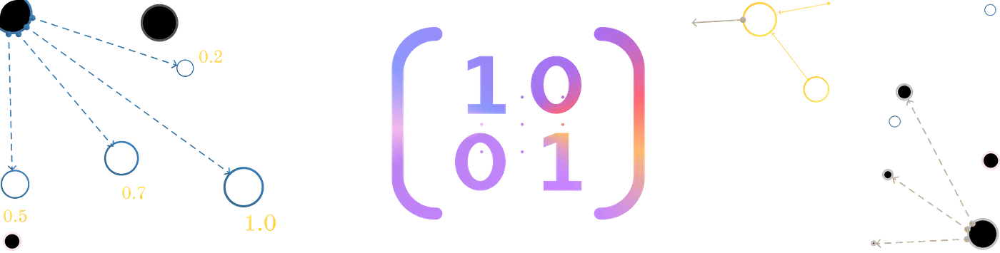
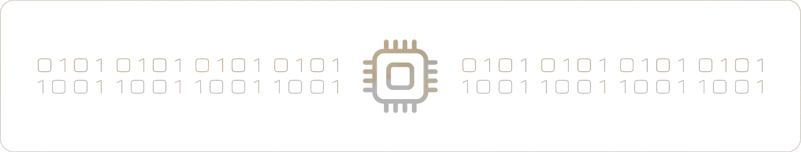
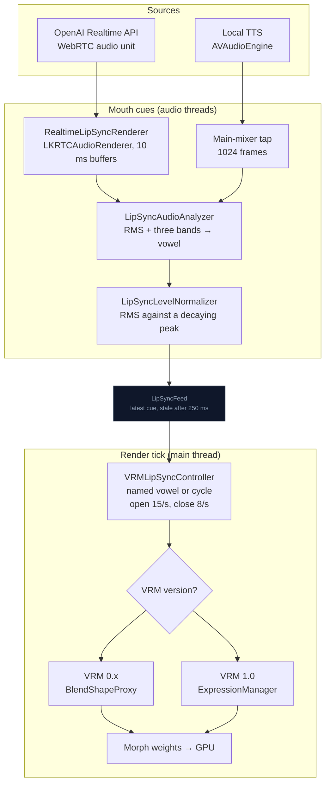

# Lip-Sync Matrices & Real-Time Processing

<p align="center">
    
</p>

In mathematics, a matrix is a rectangular array or table of numbers, symbols, or expressions, with elements or entries arranged in rows which is used to represent a mathematical object or property of such an object.

Imagine a digital painting as a grid, where each pixel is represented by a number corresponding to a specific color. Similarly, in natural language processing, words in a sentence can be converted into numbers and arranged in a matrix, where these numbers capture different aspects of the words, like their meaning or position.

In artificial intelligence, especially in deep learning, [*+ ] matrix multiplication and addition are crucial for working with data.

Neural networks use matrices of numbers to make predictions and recognize patterns. Each layer in the network processes a matrix and transforms it into a new matrix through multiplication, which helps the network understand complex data relationships.

<p align="center">
    
</p>


## 1. VRM Viseme System

VRM models use **blend shape morph targets** to deform the mesh for lip movement.  
The API changed significantly between VRM 0.x and VRM 1.0 — both are supported by NeuraLink.

---

### 1.1 VRM 0.x — BlendShapeProxy

VRM 0.x (`.vrm` files with `"specVersion": "0.0"`) exposes mouth shapes through **BlendShapeProxy**.  
Preset names use uppercase single letters matching the Japanese phoneme tradition.

| BlendShapeGroup | Phoneme(s)      | Mouth Description           | Key in `BlendShapeKey` |
|-----------------|-----------------|-----------------------------|------------------------|
| `A`             | "ah", "father"  | Jaw dropped, wide open      | `.a`                   |
| `I`             | "ih", "ee"      | Narrow, lips apart          | `.i`                   |
| `U`             | "oo", "blue"    | Tight rounded pucker        | `.u`                   |
| `E`             | "eh", "bed"     | Mid-open, slight smile      | `.e`                   |
| `O`             | "oh", "go"      | Rounded, mid-open           | `.o`                   |

Only the 5 Japanese vowel shapes (`A I U E O`) are part of the VRM 0.x spec.  
Consonant visemes require extra custom BlendShapeGroups added to the model.

**VRM 0.x API:**
```swift
// Set mouth weights via BlendShapeProxy
let proxy = vrm0.blendShapeProxy
proxy?.setValues([
    BlendShapeBinding(blendShape: .preset(.a), weight: 0.8),
    BlendShapeBinding(blendShape: .preset(.o), weight: 0.2),
])
proxy?.apply()   // flushes all pending values to the morph targets
```

> `apply()` must be called **once per frame**, after all `setValues` calls for that tick.

---

### 1.2 VRM 1.0 — ExpressionManager

VRM 1.0 (`"specVersion": "1.0"`) replaces BlendShapeProxy with **ExpressionManager**.  
Preset names are lowercase and follow the ARKit/Oculus naming convention.

| Expression key | Phoneme(s)      | Mouth Description           |
|----------------|-----------------|-----------------------------|
| `aa`           | "ah", "father"  | Jaw dropped, wide open      |
| `ih`           | "ih", "bit"     | Narrow, lips slightly apart |
| `ou`           | "oo", "blue"    | Tight rounded pucker        |
| `ee`           | "eh", "bed"     | Mid-open, slight smile      |
| `oh`           | "oh", "go"      | Rounded, mid-open           |

**VRM 1.0 API:**
```swift
let mgr = vrm1.expressionManager
mgr?.setWeight(for: "aa", weight: 0.72)
mgr?.setWeight(for: "oh", weight: 0.18)
mgr?.update(deltaTime: dt)  // single flush per frame
```

---

### 1.3 Unified Viseme Set (cross-version)

NeuraLink maps audio analysis to a shared 15-shape viseme set, then translates to the correct API at runtime:

| Viseme ID | Phoneme(s)        | Mouth Description          | VRM 0.x key | VRM 1.0 key |
|-----------|-------------------|----------------------------|-------------|-------------|
| `sil`     | silence / pause   | Lips closed, at rest       | all → 0     | all → 0     |
| `aa`      | "ah", "father"    | Jaw dropped, wide open     | `A`         | `aa`        |
| `E`       | "eh", "bed"       | Mid-open, slight smile     | `E`         | `ee`        |
| `I`       | "ih", "bit"       | Narrow, lips slightly apart| `I`         | `ih`        |
| `O`       | "oh", "go"        | Rounded, mid-open          | `O`         | `oh`        |
| `U`       | "oo", "blue"      | Tight rounded pucker       | `U`         | `ou`        |
| `PP`      | p, b, m           | Lips pressed together      | custom      | custom      |
| `FF`      | f, v              | Upper teeth on lower lip   | custom      | custom      |
| `TH`      | th                | Tongue tip between teeth   | custom      | custom      |
| `DD`      | d, t, n           | Tongue tip behind teeth    | custom      | custom      |
| `kk`      | k, g, ng          | Back of tongue to palate   | custom      | custom      |
| `CH`      | ch, sh, j         | Lips forward, wide tight   | custom      | custom      |
| `SS`      | s, z              | Teeth close, narrow slit   | custom      | custom      |
| `nn`      | n, ng (nasal)     | Soft nasal closure         | custom      | custom      |
| `RR`      | r                 | Rounded, slight lip curl   | custom      | custom      |

> **VRM 0.x and 1.0** both only guarantee the 5 vowel shapes in their spec presets.  
> Consonant visemes require custom blend shapes added to the model's mesh in Blender.

---

### 1.2 Blend Shape Weight Matrix

Each viseme is a **weight vector** over all morph target vertices.  
At runtime we maintain a `[String: Float]` dictionary of active weights (0–1), then upload the combined morph to the GPU each frame.

```
visemeWeights: {
  "aa": 0.0,   // jaw open
  "ee": 0.0,   // wide smile
  "ih": 0.0,   // narrow
  "oh": 0.0,   // rounded
  "ou": 0.0,   // puckered
}
```

Weights are **mutually blended** — multiple can be non-zero (e.g., a diphthong "ai" blends `aa` + `I`).  
A short **exponential smoothing** pass (`alpha ≈ 0.35`) prevents snapping between frames.

The `visemeWeights` dict uses the unified keys from section 1.3 and is translated to the correct API per model version at apply-time.

---

## 2. Real-Time Lip-Sync Sources

### 2.1 OpenAI Realtime API (WebRTC Audio)

The Realtime API plays its audio through WebRTC's own audio unit, and OpenAI sends no phoneme timings. The app's WebRTC is LiveKit's build of libwebrtc (`livekit/webrtc-xcframework`, module `LiveKitWebRTC`, classes prefixed `LKRTC`), chosen on 2026-11-03 because it adds one thing the upstream build lacks: a renderer on audio tracks that receives every buffer as it is played.

1. **Attach** — when the remote audio track arrives (`didStartReceiver`), `RealtimeLipSyncRenderer` is added to it; it is removed at teardown.
2. **Render** — WebRTC's playout thread hands the renderer each 10 ms buffer as it goes to the speaker, 16-bit PCM; the first channel is converted to floats in a buffer the renderer owns (vDSP, no allocation on that thread).
3. **Analyse** — the same `LipSyncAudioAnalyzer` as the local path: RMS, the level against a decaying peak, three bands, a vowel when the level is at least 0.15.
4. **Publish** — the cue goes to `LipSyncFeed` with the time it was measured; the render tick reads it once a frame. A cue older than 250 ms reads as silence.

What the mouth shows is therefore within one playout buffer of what is heard, and its shape follows the sound, the way Sonya (the author's React Native VRM app) gets it by tapping the `AVAudioPlayerNode` that plays its TTS chunks.

Before this, with the upstream `stasel/WebRTC` build, no sample was reachable and the mouth was driven from the connection's statistics: first the `audioLevel` statistic (a peak held over 100 ms, polled from the main run loop), then for a day the energy difference of `totalAudioEnergy` and `totalSamplesDuration` between polls, an envelope at 20 Hz with no shape. The statistics route also had to dodge libwebrtc's 50 ms report cache. Both are gone.

---

### 2.2 Local LLM TTS (OpenVoice / VOICEVOX)

Local TTS plays through the app's `AVAudioEngine`, whose main-mixer tap hands the played buffers (1024 frames at 48 kHz, about 21 ms) to `LipSyncAudioAnalyzer`:

1. **RMS** — the buffer's level, kept for the barge-in arbiter and normalized as above.
2. **Bands** — 512-point Hann-windowed spectra over the buffer (vDSP), summed into three bands: 100–600 Hz (voicing and the rounded vowels), 600–1 500 Hz (the open vowel's first formant), 1 500–4 000 Hz (the front vowels' second formant).
3. **Vowel** — the band shares name the shape when the level is at least 0.15: high ≥ 45 % → `ee` (mid ≥ 20 %) or `ih`; else mid ≥ 35 % → `aa`; else mid ≥ 15 % → `oh`, under that `ou`. Not phonemes, but the mouth follows the words.
4. **Publish** — the same `LipSyncFeed`; the controller takes the named shape once the current one has shown for 70 ms and holds it while the analysis agrees.

---

## 3. Processing Pipeline — Mermaid Graph



---

## 4. Smoothing & Timing Parameters

| Parameter                | Value                   | Description                                          |
|--------------------------|-------------------------|------------------------------------------------------|
| Playout buffer (OpenAI)  | 10 ms                   | Each buffer WebRTC plays reaches the renderer         |
| Tap buffer (local)       | 1024 frames @ 48 kHz    | About 21 ms per cue                                   |
| Spectrum                 | 512-point Hann (vDSP)   | Bands 100–600 / 600–1 500 / 1 500–4 000 Hz            |
| Level peak half-life     | 1.5 s                   | The loudest recent sound the level is measured against |
| Level floor              | 0.002 RMS               | Below this → silence                                  |
| Voiced level             | 0.15                    | Under this no shape is named                          |
| Stale cue                | 250 ms                  | An older cue reads as silence                         |
| Silence threshold        | 0.04 level              | Below this the mouth closes                           |
| Lerp (open / close)      | 15 /s, 8 /s             | Opening fast, closing softer                          |
| Vowel hold               | 70–140 ms               | The cycle's pace; a named shape shows at least 70 ms  |

---

## 5. Version-Specific Expression API

### VRM 0.x — BlendShapeProxy

```swift
// Called every render tick
let proxy = vrm0.blendShapeProxy
proxy?.setValues([
    BlendShapeBinding(blendShape: .preset(.a), weight: 0.72),
    BlendShapeBinding(blendShape: .preset(.o), weight: 0.18),
])
proxy?.apply()  // single flush per frame — must not be called more than once
```

### VRM 1.0 — ExpressionManager

```swift
// Called every render tick
let mgr = vrm1.expressionManager
mgr?.setWeight(for: "aa", weight: 0.72)
mgr?.setWeight(for: "oh", weight: 0.18)
mgr?.update(deltaTime: dt)  // single flush per frame — must not be called more than once
```

Both APIs follow the same rule: accumulate all weight changes first, then flush **once** per frame.  
Calling `apply()` / `update()` multiple times in one tick will overdrive the morph targets.
