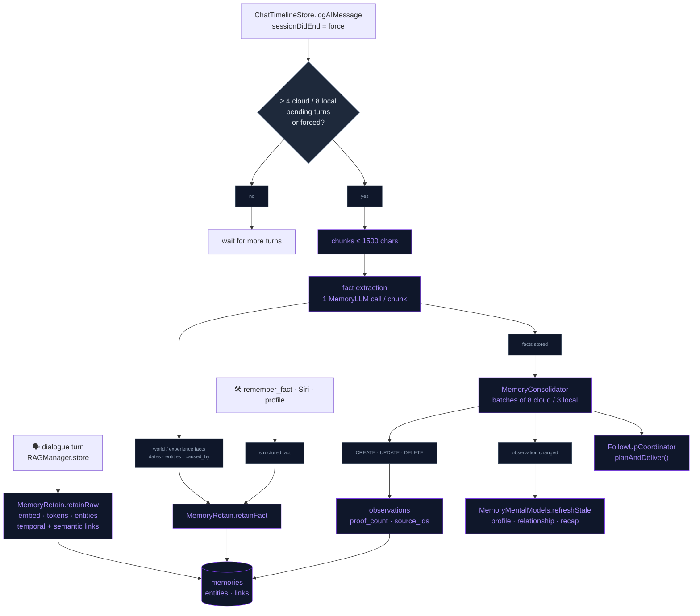
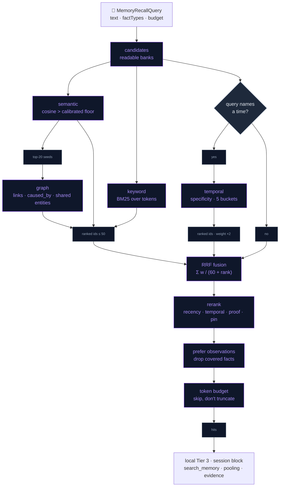

# Agentic Memory (Hindsight-style)

The companion's long-term memory is an on-device port of the architecture behind [Hindsight](https://hindsight.vectorize.io/) (Vectorize; paper *"Hindsight is 20/20: Building Agent Memory that Retains, Recalls, and Reflects"*, arXiv 2512.12818). It replaced an earlier single-table `cosine × recency` RAG, whose entry points survive as the `RAGManager` facade.

Storage, embedding and recall all run on the phone: SQLite (optionally SQLCipher), on-device sentence embeddings (Apple `NLEmbedding`, or EmbeddingGemma once downloaded) and `NLTagger` entities. Recall never calls an LLM. The background steps (fact extraction, consolidation, mental-model refresh, reflect) make one small call each through `MemoryLLM`.

## At a glance

| Concern | How it works |
|---|---|
| Memory types | `raw` dialogue, `world` facts, `experience` (what the character did), `observation` (consolidated belief), plus mental models (standing summaries) |
| Ingest | every turn stored verbatim with no LLM, **plus** batched LLM fact extraction with dates, entities and causal links |
| Retrieval | four arms (semantic, BM25, entity graph, temporal) → RRF fusion → boosted rerank → token budget |
| Prompt grounding | zero-LLM mental-model block in the stable system prefix + hybrid recall per turn (local) or per session (OpenAI) |
| Agentic lookup | `search_memory` tool: the model decides when to query memory mid-conversation |
| Consolidation | background CREATE/UPDATE/DELETE of observations with a cosine dedup guard |
| Exact facts | `remember_fact` → knowledge-graph triplet, mirrored into the units |
| Engines | `LiveMemoryLLM.tier`, re-evaluated per call: **cloud** when OpenAI is enabled with a valid key (`OpenAIChatClient`, the background text model chosen in AI Settings → Models, default `gpt-5.6-luna`); **local** when a local model is loaded and it is not LLM-jp (`runSilentGenerationOrNil`); otherwise **none**, and only the no-LLM paths run |

## Memory units and schema

Every row of `memories` is a memory unit (`MemoryUnit`). Besides the original `text`, `vector`, `timestamp`, `source` and `pinned` it carries `fact_type`, `context`, `tokens` (the BM25 token string), `mentioned_at`, `occurred_start`, `occurred_end`, `proof_count`, `source_ids`, `consolidated_at`, `vector_model` and `bank`. `migrateAgenticMemoryIfNeeded` adds the columns in place and back-fills older rows once (`source='fact'` → `world`, everything else `raw`, tokens computed).

Side tables: `memory_entities` (`canonical_name` NOCASE unique, `kind`, `first_seen`, `last_seen`, `mention_count`), `memory_unit_entities`, `memory_links` (`link_type` + `weight`; retain writes `temporal`, `semantic` and `caused_by`, while entity overlap is read from `memory_unit_entities`), and `mental_models` (`character`, `slug`, `question`, `content`, `is_stale`, `last_refreshed`, `last_memory_id`, unique per character + slug). Unit-side rows cascade on delete (`PRAGMA foreign_keys = ON`), and `MemoryStore.clear()` wipes the side tables too.

Temporal semantics follow Hindsight: `occurred_*` = when it happened (extracted, nullable), `mentioned_at` = when it was said (the recency anchor), `timestamp` = ingestion.

## Retain

* **Raw path** (`MemoryRetain.retainRaw`, through `RAGManager.store`): both engines store each user transcript and assistant reply. The local engine skips LLM-jp turns and the user side of a cue turn. Each unit is embedded and tokenised, and its entities are linked (`user` is added for user turns). It goes into its bank (see [Memory banks](#memory-banks)) and gets links. Temporal links join same-type units within 24 h with weight `max(0.3, 1 − Δh/24)` (cap 20). Semantic links join same-backend units at or above the calibrated `semanticLinkFloor` (0.62 NL, 0.6 Gemma; cap 10).
* **LLM path** (`maybeRetain`): triggered by `ChatTimelineStore.logAIMessage` (both engines) and `LocalLLMManager.maybeRunCompaction`, and forced on `SessionLifecycle.sessionDidEnd`. Pending turns are the user/assistant `message` rows newer than one global watermark (`com.neuralink.memory.retain.lastMessageID`), read from the newest 60 messages across all chats. Extraction runs at ≥ 4 pending turns (cloud) or ≥ 8 (local), in chunks of ≤ 1500 characters, one LLM call per chunk. The watermark only moves past chunks that got an answer, so a preempted run leaves its turns for the next one.
  * **Cloud** gets Hindsight's structured extraction as a JSON array (`what / when / who / type / caused_by`, 600 tokens). Relative dates become absolute using the message dates. The user is named by their Settings name when set, else "User", and `"user"` goes in `who` for facts about them. Coreference reads like *"Emily (user's roommate)"*. `experience` is only for what the character itself did.
  * **Local** 1–2B models get `LocalLLMFactExtractor`'s line-per-fact prompt (80 tokens) and its `parseFacts` quality gates. Their facts are timeless world facts about the user.
  * Every fact must pass `MemoryFactExtraction.isAcceptable` (12–300 characters, contains letters). `caused_by` becomes a `caused_by` link (weight 1.0). A run that stored anything starts consolidation.
* **Structured facts** (`retainFact`) skip extraction and become entity-linked units directly: the `remember_fact` mirror (source `tool`), Siri's "Remember something" (source `siri`, [PRESENCE_BEYOND_APP.md](../Companion/PRESENCE_BEYOND_APP.md)), the user profile (source `profile`) and `RAGManager.storeFact` (source `fact`, which nothing in the app calls).
* **User profile** (`MemoryUserProfile.sync`, at launch and on `UserSettings.profileDidChange`): name, gender (unless "Prefer not to say") and birthday are rewritten as world facts, replacing the previous `profile` rows. The same data is appended as a ground-truth block to the consolidation and mental-model prompts, so a summary never calls the user's name "unknown" and refers to them by name.

## Recall (TEMPR port)

`MemoryRecall.recall(_:)` takes a `MemoryRecallQuery`: `text`, `factTypes` (default: the knowledge types), `maxResults` (5), `tokenBudget` (400, at ≈ 4 chars/token), `preferObservations` (true), `now` and `bank`. The candidate pool is every unit of those types in the readable banks. Each arm keeps at most 50 ids.

* **Semantic**: cosine with the query vector (EmbeddingGemma gets its query prefix) above the calibrated floor. Only vectors from the active backend with a matching dimension take part.
* **Keyword**: Okapi BM25 (k1 1.2, b 0.75) over the stored token strings, scored in Swift so recall does not depend on an FTS5 build of SQLCipher.
* **Graph**: one hop out from the top 20 semantic seeds. Link weight is added for temporal/semantic neighbours, link weight + 1.0 for `caused_by`, and `tanh(shared × 0.5)` for units sharing entities with the seeds.
* **Temporal**: runs only when `MemoryTemporalParser.window` finds a time in the query. It understands today/yesterday/tomorrow/last night, this or last week/weekend/month/year, "n days/weeks/months ago", recently/lately (14 days), month names with an optional year, and `NSDataDetector` dates, where a bare year spans the whole year. Weeks are ISO, Monday first.

Fusion is plain RRF (`Σ w / (60 + rank)`), except that when the query names a time ("last weekend", "in March 2025") the temporal arm is weighted ×2 in rank space (Hindsight's per-strategy recall boost): an explicit time reference is stronger evidence than a loose semantic neighbour. Inside the window, units are ranked by **span specificity** first (a two-day event inside a weekend window beats a whole-year fact that overlaps every window), then similarity, then recency, and then spread across five time buckets. There is deliberately no similarity floor inside a window: sentence embeddings rate "what did I do last weekend?" against a hike *lower* than against "signed up for a marathon".

Rerank has no cross-encoder. The base score is seeded from the fused rank (`1 / (rank + 1)`), then multiplied in Hindsight's form: `(1 + 0.8·w·(recency − 0.5)) × (1 + 0.2·(temporal − 0.5)) × (1 + 0.1·(proof − 0.5)) × (pinned ? 1.15 : 1)`. Here `recency = exp(−ageDays / halfLife)` on the unit's `occurred_end ?? occurred_start ?? mentioned_at`. `temporal` is proximity to the window midpoint (0.5 when the query has no window), and `proof` is `log(1 + proof_count)/log(11)` for observations (0.5 otherwise). `w` and `halfLife` are `MemorySettings.recencyWeight` (0.25) and `recencyHalfLifeDays` (14), neither of which is exposed in the UI. The **Recall precision** slider (`similarityFloor`, 0.3–0.7, default 0.5) gates only the semantic arm, so keyword, entity and temporal hits still surface a memory whose embedding is weak (or zero, on a CI simulator).

`preferObservations` drops facts listed in a returned observation's `source_ids`. The budget step walks the list top-down and skips a unit that does not fit instead of truncating it. `MemoryRecall.bulletLines` formats hits as `- (yyyy-MM-dd) …` for dated facts and raw dialogue, adds `[×N]` for observations backed by several facts and `(photo)` for photo memories, and heals renamed character names.

### Embedding backends

`EmbeddingService` routes through an `EmbeddingBackend`:

* **`NLEmbeddingBackend`** (id `nl`, the default): Apple's per-language sentence embedding. The language is detected with `NLLanguageRecognizer`, falling back to English (512-dim), and models are cached per language. Calls are serialised because two concurrent `vector(for:)` calls crash inside BNNS. Where the system model is missing (a freshly erased simulator), DEBUG builds return a 512-dim zero vector so the store and recall paths stay testable. Release builds return nil and nothing is stored.
* **`GGUFEmbeddingBackend`** (id `embeddinggemma-300m-q8`): **EmbeddingGemma-300M Q8_0** (official ggml-org GGUF, 768-dim, 100+ languages, 334 MB) run through `llama_embed_bridge` (mean pooling, L2-normalised, `llama_encode` on an embeddings-only context). It is an opt-in download from the Memory page ("Multilingual recall"), pinned by size and SHA-256 in `RemoteAssetRegistry.embeddingModel` and fetched from the model's own repo at a fixed commit via `remoteURL`. It loads lazily and unloads after 60 s idle to keep the 4 GB tier's headroom. Queries and documents use Gemma's documented prefixes (`task: search result | query:` / `title: none | text:`). At launch `restorePreferredBackend` re-attaches it when the file is already on disk; it never downloads.

Every vector is stored with its backend id (`memories.vector_model`). The semantic arm, semantic links and the dedup guard only compare vectors from the active backend. `EmbeddingMigrator` re-embeds stale rows in batches of 50 at background priority, pausing 200 ms between batches; it is resumable and stops on a batch that makes no progress. Switching back to NL keeps the file on disk. A backend that cannot produce a probe vector is never activated, so memories keep being stored with NL.

Why not the smaller multilingual-e5-small: its public GGUF conversions predate a llama.cpp metadata requirement (`bert model needs to define token type count`) and fail to load on the vendored build. The f16 conversion that does load separates a matching from an unrelated fact by only 0.10 cosine, against 0.26 for Gemma.

### Embedding calibration

Cosine scales differ per embedding model, so `EmbeddingCalibration` maps the nominal Recall precision value and the internal floors onto the active backend. For Apple's `NLEmbedding` the harness measured question ↔ correct fact at 0.21–0.22 and question ↔ best unrelated fact at 0.15–0.18. The nominal 0.5 therefore becomes an effective 0.20 (`queryFloorScale 0.4`; the slider ends map to 0.12 / 0.28), and an unscaled 0.5 floor would drop every NL match. Fact ↔ nearest fact sits at p10 0.45 / p50 0.59 / p90 0.66, so semantic links use 0.62 and the observation dedup guard 0.9.

EmbeddingGemma (harness run on the simulator) measured question ↔ matching fact ≈ 0.58, question ↔ unrelated ≈ 0.32, and fact ↔ nearest fact p10 0.45 / p50 0.60 / p90 0.64. Calibration: floor = 0.1 + 0.6 × nominal (0.3 → 0.28, 0.5 → 0.40, 0.7 → 0.52), link floor 0.6, dedup 0.9. Harness result with Gemma: recall@5 1.00, MRR 0.86 (NL: 0.82), multi-session MRR 1.00. Run it yourself with `env TEST_RUNNER_NL_EMBED_GGUF=/path/embeddinggemma-300M-Q8_0.gguf xcodebuild test …` (the test is skipped when the variable is absent).

The BM25 tokeniser folds inflections onto one key (`likes/liked/like → lik`, `movies/movie → movi`, `cities/city → citi`), strips possessives, and maps a small table of family and everyday synonyms (`mum/mom → mother`, `kids → child`, `phone → iphone`) before stemming, because companion memory is mostly about people.

## Observations (consolidation)

`MemoryConsolidator.consolidatePending` takes un-consolidated world/experience facts in batches (8 cloud / 3 local, at most 4 batches per run). For each fact it pools related observations via recall (5 per fact, readable banks), then asks the LLM (400 tokens cloud / 120 local) for labeled-line actions:

```
CREATE: <text>
UPDATE O<id>: <complete new text>
DELETE O<id>
```

The prompt carries Hindsight's rules: prefer update over create, one observation per facet, update state changes concisely while keeping history, never delete event records, never compute numbers, delete only when contradicted. Observations stay under 30 words, in the third person, and `NONE` means no change. The prompt also gets the user-profile block and the character's disposition.

Guards on our side:

* Only pooled ids may be updated or deleted, with at most one update per id.
* A CREATE whose embedding reaches `dedupThreshold` (0.9) against an existing same-backend observation rewrites that one instead.
* `proof_count` / `source_ids` accumulate the batch facts that support the belief (cosine ≥ 0.3 to the new text, or the whole batch when vectors are missing).
* New observations go into the active character's bank.
* An answer with no usable action still marks the batch consolidated, so a bad batch never wedges the queue. No answer at all (preempted, request failed) leaves the batch for the next run.

When a run changes an observation, every mental model is flagged stale and `refreshStale` runs. Every run ends with `FollowUpCoordinator.planAndDeliver()` ([COMPANION_DEPTH.md](../Companion/COMPANION_DEPTH.md)).

## Mental models

Three standing questions (`MemoryMentalModels.ensureDefaults`): a global **user profile** (`user_profile`), and per character a **relationship** note (`relationship`) and the **weekly recap** (`weekly_recap`, see [MEMORY_OWNERSHIP.md](MEMORY_OWNERSHIP.md)). The questions embed the character's display name and are rewritten, with a forced regeneration, when it changes.

Refresh is delta-mode: a model is due only when it is stale *and* `MAX(memories.id)` moved past its `last_memory_id`. The recap follows its own weekend rule instead. Evidence comes from recall over the knowledge types (observations preferred, ≤ 12 hits, ≤ 900 tokens), topped up with the newest observations and then facts they do not already cover, because a profile question shares few words with concrete facts. One LLM call (160 tokens) answers in ≤ 90 words from the evidence only, preferring newer evidence, or with `UNKNOWN`, which stores an empty summary; answers are capped at 600 characters. A changed answer refreshes the live Realtime instructions and the widget snapshot (`CompanionSnapshotWriter`). Refresh runs after a consolidation that changed something and from **Update** on the Memory page.

Reading is a DB read: `promptBlock(character:compact:)` renders `[What <character> knows]` with "About the user", "Relationship" and, while visible, "This week". `compact` clips each line to 240 characters.

## Reflect and the `search_memory` tool

`MemoryReflect.evidence(for:character:)` is Hindsight's retrieval ladder without an LLM, with a 500-token default budget:

1. fresh (non-stale) mental models, with the recap only while it is visible;
2. observations (≤ 5, half the budget);
3. world/experience facts and raw dialogue (≤ 6, half the budget), only when fewer than 3 observations came back.

The `search_memory` tool (`SearchMemorySkill`) returns that evidence as "Memory search results…", or "Nothing relevant in memory.", or "Long-term memory is turned off." The Realtime model is told to call it before answering anything that depends on the past. `search_memory` is also one of the five local grammar-constrained tools (`ToolGrammarBuilder.localToolNames`: `remember_fact`, `search_memory`, `get_weather`, `create_reminder`, `play_music`). There, though, its result is bookkeeping (`ChatTimelineStore.isSilentTool`) and a 1B gets no second generation, so the local path relies on the per-turn recall in Tier 3.

`reflect(question:character:)` runs the ladder at 800 tokens plus one synthesis call (≤ 2 sentences, 200 tokens, with the character's disposition). Siri's "Ask memory" uses it ([PRESENCE_BEYOND_APP.md](../Companion/PRESENCE_BEYOND_APP.md)).

## Knowledge graph (`remember_fact`)

Alongside the units, `knowledge_graph` keeps exact `(subject, predicate, object)` triplets for facts that must not drift ("user's cat is named Rex"). The model writes them with the `remember_fact` tool ([Function_Call.md](../AI/Function_Call.md)): `RememberFactSkill` → `KnowledgeGraphManager.remember`. That call:

* stores the triplet with the character it was told to (`character`, counted by the per-character bond);
* refreshes Companion State and the Realtime instructions;
* mirrors the triplet into the units as a world fact (`"<subject> <predicate> <object>."` with underscores spaced out, entities = subject + object, source `tool`), so the graph arm and local Tier 3 can reach it.

The OpenAI instructions list every triplet, unranked, as `[Long-term Personal Facts]`. The Memory page's **Facts** section lists, edits and deletes triplets; those edits touch only the `knowledge_graph` row, not the mirrored unit. `remember_fact` and `search_memory` results are kept out of the transcript, TTS and chat history (`isSilentTool`), and `ChatTimelineStore.purgeSilentToolMessages` removes such rows from older histories at launch.

## Memory banks

`memories.bank` scopes knowledge per character (Hindsight's memory-bank isolation, scaled down). World facts and user turns are shared (`""`) because they are about the user. Assistant turns, experiences and observations carry the lower-cased name of the character that produced them, and the relationship and recap models are per character too. Recall reads every bank while "Characters share memories" is on (the default). With it off, recall reads the shared bank plus the active character's (`MemoryBanks.readable`). Consolidation pools only readable observations, so its UPDATE/DELETE actions never touch another character's beliefs. The CREATE dedup guard, though, compares against every observation.

## Disposition

`MemoryDisposition` (skepticism / literalism / empathy, 1–5, per character in `UserDefaults` under `com.neuralink.memory.disposition.<character>`) is rendered as sentences and appended to the consolidation, mental-model and reflect prompts, never to recall. Neutral (3/3/3) adds nothing. It is edited in Persona settings → "Memory Personality" (`PersonaSettingsView+Disposition`), and a change also refreshes the live Realtime instructions.

## Prompt integration

* **Local** (`LocalLLMMemoryHierarchy`, English tiers):
  * Tier 1, the stable system prefix, ends with the mental-model block (compact on the Llama 1B tier). It changes only after a background refresh, so the KV prefix stays reusable.
  * Tier 3 is `RAGManager.fetchFacts`: knowledge units, 3 hits, a 180-token budget, rendered as `[Relevant memories] … [End memories]`. It is appended *after* the history together with the follow-up mention block, so per-turn changes re-prefill only that tail.
  * The LLM-jp tier gets neither block and stores no raw turns. Knowledge-graph triplets reach the local model only through their mirrored units.
* **OpenAI Realtime** (`OpenAIRealtimeManager+SessionConfig.buildSessionInstructions`):
  * The instructions are built from persona, user context, the mental-model block, `RAGManager.fetchContext(for: sessionGroundingQuery, limit: 5, tokenBudget: 500)`, every KG triplet, companion state, and the `remember_fact` / `search_memory` usage rules.
  * `fetchContext` renders `[Long-term Memory Context] … [End of Context]`: knowledge first, then raw dialogue with half the budget if hits are short. `sessionGroundingQuery` is a fixed "important facts about the user…" query, so recall targets the person rather than the persona.
  * `OpenAIRealtimeManager.postInstructionsChanged` rebuilds the instructions mid-session when a mental model changes, a fact is stored by `remember_fact` or Siri, or a disposition is edited ([OPENAI_REALTIME.md](../AI/OPENAI_REALTIME.md)).

## Memory page

User Settings → Memory opens `MemoryTimelineView`:

* **Hero card** (`MemoryHeroCard`): the character's portrait, Facts / Insights / Moments counts, upcoming follow-ups, and the "About you" / "Between you" tiles (`MemoryModelTile`: 3 lines, tap to expand, "More" only when the text is really cut off). **Update** runs consolidation, marks the models stale and refreshes them.
* **Controls**:
  * **Remember conversations** (`isEnabled`) stops raw storage, extraction, unit writes and the Siri intents. A `remember_fact` triplet is still stored, and chat history persists regardless. Recall over what is already stored is not gated by it; only `search_memory` checks it.
  * **Auto-forget**: Never / 7 / 14 / 30 days.
  * **Multilingual recall**, **Characters share memories** and **Recall precision**.
* **Insights** (observations, swipe to forget), **Facts** (triplets: edit, delete, delete all), with "Show all" opening `MemoryBrowserView`.
* The weekly recap card and the "When" timeline ([MEMORY_OWNERSHIP.md](MEMORY_OWNERSHIP.md)).
* **Privacy**: Forget recent… (5 / 15 / 60 min of conversations and unpinned units), Export memory…, and Clear all memories (conversations and unpinned units).

**Auto-forget** (`MemorySettings.autoForgetDays`, 0 = off) prunes unpinned units older than N days by ingestion time on every raw store (`pruneMemories`). It prunes conversations untouched for N days on every logged chat row (`pruneConversations`), and changing the setting applies it at once.

## Privacy and storage

Units, links, mental models and triplets live in the conversation database, `Application Support/private/neuralink_memory.sqlite`, which has Data Protection and is excluded from backup. Page-level SQLCipher encryption (`MemoryStore+SQLCipher`, key `SecureKey.memoryDBPageKey` in the Keychain) is opt-in through the `com.neuralink.security.sqlcipherEnabled` defaults flag; no Settings switch sets it. The next launch converts the plaintext file once. See [APP_SECURITY.md](../Security/APP_SECURITY.md).

Embedding and recall never touch the network. On the cloud tier, the background steps send the turns and facts they work on to OpenAI Chat Completions, and the Realtime session receives the recalled block in its instructions. On the local tier nothing leaves the device.

## Budgets and device behaviour

| Step | LLM calls | When |
|---|---|---|
| raw retain | 0 | every turn, detached background task |
| recall | 0 | every local turn / session start / tool call / consolidation pooling / mental-model evidence |
| fact extraction | 1 per ≤ 1500-char chunk | every 4 (cloud) or 8 (local) pending turns, and at session end |
| consolidation | 1 per batch (≤ 4 batches/run) | after extraction stored something, or Update on the Memory page |
| mental-model refresh | 1 per due model | after consolidation changed something, or Update |

Local calls go through `runSilentGenerationOrNil`. It waits until the companion has been idle for 1.5 s (giving up after 120 s), keeps the conversation's KV cache (snapshot and restore, see [Local_SLM_Model.md](../AI/Local_SLM_Model.md)), and yields to a user turn at its next token. A run that gets no answer leaves its state for the next pass: retain advances its watermark only past finished chunks, consolidation leaves the batch unconsolidated, and a mental model keeps its summary. The larger local batch amortises the cost. The LLM-jp tier is excluded (`LiveMemoryLLM.tier`), matching its prompts, which carry no Tier 3.

## Flow

### Retain → consolidation → mental models



### Recall



## Files

| File | Role |
|---|---|
| `Data/DataSources/Memory/RAGManager.swift` | Facade: `store` (raw retain + auto-forget), `fetchContext`, `storeFact`, `fetchFacts` |
| `Data/DataSources/Memory/KnowledgeGraphManager.swift` | `remember_fact` triplets, the mirror into units, the `[Long-term Personal Facts]` list |
| `Data/DataSources/Memory/EmbeddingService.swift` | Active-backend routing, cosine, GGUF restore at launch |
| `Data/DataSources/Memory/MemorySettings.swift` | `isEnabled`, `autoForgetDays`, `similarityFloor`, `recencyHalfLifeDays`, `recencyWeight`, `embeddingBackendID`, `charactersShareMemories` |
| `Data/DataSources/Memory/ChatTimelineStore.swift` | Chat-history write seam for both engines; kicks `maybeRetain`; silent tool rows |
| `Data/DataSources/Memory/Store/MemoryStore.swift` (+ `+Queries`, `+SQLCipher`) | DB open and schema, KG and prune queries, opt-in page encryption |
| `Data/DataSources/Memory/Agentic/MemoryUnit.swift` | `MemoryUnit`, `MemoryFactType`, `MemoryEntity`, `MemoryLink`, `MentalModel`, `ExtractedFact` |
| `Data/DataSources/Memory/Agentic/Store/MemoryStore+Units.swift` | Schema migration (`migrateAgenticMemoryIfNeeded`), unit CRUD |
| `Data/DataSources/Memory/Agentic/Store/MemoryStore+Entities.swift` | `memory_entities`, `memory_unit_entities`, `memory_links` |
| `Data/DataSources/Memory/Agentic/Store/MemoryStore+MentalModels.swift` | `mental_models` CRUD, question rewrite on rename |
| `Data/DataSources/Memory/Agentic/MemoryTextIndex.swift` | Tokeniser (NLTokenizer + light stemming + synonyms) and Okapi BM25 |
| `Data/DataSources/Memory/Agentic/MemoryTemporalParser.swift` | Query → time window; fact `when` → absolute span |
| `Data/DataSources/Memory/Agentic/MemoryEntityExtractor.swift` | NLTagger names + capitalised-word fallback (≤ 8); `user` for user turns and facts about the user, including by name |
| `Data/DataSources/Memory/Agentic/MemoryRecall.swift` | `MemoryBanks`, the four arms, RRF, rerank, budget, bullet formatting |
| `Data/DataSources/Memory/Agentic/MemoryFactExtraction.swift` | Cloud JSON prompt/parser; local labeled-line prompt/parser; `isAcceptable` |
| `Data/DataSources/Memory/Agentic/MemoryRetain.swift` | Raw path, structured facts, batched extraction, links, watermark, session-end flush |
| `Data/DataSources/Memory/Agentic/MemoryUserProfile.swift` | Profile facts and the ground-truth prompt block |
| `Data/DataSources/Memory/Agentic/MemoryConsolidator.swift` | Observation maintenance |
| `Data/DataSources/Memory/Agentic/MemoryMentalModels.swift` | Standing questions, delta refresh, prompt block |
| `Data/DataSources/Memory/Agentic/MemoryReflect.swift` | Retrieval ladder (`evidence`) and one-call `reflect` |
| `Data/DataSources/Memory/Agentic/MemoryLLM.swift` | `MemoryLLM` protocol + `LiveMemoryLLM` router (cloud / local / none) |
| `Data/DataSources/Memory/Agentic/MemoryDisposition.swift` | Per-character skepticism / literalism / empathy, verbalised for prompts |
| `Data/DataSources/Memory/Agentic/Embedding/EmbeddingBackend.swift` | `NLEmbeddingBackend`, `GGUFEmbeddingBackend` |
| `Data/DataSources/Memory/Agentic/Embedding/EmbeddingCalibration.swift` | Per-backend query, link and dedup floors |
| `Data/DataSources/Memory/Agentic/Embedding/EmbeddingMigrator.swift` | Background re-embedding after a backend switch |
| `Data/DataSources/GGUF/LlamaEmbedBridge.swift`, `Core/Bridge/llama_embed_bridge.cpp` | EmbeddingGemma through llama.cpp |
| `Data/DataSources/Memory/Agentic/Eval/MemoryEvalFixture.swift`, `MemoryEvalRunner.swift` | Evaluation fixture and runner (DEBUG) |
| `Data/DataSources/LocalLLM/LocalLLMFactExtractor.swift` | Local extraction prompt and `parseFacts` gates |
| `Data/DataSources/LocalLLM/LocalLLMMemoryHierarchy.swift` | Local Tier 1 mental models, Tier 3 recall |
| `Data/DataSources/OpenAI/Realtime/OpenAIRealtimeManager+SessionConfig.swift` | Realtime instructions: mental models, recall block, KG list, tool rules |
| `Domain/Entities/Skills/SearchMemorySkill.swift` | The `search_memory` tool |
| `Domain/Entities/Skills/RememberFactSkill.swift` | The `remember_fact` tool |
| `Presentation/Views/Memory/MemoryTimelineView.swift` | The Memory page: controls, insights, facts, privacy actions |
| `Presentation/Views/Memory/MemoryInsightsSection.swift` | Hero card (portrait via `CompanionPortrait`), observation rows, the Multilingual recall row |
| `Presentation/Views/Memory/MemoryModelTile.swift` | One "About you" / "Between you" summary: 3 lines, tap to expand |
| `Presentation/Views/Memory/MemoryBrowserView.swift` | Searchable "Show all" list for insights and facts |
| `Presentation/Views/Settings/Persona/PersonaSettingsView+Disposition.swift` | "Memory Personality" editor |

Follow-ups and photo memories are in [COMPANION_DEPTH.md](../Companion/COMPANION_DEPTH.md); the weekly recap, export and timeline are in [MEMORY_OWNERSHIP.md](MEMORY_OWNERSHIP.md).

## Testing

* `NeuraLinkTests/Memory/AgenticMemoryTests.swift` covers:
  * the tokeniser/BM25, the temporal parser, the entity extractor, both extraction parsers and chunking;
  * consolidation parsing and prompts, and RRF/budget/observation preference;
  * the keyword and temporal arms without vectors;
  * calibration mapping, backend isolation, the migrator and the embedding asset pin;
  * a store round trip (retain → links → recall → consolidate → mental model → reflect ladder) using a scripted `MemoryLLM` stub.
* `MemoryBankTests.swift` covers bank policy, the sharing toggle, bank filtering in the store and disposition persistence.
* `MemoryTests.swift` covers embedding size, cosine and store persistence.
* `NeuraLinkTests/LocalLLM/LocalLLMFactExtractorTests.swift` covers the local gates.

### Evaluation harness

`NeuraLinkTests/Memory/MemoryEvalTests.swift` runs `MemoryEvalRunner` over `MemoryEvalFixture`. Both live in `Agentic/Eval/` and are DEBUG-only in the app target, so the device run shares them. The fixture holds 24 LongMemEval-style cases with dated sessions, the facts extraction should yield, and optional consolidation actions. Each question is typed `single_hop | multi_session | temporal | knowledge_update | preference` and has `expect` (fact keys that count, or an observation consolidated from them) and `avoid` (a superseded or out-of-window fact that must not outrank the answer). The report gives recall@5, MRR and avoid-precision per type, plus fact ↔ fact cosine quantiles for calibration, as a Swift Testing attachment on every run:

```
xcrun xcresulttool export attachments --path <xcresult> --output-path <dir>
```

Simulator baseline (fixture v1) when Apple's English sentence embedding is present: recall@5 1.00, MRR 0.82, avoid precision 0.88. A freshly erased simulator (CI) has no such asset, so `NLEmbedding` returns zero vectors and the two pure-semantic questions miss (22/24 = 0.917). The test detects which case it is in and applies 0.93 or 0.90 accordingly (per type 0.70, avoid precision 0.80), and prints the mode at the top of the report. On a device, launch with `-nl.debug.memoryEval YES` to run the same fixture and print the report to the persistent log.

## Known device-test items

- Multilingual recall (EmbeddingGemma): embed latency per turn, resident memory and jetsam on the 4 GB tier.

## Not ported (deliberately)

* Cross-encoder reranking: there is no on-device model, so rerank is a rank-seeded passthrough instead.
* Spreading activation beyond one hop.
* Per-bank visibility tags, directives and knowledge pages.
* The 10-iteration agentic reflect loop: one ladder pass + one synthesis call instead.
