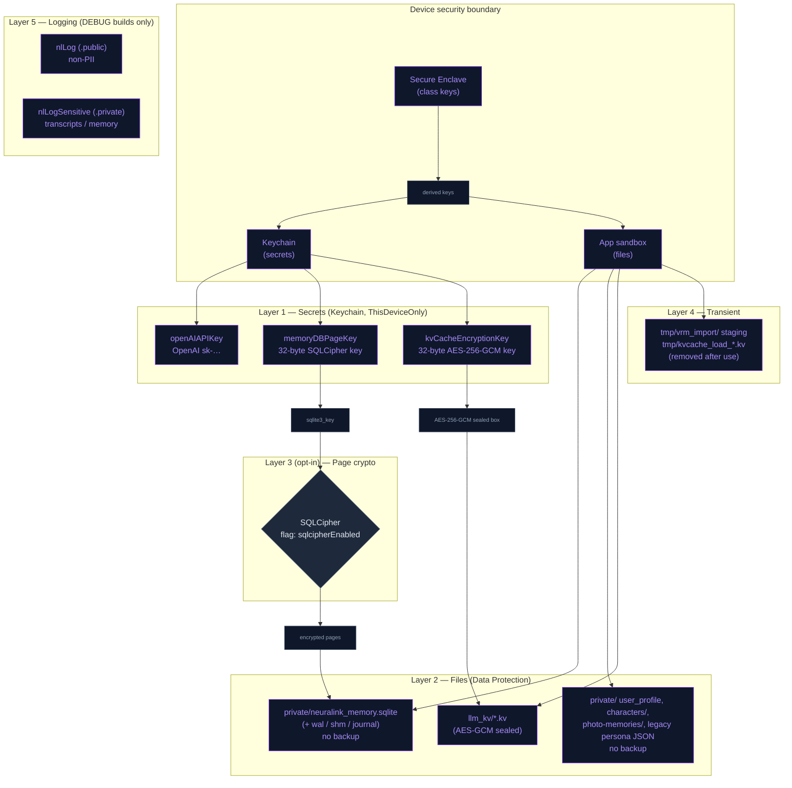

# NeuraLink App Security

---

## 1. Threat model

Everything in this document is built against one primary adversary:

> **An attacker with physical access to a powered-off, lost, or stolen device** who attempts a filesystem dump (jailbreak, passcode bypass, leaked iCloud / iTunes backup).

Secondary threats covered:

- A malicious tester or third party hooking up Console.app to a TestFlight / Ad-hoc build to scrape transcripts from system logs.
- Tampering with on-disk state (KV cache substitution) to inject hidden behavior into the next session.
- A swapped or re-uploaded model download, or a swapped imported VRM file, reaching the file parsers (llama.cpp's C loader, the VRM/glTF loader).

**Out of scope** (intentionally — closing these would require very different mitigations):

- Runtime debugger attached to an *unlocked, jailbroken* device.
- Server-side compromise at OpenAI. By design OpenAI sees plaintext to run the model — no client-side mitigation possible without changing providers.
- Screen-recording / screenshot leaks of visible chat UI.
- Side-channel attacks on Apple Neural Engine / GPU.

---

## 2. Defense layers



**Reading the diagram:** every secret traces back to either the Secure Enclave (Keychain items) or the app sandbox (files protected by iOS Data Protection). Files inherit class keys from the Secure Enclave; secrets in the Keychain *are* derived via the Secure Enclave. The opt-in SQLCipher layer adds page-level crypto on top of file-level protection for the conversation DB, and is the precondition for a passphrase mode (section 13). Transient plaintext is short-lived: VRM imports are staged in `tmp/` until confirmed, and a KV blob is decrypted into a `tmp/` file only for the moment the bridge loads it.

---

## 3. The two primitives everything is built on

### 3.1 `SecureStore` — Keychain wrapper

**File:** [NeuraLink/Core/Security/SecureStore.swift](../../NeuraLink/Core/Security/SecureStore.swift)

Stateless `enum` namespace wrapping `kSecClassGenericPassword`. Every item is bound to:

- `kSecAttrAccessible = kSecAttrAccessibleAfterFirstUnlockThisDeviceOnly`
  - **Unreadable from a cold-boot extraction** until the user unlocks the device once after boot.
  - **Never** synced via iCloud Keychain.
  - **Never** restored to a different device — a fresh install on a new phone starts without the secret, by design.

**API surface (use these, don't reinvent):**

```swift
try SecureStore.set("sk-…", for: .openAIAPIKey)
try SecureStore.get(.openAIAPIKey)              // -> String?
try SecureStore.set(data, for: .memoryDBPageKey)  // Data overload
try SecureStore.getData(.memoryDBPageKey)         // -> Data?
try SecureStore.delete(.openAIAPIKey)
try SecureStore.getOrCreateRandom(.memoryDBPageKey, bytes: 32)  // CSPRNG on first call
```

**Adding a new secret:** add a case to `SecureKey`, then add its `service` + `account` strings to the two `switch`es. Keep the strings stable — changing them orphans the existing Keychain item on every user's device.

### 3.2 `ProtectedStorage` — file Data Protection helper

**File:** [NeuraLink/Core/Security/ProtectedStorage.swift](../../NeuraLink/Core/Security/ProtectedStorage.swift)

Stateless `enum`. Owns the `Application Support/private/` directory and the API for applying `.completeUntilFirstUserAuthentication` to any file.

```swift
let dir = try ProtectedStorage.privateApplicationSupportURL()  // lazily creates + marks isExcludedFromBackup
try ProtectedStorage.protect(fileURL)                          // explicit per-file class (idempotent)
```

The chosen protection class is `.completeUntilFirstUserAuthentication`:

- Files are unreadable until the user unlocks the device once after boot.
- After that, files remain readable for the rest of the boot cycle (including while the screen is dimmed/locked).
- We use this class instead of `.complete` because features that run with the screen locked need to read DB state: proactive vision, the opt-in background audio session (`UIBackgroundModes` = `audio`) and background fetch (`fetch`). `.complete` would break all three.

---

## 4. Storage inventory

Every piece of on-disk state, where it lives, how it's protected, who reads it.

| Asset | Location | Protection | Encryption | Backup-eligible? | Code |
|---|---|---|---|---|---|
| OpenAI API key | Keychain | `kSecAttrAccessibleAfterFirstUnlockThisDeviceOnly` | n/a (Keychain native) | No | [OpenAISettings.swift](../../NeuraLink/Data/DataSources/OpenAI/OpenAISettings.swift) |
| Conversation DB | `Application Support/private/neuralink_memory.sqlite` | `.completeUntilFirstUserAuthentication` | Optional SQLCipher (off by default) | **No** (excluded) | [MemoryStore.swift](../../NeuraLink/Data/DataSources/Memory/Store/MemoryStore.swift) |
| Persona / local-LLM prompts + voices | `Application Support/private/neuralink_memory.sqlite` → `character_ai` table | `.completeUntilFirstUserAuthentication` | Optional SQLCipher (off by default) | **No** (excluded) | [PersonaStore.swift](../../NeuraLink/Data/Repositories/PersonaStore.swift), [LocalLLMPromptStore.swift](../../NeuraLink/Data/Repositories/LocalLLMPromptStore.swift), [PersonaVoiceStore.swift](../../NeuraLink/Data/Repositories/PersonaVoiceStore.swift) |
| Legacy persona / prompt JSON (dormant backup) | `Application Support/private/personas.json`, `…/local_llm_prompts.json` | `.completeUntilFirstUserAuthentication` | n/a | **No** (excluded) | left in place after migration; no longer read |
| KV cache | `Application Support/llm_kv/<config>_v<stateVersion>_<persona>.kv` | `.completeUntilFirstUserAuthentication` | AES-256-GCM encryption (32-byte Keychain key); GCM tag also provides integrity | Yes (no isExcludedFromBackup) | [LocalLLMKVCache.swift](../../NeuraLink/Data/DataSources/LocalLLM/LocalLLMKVCache.swift) |
| Whisper transcription input | in memory only (float samples fed straight to whisper.cpp) | n/a | n/a | n/a — never written; a one-shot sweep removes `Documents/whisper_*.wav` left by old builds | [LocalWhisperManager.swift](../../NeuraLink/Data/DataSources/STT/LocalWhisperManager.swift) |
| User profile (name, gender, birthday) | `Application Support/private/user_profile.json` | `.completeUntilFirstUserAuthentication` | n/a | **No** (excluded) | [UserProfileStore.swift](../../NeuraLink/Data/Repositories/UserProfileStore.swift) |
| User profile photo | `Application Support/private/user_profile.jpg` | `.completeUntilFirstUserAuthentication` | n/a | **No** (excluded) | [UserProfileStore.swift](../../NeuraLink/Data/Repositories/UserProfileStore.swift) |
| Local LLM weights (GGUF) | `Application Support/hub/<slug>/direct/<file>.gguf` | default class | n/a — integrity, not confidentiality: pinned commit + size + SHA-256 verified before the file is moved into place | **No** (per-file exclusion) | [GGUFDirectDownloader.swift](../../NeuraLink/Data/DataSources/GGUF/GGUFDirectDownloader.swift) |
| Photo memories (thumbnails of photos the user showed) | `Application Support/private/photo-memories/` | `.completeUntilFirstUserAuthentication` (directory + each file) | n/a | **No** (excluded) | [PhotoMemoryService.swift](../../NeuraLink/Data/DataSources/Photos/PhotoMemoryService.swift) |
| Diary scene pictures | `Application Support/private/scene-captures/` | `.completeUntilFirstUserAuthentication` (directory + each file) | n/a | **No** (excluded) | [CompanionSceneCapture.swift](../../NeuraLink/Data/DataSources/Companion/CompanionSceneCapture.swift) |
| Downloaded assets (scenes, voices, Whisper, motion models, parts) | `Application Support/hf-assets/<pathInRepo>` | default class | n/a — integrity: pinned size + SHA-256 verified before use | **Yes** — not excluded; re-downloadable content | [RemoteAssetCache.swift](../../NeuraLink/Data/DataSources/Assets/RemoteAssetCache.swift) |
| DEBUG log file | `Application Support/logs/YYYY-MM-DD.log` (DEBUG builds only, ~10 MB cap) | default class | n/a | Yes | [PersistentLogSink.swift](../../NeuraLink/Core/Utils/Logging/PersistentLogSink.swift) |
| Widget / Live Activity snapshot | App Group `group.com.dedicatus.NeuraLink` → `companion-snapshot.json`, `thumbnails/` | `.completeUntilFirstUserAuthentication` (explicit on write) | n/a | **No** (per-file exclusion, re-applied on every write) | [CompanionSnapshot.swift](../../NeuraLinkShared/CompanionSnapshot.swift) |
| Imported VRM characters | `Application Support/private/characters/<slug>.vrm` (+ `<slug>.png` thumbnail) | `.completeUntilFirstUserAuthentication` | Size + SHA-256 pin stored in the encrypted DB (`imported_characters`), re-verified on every load; mismatch quarantines the row | **No** (parent dir excluded) | [VRMImportService.swift](../../NeuraLink/Data/DataSources/Characters/VRMImportService.swift), [VRMIntegrityCheck.swift](../../NeuraLink/Data/DataSources/Characters/VRMIntegrityCheck.swift), [MemoryStore+ImportedCharacters.swift](../../NeuraLink/Data/DataSources/Memory/Store/MemoryStore+ImportedCharacters.swift) |
| VRM import staging | `tmpDirectory/vrm_import/<UUID>.vrm/.png` | tmp default | n/a (moved into protected dir on confirm; discarded on cancel; swept on launch) | **No** (tmp is auto-excluded) | [VRMImportService.swift](../../NeuraLink/Data/DataSources/Characters/VRMImportService.swift) |

**On the KV cache location:** it lives at `Application Support/llm_kv/` rather than `Application Support/private/` so legacy blobs from older installs don't need a relocation migration (KV blobs are regenerable; a failed decrypt just triggers a cold prefill on the next launch). The Data Protection class is still applied to the directory.

**On imported VRM characters:** the `.vrm` file itself is user-supplied content, not a secret — the security goal is *integrity*, not confidentiality. The size + SHA-256 pin lives inside the Data-Protected (optionally SQLCipher-encrypted) DB while the model sits as a plain (protected-class) file, so an attacker who can swap the file can't fix up the pin without also defeating the DB layer. [VRMIntegrityCheck](../../NeuraLink/Data/DataSources/Characters/VRMIntegrityCheck.swift) re-verifies before every load; a mismatch quarantines the row (`quarantined = 1`) and the scene falls back to the default bundled model. Prompt/voice for imported characters live in the same `character_ai` table as bundled personas and inherit its protections.

**On persona prompts/voices:** per-character AI prompts and voices (VoiceVox + OpenVoice prefs) now live in the encrypted conversation DB (the `character_ai (character, engine, prompt, voice, name)` table, engines `openai`/`gemma_jp`/`local`) instead of plaintext JSON + `UserDefaults`. `PersonaStore` and `LocalLLMPromptStore` are now thin facades over that table; `PersonaVoiceStore` is SQL-backed for VoiceVox/OpenVoice prefs. This means these prompts/voices inherit the DB's Data Protection class **and** the optional SQLCipher page encryption — strictly stronger at rest than the previous plaintext JSON-in-protected-dir + `UserDefaults` backup. A one-shot migration imports the legacy data on first launch; the old JSON files are left in place as a dormant backup and are no longer read.

---

## 5. Keychain layout

| `SecureKey` case | Service | Account | Bytes | Created when | Consumer |
|---|---|---|---|---|---|
| `.openAIAPIKey` | `com.neuralink.openai` | `apiKey` | variable (user-supplied `sk-…`) | User pastes in Settings | `OpenAISettings.apiKey` → `OpenAIRealtimeManager` (key mint), `OpenAIChatClient`, `VisionAnalyzer`, `PersonaSettingsView` + `TranscriptSpeechPlayer` (speech) |
| `.memoryDBPageKey` | `com.neuralink.memory` | `dbPageKey` | 32 (CSPRNG) | First SQLCipher conversion or first encrypted-DB open | `MemoryStore+SQLCipher.keyDatabase`, `MemoryStore+SQLCipher.convertPlaintextToSQLCipher` |
| `.kvCacheEncryptionKey` | `com.neuralink.localllm.enc` | `kvCacheEncKey` | 32 (CSPRNG) | First `encryptBlob` call | `LocalLLMKVCache.encryptBlob`, `LocalLLMKVCache.decryptBlob` |
| `.kvCacheHMACKey` (legacy) | `com.neuralink.localllm` | `kvCacheHMACKey` | 32 (CSPRNG) | pre-encryption installs only | `LocalLLMKVCache.verifyLegacyHMAC` — one-time migration of old plaintext blobs |

Two design decisions worth knowing:

- **Distinct `service` per consumer** so future per-attribute access policies can evolve independently (e.g. if we ever want `memoryDBPageKey` to require biometric unlock, we don't have to migrate `openAIAPIKey`).
- **`…ThisDeviceOnly`** ensures a new phone doesn't inherit secrets via iCloud Keychain. The user re-enters the API key on new device by design; the SQLCipher and KV-cache keys are regenerated. The conversation DB is excluded from backup, so it never reaches the new phone; KV blobs are backup-eligible but fail to decrypt there, are purged, and the model cold-prefills on the first turn.

---

## 6. Migration flags

We use one-shot `UserDefaults` flags for one-time upgrade tasks. Each flag is set only after the corresponding migration succeeds, so a failure causes the migration to retry on the next launch instead of silently dropping data.

| Flag | What it gates |
|---|---|
| `com.neuralink.migration.apiKeyKeychain.v1` | Copy legacy `UserDefaults` API key to Keychain, then delete the `UserDefaults` entry |
| `com.neuralink.migration.dbRelocate.v1` | Atomic move of `Documents/neuralink_memory.sqlite` (+ siblings) → `Application Support/private/` with rollback on partial failure |
| `com.neuralink.security.sqlcipherActive.v1` | Realised state of the SQLCipher conversion. Distinct from the user-intent flag below |
| `com.neuralink.migration.whisperDocsCleanup.v1` | Sweep legacy `Documents/whisper_*.wav` files left by older builds |
| `com.neuralink.migration.personaStoresToSQL.v1` | Import legacy persona/local-LLM prompts (JSON + `UserDefaults` backups) and VoiceVox/OpenVoice voice prefs into the encrypted DB's `character_ai` table; legacy JSON files are left in place as a dormant backup |
| `com.neuralink.migration.userProfileProtected.v1` | Move name/gender/birthday out of `UserDefaults` into `private/user_profile.json` and the photo from the Application Support root into `private/`, then delete the originals. Never overwrites a profile that already exists at the new location, so a retry can't roll back newer edits |

There is also one **user-intent feature flag**, separate from migration flags:

| Flag | Default | Effect when set |
|---|---|---|
| `com.neuralink.security.sqlcipherEnabled` | `false` | On next launch, convert the plaintext conversation DB into a SQLCipher-encrypted DB via `sqlcipher_export`. Once the realised flag (`sqlcipherActive.v1`) is set, `sqlite3_key` is called after every `sqlite3_open` |

**To opt into SQLCipher** (there is no in-app switch):
```bash
xcrun simctl spawn booted defaults write <bundle-id> com.neuralink.security.sqlcipherEnabled -bool YES
```
Next app launch performs the one-shot conversion. Verify with: a hex dump of the DB file should *not* start with `SQLite format 3\0`.

---

## 7. Conversation DB — the two layers

The conversation DB ([neuralink_memory.sqlite](../../NeuraLink/Data/DataSources/Memory/Store/MemoryStore.swift)) gets two independent layers of protection:

### Layer A (always on) — iOS Data Protection
- Path: `Application Support/private/neuralink_memory.sqlite`
- Class: `.completeUntilFirstUserAuthentication`
- `isExcludedFromBackupKey = true` on the parent directory → file never appears in iCloud / iTunes backup
- Defeats: cold-boot filesystem dump, casual `Files.app` browse, iCloud backup leak

### Layer B (opt-in) — SQLCipher page-level encryption
- Built on the **prebuilt SQLCipher.swift v4.16.0 xcframework** via SPM (`https://github.com/sqlcipher/SQLCipher.swift.git`)
- Build setting: `SQLITE_HAS_CODEC=1` in `GCC_PREPROCESSOR_DEFINITIONS` (Debug + Release at project level)
- Source: every `MemoryStore` file ([MemoryStore.swift](../../NeuraLink/Data/DataSources/Memory/Store/MemoryStore.swift) and its `MemoryStore+*.swift` extensions) imports `SQLCipher`; nothing in the app imports the system `SQLite3`
- Keying: `sqlite3_key(db, key, 32)` immediately after `sqlite3_open`, with `key` = `SecureStore.getOrCreateRandom(.memoryDBPageKey, bytes: 32)`
- Sanity check after keying: `PRAGMA cipher_version` must return a non-empty string — proves we linked against SQLCipher and not the system SQLite
- Defeats Layer A scenarios + a bypass of iOS Data Protection itself (e.g. hypothetical class-key leak)

The two-flag state machine (`sqlcipherEnabled` = intent, `sqlcipherActive.v1` = realised) means a failed conversion attempt retries on the next launch instead of corrupting half the DB.

---

## 8. KV cache integrity & encryption

**File:** the KV cache lives in [LocalLLMKVCache.swift](../../NeuraLink/Data/DataSources/LocalLLM/LocalLLMKVCache.swift) (the DB's page crypto is [MemoryStore+SQLCipher.swift](../../NeuraLink/Data/DataSources/Memory/Store/MemoryStore+SQLCipher.swift)).

Every `.kv` blob saved to `Application Support/llm_kv/` is **encrypted with AES-256-GCM** before it touches disk — a single self-contained file, no sidecar:

```
sealed box = 12-byte nonce ‖ ciphertext ‖ 16-byte GCM tag
```

where the key is `SecureStore.getOrCreateRandom(.kvCacheEncryptionKey, bytes: 32)`. The GCM authentication tag provides integrity coverage equivalent to (and stronger than) the previous HMAC-SHA256 sidecar: a tampered or truncated blob fails `AES.GCM.open` and is discarded, so an attacker can't substitute a blob across personas / model configs.

The file name is `<config>_v<stateVersion>_<persona>.kv`, where `<persona>` is a SHA-256 prefix of the system prompt, so a persona edit or a new llama.cpp state format simply misses the old blob.

**Save path** (`LocalLLMManager.persistKVCacheIfNeeded`, once per session): the bridge writes the plaintext state, and `LocalLLMKVCache.encryptBlob(at:)` overwrites it in place with the sealed box straight after.

**Load path** ([LocalLLMManager.tryRestoreKVCache](../../NeuraLink/Data/DataSources/LocalLLM/Manager/LocalLLMManager+KVCache.swift)):

1. If no `.kv` exists → nothing to load (fresh install).
2. `LocalLLMKVCache.decryptBlob(at:)` opens the sealed box with the Keychain key. On success the plaintext is written to a `tmp/kvcache_load_<UUID>.kv` file, `llmEngine.loadKVCache(from:)` reads it, and the temp file is deleted; warmup is fast.
3. On failure (tampered, wrong/missing key, read error) → `LocalLLMKVCache.purge(at:)` removes the file; warmup falls through to a cold prefill (correct, just slower).

**Legacy migration:** blobs from pre-encryption builds are plaintext `.kv` with a `.kv.hmac` sidecar. `decryptBlob` fails on them; if `verifyLegacyHMAC` still vouches for the blob (HMAC-SHA256 over `blob ‖ filename`, key `.kvCacheHMACKey`) it is salvaged and **re-encrypted in place**, preserving the warm start across the upgrade — otherwise it's purged. The `.kv.hmac` sidecar is swept on either path; `.kvCacheHMACKey` is retained solely for this one-time migration.

---

## 9. Logging

**File:** [NeuraLinkLogger.swift](../../NeuraLink/Core/Utils/Logging/NeuraLinkLogger.swift)

Two functions, identical signatures, different privacy:

| Function | `privacy:` qualifier on body | Use for |
|---|---|---|
| `nlLog(...)` | `.public` | Operational diagnostics: timestamps, status codes, file paths, counts, durations |
| `nlLogSensitive(...)` | `.private` | Conversation transcripts, persona system prompts, memory bodies, user-supplied text |

Both are **no-ops in Release** via `#if DEBUG`, so no transcript content can land in production logs even if a `nlLog` is mistakenly used for sensitive content. The `.private` qualifier is the second line of defense — it ensures that in DEBUG builds `Console.app` shows `<private>` for the body unless the device is paired with a developer profile that has the "Enable Private Data" entitlement (which Xcode itself does, so step-debugging still works).

**Persistent DEBUG log file.** In DEBUG builds `nlLog` lines (never `nlLogSensitive` ones) are also teed by [PersistentLogSink.swift](../../NeuraLink/Core/Utils/Logging/PersistentLogSink.swift) into `Application Support/logs/YYYY-MM-DD.log`, capped at ~10 MB oldest-first, so bench and error lines survive a disconnect. The sink compiles out of Release with the rest of `nlLog`. It is a second reason to keep content out of `nlLog`: in DEBUG it lands on disk, not just in the unified log.

**Pattern for log lines that mix metadata and content:** split into two calls, metadata public, content private. Example from [RAGManager.swift](../../NeuraLink/Data/DataSources/Memory/RAGManager.swift) (the facade over the agentic memory layer):

```swift
nlLog("[RAGManager] Stored raw memory (source=\(source), \(text.count) chars)", level: .info)
nlLogSensitive("[RAGManager] Memory body: \(text)", level: .info)
```

A Console.app reader sees the metadata ("did we store anything?") without the content. A developer in Xcode sees both.

**Audit acceptance criterion:** `log stream --predicate 'subsystem == "com.dedicatus.NeuraLink"'` on a Release device shows zero transcript content (because all `nlLog*` are no-ops in Release).

---

## 10. Network transport

- All OpenAI endpoints use HTTPS (`api.openai.com`).
- WebRTC media uses DTLS-SRTP (mandatory in libwebrtc).
- ATS defaults apply — no `NSAllowsArbitraryLoads` in [Info.plist](../../Info.plist), TLS ≥1.2 required.
- The OpenAI `sk-…` key only ever goes to `https://api.openai.com`, as a `Bearer` header over HTTPS. For voice sessions it is sent once to `/v1/realtime/client_secrets` to mint an ephemeral token, and WebRTC and the data channel use that token from then on. The REST calls send the key directly: chat completions ([OpenAIChatClient.swift](../../NeuraLink/Data/DataSources/OpenAI/OpenAIChatClient.swift)), vision ([VisionAnalyzer.swift](../../NeuraLink/Data/DataSources/Vision/VisionAnalyzer.swift)) and speech previews ([PersonaSettingsView.swift](../../NeuraLink/Presentation/Views/Settings/Persona/PersonaSettingsView.swift), [TranscriptSpeechPlayer.swift](../../NeuraLink/Presentation/Views/Chat/TranscriptSpeechPlayer.swift)). That is the normal pattern for a user-supplied key.
- WebRTC peer connection uses Google STUN servers for NAT traversal; standard practice, exposes only the public IP that any HTTP request to a third party would also expose.

**No certificate pinning today.** Adding it would protect against compromised root CAs in the device's trust store but has ops risk (OpenAI cert rotation). Not in v1; revisit if the threat model expands.

### Model and asset downloads

Every file fetched from Hugging Face is checked against a size + SHA-256 pin before it is used. Files from repos we don't own also name the commit in the URL (`resolve/<commit>/…`, never `resolve/main/…`), so a re-upload upstream can neither swap the bytes nor break the download:

- **Local LLM weights**: `GGUFModelAccess` / `GGUFLLMjp3ModelAccess` hold `revision` + `integrity`. [GGUFDirectDownloader](../../NeuraLink/Data/DataSources/GGUF/GGUFDirectDownloader.swift) downloads to a `.part` file, hashes it off the main actor, and only then moves it into place. On a mismatch the `.part` file is deleted, so it can't be resumed from. This matters because llama.cpp's C loader parses these files.
- **Everything else**: pins live in [RemoteAssetRegistry](../../NeuraLink/Data/DataSources/Assets/RemoteAssetRegistry.swift). Our own dataset is served from `main`, because we control it and the hashes still catch a bad upload. The one third-party file there (the embedding model) is commit-pinned.

**Changing a model or quant** means capturing the new commit, size and SHA-256 from the Hub API: `GET https://huggingface.co/api/models/<repo>/revision/main?blobs=true` returns `sha` (the commit) and each file's `lfs.size` + `lfs.sha256`. `ModelDownloadPinTests` fails if any pin is missing or malformed.

Swift packages are pinned to versions or exact revisions. The `argmax-oss-swift` commit we build against isn't a tagged release, so the package is pinned to that exact commit instead of tracking its `main` branch.

---

## 11. Test coverage

| Suite | File | What it validates |
|---|---|---|
| `AITests` | [AITests.swift](../../NeuraLinkTests/App/AITests.swift) | OpenAISettings round-trip → Keychain |
| `MemoryTests` | [MemoryTests.swift](../../NeuraLinkTests/Memory/MemoryTests.swift) | MemoryStore insert/fetch through the new protected path |
| `SQLCipherTests` | [SQLCipherTests.swift](../../NeuraLinkTests/Security/SQLCipherTests.swift) | Round-trip with the keychain key; unkeyed open fails; on-disk header is not the plaintext SQLite magic |
| `LocalLLMKVCacheTests` | [LocalLLMKVCacheTests.swift](../../NeuraLinkTests/LocalLLM/LocalLLMKVCacheTests.swift) | AES-GCM encrypt/decrypt round-trip; tampered blob fails the GCM tag; legacy HMAC-sidecar blobs migrate or purge; purge idempotent |
| `RemoteAssetIntegrityTests` | [RemoteAssetIntegrityTests.swift](../../NeuraLinkTests/Security/RemoteAssetIntegrityTests.swift) | SHA-256 helper; verify rejects wrong size / hash; every registry asset has a pin |
| `ModelDownloadPinTests` | [ModelDownloadPinTests.swift](../../NeuraLinkTests/Security/ModelDownloadPinTests.swift) | GGUF models and third-party registry assets name a commit and carry a well-formed size + SHA-256 pin |
| `UserProfileStoreTests` | [UserProfileStoreTests.swift](../../NeuraLinkTests/Security/UserProfileStoreTests.swift) | Profile migration out of `UserDefaults` (runs once, never rolls back newer edits); single-field writes keep the other fields |

**Two test patterns to know:**

- **`.serialized` trait** on suites that touch `SecureKey.<random-on-first-use>` items. Without it, Swift Testing's default parallel execution races on first-use `getOrCreateRandom` calls and the second concurrent test trashes the first's key.
- **`.disabled(if: !<keychain available>)`** at the suite level. The CI runner has no Keychain Access Group entitlement so `SecItemAdd` returns `errSecMissingEntitlement (-34018)`. We skip these suites on CI (visible as skipped in the test report); production / local-simulator paths run them in full. To run them on CI in the future, add a `keychain-access-groups` entitlement to the test target.

---

## 12. Extending the system

### Adding a new Keychain secret

1. Add a case to `SecureKey` in [SecureStore.swift](../../NeuraLink/Core/Security/SecureStore.swift) with a stable `service` + `account` mapping.
2. Use `SecureStore.set/get/delete` (String) or `set/getData/getOrCreateRandom` (Data) at the call site.
3. Never store the same secret in `UserDefaults` "as a backup" — that defeats the whole point.

### Adding a new protected file

1. Resolve a URL inside the directory `ProtectedStorage.privateApplicationSupportURL()`.
2. Write atomically (`Data.write(to:options: .atomic)`).
3. Call `ProtectedStorage.protect(url)` after every write (belt-and-suspenders — files inside the dir inherit the class on creation, but explicit is safer).
4. If you have existing data in `UserDefaults` or `Documents/`, write a one-shot migration with its own `com.neuralink.migration.<name>.vN` flag. Reuse the rollback-on-failure pattern from `MemoryStore.relocateLegacyDBIfNeeded`.

### Logging something new

- Operational fact? `nlLog`.
- User content? `nlLogSensitive`.
- Mixed? Split into two calls (metadata via `nlLog`, content via `nlLogSensitive`).

---

## 13. What's still on the table

For a true zero-knowledge mode: the user picks a passphrase, PBKDF2-SHA256 derives the SQLCipher page key from it, the key is never persisted (kept only in memory, forgotten on background, re-prompted on foreground). This is the only configuration that survives a fully compromised device + Keychain dump. Deferred until there's user demand — the current opt-in SQLCipher mode is the load-bearing precondition.

Other things deferred to future work:

- **Keychain Access Group entitlement for the test target** so `SQLCipherTests` / `LocalLLMKVCacheTests` actually run on CI instead of being skipped.
- **Certificate pinning** on `api.openai.com`.

---

## 14. Quick reference: file map

| Path | Role |
|---|---|
| [NeuraLink/Core/Security/SecureStore.swift](../../NeuraLink/Core/Security/SecureStore.swift) | Keychain wrapper |
| [NeuraLink/Core/Security/ProtectedStorage.swift](../../NeuraLink/Core/Security/ProtectedStorage.swift) | iOS Data Protection helper |
| [NeuraLink/Core/Utils/Logging/NeuraLinkLogger.swift](../../NeuraLink/Core/Utils/Logging/NeuraLinkLogger.swift) | `nlLog` + `nlLogSensitive` |
| [NeuraLink/Data/DataSources/Memory/Store/MemoryStore.swift](../../NeuraLink/Data/DataSources/Memory/Store/MemoryStore.swift) | Conversation DB path + relocation migration |
| [NeuraLink/Data/DataSources/Memory/Store/MemoryStore+SQLCipher.swift](../../NeuraLink/Data/DataSources/Memory/Store/MemoryStore+SQLCipher.swift) | SQLCipher feature flag + keying + conversion |
| [NeuraLink/Data/DataSources/Memory/Store/MemoryStore+Queries.swift](../../NeuraLink/Data/DataSources/Memory/Store/MemoryStore+Queries.swift) | `import SQLCipher` |
| [NeuraLink/Data/DataSources/Memory/RAGManager.swift](../../NeuraLink/Data/DataSources/Memory/RAGManager.swift) | Split metadata/content logging |
| [NeuraLink/Data/Repositories/PersonaStore.swift](../../NeuraLink/Data/Repositories/PersonaStore.swift) | Personas → facade over encrypted DB (`character_ai`) |
| [NeuraLink/Data/Repositories/LocalLLMPromptStore.swift](../../NeuraLink/Data/Repositories/LocalLLMPromptStore.swift) | Local LLM prompts → encrypted DB (`character_ai`) |
| [NeuraLink/Data/Repositories/PersonaVoiceStore.swift](../../NeuraLink/Data/Repositories/PersonaVoiceStore.swift) | VoiceVox/OpenVoice prefs → encrypted DB (`character_ai`); legacy Kokoro map still `UserDefaults` |
| [NeuraLink/Data/DataSources/STT/LocalWhisperManager.swift](../../NeuraLink/Data/DataSources/STT/LocalWhisperManager.swift) | whisper.cpp feeds in-memory float samples (no temp WAV); legacy `whisper_*.wav` sweep + private logs |
| [NeuraLink/Data/DataSources/LocalLLM/LocalLLMKVCache.swift](../../NeuraLink/Data/DataSources/LocalLLM/LocalLLMKVCache.swift) | KV cache path + AES-GCM encrypt/decrypt/purge + legacy HMAC migration |
| [NeuraLink/Data/Repositories/UserProfileStore.swift](../../NeuraLink/Data/Repositories/UserProfileStore.swift) | User profile + photo in `private/` + one-shot `UserDefaults` migration |
| [NeuraLink/Data/DataSources/GGUF/GGUFDirectDownloader.swift](../../NeuraLink/Data/DataSources/GGUF/GGUFDirectDownloader.swift) | Commit-pinned, SHA-256-verified GGUF downloads |
| [NeuraLink/Data/DataSources/Assets/RemoteAssetCache.swift](../../NeuraLink/Data/DataSources/Assets/RemoteAssetCache.swift) | Resumable download + size/SHA-256 verify gate shared by all remote assets |
| [NeuraLink/PrivacyInfo.xcprivacy](../../NeuraLink/PrivacyInfo.xcprivacy), [NeuraLinkWidgets/PrivacyInfo.xcprivacy](../../NeuraLinkWidgets/PrivacyInfo.xcprivacy) | Privacy manifests (app + widget extension) |
| [NeuraLink/Data/DataSources/LocalLLM/Manager/LocalLLMManager+KVCache.swift](../../NeuraLink/Data/DataSources/LocalLLM/Manager/LocalLLMManager+KVCache.swift) | KV cache load/save with integrity check |
| [NeuraLink/Data/DataSources/OpenAI/OpenAISettings.swift](../../NeuraLink/Data/DataSources/OpenAI/OpenAISettings.swift) | API key → Keychain + one-shot migration |
| [NeuraLink/Data/DataSources/OpenAI/Realtime/OpenAIRealtimeManager+Handlers.swift](../../NeuraLink/Data/DataSources/OpenAI/Realtime/OpenAIRealtimeManager+Handlers.swift) | Transcript log sites → `nlLogSensitive` |

## Data outside the protected sandbox

Widgets and the session Live Activity run in a separate extension and read a
small JSON snapshot in the App Group container `group.com.dedicatus.NeuraLink`
(`NeuraLinkShared/CompanionSnapshot.swift`): character name, relationship
label and score, the prepared greeting, one short remembered line (with its
source label), the number of remembered things and days together, the last
chat time and a character thumbnail. It never contains transcripts, facts or
observations beyond that single line, is rewritten by the app (not the
extension), and is deleted when "Companion widgets" is switched off. The
SQLCipher database, keychain material and all memory rows stay in the
protected App Support directory as before. The snapshot and thumbnails are
written with `.completeUntilFirstUserAuthentication` (so lock-screen
widgets still render) and excluded from backup on every write.

The `createNote` tool puts the note on the clipboard so it can be pasted into
Notes. With Notes installed it writes only when the user taps the phone
widget (otherwise straight away, as the only way to hand the note over). The
item is always local-only (no Universal Clipboard hop to other devices) and
expires after 10 minutes ([NotesSkill.swift](../../NeuraLink/Domain/Entities/Skills/NotesSkill.swift)).

Background audio (`UIBackgroundModes = audio`) is opt-in ("Keep talking in
background"); while active the microphone stays open and iOS shows the
system indicator. The session ends automatically after the configured idle
time, on Low Power Mode, a serious thermal state or a memory warning.

Photo memories keep only a 256 px JPEG thumbnail and a text description under
the protected App Support directory (`private/photo-memories/`, Data Protection
applied, no backup); the original photo is sent to OpenAI once for description
when the cloud model is enabled and is never stored by the app.

## Privacy manifest

[NeuraLink/PrivacyInfo.xcprivacy](../../NeuraLink/PrivacyInfo.xcprivacy) declares no tracking and the required-reason APIs the app binary uses:

| API category | Reason | Where |
|---|---|---|
| `UserDefaults` | `CA92.1` — the app's own settings | settings and migration flags throughout |
| File timestamp | `C617.1` — files inside the app container | log rotation, scene captures, donor texture cache |
| System boot time | `35F9.1` — elapsed time between in-app events | `ProcessInfo.systemUptime` for mic gating / barge-in |

It also lists the data sent to OpenAI when the cloud model is on (audio, photos, other user content) as collected for app functionality, not linked and not used for tracking. **Keep this in step with the App Store Connect privacy label.** The widget extension has its own manifest that declares nothing, because it uses none of those APIs.

When adding code, re-check the manifest if it calls a new required-reason API (disk space, active keyboards, or a file timestamp outside the container). Apple scans the binary, not the source, so `nm -u` on the built app is the quickest audit.

Two embedded frameworks have no manifest of their own: `RealTimeCutVADCXXLibrary` (`stat`, `fstat`, `mach_absolute_time`) and the VOICEVOX frameworks (`stat`, `fstat`, `lstat`). Their usage falls under the app's `C617.1` / `35F9.1` reasons. Upstream manifests would be cleaner if those projects ever ship them.

