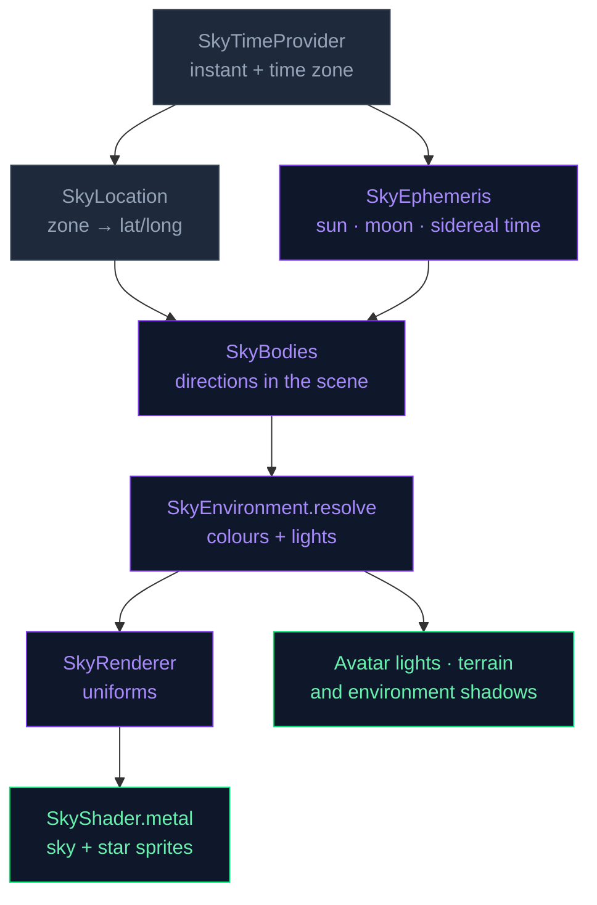

# 🌤️ Realtime Sky System

NeuraLink features a fully procedural, physically-inspired sky rendered entirely on the GPU using **Metal**. The sky follows the device's **real clock and place**: the sun rises and sets at the real times for where the user is, the moon stands where it really is with tonight's phase (by day too), and the stars turn through the night, the real constellations among them.

---

## Gallery

Renders from the app's own renderer, over Antananarivo (regenerated by
`SkySnapshots`, see [Checking the sky](#checking-the-sky)).

### A day, toward the sun

| Before dawn | Sunrise | Morning | Noon |
|:---:|:---:|:---:|:---:|
|  |  |  |  |
| **Afternoon** | **Sunset** | **Dusk** | **Night, toward the moon** |
|  |  |  |  |

### The moon through a month

Each is the moon as it stands over Antananarivo that night, at its highest in
a dark sky, so its lit side points to the sun below the horizon: near the
tropics the crescents lie almost on their backs. By day it shows too, the sky's
blue through its unlit part.

| Waxing crescent | First quarter | Waxing gibbous | Full |
|:---:|:---:|:---:|:---:|
|  |  |  |  |
| **Waning gibbous** | **Last quarter** | **Waning crescent** | **By day** |
|  |  |  |  |

### The Southern Cross

| The Southern Cross |
|:---:|
|  |

*High in the south on a moonless evening: the Cross upright at upper right,
orange γ Crucis at its head and α Crucis at its foot, and the Pointers
(α and β Centauri) the bright pair at left, among the faint procedural field.*

### In the app

<p align="center">
  
  
  
  
  
  
</p>
<p align="center">
  
  
  
</p>

*From left to right: sunrise · early morning · afternoon · evening (phase 1) · evening (phase 2) · sunset · early night · night*

---

## Architecture Overview

```
NeuraLink/Core/Engine/Sky/
├── SkyTimeProvider.swift   — The device clock and time zone (or a test's, or NL_SKY_*)
├── SkyLocation.swift       — Time zone → latitude/longitude, from sky_zones.txt
├── SkyEphemeris.swift      — Sun, moon and sidereal time from the instant (Meeus)
├── SkyBodies.swift         — Places sun, moon and stars in the scene (the compass)
├── SkyColorPalette.swift   — SkyEnvironment: colours and lights for where they stand
├── SkyStarCatalogue.swift  — The bright stars, from sky_bright_stars.txt, in a GPU buffer
├── SkyUniforms.swift       — The 224-byte GPU uniform struct (Swift ↔ Metal bridge)
└── SkyRenderer.swift       — Per-frame update → uniform upload → sky and star draws

NeuraLink/App/Resources/
├── sky_zones.txt           — IANA time zone → coordinates (tz database zone.tab)
└── sky_bright_stars.txt    — ~300 stars down to magnitude 3.55 (Yale Bright Star Catalogue)

NeuraLink/Core/Engine/VRM/Shaders/
└── SkyShader.metal         — Fullscreen sky + bright-star sprites
```

Both tables are generated by `scripts/make_sky_tables.py`.



---

## 1. When and where — `SkyTimeProvider` and `SkyLocation`

`SkyTimeProvider` gives the sky its instant (`now`, injectable so tests can
freeze it) and its time zone (`.autoupdatingCurrent`, so the sky follows the
user when they travel).

The place comes from the time zone, with no location permission:
`SkyLocation(timeZone:)` looks the zone's name up in `sky_zones.txt`, one row
per zone of the tz database's `zone.tab`, plus the older names iOS still
reports for some zones (`Asia/Calcutta`, `Europe/Kiev`…). `Indian/Antananarivo`
gives 18.92° S, 47.52° E, which puts sunrise and sunset within a few minutes of
the real ones anywhere in Madagascar. A zone the table doesn't know (`GMT`, a
fixed offset) gets the equator, at the longitude its UTC offset stands for.

---

## 2. Sky Environment — `SkyColorPalette`

`SkyEnvironment.resolve(at:location:)` is the heart of the system. It works out
where the sun and moon stand (`SkyBodies`), then the colours and lights for
that (`resolve(_ bodies:)`).

### The sun, the moon and the stars — `SkyEphemeris`, `SkyBodies`

Everything comes from the instant itself, in double precision, after Meeus,
*Astronomical Algorithms*:

- **Sun** — the low-precision solar position of ch. 25, the NOAA calculator's
  (about 0.01°). Sunrise and sunset over Antananarivo land within two minutes of
  NOAA's on the solstices and equinoxes.
- **Moon** — the largest terms of the lunar theory of ch. 47 (about 0.1°),
  seen from the Earth's surface rather than its centre (up to 1° lower). Its
  lit fraction comes from the angle between it and the sun, and its light from
  that phase (a quarter moon gives about a tenth of a full moon's).
- **Stars** — the catalogue's J2000 positions, precessed to today (0.36° by
  2026) and turned by local sidereal time (ch. 12) and latitude. They rise in
  the east, the celestial pole stays put at the latitude's height, and from
  Madagascar the Southern Cross circles the south pole.

**The compass.** The scene is +Y up with the camera on +Z. North is put on
+Z in the southern hemisphere and south on +Z in the northern, so the noon sun
always stands on the camera's side and the avatar is lit from the front through
the middle of the day. The sun still rises in the east and sets in the west:
the two layouts are one turned 180° about the vertical, not mirrored. Between
the tropics the noon sun can pass a little to the other side of the zenith (in
Antananarivo from late November to mid-January).

| Antananarivo | Sunrise | Sunset | Noon sun |
|---|---|---|---|
| 21 June | 06:22 | 17:21 | 48° up, north |
| 21 December | 05:10 | 18:26 | 85° up, just south |

### Transition Factors

Two smoothstep-based factors drive every colour interpolation:

| Factor | Formula | Meaning |
|--------|---------|---------|
| `dayFactor` | `skySmooth(-0.15, 0.20, sunDir.y)` | 0 = full night → 1 = full day |
| `sunsetFactor` | `clamp(1 – |sunDir.y| × 3.5, 0, 1)` | Peaks at sunrise/sunset, 0 mid-day & night |

The `skySmooth` helper is a classic **smoothstep** (`t² (3−2t)`) giving a perceptually natural S-curve transition instead of a harsh linear ramp.

### Sky Gradient Palette

The horizon-to-zenith gradient cycles through three colour keyframes:

| Phase | Horizon (`skyColorLow`) | Zenith (`skyColorHigh`) |
|-------|------------------------|------------------------|
| **Night** | `#0d1321` (dark navy) | `#1c2331` (midnight blue) |
| **Dawn/Dusk** | `#ffc832` (warm gold) | `#996666` (soft rose/purple) |
| **Day** | `#87ceeb` (sky blue) | `#264899` (deep blue) |

Transitions between phases use the `tDawn` and `tDay` smooth factors computed from `sunDir.y`.

### Three-Point Lighting for VRM Models

The resolved `SkyEnvironment` also drives the three-point light rig that illuminates the VRM character so the model always looks natural against the sky:

| Light | Source | Day colour | Night colour |
|-------|--------|-----------|-------------|
| **Key** | `SkyKeyLight`: sun by day, moon (or the sky above) by night | Warm white `#fff5db` → orange at horizon | Cool blue `#8c99d9` |
| **Fill** | Opposite side of key, angled from sky | Sky blue `#73 99d9` | Dim blue `#40475a` |
| **Rim** | Fixed above-behind the model | Cool white `#d9e5ff` | Cool white `#d9e5ff` |

> **Why a moon key light?** At night `dayFactor` = 0, so the key light smoothly transitions to a cool-blue night light: from the moon while it is up and more than a crescent, from high in the sky otherwise. Its intensity follows the moon's brightness, 0.42 on a moonless night to 0.58 under a high full moon, so the character stays readable without breaking the night-sky illusion.

**One key light, no flip.** `SkyEnvironment.keyLight` is the only light the
avatar, its self-shadow, the terrain shadows and the 3D environments follow.
Through twilight it travels from the sun to the night light *over the sky*
rather than jumping to the opposite horizon when the sun crosses it, so
shadows shorten and turn instead of swinging across in one frame. It never
drops below about 7° of elevation (`SkyKeyLight.minimumElevation`), where a
grazing light would throw endless shadows. Its largest turn between two
consecutive minutes is under 8°.

---

## 3. GPU Uniforms — `SkyUniforms`

`SkyUniformsData` is a **224-byte flat struct** shared between Swift and Metal. The layout is fixed and must match `SkyUniforms` in `SkyShader.metal` exactly:

| Field | Bytes | Offset | Description |
|-------|-------|--------|-------------|
| `invViewProjection` | 64 | 0 | Camera inverse VP matrix — maps NDC → world ray |
| `sunDirectionAndIntensity` | 16 | 64 | `xyz` = toward-sun unit vector, `w` = key intensity |
| `sunColorAndSize` | 16 | 80 | `xyz` = disc colour, `w` = disc exponent (300 = tight) |
| `skyColorLow` | 16 | 96 | Horizon gradient colour |
| `skyColorHigh` | 16 | 112 | Zenith gradient colour |
| `cloudParams` | 16 | 128 | `x` = elapsed time · `y` = scroll speed · `z` = coverage · `w` = star visibility |
| `moonDirectionAndPhase` | 16 | 144 | `xyz` = toward-moon unit vector, `w` = lit fraction |
| `bodyParams` | 16 | 160 | `x` = moon angular radius (radians) · `y` = turbidity · `z` = moon brightness against full |
| `starRotation` | 48 | 176 | `float3x3`: star catalogue (J2000 equatorial) → world; its transpose takes a view ray back into the stars' frame |

The buffer is allocated once with `.storageModeShared` (CPU-visible Metal memory) and updated every frame via `copyMemory`.

---

## 4. Sky Renderer — `SkyRenderer`

`SkyRenderer` owns the Metal pipeline and orchestrates the two-phase render:

### Per-Frame Update (Main Thread)
```swift
func update(deltaTime: Float)
```
- Advances `cloudTime` (the cloud animation clock).
- Calls `SkyEnvironment.resolve(at: timeProvider.now(), location: timeProvider.location)` to get a fresh environment.

### Render Thread Preparation
```swift
func prepareForEncoding(viewProjection: simd_float4x4)
```
Packs the latest `SkyEnvironment` into `SkyUniformsData` and `copyMemory`s it into the shared Metal buffer. This must be called from the render thread, immediately before `encode`.

### Draw Call
```swift
func encode(encoder: MTLRenderCommandEncoder)
```
Issues a **single 3-vertex draw** — a fullscreen triangle. No vertex buffer is needed; vertex positions are hardcoded in the vertex shader using the `vertex_id` built-in. The depth state is set to **always pass / no write**, ensuring the sky only fills pixels behind all other geometry.

While stars are out, a second draw adds the bright-star catalogue on top: one
instanced 4-vertex strip per star (about 300), blended additively. It is skipped
by day, and under an orthographic camera, which has no sky to place them in.

> The sky must be encoded **before** VRM draw calls so it renders behind the model without a depth conflict.

---

## 5. Metal Shader — `SkyShader.metal`

The fragment shader reconstructs a **world-space view ray** from the screen UV using the inverse view-projection matrix, then composites five visual layers from back to front:

### Layer Stack (back → front)

```
┌─────────────────────────────────────────────┐
│  1. Vertical Gradient       (always)        │
│  2. Below-Horizon Darkening (always)        │
│  3. Faint Stars             (night only)    │
│  4. Dome Clouds — two layers                │
│  5. Sun Disc + Bloom        (above horizon) │
│  6. Moon — phase-lit sphere (when it's up)  │
│  7. Bright Stars — sprites  (night only)    │
└─────────────────────────────────────────────┘
```

#### ① Vertical Gradient
```metal
float gradT  = clamp(viewDir.y * 0.5 + 0.5, 0, 1);
float3 colour = mix(skyColorLow, skyColorHigh, gradT);
```
A simple horizon-to-zenith lerp driven by the view ray's Y component.

#### ② Below-Horizon Darkening
Rays pointing below the horizon are darkened to 22% of the horizon colour using a `smoothstep`, producing a subtle ground-sky boundary.

#### ③ Faint Stars
The faint stars are procedural, but in the stars' own frame: the view ray is
turned back by `transpose(starRotation)`, so they turn with the sky. A grid on
the faces of a cube holds at most one star a cell, kept inside it; the chance
of one follows the cell's solid angle, so the cube's corners are no denser than
its faces, and each star is a round dot of a set angular size (0.09–0.16°).
Visibility is gated on `starVis`, which reaches 1 only when the sun is well
below the horizon, and the moon's glare washes them out (more near it, and more
the fuller it is).

#### ④ Dome Clouds (two layers)
Two independent FBM (fractal Brownian motion) noise layers are dome-projected and animated by `cloudTime × cloudSpeed`:

| Layer | Projection | Density | Alpha cap |
|-------|------------|---------|-----------|
| Low   | `xz / max(y, 0.20)` — near-horizon | 2.0 | ~88 % |
| High  | `xz / (y + 0.45)` — near-zenith flat | 1.5 | ~75 % |

The two masks are composited with `low + high × (1 − low)` to avoid double-counting. Cloud coverage increases slightly at sunset (`0.50 + sunsetFactor × 0.10`), and the horizontal scroll speed peaks at noon (`0.008 + dayFactor × 0.018`).

#### ⑤ Sun Disc + Bloom
```metal
float disc  = pow(dot(viewDir, sunDir), discExponent);   // tight disc
float bloom = pow(dot(viewDir, sunDir), 18.0) * 0.35;   // wide corona
colour += sunColor * (disc * discClear + bloom * glowClear);
```
`discExponent` is hardcoded to **300** giving a physically small but bright disc. The lower-exponent bloom adds a realistic atmospheric glow halo. The sun sits behind the clouds: `discClear = 1 − 0.95 × clouds` hides the disc under a thick cloud, and the glow carries through more (`glowClear = 1 − 0.6 × clouds`). The disc takes the sun's own colour (`SkyEnvironment.sunColor`), not the key light's.

#### ⑥ Moon
The moon is drawn at its own position (`moonDirectionAndPhase`), at a stylised
size of about five times the real one (`SkyRenderer.moonAngularRadius`). Each
pixel of the disc is a point on a sphere lit from the sun's direction, so the
phase, and the tilt of its horns, follow from where the two stand: a first
quarter moon is lit on its sunward side in the afternoon and from below as it
sets. Darker seas are fixed to its face. At night the unlit part takes a faint
earthshine (strongest under a thin crescent) and still hides the stars behind
it, and a glow scaled by the moon's brightness surrounds it. By day it shows
whenever it is up, part-transparent, so its seas take the blue of the sky. The
clouds in front dim it, like the sun.

#### ⑦ Bright Stars
The ~300 catalogue stars are sprites (`sky_star_vertex` / `sky_star_fragment`):
small camera-facing quads at the star's turned direction, sized and brightened
by magnitude (Sirius largest) and tinted by colour index, from blue-white to
orange. Everything that dims one is worked out once per star in the vertex
shader: daylight, the horizon (dimmer and twinkling through the low air), the
moon in front of it or its glare, and the clouds.

---

## Time-of-Day Reference

The palette keys on the sun's elevation, so the clock times shift with the
date and place. Antananarivo in June (sunrise 06:22, sunset 17:21):

| Time   | Sky appearance              | Star field    | Clouds          |
|--------|-----------------------------|---------------|-----------------|
| 00:00  | Deep navy — full night      | Fully visible | Slow drift      |
| 06:00  | Dark → warming horizon      | Fading        | Thickening slightly |
| 06:30  | Golden sunrise — rose zenith | Gone         | Peak sunset coverage |
| 09:00  | Bright blue, low sun disc   | Off           | Normal          |
| 12:00  | Sky blue horizon → deep blue zenith, sun 48° up in the north | Off | Fastest scroll |
| 16:00  | Afternoon blue, sun low in the west | Off | Normal |
| 17:15  | Sunset gold, rose zenith    | Emerging      | Peak coverage   |
| 18:00  | Dark transition             | Brightening   | Slowing         |
| 19:00  | Full night sky              | Fully visible | Slow drift      |

---

## 🌧️ Procedural Rain System

The rain system in NeuraLink is a two-tier GPU-driven effect that simulates atmospheric depth and camera-lens proximity.

### 1. 3D World Rain (Streaks)
- **Shader**: `RainShader.metal` (vertex-driven)
- **Technique**: Millions of tiny streaks are procedurally positioned in a 3D volume around the camera.
- **Physics**: Falling speed and slant are controlled via `RainUniforms` to simulate wind.
- **Efficiency**: No geometry is stored; the vertex shader uses the `vertex_id` to generate positions on-the-fly using a high-speed hash function.

### 2. 2D Lens Splashing (Ripples)
- **Shader**: `RainOverlay.metal` (fragment-driven)
- **Technique**: A full-screen overlay that simulates raindrops hitting the "camera lens".
- **Visuals**: Uses procedural noise to generate ripple distortions and refractive "beads" of water that drip down the screen.

### 3. Weather Synchronization
The `RainController` manages the global `intensity` (0.0 to 1.0).
- **Opacity**: Both the 3D streaks and 2D splashes scale their alpha based on intensity.
- **MToon Sync**: The character's materials automatically darken and gain a specular sheen as rain intensity increases, simulating wet fabric and skin.

---

## Checking the sky

- **Run the clock elsewhere.** Set `NL_SKY_DATE` (`yyyy-MM-dd`) and/or
  `NL_SKY_TIME` (`HH:mm`) in the scheme's environment to start the sky's clock
  at that moment, and `NL_SKY_SPEED` to run it faster (`60` = a minute a
  second). `NL_SKY_ZONE` (an IANA name such as `Europe/Paris`) moves the sky to
  that zone's city and reads the date and time there. Use them to watch a dawn,
  a moonrise or the other hemisphere on a device without waiting.
- **Snapshots.** `SkySnapshots` (env-gated by `NL_SKY_SNAPSHOT_DIR`) renders Oz
  on the open terrain at fixed dates and times in Antananarivo: a first-quarter
  evening, a full moon and a waxing gibbous. It takes the figure, the sky toward
  the light and the sky away from it, the moon close up whenever it is up, and at
  night the sky toward the celestial pole (the Southern Cross and the Pointers).
  It also writes the sun, moon and key-light angles and the moon's lit fraction,
  plus the GPU time of the sky pass alone, to `report.txt`. On a device, the
  pass shows up as `SkyBackground` in a Metal System Trace.
- **The gallery.** With `NL_SKY_DOC_DIR` set to the absolute path of
  `docs/Sky` instead, `SkySnapshots` rewrites the pictures at the top of this
  page: a winter's day toward the sun, the moon through the lunation that starts at the June new moon, and the Southern Cross
  on that moonless night. Regenerate them whenever the sky's look changes.

